# Application Documentation Framework – Consolidated Guide

Generated from source files by build/build_consolidated.py. Do not edit; edit the source files and regenerate.

## Contents

- [README.md](#readmemd)
- [00_documentation_model.md](#00_documentation_modelmd)
- [01_document_set_register.md](#01_document_set_registermd)
- [02_conventions.md](#02_conventionsmd)
- [03_scoping_guide.md](#03_scoping_guidemd)
- [templates/spine/SP-00-scope-record.md](#templatesspinesp-00-scope-recordmd)
- [templates/spine/SP-01-glossary.md](#templatesspinesp-01-glossarymd)
- [templates/spine/SP-10-success-measures.md](#templatesspinesp-10-success-measuresmd)
- [templates/spine/SP-11-acceptance-criteria-and-verification.md](#templatesspinesp-11-acceptance-criteria-and-verificationmd)
- [templates/spine/SP-12-acceptance-and-handover-record.md](#templatesspinesp-12-acceptance-and-handover-recordmd)
- [templates/business/BUS-01-overview-and-business-case.md](#templatesbusinessbus-01-overview-and-business-casemd)
- [templates/business/BUS-02-capabilities-register.md](#templatesbusinessbus-02-capabilities-registermd)
- [templates/business/BUS-03-business-process-register.md](#templatesbusinessbus-03-business-process-registermd)
- [templates/business/BUS-04-roles-and-access-matrix.md](#templatesbusinessbus-04-roles-and-access-matrixmd)
- [templates/business/BUS-05-business-rules-and-status-lifecycle.md](#templatesbusinessbus-05-business-rules-and-status-lifecyclemd)
- [templates/business/BUS-06-data-reports-and-notifications.md](#templatesbusinessbus-06-data-reports-and-notificationsmd)
- [templates/business/BUS-07-resource-and-cost-model.md](#templatesbusinessbus-07-resource-and-cost-modelmd)
- [templates/business/BUS-08-risk-and-controls-register.md](#templatesbusinessbus-08-risk-and-controls-registermd)
- [templates/business/BUS-09-user-and-admin-guide.md](#templatesbusinessbus-09-user-and-admin-guidemd)
- [templates/engineering/ENG-01-requirements-specification.md](#templatesengineeringeng-01-requirements-specificationmd)
- [templates/engineering/ENG-02-user-journeys.md](#templatesengineeringeng-02-user-journeysmd)
- [templates/engineering/ENG-03-architecture-and-design.md](#templatesengineeringeng-03-architecture-and-designmd)
- [templates/engineering/ENG-04-data-model.md](#templatesengineeringeng-04-data-modelmd)
- [templates/engineering/ENG-05-integrations-and-dependencies.md](#templatesengineeringeng-05-integrations-and-dependenciesmd)
- [templates/engineering/ENG-06-configuration-and-environments.md](#templatesengineeringeng-06-configuration-and-environmentsmd)
- [templates/engineering/ENG-07-deployment-and-release.md](#templatesengineeringeng-07-deployment-and-releasemd)
- [templates/engineering/ENG-08-operations-and-support-runbook.md](#templatesengineeringeng-08-operations-and-support-runbookmd)
- [templates/engineering/ENG-09-developer-and-agent-guide.md](#templatesengineeringeng-09-developer-and-agent-guidemd)
- [templates/engineering/ENG-10-decision-log.md](#templatesengineeringeng-10-decision-logmd)
- [rubrics/00_universal_rubric.md](#rubrics00_universal_rubricmd)
- [rubrics/01_business_rubrics.md](#rubrics01_business_rubricsmd)
- [rubrics/02_engineering_rubrics.md](#rubrics02_engineering_rubricsmd)
- [rubrics/03_spine_rubrics.md](#rubrics03_spine_rubricsmd)
- [rubrics/04_decision_rules.md](#rubrics04_decision_rulesmd)
- [review/01_audit_result_template.md](#review01_audit_result_templatemd)
- [review/02_cross_document_rules.md](#review02_cross_document_rulesmd)
- [review/03_package_gates.md](#review03_package_gatesmd)
- [review/04_review_process.md](#review04_review_processmd)
- [review/05_linter_spec.md](#review05_linter_specmd)
- [agent_prompts/scoping.md](#agent_promptsscopingmd)
- [agent_prompts/producer_forward.md](#agent_promptsproducer_forwardmd)
- [agent_prompts/producer_reverse.md](#agent_promptsproducer_reversemd)
- [agent_prompts/reviewer.md](#agent_promptsreviewermd)
- [agent_prompts/verifier.md](#agent_promptsverifiermd)
- [CHANGELOG.md](#changelogmd)

---

# README.md

## Application Documentation Framework

A standard that teams and AI agents follow while they build and run applications, so that every application ends up with documentation that serves both the business and the engineers who build and operate it.

### What this framework is

This repository is a **guide to documenting an application**, not documentation of any application. It does three things:

1. **It tells teams what to document, and how much.** A short [scoping method](03_scoping_guide.md) decides which documents a project needs and at what depth, so small projects write two files and complex ones the full set. Nobody writes documents nobody needs.
2. **It requires every application's documentation to say how success is judged:** what success looks like, success measures at four levels, and **application acceptance criteria** that operators use to check whether the application and its output are right.
3. **It supplies documentation review criteria** (rubrics, cross-document rules, gates and a linter) that judge whether the *documents* are good enough.

"Application acceptance criteria" judge the application. "Documentation review criteria" judge the documents. The framework never uses the bare phrase "acceptance criteria", because mixing them up is how documentation ends up approved while the application is never tested against anything.

### What the resulting documentation lets people answer

| Business readers | Engineering readers (engineers, operators, AI agents) | Both |
|---|---|---|
| **B1** What the application contributes to the business | **E1** Technical design and architecture | **S1** What success looks like |
| **B2** Why it matters | **E2** How it works end to end | **S2** Success measures: business outcome, product acceptance, operational health, output correctness |
| **B3** What capabilities it enables | **E3** Functional and non-functional requirements | **S3** Testable application acceptance criteria |
| **B4** What it takes to deploy and run: people, effort, infrastructure, licences, cost | **E4** What it takes to deploy, operate and maintain it | |
| | **E5** User flows and journeys | |
| | **E6** Interfaces with other applications and systems | |

The [documentation model](00_documentation_model.md) explains how the documents answer these and how they link into one **success chain**, from a business benefit down to the daily check that proves the output is right.

### Where application documentation lives

In the application's own code repository, under `/docs`, as markdown with front-matter, versioned and reviewed with the code. A root `AGENTS.md` is what AI agents read first. Business readers get a generated site or PDF. See [conventions](02_conventions.md).

### How to start

| Step | Do this | Using |
|---|---|---|
| 1 | Score the project and record the scope (under 30 minutes for a small project) | [Scoping guide](03_scoping_guide.md), [SP-00 template](templates/spine/SP-00-scope-record.md), [scoping prompt](agent_prompts/scoping.md) |
| 2 | Write the documents in scope, stage by stage as the application is built | [Document register](01_document_set_register.md), [templates](templates/), [forward](agent_prompts/producer_forward.md) or [reverse](agent_prompts/producer_reverse.md) producer prompt |
| 3 | Lint the package | `python3 tools/doclint.py package <app-repo>` ([spec](review/05_linter_spec.md)) |
| 4 | Review documents and the package | [Review process](review/04_review_process.md), [rubrics](rubrics/), [reviewer](agent_prompts/reviewer.md) and [verifier](agent_prompts/verifier.md) prompts |
| 5 | Keep it true: update the listed documents in the same pull request as each change | [Update triggers](00_documentation_model.md#update-triggers) |

To see what good looks like, read a worked example:

- [examples/small_tool/](examples/small_tool/): a Foundation package in two files.
- [examples/lhc_booking_system/](examples/lhc_booking_system/): a Standard package for a public booking system, starting with its Scope Record.
- [examples/review_training/](examples/review_training/): deliberately flawed documents with the audit result a reviewer should produce.

### Files

```text
README.md                         this file
00_documentation_model.md         outcomes, layers, success chain, traceability, stages, update triggers, cadence
01_document_set_register.md       every document: purpose, readers, due stage, how to produce, questions to answer
02_conventions.md                 storage, file names, front-matter, layout, IDs, linked columns, writing style
03_scoping_guide.md               levels, floor rules, triggers, depth matrix, never-dropped minimum, Scope Record
templates/
  spine/                          SP-00 Scope Record · SP-01 Glossary · SP-10 Success Measures ·
                                  SP-11 Acceptance Criteria & Verification · SP-12 Acceptance & Handover
  business/                       BUS-01 … BUS-09
  engineering/                    ENG-01 … ENG-10
rubrics/
  00_universal_rubric.md          criteria for every document file
  01_business_rubrics.md          criteria per business document
  02_engineering_rubrics.md       criteria per engineering document
  03_spine_rubrics.md             criteria per spine document
  04_decision_rules.md            the only place decisions, severity and critical criteria are defined
review/
  01_audit_result_template.md     review output
  02_cross_document_rules.md      X-rules, each Mechanical or Judgment, each in one gate
  03_package_gates.md             G1–G8
  04_review_process.md            who reviews what, when, in which order
  05_linter_spec.md               what the linter checks
agent_prompts/                    scoping, producer (forward and reverse), reviewer, verifier
examples/                         worked packages and review-training material
tools/doclint.py                  the linter (Python 3, no dependencies)
build/                            manifest and script that generate consolidated_guide.md
consolidated_guide.md             every source file in one document, for agents with small contexts (generated; do not edit)
CHANGELOG.md                      framework versions, mapping from the 2026-06-30 release, calibration log
releases/                         archived releases
```

### Working on the framework itself

- Change a rule in the one file that owns it; other files link to it.
- After any change, run:

  ```text
  python3 build/build_consolidated.py
  python3 tools/doclint.py framework .
  python3 -m unittest discover -s tests
  ```

- Record the change in [CHANGELOG.md](CHANGELOG.md).

---

# 00_documentation_model.md

## Documentation Model

### Purpose

This model explains what an application's documentation must achieve, how the documents fit together, and when each one is written and kept up to date. Read it before the [document set register](01_document_set_register.md) and the templates.

### What this framework does

The framework does three things, and keeps them separate:

1. **It tells teams what to document** about their application, and how much, through the [scoping guide](03_scoping_guide.md), the [document set register](01_document_set_register.md) and the templates.
2. **It requires the documentation to define how the application's success is judged.** Every package states success measures and **application acceptance criteria**: testable statements, written by the application team, that operators use to judge whether the *application and its output* are right.
3. **It supplies documentation review criteria** (rubrics, cross-document rules, gates and decision rules) that judge whether the *documents* are good enough.

The two kinds of criteria are never mixed:

| Term | Judges | Written by | Lives in |
|---|---|---|---|
| **Application acceptance criteria** | The application and its output: does it do the right thing? | The application team, approved by owners | The application's own SP-11 (`AC-xx`) |
| **Documentation review criteria** | The documents: are they complete, correct and usable? | This framework | `rubrics/` and `review/` |

The bare phrase "acceptance criteria" is not used anywhere in this framework.

### What the documentation must let people answer

These are the outcome requirements. Every template section, rubric criterion and gate exists to serve at least one of them. A package that passes review but leaves one of these unanswered (within its scope) has found a gap in the framework, and that gap should be reported as framework feedback.

#### Business readers

| Req | The business reader can answer… | Mainly answered by |
|---|---|---|
| **B1** | What the application contributes to the business if it is used: benefits, outcomes, who gains what | BUS-01, SP-10 (L1) |
| **B2** | Why it matters: the problem, the cost of not having it, strategic fit, impact if unavailable | BUS-01, BUS-08 |
| **B3** | What capabilities it enables | BUS-02, BUS-03, BUS-06 |
| **B4** | What resources are needed to deploy and operate it: people, skills, effort, infrastructure, licences, running costs, renewals | BUS-07, ENG-05 |

#### Engineering readers (engineers, operators and AI agents)

| Req | The engineering reader can answer… | Mainly answered by |
|---|---|---|
| **E1** | The technical design and architecture: components, boundaries, technology, deployment topology | ENG-03, ENG-04, ENG-10 |
| **E2** | How the whole thing works end to end: runtime behaviour, data flow, state changes | ENG-03, ENG-04, BUS-05 |
| **E3** | The requirements, functional and non-functional | ENG-01, BUS-05 |
| **E4** | The work needed to deploy, operate and maintain it in a working state | ENG-06, ENG-07, ENG-08, ENG-09, BUS-07 |
| **E5** | The user flows and journeys it must support | ENG-02, BUS-03, BUS-09 |
| **E6** | Its interaction with other applications and systems: interfaces, contracts, dependencies | ENG-05 |

#### Both

| Req | The documentation provides… | Mainly answered by |
|---|---|---|
| **S1** | **What success looks like**, stated at the right level for each reader | BUS-01, SP-10 |
| **S2** | **Success measures** at four levels: business outcome, product acceptance, operational health, output correctness | SP-10, ENG-08 |
| **S3** | **Testable application acceptance criteria**, so an operator can objectively judge whether the application and its output are right | SP-11, SP-12 |

At Foundation level these are answered at a glance, inside two files; at Full level, in depth. They are always answered.

### Three layers, one spine

```text
                 ┌──────────────────────────── Shared spine ─────────────────────────────┐
                 │ SP-00 Scope Record · SP-01 Glossary · SP-10 Success Measures ·        │
                 │ SP-11 Acceptance Criteria & Verification · SP-12 Acceptance & Handover│
                 └───────────────────────────────────────────────────────────────────────┘
  Business layer (why, what, who, cost)            Engineering layer (how it is built and run)
  BUS-01 Overview & Business Case                  ENG-01 Requirements
  BUS-02 Capabilities                              ENG-02 User Journeys
  BUS-03 Business Processes                        ENG-03 Architecture & Design
  BUS-04 Roles & Access                            ENG-04 Data Model
  BUS-05 Business Rules & Status Lifecycle         ENG-05 Integrations & Dependencies
  BUS-06 Data, Reports & Notifications             ENG-06 Configuration & Environments
  BUS-07 Resource & Cost Model                     ENG-07 Deployment & Release
  BUS-08 Risk & Controls                           ENG-08 Operations & Support Runbook
  BUS-09 User & Admin Guide                        ENG-09 Developer & Agent Guide
                                                   ENG-10 Decision Log
```

- The **business layer** is written in plain language for owners, managers, support staff and auditors.
- The **engineering layer** is written for engineers, technical operators and AI agents that build and maintain the application. Technical language is expected; unfamiliar terms are defined in SP-01.
- The **spine** joins them. It holds the scope decision, the shared vocabulary, and the success chain, which runs through both layers.

### Core concepts

| Concept | Meaning | ID | Example |
|---|---|---|---|
| Application | The software product or service being documented | — | A room booking system |
| Capability | What the system can do for users or the business | `C` | Submit booking request |
| Business process | How one or more capabilities are used in real work, including steps outside the system | `W` | Review and decide a booking request |
| User journey | One person's interaction *with the system* to reach a goal | `J` | Guest submits a request and receives an acknowledgement |
| Role | A type of user or owner with permissions and responsibilities | `R` | Booking staff |
| Business rule | A condition the business requires the application to enforce | `BR` | A room cannot be confirmed for dates it is already confirmed for |
| Status and transition | The allowed states of a record and the moves between them | `ST`, `TR` | Submitted → Confirmed |
| Record | A business record the application creates or manages | `REC` | Booking request |
| Requirement | A behaviour (functional) or quality target (non-functional) the system must meet | `FR`, `NFR` | p95 page load ≤ 2 s |
| Component | A deployable or logical part of the system | `CMP` | Web front end, API, database |
| Dependency and interface | Something the application relies on, and the contract for exchanging data with it | `D`, `INT` | Email service; outbound SMTP |
| Success measure | A number that shows whether the application is succeeding, at one of four levels | `SM` | Median request-to-decision time |
| Application acceptance criterion | A testable statement of correct behaviour, in Given/When/Then form | `AC` | Given a Submitted booking… |
| Output check | A repeatable check that what the application produces is right | `OC` | Confirmed bookings in the app = bookings in the monthly report |

#### Capability vs business process vs journey

| | Capability (BUS-02) | Business process (BUS-03) | User journey (ENG-02) |
|---|---|---|---|
| Answers | What can the system do? | How is the work done? | How does a person use the system to do it? |
| Includes manual work outside the system | No | Yes | No |
| Example | Check room availability | Booking staff review a request, check availability, phone the guest if unclear, decide | Staff member opens the queue, filters by date, opens a request, sees availability, selects Confirm |

### The success chain

Every level links to the one above it by ID, so an operator can go from "is it working?" to "is it delivering the benefit?" without guessing.

```text
Benefit (BUS-01)                          BEN-01 Guests get a decision the same day
 └─ Success measure (SP-10)               SM-01 Median request→decision time, baseline 3 d, target ≤ 1 d
     └─ Capability / requirement          C-03 Review booking request · FR-07
         └─ Acceptance criterion (SP-11)  AC-14 Given a complete request… Then status is Under Review within 5 min
             └─ Verification (SP-11)      T-14 automated test · evidence link · Result: Pass
                 └─ Operational check     SM-06 (L3 SLO) and OC-03 (L4 output check) in ENG-08, alert owner on breach
```

#### Four levels of success measure

| Level | Question it answers | Typical measures | Read by | When |
|---|---|---|---|---|
| **L1 Business outcome** | Is the application delivering the benefit it was built for? | Cycle time, cost per transaction, error rate in the business process, adoption, satisfaction | Business owner, management | Quarterly, or at benefit review |
| **L2 Product acceptance** | Does the application do what was agreed? | Pass rate of Must acceptance criteria, defects open by severity | Business owner, project owner | At UAT and go-live |
| **L3 Operational health** | Is it up and performing now? | Availability, latency, job success rate, queue age, written as SLI with an SLO target | Operators, support | Continuously |
| **L4 Output correctness** | Is what it produces actually right? | Reconciliations, rule-invariant checks, sample audits, report-vs-source checks | Operators, data owner | Per run, daily or monthly |

L4 is what lets an operator judge whether the application's *output* is right, not only whether it is running. It applies whenever trigger T6 is Yes.

### Traceability

A complete package supports these links. The [cross-document rules](review/02_cross_document_rules.md) check them, and most are checked by the [linter](review/05_linter_spec.md).

| Source | Must trace to |
|---|---|
| Benefit | At least one success measure |
| Capability | At least one business process, or marked `Admin/support only`; its roles; its critical dependencies |
| Business process | Its capabilities (both directions), roles, statuses, and journeys (both directions) |
| Journey | Its process, roles and the transitions it causes |
| Functional requirement | At least one capability; business rules where relevant |
| Every Must requirement, every NFR, every business rule, every transition | At least one application acceptance criterion |
| Acceptance criterion | A verification method and, once run, a result with evidence |
| Role | Its permissions, access approver and access removal process |
| Status | Its meaning and its allowed transitions |
| Record | Its owner, classification, retention, and the entities that store it |
| Report and notification | Audience or recipient, purpose, owner, source or trigger |
| Dependency | Owner, criticality, impact, support path, workaround; runbook entry if High; cost line if it costs money |
| Alert | A runbook entry |
| Risk | A control and an owner |
| Known limitation | The SP-12 handover record |

### Stages

Documentation is written alongside the build, not at the end. Each stage has documents that must exist (at least Draft) and documents that must be Accepted before the stage is passed. Items the Scope Record marks — are skipped; S items are due with their parent.

| Stage | Must be at least Draft | Must be Accepted |
|---|---|---|
| **1. Initiate** (before the build is approved) | SP-00, BUS-01 (with business case), SP-10 (L1 measures), BUS-07 (initial estimate), SP-01 | SP-00, BUS-01 |
| **2. Define** (before the build starts) | BUS-02 to BUS-06, ENG-01, ENG-02, ENG-03 (context and containers), SP-11 (criteria for Must requirements) | BUS-02, BUS-03, ENG-01 |
| **3. Build** | ENG-03 (complete), ENG-04, ENG-05, ENG-06, ENG-09, ENG-10 (kept current as decisions are made) | ENG-03, ENG-04 |
| **4. Verify** (user acceptance testing) | ENG-07, ENG-08, BUS-08, BUS-09, SP-11 (results filled in) | BUS-04, BUS-05, BUS-06, ENG-05, SP-11 |
| **5. Go-live** | SP-12 | Every item in the Scope Record |
| **6. Operate** | — | Periodic re-review (below) and updates on change |

Re-score the Scope Record at each stage gate.

When documenting an existing application (reverse documentation), all stages collapse into one: draft everything in scope from the code and from people, then review and accept as for go-live.

### Update triggers

Documentation is kept true by updating it in the same change that alters the application. When something in the left column changes, the documents on the right are updated in the same pull request and re-reviewed.

| Change | Documents to update |
|---|---|
| New or changed feature | BUS-02, ENG-01, SP-11, BUS-09, release notes (ENG-07) |
| New status or transition | BUS-05, ENG-04, ENG-02, BUS-09 (Concepts), SP-11 |
| New or changed business rule | BUS-05, ENG-01, SP-11 |
| New role or permission | BUS-04, SP-01, BUS-09 |
| New record, field classification or retention change | BUS-06, ENG-04 |
| New report, export or notification | BUS-06, SP-10 or ENG-08 output checks if others rely on it |
| New integration or dependency | ENG-05, ENG-03, ENG-08, BUS-07 if cost changes, SP-00 (re-score D4) |
| Architecture or technology decision | ENG-10, ENG-03 |
| New configuration item, secret or feature flag | ENG-06 |
| Deployment or release process change | ENG-07 |
| Incident with a new failure mode | ENG-08 (runbook entry), BUS-08 |
| Success measure missed for two periods | SP-10 (review), BUS-08 |
| New user group, data type or regulatory exposure | SP-00 (re-score) |

ENG-09 repeats this table as the rule agents follow. A pull request that changes behaviour without touching the listed documents fails review.

### Review cadence

Every document records `last_reviewed` in its front-matter. A document not reviewed within its interval is **Stale**, which the linter reports as a Low finding.

| Level | Review interval |
|---|---|
| Foundation | 12 months |
| Standard | 6 months |
| Full | 3 months |

A review that finds nothing to change still updates `last_reviewed` and adds a change-log line ("Reviewed, no changes").

### Ownership

| Role | Accountable for |
|---|---|
| **Business owner** | Business accuracy, benefits, success measures (L1), the Scope Record, and business acceptance |
| **Technical owner** | Engineering-layer accuracy, the Scope Record, and technical acceptance |
| **Support owner** | Support model, runbooks and operational acceptance |
| **Document owner** | The content of one document (named in its front-matter) |
| **Producer** (person or agent) | Drafting and updating documents |
| **Reviewer** (person or agent) | Applying the documentation review criteria and writing findings |
| **Verifier** (person or agent) | Applying the decision rules and gates to reach a decision |

One person may hold several roles in a small project. The producer and the reviewer of the same document are never the same agent run.

---

# 01_document_set_register.md

## Document Set Register

### Purpose

This register lists every document in the standard: what it is for, who reads it, which outcome requirements it serves, when it is due, how to produce it and what questions it must answer. Which of these a given project actually writes, and at what depth, is decided by its [Scope Record](03_scoping_guide.md); this register describes each document at its full extent.

Requirement codes (B1–B4, E1–E6, S1–S3) are defined in the [documentation model](00_documentation_model.md#what-the-documentation-must-let-people-answer). Stages are defined in the [documentation model](00_documentation_model.md#stages). Depth by level is in the [scoping guide's depth matrix](03_scoping_guide.md#depth-matrix).

### Document set

| ID | Document | Layer | Serves | Primary readers | Draft by stage | Accepted by stage | Replaces | Template |
|---|---|---|---|---|---|---|---|---|
| SP-00 | Scope Record | Spine | all | Owners, reviewers | 1 | 1 | new | [SP-00](templates/spine/SP-00-scope-record.md) |
| SP-01 | Glossary | Spine | all | Everyone | 1 | 5 | new | [SP-01](templates/spine/SP-01-glossary.md) |
| SP-10 | Success Measures Register | Spine | S1, S2 | Business owner, operators | 1 (L1) | 5 | new | [SP-10](templates/spine/SP-10-success-measures.md) |
| SP-11 | Acceptance Criteria & Verification Register | Spine | S3 | Business owner, testers, operators, agents | 2 | 4 | new | [SP-11](templates/spine/SP-11-acceptance-criteria-and-verification.md) |
| SP-12 | Acceptance & Handover Record | Spine | S1, S3 | Owners, project owner | 5 | 5 | DOC-11 | [SP-12](templates/spine/SP-12-acceptance-and-handover-record.md) |
| BUS-01 | Application Overview & Business Case | Business | B1, B2, S1 | Management, business owner, everyone first | 1 | 1 | DOC-01 | [BUS-01](templates/business/BUS-01-overview-and-business-case.md) |
| BUS-02 | Capabilities Register | Business | B3 | Business owner, support, engineering | 2 | 2 | DOC-02 | [BUS-02](templates/business/BUS-02-capabilities-register.md) |
| BUS-03 | Business Process Register | Business | B3, E5 | Process owner, operations staff | 2 | 2 | DOC-03 | [BUS-03](templates/business/BUS-03-business-process-register.md) |
| BUS-04 | Roles & Access Matrix | Business | B3, E3 | Business owner, access approvers, auditors | 2 | 4 | DOC-04 | [BUS-04](templates/business/BUS-04-roles-and-access-matrix.md) |
| BUS-05 | Business Rules & Status Lifecycle | Business | E2, E3, S3 | Business owner, engineering, testers | 2 | 4 | DOC-05 | [BUS-05](templates/business/BUS-05-business-rules-and-status-lifecycle.md) |
| BUS-06 | Data, Reports & Notifications Register | Business | B3, E2 | Data owner, compliance, support | 2 | 4 | DOC-06 | [BUS-06](templates/business/BUS-06-data-reports-and-notifications.md) |
| BUS-07 | Resource & Cost Model | Business | B4, E4 | Budget holder, management | 1 | 5 | new | [BUS-07](templates/business/BUS-07-resource-and-cost-model.md) |
| BUS-08 | Risk & Controls Register | Business | B2, E4 | Management, risk and audit | 4 | 5 | DOC-09 | [BUS-08](templates/business/BUS-08-risk-and-controls-register.md) |
| BUS-09 | User & Admin Guide | Business | E5 | End users, admins, support | 4 | 5 | DOC-10 | [BUS-09](templates/business/BUS-09-user-and-admin-guide.md) |
| ENG-01 | Requirements Specification | Engineering | E3, S3 | Engineering, testers, agents | 2 | 2 | new | [ENG-01](templates/engineering/ENG-01-requirements-specification.md) |
| ENG-02 | User Journeys | Engineering | E5 | Engineering, designers, testers | 2 | 5 | new | [ENG-02](templates/engineering/ENG-02-user-journeys.md) |
| ENG-03 | Architecture & Design | Engineering | E1, E2 | Engineering, technical operators, agents | 2 (context) | 3 | new | [ENG-03](templates/engineering/ENG-03-architecture-and-design.md) |
| ENG-04 | Data Model | Engineering | E1, E2 | Engineering, data owner, agents | 3 | 3 | new | [ENG-04](templates/engineering/ENG-04-data-model.md) |
| ENG-05 | Integrations & Dependencies Register | Engineering | E6, B4 | Engineering, support, owners | 3 | 4 | DOC-07 | [ENG-05](templates/engineering/ENG-05-integrations-and-dependencies.md) |
| ENG-06 | Configuration & Environments | Engineering | E4 | Engineering, technical operators | 3 | 5 | new | [ENG-06](templates/engineering/ENG-06-configuration-and-environments.md) |
| ENG-07 | Deployment & Release Guide | Engineering | E4 | Technical operators, release managers | 4 | 5 | new | [ENG-07](templates/engineering/ENG-07-deployment-and-release.md) |
| ENG-08 | Operations & Support Runbook | Engineering | E4, S2 | Support desk, technical operators | 4 | 5 | DOC-08 | [ENG-08](templates/engineering/ENG-08-operations-and-support-runbook.md) |
| ENG-09 | Developer & Agent Guide | Engineering | E1, E4 | Developers and AI agents (read first) | 3 | 5 | new | [ENG-09](templates/engineering/ENG-09-developer-and-agent-guide.md) |
| ENG-10 | Decision Log | Engineering | E1 | Engineering, agents, future maintainers | 3 | 5 | new | [ENG-10](templates/engineering/ENG-10-decision-log.md) |

IDs SP-02 to SP-09 are reserved for future spine documents.

---

### Spine

#### SP-00 Scope Record

**Purpose:** records which items this application documents, at what depth, and why. It is the contract the package is reviewed against.

**How to produce:** follow the [scoping guide](03_scoping_guide.md). Score with the business and technical owners together, or have the scoping agent draft it and the owners correct it. Approve before any other document is accepted.

**Questions to answer:**
- What level is this project, and why (one reason per dimension)?
- Which floor rules and triggers apply?
- For every item: what depth, which parent for S items, and why is any item not needed?
- Who approved the scope, and when? What has changed since?

#### SP-01 Glossary

**Purpose:** defines every role, status, record and specialist term once, so every document uses the same names.

**How to produce:** start from the role, status and record tables; add any term a new team member or an agent would not know; list the synonyms people actually use so documents can avoid them.

**Questions to answer:**
- What does each term mean, in one sentence?
- What other names are used for it, and which must be avoided?
- Where is it defined in detail (document and ID)?

#### SP-10 Success Measures Register

**Purpose:** states how success is measured at each level (L1 business outcome, L2 product acceptance, L3 operational health, L4 output correctness), with baselines, targets, data sources and owners.

**How to produce:** start from the BUS-01 benefits; for each, ask "what number would show this is happening?" Add L2 from SP-11 pass rates, L3 as SLI/SLO pairs that ENG-08 monitors, and L4 output checks derived from business rules and reports (invariants, reconciliations, completeness, sample audits, golden data). Where no baseline exists, say when it will be captured.

**Questions to answer:**
- How will we know the application is delivering its benefits?
- What exactly is measured, from what data, how often, by whom?
- What is the baseline, the target, and the value at which someone must act?
- How do we know the outputs are correct, not only that the system is up?

#### SP-11 Acceptance Criteria & Verification Register

**Purpose:** holds the application acceptance criteria (Given/When/Then), how each is verified, and the result. It is the objective test of "does the application do the right thing?".

**How to produce:** write at least one criterion for every Must requirement and every NFR in ENG-01, and a positive and a negative criterion for every business rule and every status transition in BUS-05. Write so a third party can say pass or fail without asking the author. Fill in results and evidence during the Verify stage.

**Questions to answer:**
- For each requirement, rule and transition, what observable outcome proves it works?
- How is each criterion verified, and where is the test or evidence?
- What passed, what failed, what was waived and by whom?

#### SP-12 Acceptance & Handover Record

**Purpose:** the formal readiness and accountability record: what was delivered, what was deferred, what the acceptance results were, which limitations and risks were accepted, who operates the application now, and who signed off.

**How to produce:** compile at go-live from SP-11 results, SP-10 baselines, the Known limitations sections of every document, and the open conditions from reviews. Collect decisions from the business, support and technical owners. Never pre-fill a sign-off.

**Questions to answer:**
- What was delivered and what was deferred?
- Did every Must acceptance criterion pass, or was it waived by an owner?
- Which success measures have baselines, and when is the first benefit review?
- Which limitations and risks are accepted, and by whom?
- Who owns, supports and operates the application from now on?

---

### Business layer

#### BUS-01 Application Overview & Business Case

**Purpose:** the first document anyone reads. Explains what the application is, why it exists, what it is worth, what success looks like, and who owns and supports it.

**How to produce:** interview the business owner and support owner; review project briefs and existing descriptions. Keep it short enough for a manager to read first. Link to detailed documents rather than repeating them. At Foundation level it also holds the S sections of the other business and spine items.

**Questions to answer:**
- What is the application, what does it do, and where is it accessed?
- What problem does it solve, who is affected, and what does that problem cost today?
- What benefits will it deliver, to whom, measured how, from what baseline to what target, by when?
- What does success look like, in three to five plain sentences?
- What happens if it is unavailable? Which business objective or policy does it support?
- What will it cost to run, in one paragraph?
- Who owns it, supports it and uses it? What is in and out of scope?
- What are the top non-functional commitments, in plain words ("available during office hours, 99.5%")?

#### BUS-02 Capabilities Register

**Purpose:** lists what the system can do, in business language, with the outcome, users, owner, criticality and the processes that use each capability.

**How to produce:** ask what the application can do for users and the business. Use business verbs (Submit, Review, Approve, Assign, Track, Notify, Report, Reconcile, Archive, Audit), not interface words. Validate against the business processes and support needs.

**Questions to answer:**
- What can the system do, and what outcome does each capability produce?
- Who uses each capability (by role), and which processes use it?
- Which are critical for launch, and which dependencies do they rely on?
- Which are administrative, support, reporting, access or audit capabilities?
- Which actions are automated rather than performed by a role?

#### BUS-03 Business Process Register

**Purpose:** documents the end-to-end business processes the application supports, including manual work outside the system.

**How to produce:** start from the real work people do. For each process, define the trigger, roles, steps, decisions, statuses, outcome, exceptions and capabilities used. Keep all processes at the same business level: one trigger to one outcome. Validate with process owners and actual users.

**Questions to answer:**
- What starts each process, who takes part, and what is the successful outcome?
- What steps happen in order, and which decisions are made by whom?
- Which statuses and capabilities are used?
- What are the exception and alternate paths?
- What still happens outside the system?

#### BUS-04 Roles & Access Matrix

**Purpose:** defines each role, what it may do, who approves access, and how access is requested and removed.

**How to produce:** collect every user type from processes, journeys, support and administration. Define permissions per role. Identify approvers, the removal process and sensitive permissions or risky combinations.

**Questions to answer:**
- What roles exist and what can each do?
- Who approves access, how is it requested, and how is it removed (including urgent removal)?
- Which permissions are sensitive, and which combinations must be separated?
- How often is access reviewed, and by whom?

#### BUS-05 Business Rules & Status Lifecycle

**Purpose:** the rules the application must enforce, and every status and allowed transition of its records, written so each can be tested.

**How to produce:** extract rules from processes, policies, decisions, exceptions and support issues. Write each as a condition and an action. Define every status and every allowed transition with the role (or `Automated`) that performs it and the rule that guards it. Assign rule owners and exception authorities.

**Questions to answer:**
- What rules must the application enforce, who owns each, and what exceptions are allowed by whom?
- What statuses exist and what does each mean?
- Which transitions are allowed, by whom, under what condition?
- What validations block progress?

#### BUS-06 Data, Reports & Notifications Register

**Purpose:** lists the business records the application holds, how they are classified and kept, and the reports, exports and notifications it produces.

**How to produce:** identify the main records, their required fields, owner, classification, purpose (for personal data), retention period with rationale and disposal method. List every report, export, dashboard and notification with its audience, purpose, source or trigger, and expected action.

**Questions to answer:**
- What records does the application create or manage, and who owns them?
- How is each classified, why is personal data held, how long is it kept, and how is it disposed of?
- What reports and exports are produced, for whom, from what source, how often? Which are official records?
- What notifications are sent, when, to whom, why, and what should the recipient do?

#### BUS-07 Resource & Cost Model

**Purpose:** tells the business what it takes to deploy and run the application: people, effort, skills, infrastructure, licences, running costs, renewals and end-of-life.

**How to produce:** start with an estimate at Initiate and refine it. Take every cost-bearing dependency from ENG-05 and every routine task from ENG-08. Estimates are acceptable if marked as estimates with their basis.

**Questions to answer:**
- Who needs to spend how much time on support, administration, data upkeep and releases?
- What one-off effort does deployment need (build, migration, training, cutover)?
- What infrastructure, services and licences are needed, at what cost, renewing when, owned by whom?
- What does it cost per month and per year, under what assumptions, and what makes the cost grow?
- Who holds the budget? What would retiring it involve?

#### BUS-08 Risk & Controls Register

**Purpose:** records what can go wrong (operational, access, data, privacy and compliance, reporting, dependency, support, technical) and the controls that reduce it.

**How to produce:** derive risks from processes, access, data, reports, dependencies, support, known limitations, technical debt in ENG-03 and incidents. For each, rate likelihood and impact, name the control and the owner, and state residual risk and review cadence. Ask: has a privacy impact assessment been done? Link it or state why not needed.

**Questions to answer:**
- What can go wrong, how likely is it, and how bad would it be?
- What controls reduce each risk, and who owns them?
- What risk remains, who has accepted it, and when is it reviewed?

#### BUS-09 User & Admin Guide

**Purpose:** helps users and administrators succeed with the application, organised by what the reader is trying to do: get started, do a task, understand the system, look something up, get help, see what changed.

**How to produce:** turn each user-facing journey in ENG-02 into a how-to. Explain every user-visible status in the user's own words. Separate user and admin tasks. Include the accessibility statement and supported browsers and devices when in scope. Instructions must never exceed the reader's permissions.

**Questions to answer:**
- How does a new user get access and complete a first task?
- How does a user or admin perform each main task, and what should they see when it works?
- What do the statuses and messages mean, and what should the user do?
- What went wrong, and where do I get help?
- What changed in the latest release?

---

### Engineering layer

#### ENG-01 Requirements Specification

**Purpose:** the functional and non-functional requirements the system must meet, each traceable to a capability and verifiable by an acceptance criterion.

**How to produce:** write functional requirements as "The system shall…", one behaviour each, traced to capabilities and business rules. Write non-functional requirements in the fixed categories (availability, performance, capacity, security, privacy, accessibility, compatibility, maintainability, observability, data retention, recoverability) with measurable targets. List constraints. Prioritise with MoSCoW.

**Questions to answer:**
- What must the system do, and for which capability?
- How well must it do it: how fast, how available, how secure, how recoverable, for how many users?
- What constraints apply (technology, hosting, budget, regulation)?
- Which requirements are Must, and what is the status of each?

#### ENG-02 User Journeys

**Purpose:** describes each main persona goal as a step-by-step interaction with the system, including error paths and the status changes it causes.

**How to produce:** one journey per main role goal. List entry point, steps with system responses, transitions caused, happy, alternative and error paths, and exit state. Add a Mermaid flow diagram. BUS-03 describes the business process including manual work; ENG-02 describes only the person's interaction with the system.

**Questions to answer:**
- What is each role trying to achieve, and where do they start?
- What do they do at each step, and how does the system respond?
- What can go wrong, and what does the user see then?
- Which statuses change, and which process and requirements does the journey serve?

#### ENG-03 Architecture & Design

**Purpose:** explains how the system is built and how it works at run time, using a cut-down arc42 outline and C4 diagrams.

**How to produce:** draw the C4 context and containers at Define; add the runtime view for the most important journeys, the deployment view, cross-cutting concepts, quality goals, the security section and technical risks during Build. At Full level add component views for critical containers. For an existing system, derive from the code and mark inferences.

**Questions to answer:**
- What are the system's parts, what technology does each use, and how do they talk?
- How does a request for each main journey move through the system?
- Where and how is it deployed, and where are the network and trust boundaries?
- How are authentication, authorisation, logging, errors, auditing and time zones handled?
- Which quality goals does the design optimise for?
- What technical risks and debt exist?

#### ENG-04 Data Model

**Purpose:** the technical data model: entities, fields, keys, relationships, classification, system of record and retention, mapped to the business records in BUS-06.

**How to produce:** derive from the schema or design. Map each business record to its entities. Carry classification down to fields and stores. Make status fields reference BUS-05 status IDs. Describe migrations and reference data with owners.

**Questions to answer:**
- Which entities store each business record, and how are they related?
- What fields, types, constraints and keys does each entity have?
- Where is each entity the system of record? How long is it kept?
- How are schema changes migrated, and who maintains reference data?

#### ENG-05 Integrations & Dependencies Register

**Purpose:** everything the application relies on (systems, services, accounts, data, people, vendors, funding) and the contract for every data exchange with another system.

**How to produce:** list every dependency with owner, purpose, type, criticality, impact if unavailable, support path, workaround, renewal and whether it costs money. For each integration, add an interface entry: direction, protocol, endpoint (non-secret), data exchanged, trigger, authentication, error and retry behaviour, contract link, and the owning team on the other side. Classify upstream and downstream.

**Questions to answer:**
- What must be available for the application to work, who owns it, and what happens if it fails?
- Who supports each dependency, and is there a workaround?
- What data is exchanged with which systems, how, how often, and under what contract?
- What breaks if this application fails (downstream)?
- Which dependencies need renewal, funding or periodic review?

#### ENG-06 Configuration & Environments

**Purpose:** the environments, configuration items, secrets (locations only) and feature flags an operator or agent must know to run the system.

**How to produce:** list each environment with purpose, URL, data type and access. List configuration items with defaults and the source of per-environment values. List secrets by name, storage location, rotation and owner, never by value. List feature flags with owner and removal criteria.

**Questions to answer:**
- Which environments exist, what are they for, and who can reach them?
- What configuration does the application read, and where do the values come from?
- What secrets exist, where are they stored, and when are they rotated?
- What feature flags exist, and when will each be removed?

#### ENG-07 Deployment & Release Guide

**Purpose:** how a change gets from a merged commit to production safely, how to verify it, and how to roll it back.

**How to produce:** write the pipeline steps, approvals, pre-deployment checklist, per-environment deployment steps with verification (smoke tests), rollback procedure with decision criteria, versioning scheme and release notes location. Dry-run it with someone who did not write it.

**Questions to answer:**
- How is a release built, approved and deployed to each environment?
- What must be checked before and after deploying?
- When do we roll back, and exactly how?
- Where are release notes, and how are versions numbered?

#### ENG-08 Operations & Support Runbook

**Purpose:** everything needed to support and operate the application after go-live: ownership, intake, triage, service levels, monitoring, incidents, runbook entries, backup and restore, continuity, maintenance, output checks and change management.

**How to produce:** separate business support from technical support. Define intake, triage and escalation. Take SLOs from SP-10 L3 and output checks from L4. For every alert, every High dependency and every known failure mode, write a runbook entry: symptom, diagnosis, fix, verification, escalation. Test the restore procedure and record the date. Validate with the support owner.

**Questions to answer:**
- How do users get help, and who handles business, access and technical issues?
- What service levels apply, and what is monitored against which thresholds?
- When an alert fires or a dependency fails, what exactly does the operator do?
- How are incidents classified, declared, communicated and reviewed?
- What is backed up, how is it restored, and when was restore last tested? What are the RTO and RPO?
- What routine and calendar tasks keep it healthy, and who does them?
- How do we check the outputs are right?
- How are changes after go-live requested, approved and communicated?

#### ENG-09 Developer & Agent Guide

**Purpose:** the document developers and AI agents read first. It explains how the repository is organised, how to build, run and test, the conventions to follow, how to make a change safely, and which documents to update with which change.

**How to produce:** model it on `AGENTS.md` conventions. Give exact commands and verify them by running them. List agent rules: what an agent may change without asking, what needs a human, and the update-trigger table. Place `AGENTS.md` at the repository root, either as this document (Foundation) or as a pointer to it.

**Questions to answer:**
- Where are things in the repository?
- How do I install, run, test, lint and build, exactly?
- What conventions and patterns must my change follow?
- How do I make and ship a change safely, and what is the definition of done?
- What may an agent change on its own, and what needs a person?
- Which documents must I update with my change?

#### ENG-10 Decision Log

**Purpose:** records significant technical and product decisions as ADRs, so nobody, human or agent, undoes a deliberate choice without knowing why it was made.

**How to produce:** write an ADR for every choice an agent might otherwise "fix": framework, data store, authentication approach, hosting, deliberate omissions, and any rule that looks wrong but is intended. Keep superseded ADRs and link them to their replacements.

**Questions to answer:**
- What was decided, when, and by whom?
- What problem forced the decision, and which alternatives were rejected and why?
- What follows from the decision, good and bad?
- Is it still in force, or what superseded it?

---

# 02_conventions.md

## Conventions

This file is the single source for how application documentation is stored, named, identified and laid out. Templates, rubrics, review rules, agent prompts and the linter all follow it. If another file appears to disagree with this one, this file wins and the other file has a bug.

### 1. Where documentation lives

- An application's documentation lives **in the application's own code repository**, under `/docs`, as markdown files with YAML front-matter (docs-as-code). It is versioned, reviewed and merged with the code it describes.
- Put a short `AGENTS.md` at the repository root. It is either the full ENG-09 Developer & Agent Guide (Foundation level) or a pointer to it (Standard and Full).
- Business readers who do not use the repository read a generated site or PDF built from `/docs`. The markdown stays the source; nobody edits the generated copy.
- ENG-10 may keep one file per decision under `docs/decisions/ADR-001-<title>.md`. These files have no front-matter; they belong to ENG-10, and every ADR ID is defined in the ENG-10 decision index table, which links each file.
- Never store secret values (passwords, keys, tokens, connection strings) in documentation. Record *where* a secret is stored and who owns it.

Typical layouts:

```text
Foundation                         Standard / Full
repo/                              repo/
  AGENTS.md        (ENG-09)          AGENTS.md                       (points to ENG-09)
  docs/                              docs/
    README.md      (BUS-01)            SP-00-scope-record.md
                                       BUS-01-overview-and-business-case.md
                                       BUS-02-capabilities-register.md
                                       ...
                                       ENG-09-developer-and-agent-guide.md
                                       decisions/ADR-001-<title>.md    (optional: one file per ADR)
```

### 2. Document IDs and file names

Every document has a fixed **document ID** from the [document set register](01_document_set_register.md): `SP-00` to `SP-12` (spine), `BUS-01` to `BUS-09` (business layer), `ENG-01` to `ENG-10` (engineering layer).

- File name: `<DOC-ID>-<kebab-title>.md`, for example `BUS-02-capabilities-register.md`.
- Two allowed exceptions, both used mainly at Foundation level: BUS-01 may be `docs/README.md`, and ENG-09 may be the root `AGENTS.md`.
- A document is identified by the `id` in its front-matter, not by its file name.

#### Items held as sections (depth S)

When the Scope Record sets an item to depth **S** (see the [scoping guide](03_scoping_guide.md)), it has no file of its own. It is a section inside a parent document:

- The section heading is `## <DOC-ID> <Title>`, where `<Title>` is the document's title in the [document set register](01_document_set_register.md), for example `## ENG-06 Configuration & Environments` or `## SP-10 Success Measures Register`.
- Inside an S section use level-3 headings and below, because the section ends at the next level-2 heading.
- The parent's front-matter lists it under `contains`.
- The section uses the core tables of that item's template, keeping every linked column (§6) and dropping other columns that add nothing, so it can be promoted to its own file without restructuring. It does not repeat the front-matter or standard sections; the parent's apply.

### 3. Front-matter

Every document file starts with this block. All keys are required; use `[]` for an empty list.

```yaml
---
id: BUS-02                      # document ID
title: Capabilities Register
application: <application name, identical in every document>
version: 1.0                    # 0.x while drafting; 1.0 at first acceptance; raise the minor number for each later accepted change
status: Draft                   # Draft | In Review | Accepted | Superseded
owner: <named person and role>  # accountable for the content
audience: [Business owner, Support, Engineering, Agents]
level: Standard                 # Foundation | Standard | Full (from the Scope Record)
depth: D                        # D | D+ (from the Scope Record; S items have no file)
contains: []                    # IDs of S-depth items held as sections in this file
related: [BUS-03, BUS-04, ENG-01, SP-11]   # document IDs only
last_reviewed: 2026-10-06       # ISO date
---
```

Rules:

- `related` and `contains` hold document IDs only. Each must exist in the package as a file or as a section (checked by the linter).
- `status: Accepted` requires a matching approval entry in the change log and, for the package, in SP-12. A document must never claim Accepted without that evidence.
- `level` is the same in every document of a package.

### 4. Standard document layout

Every template, and therefore every document, has this shape:

```markdown
---
(front-matter)
---
# <Application> – <Title>

## Purpose
Why this document exists and what decision or operation it supports. Two to four sentences.

## Scope
What this document covers and what it leaves to other documents (by ID).

## <Body sections>
Specific to the document type. See its template.

## Assumptions and open questions
| ID | Assumption or question | Owner | Due | Status |

## Known limitations
| ID | Limitation | Impact | Workaround | Owner |

## Change log
| Version | Date | Author | Summary | Approved by |
```

- If a standard section has nothing to say, write one line, for example "No known limitations." Do not delete the heading.
- Every limitation gets a `LIM-xx` ID and must also appear in SP-12 (X-12).
- Every open question gets a `Q-xx` ID.

### 5. Content IDs

IDs make cross-document links checkable by a script. They are fixed-format, unique within the application, and **never reused** after an item is deleted (mark it "Retired" instead).

Format: an uppercase prefix, a hyphen and a zero-padded number. Two digits unless shown otherwise (`C-01` … `C-99`, then `C-100`).

| Prefix | Item | Defined in (home) | Example |
|---|---|---|---|
| `BEN` | Benefit | BUS-01 | BEN-01 |
| `C` | Capability | BUS-02 | C-01 |
| `W` | Business process (workflow) | BUS-03 | W-01 |
| `R` | Role | BUS-04 | R-01 |
| `BR` | Business rule | BUS-05 | BR-01 |
| `ST` | Status | BUS-05 | ST-01 |
| `TR` | Status transition | BUS-05 | TR-01 |
| `REC` | Business record | BUS-06 | REC-01 |
| `REP` | Report, export or dashboard | BUS-06 | REP-01 |
| `NTF` | Notification | BUS-06 | NTF-01 |
| `COST` | Cost or effort line | BUS-07 | COST-01 |
| `RISK` | Risk | BUS-08 | RISK-01 |
| `FR` | Functional requirement | ENG-01 | FR-01 |
| `NFR` | Non-functional requirement | ENG-01 | NFR-01 |
| `J` | User journey | ENG-02 | J-01 |
| `CMP` | Component or container | ENG-03 | CMP-01 |
| `ENT` | Data entity | ENG-04 | ENT-01 |
| `D` | Dependency | ENG-05 | D-01 |
| `INT` | Interface (integration contract) | ENG-05 | INT-01 |
| `ENV` | Environment | ENG-06 | ENV-01 |
| `CFG` | Configuration item | ENG-06 | CFG-01 |
| `SEC` | Secret (location, never value) | ENG-06 | SEC-01 |
| `FLAG` | Feature flag | ENG-06 | FLAG-01 |
| `ALR` | Alert | ENG-08 | ALR-01 |
| `RB` | Runbook entry | ENG-08 | RB-01 |
| `OC` | Output check (L4) | ENG-08 | OC-01 |
| `MT` | Maintenance task | ENG-08 | MT-01 |
| `ADR` | Decision record (three digits) | ENG-10 | ADR-001 |
| `SM` | Success measure | SP-10 | SM-01 |
| `AC` | Application acceptance criterion | SP-11 | AC-01 |
| `T` | Test (automated or manual script) | SP-11 (referenced) | T-01 |
| `COND` | Acceptance condition or open handover item | SP-12 | COND-01 |
| `LIM` | Known limitation | Raised in any document, listed in SP-12 | LIM-01 |
| `Q` | Assumption or open question | Any document | Q-01 |

Rules:

- **Definition:** an ID is defined where it is the first cell of a table row whose first column header is `ID`. Each ID is defined exactly once in the package. Everywhere else it is a reference.
- **References** use the bare ID (`C-03`, `ST-02`). In tables, list several IDs separated by commas.
- **Names vs IDs:** tables refer to roles, statuses, capabilities and so on by ID. Prose may use the name, and the name must be exactly the one in the home table and in SP-01 Glossary.
- Document IDs (`SP-`, `BUS-`, `ENG-`) are never used as content IDs.
- Rubric criterion IDs (section 7) and audit finding IDs (section 8) are not content IDs and never appear inside an application's `/docs`.

### 6. Linked columns

The linter finds the tables that hold links by their header text, so these headers must be used exactly as written. A template may add other columns freely.

| Table (first column `ID`, prefix) | Column header | Holds | Checked by |
|---|---|---|---|
| Capabilities (`C`) | `Processes` | W IDs, or `Admin/support only` | X-01, X-02 |
| Capabilities (`C`) | `Roles` | R IDs | X-03 |
| Capabilities (`C`) | `Dependencies` | D IDs, or `None` | X-09 |
| Processes (`W`) | `Capabilities` | C IDs | X-01, X-02 |
| Processes (`W`) | `Roles` | R IDs | X-03 |
| Processes (`W`) | `Statuses` | ST IDs, or `None` | X-04 |
| Processes (`W`) | `Journeys` | J IDs, or `None` | X-16 |
| Rules (`BR`) | `Owner` | Person or role | X-06 |
| Transitions (`TR`) | `From`, `To` | ST IDs | X-05 |
| Transitions (`TR`) | `Roles` | R IDs, or `Automated` | X-03 |
| Records (`REC`) | `Core` | Yes / No (a core record needs an output check when T6 applies) | X-23 |
| Records (`REC`) | `Classification` | Public / Internal / Confidential / Personal / Special-category | X-17 |
| Records (`REC`) | `Retention` | Period and rationale | X-17 |
| Reports (`REP`) | `Audience`, `Purpose`, `Owner`, `Source` | Text | X-07 |
| Notifications (`NTF`) | `Trigger`, `Recipient`, `Purpose`, `Expected action` | Text | X-08 |
| Cost lines (`COST`, every table holding COST rows) | `Dependency` | D ID, or `None` | X-24 |
| Risks (`RISK`) | `Owner`, `Control` | Text | X-11 |
| Functional requirements (`FR`) | `Capabilities` | C IDs | X-18 |
| Functional / non-functional requirements (`FR`, `NFR`) | `Priority` | Must / Should / Could / Won't | X-19 |
| Non-functional requirements (`NFR`) | `Target` | Measurable target | X-19 |
| Journeys (`J`) | `Processes` | W IDs | X-16 |
| Journeys (`J`) | `Roles` | R IDs | X-03 |
| Journeys (`J`) | `Transitions` | TR IDs, or `None` | X-05 |
| Entities (`ENT`) | `Records` | REC IDs | X-17 |
| Entities (`ENT`) | `Classification` | As for records | X-17 |
| Dependencies (`D`) | `Type` | Hosting / Domain / Email / Identity / Integration / Data / Vendor / Network / People / Process / Funding | X-20 |
| Dependencies (`D`) | `Criticality` | High / Medium / Low | X-09, X-21 |
| Dependencies (`D`) | `Owner`, `Impact`, `Support path`, `Workaround` | Text (`None` allowed for Workaround) | X-09 |
| Dependencies (`D`) | `Capabilities affected` | C IDs; must agree with the capabilities that list this dependency in `Dependencies` | X-09 |
| Dependencies (`D`) | `Runbook` | RB IDs, or `None` | X-21 |
| Dependencies (`D`) | `Cost` | Yes / No | X-24 |
| Interfaces (`INT`) | `Dependency` | D ID | X-20 |
| Output checks (`OC`) | `Procedure`, `Frequency`, `Owner` | Text | X-23 |
| Alerts (`ALR`) | `Runbook` | RB IDs | X-21 |
| Triage categories (ENG-08) | `Dependencies` | D IDs, or `None` | X-15 |
| Output checks (`OC`) | `Records` | REC IDs | X-23 |
| Success measures (`SM`) | `Level` | L1 / L2 / L3 / L4 | X-22 |
| Success measures (`SM`) | `Baseline`, `Target`, `Source`, `Owner` | Text | X-22 |
| Success measures (`SM`) | `Links` | BEN, C, OC IDs | X-22, X-23 |
| Acceptance criteria (`AC`) | `Verifies` | FR, NFR, BR, J or TR IDs | X-19 |
| Acceptance criteria (`AC`) | `Method` | Automated test / Manual test / Inspection / Demonstration / Measurement | X-19 |
| Acceptance criteria (`AC`) | `Priority`, `Result` | Must/Should/Could; Not run / Pass / Fail / Waived | X-26 |
| Benefits (`BEN`) | `Measure` | SM IDs | X-22 |
| Capabilities, processes, roles, statuses, records, notifications (`C`, `W`, `R`, `ST`, `REC`, `NTF`) | `Name` | The exact name used in prose and in SP-01 | X-13 |
| Glossary (SP-01, first column `Term`) | `Term` | The defined term | X-13 |
| Risks (`RISK`) | `Severity` | High / Medium / Low | X-11 |
| Acceptance criteria (`AC`) | `Approver` | Who waived it, when `Result` is Waived | X-26 |
| Scope Record triggers (SP-00, first column `Trigger`) | `Trigger`, `Answer`, `Reason` | T1–T11; Yes / No | X-27 |
| Scope Record items (SP-00, first column `Item`) | `Item`, `Depth`, `Parent`, `Reason` | Document ID and title; — / S / D / D+ | X-27 |
| Known limitations (`LIM`) | — | Defined in each document's Known limitations section (first column `ID`); listed in SP-12's "Consolidated known limitations" table, whose first column header is `Limitation` | X-12 |

### 7. Rubric criterion IDs

- Universal criteria: `U-01` to `U-13`.
- Artifact criteria: `<DOC-ID>.<n>`, for example `BUS-02.4` is criterion 4 for the Capabilities Register.
- Each artifact rubric row has two flags: **Critical** (Yes/No) and **Full only** (Yes/No). How they are used is set in [rubrics/04_decision_rules.md](rubrics/04_decision_rules.md).

### 8. Review finding IDs

Audit results (produced by review agents, stored outside `/docs`, for example in the pull request or `docs/reviews/`) number their findings `A-BUG-01`, `A-RISK-01`, `A-IDEA-01`. The `A-` prefix keeps them apart from risks in the application's own BUS-08 register.

### 9. Writing style

- **Business layer and spine:** plain language for a manager, process owner or support person. Use business verbs. Prefer *Submit booking request* to *Submit button*, *Review booking request* to *Admin page*, *Generate monthly report* to *Excel export button*, *Manage access and roles* to *User table*, *Send notifications* to *Email API*.
- **Engineering layer:** technical language is expected, but every term a newcomer would not know is defined in SP-01 Glossary.
- **Unknowns:** write `TBD` with an owner and a `Q-xx` entry. Never invent a value, an owner, a sign-off or a test result.
- **Inferences:** when an agent derives content from code or other material instead of from a person, mark it `Inferred from <path or source>; confirm with <owner>` until confirmed.
- **Say it once:** if something is stated in another document, link to it by ID instead of copying it.
- **Write what answers a question:** a table with one or two rows becomes a sentence, unless its rows carry IDs that other documents link to (an ID is defined only in a table), in which case keep a short table; a section with nothing to say becomes one line ("No scheduled jobs.").
- **Diagrams:** use Mermaid in markdown so diagrams are versioned and diffable. Every diagram has a one-sentence caption saying what it shows.
- **Dates:** ISO format (`2026-10-06`). **Numbers:** include units and timeframes ("p95 ≤ 2 s at 50 concurrent users", not "fast").
- **Names:** generic files in this framework never use the names of a real application or organisation; those appear only under `examples/`.

---

# 03_scoping_guide.md

## Scoping Guide: Deciding What a Project Documents

### Purpose

Not every application needs every document. This guide is the method a team uses to decide, once and in writing, which information its application needs and in how much depth. The result is the **Scope Record (SP-00)**, and the package is reviewed against that record, not against the full standard.

Small projects do the foundational minimum, complex ones do the full standard, and most land in between. Scoping takes under 30 minutes for a small project. A person can run it, or the [scoping agent prompt](agent_prompts/scoping.md) can draft it for the owners to approve.

**The principle:** the full standard is a menu, not a checklist. Only information that answers a real question for a real reader gets written.

### The four steps

1. Score seven dimensions to pick a **level**: Foundation, Standard or Full.
2. Answer eleven **trigger** questions that add or drop specific items.
3. Read each item's **depth** from the matrix: not needed, section, document, or document with extras.
4. Record the result in the **Scope Record** and have the owners approve it.

---

### Step 1. Score the project to pick a level

Score each dimension 0 to 3. Pick the description that best fits; the descriptions matter more than the numbers. Write a one-line reason for each score.

| Dimension | 0 | 1 | 2 | 3 |
|---|---|---|---|---|
| **D1 Users and reach** | Only the builder | One team, under 20 users | Several teams or departments | Public, customers or external partners |
| **D2 Impact if down or wrong** | Inconvenience | Work slows; a manual workaround is easy | A business process stops, or errors cost money | Safety, legal, financial or reputational harm |
| **D3 Data sensitivity** | No business data | Internal, non-personal data | Personal or confidential data | Special-category personal data, financial or regulated data |
| **D4 Integrations** | None | One or two, simple and one-way (for example, sends email, staff sign-in) | 2 to 4, or one two-way integration | 5 or more, or other systems depend on this one |
| **D5 Process and rule complexity** | Single task | Simple flow, one or two roles, no statuses or approvals | Several roles, statuses or approvals | Many rules, exceptions, approvals or calculations |
| **D6 Team and lifespan** | Throwaway, or under 3 months | One maintainer, under a year | Small team, or handed over to another team | Several teams, multi-year, or maintained mainly by agents |
| **D7 Regulatory and audit exposure** | None | Internal policy only | Internal audit, or contractual obligations | External regulation or certification applies |

| Total | Level | What it means |
|---|---|---|
| 0–7 | **Foundation** | The essentials: what it is, why it exists, how it works at a glance, how to run and support it, and how to tell it is working. |
| 8–15 | **Standard** | The core document set, with brief sections where depth adds little. |
| 16–21 | **Full** | The complete standard, including every section marked Full in the templates. |

#### Floor rules

Floor rules stop a low total from hiding a serious risk. Apply them after totalling.

- **F1:** a 3 on D2, D3 or D7 sets the level to at least **Standard**.
- **F2:** a 3 on two or more of D2, D3 and D7 sets the level to **Full**.
- **F3:** a 2 or more on D6 (handover to another team, or maintained by agents) makes ENG-09 Developer & Agent Guide depth **D** at any level.

#### Worked checks

| Project | D1 | D2 | D3 | D4 | D5 | D6 | D7 | Total | Floors | Level |
|---|---|---|---|---|---|---|---|---|---|---|
| Small internal tool for one team | 1 | 1 | 1 | 0 | 1 | 1 | 0 | 5 | None | Foundation |
| Public booking system handed to IT support | 3 | 2 | 2 | 1 | 3 | 2 | 1 | 14 | F3 | Standard |
| Payroll export feeding finance and a regulator | 2 | 3 | 3 | 3 | 3 | 2 | 3 | 19 | F2, F3 | Full |

**Calibration:** the thresholds are a starting point. Record every scored project's scores and the level the owners finally agreed in the framework's calibration log ([CHANGELOG.md](CHANGELOG.md), "Calibration"). If two people score the same project and land on different levels, compare reasons dimension by dimension; the disagreement usually sits in one description that needs sharper wording.

---

### Step 2. Answer the triggers

The level sets the baseline. Triggers then adjust individual items, because the right set depends on what the application *is*, not only on how big it is.

- A **Yes** adds the item at least at section depth (S), even at Foundation.
- A **No** removes the item, or the part named, and its review criteria. Record the one-line replacement shown.

| Trigger question | If Yes | If No |
|---|---|---|
| **T1** Do people use it through a screen (not only through an API or a job)? | ENG-02 User Journeys and BUS-09 User & Admin Guide in scope | Drop both |
| **T2** Is there more than one role or permission level? | BUS-04 Roles & Access in scope | One line in BUS-01 stating who has access, with a single R-01 role |
| **T3** Do records move through statuses or approvals? | Lifecycle part of BUS-05; an AC for each transition | Drop the lifecycle part of BUS-05 |
| **T4** Does it store personal or confidential data? | Classification, purpose and retention in BUS-06; Security section and threat-model summary in ENG-03 | One line: "No personal or confidential data." |
| **T5** Does it exchange data with other systems? | Interface (INT) entries in ENG-05 | ENG-05 lists platform dependencies only |
| **T6** Does it produce outputs others rely on (reports, exports, calculations, notifications)? | L4 output checks in SP-10 and ENG-08 | Drop L4 |
| **T7** Does it run scheduled or background jobs? | Job monitoring and failure runbook entries in ENG-08 | One line: "No scheduled jobs." |
| **T8** Does it cost anything beyond an existing shared platform (licences, hosting, staff time)? | BUS-07 Resource & Cost Model in scope | One line in BUS-01 naming the shared platform |
| **T9** Does a non-technical person own it or approve its results? | Plain-language BUS-01 and L1 measures in SP-10 written for that owner | Owner sections may be brief |
| **T10** Will a different team or AI agents build or maintain it? | ENG-09 at depth D; ENG-10 Decision Log in scope | ENG-09 may be a short README |
| **T11** Is it public-facing? | Accessibility statement in BUS-09; Security section and threat-model summary in ENG-03 | Drop |

---

### Step 3. Read the depth of each item

| Depth | Meaning | What gets reviewed |
|---|---|---|
| **—** | Not needed. One line in the Scope Record says why. Nothing is written. | Nothing. Absence is not a finding. |
| **S** | Section. A few lines or a short table inside a parent document, headed `## <DOC-ID> <Title>`. | That item's **critical** criteria only. |
| **D** | Document. Its own file with the template's core sections. | All criteria not marked Full only. |
| **D+** | Document with extras: the template sections marked *(Full)*. | All criteria, including Full only. |

#### Depth matrix

The **Parent** column says where an S item goes. A Scope Record may name a different parent, with a reason.

| Item | Foundation | Standard | Full | Parent when S | Triggers that change it |
|---|---|---|---|---|---|
| SP-00 Scope Record | S | D | D | BUS-01 | — |
| SP-01 Glossary | — | S | D | BUS-01 | Add at S if teams use different names for the same thing |
| SP-10 Success Measures | S (1–3 measures) | D | D+ | BUS-01 | T6, T9 |
| SP-11 Acceptance Criteria & Verification | S (Must features only) | D | D+ | BUS-01 | T3 |
| SP-12 Acceptance & Handover Record | S (sign-off checklist) | D | D+ | BUS-01 | — |
| BUS-01 Overview & Business Case | D (brief) | D | D+ | — | T9 |
| BUS-02 Capabilities | S | D | D+ | BUS-01 | — |
| BUS-03 Business Processes | S | D | D+ | BUS-01 | — |
| BUS-04 Roles & Access | — | D | D+ | BUS-01 | T2 |
| BUS-05 Rules & Status Lifecycle | S | D | D | BUS-01 | T3 |
| BUS-06 Data, Reports & Notifications | S | D | D+ | BUS-01 | T4, T6 |
| BUS-07 Resource & Cost | S | D | D+ | BUS-01 | T8 |
| BUS-08 Risk & Controls | — (limitations in BUS-01) | D | D+ | BUS-01 | — |
| BUS-09 User & Admin Guide | S (quick start) | D | D+ | BUS-01 | T1, T11 |
| ENG-01 Requirements | S (Must features, key NFRs) | D | D+ | ENG-09 | — |
| ENG-02 User Journeys | — | S | D | BUS-03 (BUS-01 when BUS-03 is itself S) | T1 |
| ENG-03 Architecture & Design | S (one diagram, stack) | D | D+ | ENG-09 | T4, T11 |
| ENG-04 Data Model | S (entity list) | D | D+ | ENG-09 | — |
| ENG-05 Integrations & Dependencies | S (list with owners) | D | D+ | ENG-09 | T5 |
| ENG-06 Configuration & Environments | S | S | D | ENG-09 | — |
| ENG-07 Deployment & Release | S | D | D+ | ENG-09 | — |
| ENG-08 Operations & Support Runbook | S (who supports, backups, health check) | D | D+ | ENG-09 | T6, T7 |
| ENG-09 Developer & Agent Guide | D (root `AGENTS.md`) | D | D | — | F3, T10 |
| ENG-10 Decision Log | — | D (light ADRs) | D | ENG-09 | T10 |

A **Foundation** package is therefore two files: `docs/README.md` (BUS-01, holding its S sections) and the root `AGENTS.md` (ENG-09, holding its S sections). It still answers every business, engineering and success question in the [documentation model](00_documentation_model.md), at a glance rather than in depth.

#### Never dropped, at any level

These five things are always in scope. No trigger, deviation or approval removes them.

1. **What success looks like** (section in BUS-01).
2. **At least one success measure** with baseline, target, source and owner (SP-10).
3. **Application acceptance criteria for every Must feature** (SP-11).
4. **How to run and deploy it** (ENG-07, or its section in ENG-09).
5. **Who supports it**, and how to reach them (ENG-08, or its section).

---

### Step 4. Record the decision in the Scope Record

Use [templates/spine/SP-00-scope-record.md](templates/spine/SP-00-scope-record.md). It holds:

| Section | Content |
|---|---|
| Scores | D1–D7 with a one-line reason each, the total and the resulting level |
| Floor rules applied | F1, F2, F3, or "None" |
| Triggers | T1–T11 answers, each with a one-line reason |
| Item table | Every item with its depth (—, S, D, D+), its parent for S items, and a reason for every — |
| Deviations | Any item set differently from the matrix, with the reason and who agreed |
| Approval | Business owner and technical owner, with date |
| Re-scope log | Date, what changed, new level or depths, who approved |

### Rules that keep scoping honest

1. **Review against scope.** Reviewers and the verifier check the package against the Scope Record. An item marked — is not a finding, as long as its reason is recorded.
2. **Depth sets the rubric.** S items are judged on that item's critical criteria only; D items on all criteria not marked Full only; D+ items on all criteria.
3. **Re-scope when the project changes.** Re-score at each stage gate (see the [documentation model](00_documentation_model.md#stages)) and whenever an update trigger adds a role, integration, data type or user group. Raising a level or depth needs no approval. Lowering one needs the business owner's approval, recorded in the re-scope log.
4. **Write what answers a question.** A register with one or two rows becomes a sentence, unless its items carry IDs other documents link to; then a one- or two-row table is the short form. A section with nothing to say becomes one line.
5. **Reference instead of repeating.** Link to the other document by ID rather than copying it.
6. **Draft from what exists.** Where code, tickets or designs already hold the information, an agent drafts from them (see the [reverse producer prompt](agent_prompts/producer_reverse.md)) and people review rather than write from scratch.
7. **Promote, don't rewrite.** An S section uses the same tables as its template, so it can be lifted into its own file without restructuring when the level or depth goes up.

---

# templates/spine/SP-00-scope-record.md

```yaml
id: SP-00
title: Scope Record
application: <Application name>
version: 0.1
status: Draft
owner: <Named person and role>
audience: [Business owner, Technical owner, Reviewers, Agents]
level: <Foundation | Standard | Full>   # the level this record decides
depth: D                                # SP-00 is D at Standard and Full; at Foundation it is a section in BUS-01
contains: []
related: [BUS-01, ENG-09, SP-12]
last_reviewed: <YYYY-MM-DD>
```
## <Application> – Scope Record

> **How to use this template**
> - **Who writes it:** the business owner and technical owner together, in one short session, or the scoping agent drafts it and the owners correct it. Follow the framework's scoping guide; this template only records the result.
> - **When it is due:** Draft and Accepted at stage 1 (Initiate), before any other document is accepted. Re-score at every stage gate and whenever an update trigger adds a role, integration, data type or user group.
> - **Depth S (Foundation):** a section `## SP-00 Scope Record` in BUS-01 (`docs/README.md`) holding the Scores, Triggers, Items and Approval tables. Drop the standard sections; BUS-01's apply.
> - **Depth D (Standard and Full):** everything below. SP-00 has no sections marked (Full).
> - Keep the `Trigger` and `Item` tables exactly as laid out: the linter reads them by their headers and checks that every one of the 24 document IDs is listed.
> - Delete this block and every `> **Guide:**` block before review, and replace every `<…>`.

### Purpose

This record states which documents <Application> produces, at what depth, and why. It is the contract the documentation package is reviewed against: reviewers judge the package against this record, not against the full standard.

### Scope

Covers the scoring, triggers, depth of every item, deviations from the depth matrix, owner approval and later re-scoping. It does not describe the application; BUS-01 does.

### Scores

> **Guide:** score each dimension 0–3 by picking the description in the scoping guide that best fits, and give a one-line reason that a second scorer could check. The reason matters more than the number.
> Prefer: "2 – personal data of guests (name, email, phone)". Avoid: "2 – some data".

| Dimension | Score (0–3) | Reason |
|---|---|---|
| D1 Users and reach | <0–3> | <who uses it, how many, internal or external> |
| D2 Impact if down or wrong | <0–3> | <what stops or goes wrong> |
| D3 Data sensitivity | <0–3> | <the most sensitive data it holds> |
| D4 Integrations | <0–3> | <the systems it exchanges data with> |
| D5 Process and rule complexity | <0–3> | <roles, statuses, approvals, calculations> |
| D6 Team and lifespan | <0–3> | <who maintains it, for how long, handover or agents> |
| D7 Regulatory and audit exposure | <0–3> | <policy, audit, contract or regulation that applies> |
| **Total** | <0–21> | 0–7 Foundation · 8–15 Standard · 16–21 Full |

**Level from total:** <Foundation | Standard | Full>

### Floor rules applied

> **Guide:** apply after totalling. Write "None" if no rule applies. The final level is the higher of the total's level and any floor rule's level.

| Floor rule | Applies | Effect |
|---|---|---|
| F1 A 3 on D2, D3 or D7 sets the level to at least Standard | <Yes / No> | <…> |
| F2 A 3 on two or more of D2, D3 and D7 sets the level to Full | <Yes / No> | <…> |
| F3 A 2 or more on D6 makes ENG-09 depth D at any level | <Yes / No> | <…> |

**Final level:** <Foundation | Standard | Full> (must equal `level` in the front-matter of every document)

### Triggers

> **Guide:** answer every trigger Yes or No with a one-line reason. A Yes adds the item at least at depth S, even at Foundation. A No removes the item, or the part named, and records the one-line replacement from the scoping guide in the item's Reason.

| Trigger | Question | Answer | Reason |
|---|---|---|---|
| T1 | Do people use it through a screen (not only through an API or a job)? | <Yes / No> | <…> |
| T2 | Is there more than one role or permission level? | <Yes / No> | <…> |
| T3 | Do records move through statuses or approvals? | <Yes / No> | <…> |
| T4 | Does it store personal or confidential data? | <Yes / No> | <…> |
| T5 | Does it exchange data with other systems? | <Yes / No> | <…> |
| T6 | Does it produce outputs others rely on (reports, exports, calculations, notifications)? | <Yes / No> | <…> |
| T7 | Does it run scheduled or background jobs? | <Yes / No> | <…> |
| T8 | Does it cost anything beyond an existing shared platform (licences, hosting, staff time)? | <Yes / No> | <…> |
| T9 | Does a non-technical person own it or approve its results? | <Yes / No> | <…> |
| T10 | Will a different team or AI agents build or maintain it? | <Yes / No> | <…> |
| T11 | Is it public-facing? | <Yes / No> | <…> |

### Items

> **Guide:** for every item, read the depth for the final level from the scoping guide's depth matrix, then apply the triggers.
> - **Depth** is one of `—` (not needed), `S` (section in a parent), `D` (own file) or `D+` (own file with the template's (Full) sections).
> - **Parent** is filled only for S items: BUS-01 for spine and business items, ENG-09 for engineering items, BUS-03 for ENG-02 (BUS-01 when BUS-03 is itself S). Write `—` otherwise.
> - **Reason** is required for every `—` (for example "T2 No: single role R-01 recorded in BUS-01") and for any depth that differs from the matrix (also record it under Deviations). For other rows, "Matrix" is enough.
> - Never set these to `—`: BUS-01 (holds What success looks like), SP-10 (at least one measure), SP-11 (criteria for every Must feature), ENG-07 (how to run and deploy, or its section in ENG-09), ENG-08 (who supports it, or its section).

| Item | Depth | Parent | Reason |
|---|---|---|---|
| SP-00 Scope Record | <S / D> | <BUS-01 if S> | <…> |
| SP-01 Glossary | <— / S / D> | <BUS-01 if S> | <…> |
| SP-10 Success Measures Register | <S / D / D+> | <BUS-01 if S> | <…> |
| SP-11 Acceptance Criteria & Verification Register | <S / D / D+> | <BUS-01 if S> | <…> |
| SP-12 Acceptance & Handover Record | <S / D / D+> | <BUS-01 if S> | <…> |
| BUS-01 Application Overview & Business Case | <D / D+> | — | <…> |
| BUS-02 Capabilities Register | <S / D / D+> | <BUS-01 if S> | <…> |
| BUS-03 Business Process Register | <S / D / D+> | <BUS-01 if S> | <…> |
| BUS-04 Roles & Access Matrix | <— / S / D / D+> | <BUS-01 if S> | <…> |
| BUS-05 Business Rules & Status Lifecycle | <— / S / D> | <BUS-01 if S> | <…> |
| BUS-06 Data, Reports & Notifications Register | <— / S / D / D+> | <BUS-01 if S> | <…> |
| BUS-07 Resource & Cost Model | <— / S / D / D+> | <BUS-01 if S> | <…> |
| BUS-08 Risk & Controls Register | <— / S / D / D+> | <BUS-01 if S> | <…> |
| BUS-09 User & Admin Guide | <— / S / D / D+> | <BUS-01 if S> | <…> |
| ENG-01 Requirements Specification | <S / D / D+> | <ENG-09 if S> | <…> |
| ENG-02 User Journeys | <— / S / D> | <BUS-03 if S> | <…> |
| ENG-03 Architecture & Design | <S / D / D+> | <ENG-09 if S> | <…> |
| ENG-04 Data Model | <S / D / D+> | <ENG-09 if S> | <…> |
| ENG-05 Integrations & Dependencies Register | <S / D / D+> | <ENG-09 if S> | <…> |
| ENG-06 Configuration & Environments | <S / D> | <ENG-09 if S> | <…> |
| ENG-07 Deployment & Release Guide | <S / D / D+> | <ENG-09 if S> | <…> |
| ENG-08 Operations & Support Runbook | <S / D / D+> | <ENG-09 if S> | <…> |
| ENG-09 Developer & Agent Guide | <D> | — | <…> |
| ENG-10 Decision Log | <— / S / D> | <ENG-09 if S> | <…> |

### Deviations

> **Guide:** list every item whose depth or parent differs from the depth matrix after triggers, with the reason and who agreed. Raising a depth needs no approval; lowering one needs the business owner. Write "No deviations from the depth matrix." if there are none.

| Item | Matrix depth | Recorded depth | Reason | Agreed by | Date |
|---|---|---|---|---|---|
| <DOC-ID Title> | <…> | <…> | <…> | <Name, role> | <YYYY-MM-DD> |

### Approval

> **Guide:** both owners approve the record before any other document is accepted. Record only an approval that actually happened; never pre-fill a name, decision or date.

| Role | Name | Decision | Date |
|---|---|---|---|
| Business owner | <…> | <Approved / Not approved> | <YYYY-MM-DD> |
| Technical owner | <…> | <Approved / Not approved> | <YYYY-MM-DD> |

### Re-scope log

> **Guide:** add a row each time the record is re-scored (at every stage gate) or changed. Lowering a level or depth needs the business owner's approval in this row. A re-score with no change still gets a row ("Re-scored at stage 3, no change").

| Date | Stage or reason | What changed | New level or depths | Approved by |
|---|---|---|---|---|
| <YYYY-MM-DD> | <…> | <…> | <…> | <Name, role> |

### Assumptions and open questions

> **Guide:** IDs are unique across the whole package. Continue numbering from the last `Q-xx` used in any document.

| ID | Assumption or question | Owner | Due | Status |
|---|---|---|---|---|
| Q-01 | <…> | <…> | <YYYY-MM-DD> | <Open / Closed> |

### Known limitations

> **Guide:** list limitations of the scoping decision itself (for example, "D4 scored on planned integrations; re-score when the finance export is confirmed"). Every `LIM-xx` also goes into SP-12. Write "No known limitations." if there are none.

| ID | Limitation | Impact | Workaround | Owner |
|---|---|---|---|---|
| LIM-01 | <…> | <…> | <… or None> | <…> |

### Change log

| Version | Date | Author | Summary | Approved by |
|---|---|---|---|---|
| 0.1 | <YYYY-MM-DD> | <Name> | First draft | — |

---

# templates/spine/SP-01-glossary.md

```yaml
id: SP-01
title: Glossary
application: <Application name>
version: 0.1
status: Draft
owner: <Named person and role>
audience: [Everyone, Agents]
level: <Foundation | Standard | Full>
depth: D            # D at Full; a section in BUS-01 at Standard; usually not needed at Foundation
contains: []
related: [BUS-04, BUS-05, BUS-06, ENG-04]
last_reviewed: <YYYY-MM-DD>
```
## <Application> – Glossary

> **How to use this template**
> - **Who writes it:** the business owner's delegate or the producer, starting from the role, status and record tables; engineers add technical terms. Agents may draft it from the home tables and mark entries inferred.
> - **When it is due:** Draft at stage 1 (Initiate), kept current through the build, Accepted at stage 5 (Go-live).
> - **Depth S (usually Standard):** a section `## SP-01 Glossary` in BUS-01 holding one Terms table with every role, status and record name, and any term teams use differently. Drop Abbreviations if there are none.
> - **Depth D (Full):** everything below. SP-01 has no sections marked (Full).
> - SP-01 is the vocabulary the linter checks names against: every `Name` in the role (BUS-04), status (BUS-05) and record (BUS-06) tables must appear here in the `Term` column, spelled the same way.
> - Delete this block and every `> **Guide:**` block before review, and replace every `<…>`.

### Purpose

Defines every role, status, record and specialist term used in the <Application> documentation once, so every document, every screen and every conversation uses the same name for the same thing.

### Scope

Covers business and technical terms used anywhere in the package. Detailed definitions stay in their home documents (roles in BUS-04, statuses in BUS-05, records in BUS-06, entities in ENG-04); this glossary gives the one-sentence meaning and points to them.

### Terms

> **Guide:** one row per term, sorted alphabetically.
> - **Term:** exactly the name used in the home table's `Name` column and in the user interface. Capitalise as the documents do.
> - **Definition:** one plain sentence a new team member, a support person or an agent can understand. Do not define a term with itself.
> - **Synonyms to avoid:** other names people actually use (in email, old systems, the code) that documents must not use. Write "None" if there are none.
> - **Defined in:** the home document and ID, for example `BUS-05 ST-03`. Write "Here" for terms with no other home.
> - Include: every role, status and record name; every term teams use differently; every technical term in the engineering layer a newcomer would not know.
> Prefer: "Confirmed: the booking is accepted and the room is held for the guest." Avoid: "Confirmed: status after confirmation."

| Term | Definition | Synonyms to avoid | Defined in | Category |
|---|---|---|---|---|
| <Term> | <One sentence> | <… or None> | <DOC-ID and ID, or Here> | <Role / Status / Record / Business term / Technical term> |

### Abbreviations

> **Guide:** expand every abbreviation used in the package. If an abbreviation is also a term, define it once in Terms and list it here with a pointer. Write "No abbreviations used." if there are none.

| Abbreviation | Stands for | Meaning or see |
|---|---|---|
| <ABBR> | <Expansion> | <… or Terms: <Term>> |

### Assumptions and open questions

> **Guide:** record terms whose meaning is disputed between teams as open questions until the owner decides.

| ID | Assumption or question | Owner | Due | Status |
|---|---|---|---|---|
| Q-01 | <…> | <…> | <YYYY-MM-DD> | <Open / Closed> |

### Known limitations

> **Guide:** for example, a legacy system that still uses a synonym the glossary says to avoid. Every `LIM-xx` also goes into SP-12. Write "No known limitations." if there are none.

| ID | Limitation | Impact | Workaround | Owner |
|---|---|---|---|---|
| LIM-01 | <…> | <…> | <… or None> | <…> |

### Change log

| Version | Date | Author | Summary | Approved by |
|---|---|---|---|---|
| 0.1 | <YYYY-MM-DD> | <Name> | First draft | — |

---

# templates/spine/SP-10-success-measures.md

```yaml
id: SP-10
title: Success Measures Register
application: <Application name>
version: 0.1
status: Draft
owner: <Named person and role>
audience: [Business owner, Management, Operators, Support, Agents]
level: <Foundation | Standard | Full>
depth: <D | D+>
contains: []
related: [BUS-01, BUS-02, BUS-06, SP-11, SP-12, ENG-08]
last_reviewed: <YYYY-MM-DD>
```
## <Application> – Success Measures Register

> **How to use this template**
> - **Who writes it:** the business owner (L1, with the producer's help), the project owner (L2), the technical owner and support owner (L3 and L4). Agents may draft from BUS-01 benefits, SP-11 and ENG-08, marking drafts inferred.
> - **When it is due:** L1 measures Draft at stage 1 (Initiate); L2–L4 added by stage 4 (Verify); Accepted at stage 5 (Go-live).
> - **Depth S (Foundation):** a section `## SP-10 Success Measures Register` in BUS-01 holding the Success measures table with 1–3 measures in total: at least one L1 with baseline, target, source and owner, and one L4 when T6 is Yes. Skip the per-level guidance and the review section.
> - **Depth D (Standard):** everything except sections marked (Full). Each level L1–L4 has at least one measure (L4 only when T6 is Yes).
> - **Depth D+ (Full):** everything, including sections marked (Full).
> - Delete this block and every `> **Guide:**` block before review, and replace every `<…>`.

### Purpose

States how <Application>'s success is measured at four levels, from "is it delivering the benefit?" down to "is what it produces right?", with the baseline, target, data source and owner of each measure, so success can be judged with numbers rather than opinion.

### Scope

Covers every success measure (`SM-xx`). Benefits are defined in BUS-01, application acceptance criteria in SP-11, and the monitoring, alerts and output check procedures (`OC-xx`) that produce L3 and L4 numbers in ENG-08. This register states the measures and links to those items.

### Success measures

> **Guide:** one row per measure.
> - **Level:** `L1` Business outcome · `L2` Product acceptance · `L3` Operational health · `L4` Output correctness. Start the cell with the level code.
> - **Measure:** plain-language name. **Definition:** exactly how the number is calculated (numerator, denominator, filters, time window), so two people get the same value.
> - **Source:** where the number comes from: a report (`REP-xx`), a log, a dashboard, a query, a survey.
> - **Baseline:** today's value with the date measured, or `Not measured – capture by <YYYY-MM-DD>` with an owner. Never invent a baseline.
> - **Target:** value and timeframe ("≤ 1 working day by <YYYY-MM-DD>"). **Threshold for action:** the value at which the owner must act.
> - **Owner:** a named person who reports the measure and acts on it. **Links:** the benefit (`BEN-xx`) for L1, the capability (`C-xx`) where relevant, and the output check (`OC-xx`) for L4.
> Prefer: "Median working days from Submitted to decision, all requests decided in the month". Avoid: "Faster bookings".

| ID | Level | Measure | Definition | Source | Baseline | Target | Threshold for action | Frequency | Owner | Links |
|---|---|---|---|---|---|---|---|---|---|---|
| SM-01 | <L1 / L2 / L3 / L4> | <…> | <…> | <REP-xx, log, dashboard, query> | <value and date, or Not measured – capture by YYYY-MM-DD> | <value and timeframe> | <…> | <…> | <Name, role> | <BEN-xx, C-xx, OC-xx> |

### Writing measures at each level

> **Guide:** at Foundation, 1–3 measures in total are enough: at least one L1, plus one L4 when T6 is Yes. At Standard and Full, give each level at least one measure.

#### L1 Business outcome

> **Guide:** answers "is the application delivering the benefit it was built for?". Read by the business owner and management, usually quarterly or at benefit review. Derive one or more from each benefit in BUS-01: ask "what number would show this benefit is happening?". Every benefit's `Measure` column must name an L1 measure, and every L1 measure needs `Baseline`, `Target`, `Source` and `Owner`. Typical measures: cycle time, cost per transaction, error rate in the business process, adoption, satisfaction.

#### L2 Product acceptance

> **Guide:** answers "does the application do what was agreed?". Read at user acceptance testing and go-live. Typical measures: pass rate of Must application acceptance criteria in SP-11 (target 100% Pass or Waived), open defects by severity (target: no open High). The source is SP-11 and the defect tracker.

#### L3 Operational health

> **Guide:** answers "is it up and performing now?". Write each as an SLI with an SLO: the indicator, the good-event definition and the target over a window. Example: "99.5% of request submissions succeed (HTTP 2xx within 3 s), measured over each calendar month." ENG-08 monitors each L3 measure and names the alert that fires on breach. Typical measures: availability, latency, job success rate, queue age.

#### L4 Output correctness

> **Guide:** answers "is what it produces actually right?". Required when T6 is Yes. Each L4 measure links to an output check (`OC-xx`) whose procedure, frequency and owner are in ENG-08, and every record marked `Core` = Yes in BUS-06 is covered by at least one output check. Derive checks from business rules and reports:
> - **Invariant:** a rule that must always hold, from a business rule ("no room is confirmed twice for overlapping dates", from `BR-xx`).
> - **Reconciliation:** two counts that must agree ("confirmed bookings in the application = confirmed bookings in the monthly report `REP-xx`").
> - **Completeness:** every item that should have something has it ("every Confirmed booking has a confirmation notification logged").
> - **Sample audit:** a person checks a random sample against its source ("10 random bookings per month checked against the original request").
> - **Golden data:** a fixed test dataset that must produce a known result ("the test month produces a report total of 1,240").
> Write the measure as the result of the check, for example "Number of invariant violations found per daily run, target 0".

### Reporting and review

> **Guide:** say who reviews which levels, when, and where the result is recorded. State the date of the first L1 review (SP-12 repeats it). A measure missed for two periods triggers a review of this register and a risk entry in BUS-08.

| Levels | Reviewed by | Frequency | Where reported | First review |
|---|---|---|---|---|
| <L1> | <Name, role> | <Quarterly> | <…> | <YYYY-MM-DD> |

### Measure review log (Full)

> **Guide:** at each L1 review, record the values and the decision. This is the evidence that benefits are being tracked after go-live.

| Date | Measure | Value | Against target | Decision or action | Reviewed by |
|---|---|---|---|---|---|
| <YYYY-MM-DD> | <SM-xx> | <…> | <Met / Not met / Trend> | <…> | <Name, role> |

### Source data quality (Full)

> **Guide:** for each source, say how trustworthy it is and what could distort the number (manual entry, missing records, time-zone cut-offs), and what is done about it.

| Source | Used by | Known quality issues | Mitigation | Owner |
|---|---|---|---|---|
| <…> | <SM-xx> | <…> | <…> | <…> |

### Assumptions and open questions

| ID | Assumption or question | Owner | Due | Status |
|---|---|---|---|---|
| Q-01 | <…> | <…> | <YYYY-MM-DD> | <Open / Closed> |

### Known limitations

> **Guide:** for example, a measure that cannot be captured until a report exists. Every `LIM-xx` also goes into SP-12. Write "No known limitations." if there are none.

| ID | Limitation | Impact | Workaround | Owner |
|---|---|---|---|---|
| LIM-01 | <…> | <…> | <… or None> | <…> |

### Change log

| Version | Date | Author | Summary | Approved by |
|---|---|---|---|---|
| 0.1 | <YYYY-MM-DD> | <Name> | First draft | — |

---

# templates/spine/SP-11-acceptance-criteria-and-verification.md

```yaml
id: SP-11
title: Acceptance Criteria & Verification Register
application: <Application name>
version: 0.1
status: Draft
owner: <Named person and role>
audience: [Business owner, Testers, Operators, Engineering, Agents]
level: <Foundation | Standard | Full>
depth: <D | D+>
contains: []
related: [ENG-01, ENG-02, BUS-05, SP-10, SP-12]
last_reviewed: <YYYY-MM-DD>
```
## <Application> – Acceptance Criteria & Verification Register

> **How to use this template**
> - **Who writes it:** the producer with the business owner (who approves the criteria) and testers. Engineers and agents link each criterion to its automated test. Results are filled in by whoever ran the verification, never by the author on their behalf.
> - **When it is due:** criteria for Must requirements Draft at stage 2 (Define); results and evidence filled in and Accepted at stage 4 (Verify).
> - **Depth S (Foundation):** a section `## SP-11 Acceptance Criteria & Verification Register` in BUS-01 holding the Application acceptance criteria table for every Must feature (and every transition when T3 is Yes), each with a method and result. Skip the summary and the (Full) sections.
> - **Depth D (Standard):** everything except sections marked (Full), with full coverage (see Coverage rule).
> - **Depth D+ (Full):** everything, including sections marked (Full).
> - These are **application acceptance criteria**: they judge whether the application and its output are right. They are not documentation review criteria.
> - Delete this block and every `> **Guide:**` block before review, and replace every `<…>`.

### Purpose

Holds the application acceptance criteria for <Application>: testable Given/When/Then statements of correct behaviour, how each is verified, and the result. It lets a business owner, tester or operator decide objectively whether the application does the right thing, without asking the author.

### Scope

Covers every application acceptance criterion (`AC-xx`) and its verification. The requirements are in ENG-01, journeys in ENG-02, business rules and transitions in BUS-05; tests (`T-xx`) live in the code repository and are referenced here. The L2 measures in SP-10 are computed from this register, and SP-12 summarises its results at handover.

### Coverage rule

> **Guide:** the register is complete when:
> - every **Must** functional requirement (`FR`) has at least one criterion;
> - every non-functional requirement (`NFR`) has at least one criterion that measures its target;
> - every business rule (`BR`) and every status transition (`TR`) has at least **one positive** criterion (the rule allows or the transition happens) and **one negative** criterion (the rule blocks or the transition is refused);
> - every journey (`J`) that is the main path of a Must feature has an end-to-end criterion.
> Should and Could requirements get criteria when they are in the release. The linter checks coverage through the `Verifies` column.

### Application acceptance criteria

> **Guide:**
> - **Verifies:** the IDs this criterion proves: `FR`, `NFR`, `BR`, `J` or `TR`.
> - **Criterion:** one Given/When/Then statement (rules below).
> - **Type:** Functional / Non-functional / Data / Security / Usability / Operational.
> - **Method:** Automated test / Manual test / Inspection / Demonstration / Measurement.
> - **Evidence:** the test ID (`T-xx`), test file path, script, or a link to the evidence (run log, screenshot set, measurement report). Required for every result other than Not run.
> - **Priority:** Must / Should / Could, inherited from the requirement it verifies (a BR or TR criterion is Must unless the owner says otherwise).
> - **Result:** Not run / Pass / Fail / Waived. Record only what actually happened.
> - **Approver:** for a Waived result, the owner who waived it, with the reason in this row or in SP-12. Leave empty otherwise.

| ID | Verifies | Criterion | Type | Method | Evidence | Priority | Result | Verified by | Date | Approver |
|---|---|---|---|---|---|---|---|---|---|---|
| AC-01 | <FR-xx, NFR-xx, BR-xx, J-xx, TR-xx> | Given <starting state and actor>, when <action>, then <observable outcome>. | <Functional / Non-functional / Data / Security / Usability / Operational> | <Automated test / Manual test / Inspection / Demonstration / Measurement> | <T-xx, path or link> | <Must / Should / Could> | Not run | <Name> | <YYYY-MM-DD> | <Name, role, if Waived> |

### Writing rules

> **Guide:** a criterion is well formed when a third party can say Pass or Fail without asking the author.
> 1. **Given** states the starting state: the record and its status (by name and `ST` ID), relevant data, and the actor by role ID.
> 2. **When** states one action by that actor, or one event (a scheduled job runs, a date passes).
> 3. **Then** states what can be observed: the resulting status, the message shown (exact wording), the record or notification created, the number measured.
> 4. **Concrete values:** dates, amounts, counts, times with units. Never "fast", "easy", "correct", "appropriate".
> 5. **One behaviour per criterion.** If you need "and also", write a second criterion.
> 6. **No implementation detail** (button colours, table names, API paths) unless that detail is the requirement.
> 7. **Negative criteria** say what must not happen and what the user sees instead, and that the state is unchanged.
> Prefer: "Then the status remains Submitted and the message 'Room 12 is not available on 4 May' is shown." Avoid: "Then the system handles the conflict correctly."

> **Guide: worked example (generic room booking).** A pair of criteria for one rule and one transition:
>
> **Positive** – Verifies the rule "a room cannot be confirmed for dates it is already confirmed for" and the transition Submitted → Confirmed.
> Given a booking request in status *Submitted* for room 12 on 3–5 May, and no other booking for room 12 *Confirmed* on any of those dates,
> When a user with the booking staff role selects Confirm,
> Then the status changes to *Confirmed*, and a confirmation notification to the requester is logged within 5 minutes.
> Method: Automated test, evidence: the test ID and path.
>
> **Negative** – Verifies the same rule and transition.
> Given a booking request in status *Submitted* for room 12 on 3–5 May, and room 12 already *Confirmed* for 4 May for another booking,
> When a user with the booking staff role selects Confirm,
> Then confirmation is blocked, the message "Room 12 is not available on 4 May" is shown, and the status remains *Submitted*.
> Method: Automated test.
>
> **Non-functional** – Verifies a performance requirement.
> Given 50 concurrent signed-in users and 10,000 booking records in the test environment,
> When each user opens the booking queue once a minute for 30 minutes,
> Then the 95th-percentile page load time is ≤ 2 s.
> Method: Measurement, evidence: the load-test report link.
>
> In the register, write the IDs in `Verifies` and the role, status and record IDs in the criterion, for example "Given REC-01 in ST-02 Submitted…, when a user with R-02 selects Confirm…".

### Criterion details

> **Guide:** optional. When a criterion needs test data, preconditions or several observable outcomes that do not fit in one cell, add a `### AC-xx` subsection here with the detail. Do not define new IDs here; the register row is the definition. Write "No additional details." if none are needed.

### Results summary

> **Guide:** recompute after every verification run. Counts must match the register. Every Must criterion that is Fail or Not run is listed in SP-12, and SP-12 cannot be Accepted while one remains without a waiver.

| Priority | Total | Pass | Fail | Waived | Not run |
|---|---|---|---|---|---|
| Must | <n> | <n> | <n> | <n> | <n> |
| Should | <n> | <n> | <n> | <n> | <n> |
| Could | <n> | <n> | <n> | <n> | <n> |

**Last verification run:** <YYYY-MM-DD>, environment <ENV-xx>, run by <Name, role>.

**Failed and waived Must criteria:**

| Criterion | Result | Reason | Defect or waiver reference | Owner |
|---|---|---|---|---|
| <AC-xx> | <Fail / Waived> | <…> | <…> | <Name, role> |

### Traceability matrix (Full)

> **Guide:** one row per requirement, rule, transition and Must journey, showing which criteria verify it and the combined result. Any row with no criterion is a coverage gap to fix before review. Generate it from the register where possible rather than maintaining it by hand.

| Verified item | Priority | Criteria | Combined result |
|---|---|---|---|
| <FR-xx / NFR-xx / BR-xx / TR-xx / J-xx> | <Must / Should / Could> | <AC-xx, AC-yy> | <Pass / Fail / Partly run / Not run> |

### Re-verification after go-live (Full)

> **Guide:** say which criteria run automatically on every change (regression suite), which are re-run manually and when (each release, quarterly), and who owns the regression suite.

| Criteria | When re-run | How | Owner |
|---|---|---|---|
| <All automated AC> | <Every merge to main> | <CI pipeline> | <Name, role> |

### Assumptions and open questions

| ID | Assumption or question | Owner | Due | Status |
|---|---|---|---|---|
| Q-01 | <…> | <…> | <YYYY-MM-DD> | <Open / Closed> |

### Known limitations

> **Guide:** for example, a criterion that can only be verified in production. Every `LIM-xx` also goes into SP-12. Write "No known limitations." if there are none.

| ID | Limitation | Impact | Workaround | Owner |
|---|---|---|---|---|
| LIM-01 | <…> | <…> | <… or None> | <…> |

### Change log

| Version | Date | Author | Summary | Approved by |
|---|---|---|---|---|
| 0.1 | <YYYY-MM-DD> | <Name> | First draft | — |

---

# templates/spine/SP-12-acceptance-and-handover-record.md

```yaml
id: SP-12
title: Acceptance & Handover Record
application: <Application name>
version: 0.1
status: Draft
owner: <Named person and role>
audience: [Business owner, Support owner, Technical owner, Project owner, Auditors]
level: <Foundation | Standard | Full>
depth: <D | D+>
contains: []
related: [SP-00, SP-10, SP-11, BUS-01, BUS-08, ENG-07, ENG-08]
last_reviewed: <YYYY-MM-DD>
```
## <Application> – Acceptance & Handover Record

> **How to use this template**
> - **Who writes it:** the project owner or producer compiles it; the business owner, support owner and technical owner each record their own decision. Agents may compile it but never fill in a decision, approval, test result or dry run.
> - **When it is due:** Draft and Accepted at stage 5 (Go-live). Compile it from SP-11 results, SP-10 baselines, the Known limitations section of every document, BUS-08 accepted risks and the open conditions from reviews.
> - **Depth S (Foundation):** a section `## SP-12 Acceptance & Handover Record` in BUS-01 used as a sign-off checklist: Acceptance results (one line of counts), Dry-run evidence, Consolidated known limitations, Support and operations ownership, and Final decisions. Skip the other tables or reduce each to one line.
> - **Depth D (Standard):** everything except sections marked (Full).
> - **Depth D+ (Full):** everything, including sections marked (Full).
> - This record must be honest. It is never `Accepted` while a Must application acceptance criterion is Not run or Fail without a waiver, and no decision is ever pre-filled.
> - Delete this block and every `> **Guide:**` block before review, and replace every `<…>`.

### Purpose

The formal readiness and accountability record for <Application>: what was delivered and deferred, what the acceptance results were, which limitations and risks were accepted, who supports and operates the application from now on, and who signed off.

### Scope

Covers the handover at go-live (and any later re-handover). It summarises and links to SP-11 (results), SP-10 (baselines), BUS-08 (risks), ENG-07 and ENG-08 (deploy, rollback and restore procedures); it does not repeat them.

### Delivered scope

> **Guide:** list what is live, by capability and process ID, with the evidence that it was accepted (SP-11 criteria, demonstration, review decision). Write business outcomes, not tickets.

| Item | Description | Evidence | Accepted |
|---|---|---|---|
| <C-xx / W-xx> | <…> | <AC-xx, review link> | <Yes / No> |

### Deferred scope

> **Guide:** list everything agreed but not delivered, with the reason and where it is tracked. Write "Nothing deferred." if that is true.

| Item | Reason deferred | Owner | Target date | Tracked as |
|---|---|---|---|---|
| <C-xx / FR-xx / description> | <…> | <Name, role> | <YYYY-MM-DD> | <COND-xx, ticket or LIM-xx> |

### Acceptance results

> **Guide:** copy the counts from the SP-11 results summary on the date of handover. Every Must criterion must be Pass, or Waived with a named approver. A Must criterion that is Fail or Not run blocks `Accepted`; list it here and as a condition only if the owners decide to go live with it waived.

| Priority | Total | Pass | Fail | Waived | Not run |
|---|---|---|---|---|---|
| Must | <n> | <n> | <n> | <n> | <n> |
| Should | <n> | <n> | <n> | <n> | <n> |
| Could | <n> | <n> | <n> | <n> | <n> |

**SP-11 version and verification date:** <version>, <YYYY-MM-DD>

| Criterion | Result | Reason | Approver | Date |
|---|---|---|---|---|
| <AC-xx> | <Waived / Fail / Not run> | <…> | <Name, role, for Waived> | <YYYY-MM-DD> |

### Success baseline

> **Guide:** say which success measures have a baseline captured, and when each missing baseline will be captured. State the date of the first L1 review.

| Measure | Level | Baseline captured | Value and date | Capture by |
|---|---|---|---|---|
| <SM-xx> | <L1–L4> | <Yes / No> | <…> | <YYYY-MM-DD if No> |

**First L1 benefit review:** <YYYY-MM-DD>, by <Name, role>

### Dry-run evidence

> **Guide:** a deploy, a rollback and a restore must each have been performed from the documents alone, by someone who did not write them, before handover. Record what actually happened, with evidence. A missing or failed dry run fails gate G6.

| Procedure | Followed document | Performed by | Date | Environment | Result | Evidence |
|---|---|---|---|---|---|---|
| Deploy | <ENG-07 section> | <Name, role> | <YYYY-MM-DD> | <ENV-xx> | <Succeeded / Failed / Not done> | <link> |
| Rollback | <ENG-07 section> | <Name, role> | <YYYY-MM-DD> | <ENV-xx> | <Succeeded / Failed / Not done> | <link> |
| Restore | <ENG-08 section> | <Name, role> | <YYYY-MM-DD> | <ENV-xx> | <Succeeded / Failed / Not done> | <link> |

### Accepted areas

> **Guide:** the areas the owners confirm as ready to operate. Each row points to the accepted document. Add rows for reports, notifications and dependencies where they matter to this application.

| Area | Document | Accepted | Accepted by | Notes |
|---|---|---|---|---|
| Business processes | BUS-03 | <Yes / No> | <Name, role> | <…> |
| Roles and access model (definitions, permissions, request, removal) | BUS-04 | <Yes / No> | <Name, role> | <…> |
| Support model (intake, triage, escalation, routine tasks) | ENG-08 | <Yes / No> | <Name, role> | <…> |
| Dependency support paths | ENG-05 | <Yes / No> | <Name, role> | <…> |
| Reports and notifications | BUS-06 | <Yes / No> | <Name, role> | <…> |

### Consolidated known limitations

> **Guide:** the consolidated list of every `LIM-xx` raised in any document in the package (the linter checks none is missing). Limitations are defined where they are raised, so this table's first column is `Limitation`, not `ID`. Each one is accepted by a named owner or it becomes a condition.

| Limitation | Description | Raised in | Impact | Workaround | Accepted by | Date |
|---|---|---|---|---|---|---|
| <LIM-xx> | <…> | <DOC-ID> | <…> | <… or None> | <Name, role> | <YYYY-MM-DD> |

### Accepted risks

> **Guide:** list every High risk from BUS-08, and any Medium risk accepted rather than mitigated, with who accepted the residual risk and when it is reviewed again.

| Risk | Severity | Residual risk | Accepted by | Date | Review by |
|---|---|---|---|---|---|
| <RISK-xx> | <High / Medium / Low> | <…> | <Name, role> | <YYYY-MM-DD> | <YYYY-MM-DD> |

### Open items and conditions

> **Guide:** every condition from a document or package decision of Accept with Conditions, every critical Partial, every waived Must criterion that still needs work, and every open handover item. Each has an owner, a target date, and the owner who agreed to go live with it open.

| ID | Condition or open item | Source | Owner | Target date | Agreed by | Status |
|---|---|---|---|---|---|---|
| COND-01 | <…> | <review finding, DOC-ID or AC-xx> | <Name, role> | <YYYY-MM-DD> | <Name, role> | <Open / Closed> |

### Support and operations ownership after handover

> **Guide:** name a person, not only a team, for each responsibility, from the go-live date. The owners named here must match BUS-01 and ENG-08.

| Responsibility | Owner | Team | Contact or support path | From |
|---|---|---|---|---|
| Business ownership and benefits | <Name, role> | <…> | <…> | <YYYY-MM-DD> |
| Business and process support | <Name, role> | <…> | <…> | <YYYY-MM-DD> |
| Technical support and incidents | <Name, role> | <…> | <…> | <YYYY-MM-DD> |
| Hosting and infrastructure | <Name, role> | <…> | <…> | <YYYY-MM-DD> |
| Access administration | <Name, role> | <…> | <…> | <YYYY-MM-DD> |
| Data ownership | <Name, role> | <…> | <…> | <YYYY-MM-DD> |
| Releases and changes | <Name, role> | <…> | <…> | <YYYY-MM-DD> |
| Success measure reporting | <Name, role> | <…> | <…> | <YYYY-MM-DD> |

### Early-life support (Full)

> **Guide:** the period after go-live with extra support: how long it lasts, who is on call, the exit criteria (for example, "no High incident for 4 weeks and L3 SLOs met"), and the date of the post-go-live review.

| Item | Value |
|---|---|
| Early-life support period | <YYYY-MM-DD to YYYY-MM-DD> |
| Extra support arrangements | <…> |
| Exit criteria | <…> |
| Post-go-live review | <YYYY-MM-DD, by Name, role> |

### Final decisions

> **Guide:** each owner records their own decision: Accept, Accept with Conditions (the conditions are listed under Open items and conditions) or Reject. **Never pre-fill** a name, decision or date: leave the cells empty until the owner decides. SP-12 `status` becomes `Accepted` only when all three decisions are Accept or Accept with Conditions, and the change log records it.

| Owner | Role | Decision | Date | Conditions | Notes |
|---|---|---|---|---|---|
| | Business owner | | | | |
| | Support owner | | | | |
| | Technical owner | | | | |

### Assumptions and open questions

| ID | Assumption or question | Owner | Due | Status |
|---|---|---|---|---|
| Q-01 | <…> | <…> | <YYYY-MM-DD> | <Open / Closed> |

### Known limitations

> **Guide:** limitations of the handover itself (for example, "restore dry run used a test backup only"). Define them here with an `LIM-xx` ID and list them in Consolidated known limitations above too. Write "No known limitations." if there are none.

| ID | Limitation | Impact | Workaround | Owner |
|---|---|---|---|---|
| LIM-01 | <…> | <…> | <… or None> | <…> |

### Change log

| Version | Date | Author | Summary | Approved by |
|---|---|---|---|---|
| 0.1 | <YYYY-MM-DD> | <Name> | First draft | — |

---

# templates/business/BUS-01-overview-and-business-case.md

```yaml
id: BUS-01
title: Application Overview & Business Case
application: <Application name>
version: 0.1
status: Draft
owner: <Named person and role>
audience: [Management, Business owner, Support, Engineering, Agents, Everyone]
level: <Foundation | Standard | Full>
depth: <D | D+>
contains: []        # at Foundation, the S items held here, e.g. [SP-00, SP-10, SP-11, SP-12, BUS-02, BUS-03, BUS-05, BUS-06, BUS-07, BUS-09]
related: [SP-00, SP-10, BUS-02, BUS-07, BUS-08, ENG-01, ENG-08, SP-12]
last_reviewed: <YYYY-MM-DD>
```
## <Application> – Application Overview & Business Case

> **How to use this template**
> - **Who writes it:** the producer, from interviews with the business owner and support owner and from project briefs. The business owner approves it. Keep it short enough for a manager to read first; link to the detailed documents rather than repeating them.
> - **When it is due:** Draft and Accepted at stage 1 (Initiate), including the business case. Update it when benefits, owners or scope change.
> - **BUS-01 is never a section.** At Foundation it is a brief document (`docs/README.md` is allowed) that also holds the S sections of other items; see "Sections held here at Foundation".
> - **Depth D (Foundation and Standard):** everything except sections marked (Full). At Foundation, keep each section to a few lines.
> - **Depth D+ (Full):** everything, including sections marked (Full).
> - "What success looks like" is never dropped, at any level.
> - Delete this block and every `> **Guide:**` block before review, and replace every `<…>`.

### Purpose

The first document anyone reads about <Application>. It explains what the application is, why it exists, what it is worth, what success looks like, and who owns and supports it.

### Scope

Covers the identity, business case, success statement, ownership and scope of <Application>, and a map of the documentation package. Details live in the linked documents: capabilities in BUS-02, costs in BUS-07, risks in BUS-08, success measures in SP-10, requirements in ENG-01, support in ENG-08.

### Application at a glance

> **Guide:** two or three sentences on what the application does, in business verbs, then the access point. A manager should know what it is after reading this paragraph.
> Prefer: "Guests submit room booking requests online; booking staff review, confirm or return them; managers see weekly occupancy." Avoid: "A web portal with a form and an admin page."

<What the application does, for whom, in two or three sentences.>

| Item | Value |
|---|---|
| Access point | <URL or entry point> |
| Access method | <Single sign-on / account / public> |
| How to get access | <Request path, or link to BUS-04> |
| Hours of use | <…> |

### Problem statement

> **Guide:** the situation today, who is affected, and what it costs, in numbers where possible (time, money, errors, risk). Unknown costs are `TBD` with an owner and a `Q-xx`.
> Prefer: "Requests arrive by email; staff re-key about 40 a week, taking 3 working days on average to answer." Avoid: "The current process is inefficient."

| Item | Description |
|---|---|
| Current situation | <…> |
| Who is affected | <…> |
| Cost today | <time, money, errors or risk, with numbers> |

### Benefits

> **Guide:** one row per benefit the application should deliver. Each names at least one L1 success measure from SP-10 in `Measure`; that measure holds the definition, source and owner. Baseline and target here must match SP-10.

| ID | Benefit | Beneficiary | Measure | Baseline | Target | By when | Benefit owner |
|---|---|---|---|---|---|---|---|
| BEN-01 | <…> | <…> | <SM-xx> | <value, or Not measured – capture by YYYY-MM-DD> | <…> | <YYYY-MM-DD> | <Name, role> |

### What success looks like

> **Guide:** three to five plain sentences describing the world once the application works, for the business reader. Make each sentence observable and consistent with the benefits above; no technology words.
> Example: "Every booking request gets a decision within one working day. Staff no longer re-key requests from email. Management sees occupancy weekly without manual spreadsheets."

<Three to five sentences.>

### Impact if unavailable

> **Guide:** what stops, who is affected, how fast it hurts, and the manual workaround. This feeds the availability NFRs in ENG-01 and the recovery targets in ENG-08.

| Outage length | Impact | Workaround |
|---|---|---|
| <Up to 4 hours> | <…> | <… or None> |
| <More than 1 working day> | <…> | <… or None> |

### Strategic fit

> **Guide:** the business objective, plan or policy this application supports, in one or two sentences, with a reference.

<…>

### Users and stakeholders

> **Guide:** the main user groups and other stakeholders and what each needs from the application. Roles are defined in BUS-04; refer to them by role ID.
> When T2 is No (one role), there is no BUS-04: define the single role here instead, in a table whose first column is `ID`, with one row `R-01`.

| Stakeholder | Description | Main interest | Role |
|---|---|---|---|
| <…> | <…> | <…> | <R-xx or None> |

<!-- Only when T2 is No: -->
| ID | Name | Who has access | Access approver |
|---|---|---|---|
| R-01 | <Role name> | <…> | <Name, role> |

### Ownership

> **Guide:** named people, not only teams. These names must match ENG-08 and SP-12.

| Responsibility | Name and role | Team | Contact |
|---|---|---|---|
| Business owner | <…> | <…> | <…> |
| Support owner | <…> | <…> | <…> |
| Technical owner | <…> | <…> | <…> |

### In scope and out of scope

> **Guide:** list what the application does and, just as important, what people might expect it to do but it does not. Use capability names from BUS-02.

**In scope:**
- <…>

**Out of scope:**
- <…>

### Key non-functional commitments

> **Guide:** the three to six commitments a business reader cares about, in plain words, each linked to its NFR in ENG-01.
> Prefer: "Available Monday to Friday 08:00–18:00, 99.5% of the time (NFR-01)." Avoid: "High availability."

| Commitment | Requirement |
|---|---|
| <…> | <NFR-xx> |

### Resources and costs summary

> **Guide:** one paragraph: the people and effort it ties up, the main running costs per year, and the budget holder, linking BUS-07 for detail. When T8 is No, one line naming the shared platform it runs on and who funds it.

<…>

### Documentation package

> **Guide:** copy the depth of every item in scope from SP-00, so a reader knows where to look. Do not list items marked —.

| Document | Depth | Where |
|---|---|---|
| <DOC-ID Title> | <S / D / D+> | <file name, or section in this file> |

### Sections held here at Foundation

> **Guide:** at Foundation level, BUS-01 holds the S sections of the spine and business items the Scope Record places here. Each is a level-2 heading `## <DOC-ID> <Title>`, uses its own template's core tables cut down to what answers the question, and has no front-matter or standard sections of its own (this file's apply). Use level-3 headings inside a section. List every section's ID under `contains` in the front-matter. Place them after this section and before "Assumptions and open questions". Delete this guide section and keep only the S sections. An illustrative skeleton:
>
> ```markdown
> ## SP-00 Scope Record
> | Dimension | Score (0–3) | Reason |  … scores, level, floor rules
> | Trigger | Question | Answer | Reason |  … T1–T11
> | Item | Depth | Parent | Reason |  … all 24 items
> | Role | Name | Decision | Date |  … business owner, technical owner
>
> ## SP-10 Success Measures Register
> | ID | Level | Measure | Definition | Source | Baseline | Target | Threshold for action | Frequency | Owner | Links |
> (1–3 measures: at least one L1; one L4 if T6 is Yes)
>
> ## SP-11 Acceptance Criteria & Verification Register
> | ID | Verifies | Criterion | Type | Method | Evidence | Priority | Result | Verified by | Date | Approver |
> (every Must feature)
>
> ## SP-12 Acceptance & Handover Record
> Sign-off checklist: acceptance results, dry-run evidence, consolidated known limitations, support ownership, final decisions
>
> ## BUS-02 Capabilities Register
> | ID | Name | Outcome | Roles | Processes | Dependencies | Automated | Criticality |
>
> ## BUS-03 Business Process Register
> | ID | Name | Trigger | Outcome | Roles | Capabilities | Statuses | Journeys |
>
> ## BUS-05 Business Rules & Status Lifecycle
> Rules, statuses and transitions tables, a few rows each
>
> ## BUS-06 Data, Reports & Notifications Register
> Records table; one line each for reports and notifications if few
>
> ## BUS-07 Resource & Cost Model
> A few cost lines and the yearly total, or one line naming the shared platform
>
> ## BUS-09 User & Admin Guide
> Quick start: get access, first task, where to get help
> ```

### Options considered (Full)

> **Guide:** the alternatives that were weighed (do nothing, buy, build, extend an existing system), with cost, benefit and the reason this option was chosen. Link ENG-10 for technical decisions.

| Option | Summary | Cost | Benefit | Why chosen or rejected |
|---|---|---|---|---|
| <Do nothing> | <…> | <…> | <…> | <…> |

### Stakeholder communication (Full)

> **Guide:** who needs to hear about changes, outages and benefit results, how and how often.

| Stakeholder | What they need to know | Channel | Frequency | Owner |
|---|---|---|---|---|
| <…> | <…> | <…> | <…> | <Name, role> |

### Assumptions and open questions

> **Guide:** IDs are unique across the whole package. Continue numbering from the last `Q-xx` used in any document.

| ID | Assumption or question | Owner | Due | Status |
|---|---|---|---|---|
| Q-01 | <…> | <…> | <YYYY-MM-DD> | <Open / Closed> |

### Known limitations

> **Guide:** at Foundation, when BUS-08 is not in scope, this is where the application's main limitations and risks are listed. Every `LIM-xx` also goes into SP-12. Write "No known limitations." if there are none.

| ID | Limitation | Impact | Workaround | Owner |
|---|---|---|---|---|
| LIM-01 | <…> | <…> | <… or None> | <…> |

### Change log

| Version | Date | Author | Summary | Approved by |
|---|---|---|---|---|
| 0.1 | <YYYY-MM-DD> | <Name> | First draft | — |

---

# templates/business/BUS-02-capabilities-register.md

```yaml
id: BUS-02
title: Capabilities Register
application: <Application name>
version: 0.1
status: Draft
owner: <Named person and role>
audience: [Business owner, Support, Engineering, Agents]
level: <Foundation | Standard | Full>
depth: <D | D+>
contains: []
related: [BUS-03, BUS-04, ENG-01, ENG-05, SP-11]
last_reviewed: <YYYY-MM-DD>
```
## <Application> – Capabilities Register

> **How to use this template**
> - **Who writes it:** the producer with the business owner; validate against the business processes (BUS-03) and with the support owner. Agents may draft from the code and screens and mark rows inferred.
> - **When it is due:** Draft and Accepted at stage 2 (Define). Update with every new or changed feature.
> - **Depth S (Foundation):** a section `## BUS-02 Capabilities Register` in BUS-01 holding the Capability register table with the columns ID, Name, Outcome, Roles, Processes, Dependencies, Automated and Criticality. Keep every linked column (`Roles`, `Processes`, `Dependencies`); the linter checks them. Drop the other sections.
> - **Depth D (Standard):** everything except sections marked (Full).
> - **Depth D+ (Full):** everything, including sections marked (Full).
> - Delete this block and every `> **Guide:**` block before review, and replace every `<…>`.

### Purpose

Lists what <Application> can do, in business language, with the outcome of each capability, who uses it, who owns it, how critical it is and which processes use it. It is the reference for scope, requirements (ENG-01), access (BUS-04) and support.

### Scope

Covers every capability (`C-xx`) the application offers to users, administrators, support and other systems, including automated actions. How capabilities are used in real work is in BUS-03; detailed requirements are in ENG-01; dependencies are defined in ENG-05.

### Capability register

> **Guide:**
> - **Name:** a business verb and object: Submit, Review, Approve, Assign, Track, Manage, Notify, Report, Reconcile, Escalate, Archive, Audit. Not a screen, button or table.
> - **Outcome:** the business or operational result when the capability is used.
> - **Roles:** the role IDs (`R-xx`) that use or oversee it. Never write "System" or "Admin" as a role. For a capability that runs with no person acting, set `Automated` = Yes and write `Automated` in `Roles`, or the role that oversees it.
> - **Processes:** the process IDs (`W-xx`) that use it, or `Admin/support only`. The link must be two-way: each process listed must list this capability back.
> - **Dependencies:** the dependency IDs (`D-xx`) from ENG-05 it relies on, or `None`. Every High dependency must appear against at least one capability.
> - **Criticality:** High (launch-critical; the business process stops without it) / Medium / Low.
> Prefer: "Review booking request". Avoid: "Admin page" or "Approve button".

| ID | Name | Description | Outcome | Roles | Processes | Dependencies | Automated | Criticality | Owner | Notes |
|---|---|---|---|---|---|---|---|---|---|---|
| C-01 | <Verb + object> | <What the system enables> | <Business result> | <R-xx, or Automated> | <W-xx, or Admin/support only> | <D-xx, or None> | <Yes / No> | <High / Medium / Low> | <Name, role> | <…> |

### Coverage check

> **Guide:** before review, confirm each kind of capability is covered where it applies, or say why it does not. This catches the administrative and support capabilities that are easy to forget.

| Kind | Covered by | Or why not needed |
|---|---|---|
| Core user tasks | <C-xx> | <…> |
| Administration and setup | <C-xx> | <…> |
| Access and role management | <C-xx> | <…> |
| Support and correction | <C-xx> | <…> |
| Reporting and export | <C-xx> | <…> |
| Notifications | <C-xx> | <…> |
| Audit and history | <C-xx> | <…> |
| Automated and scheduled actions | <C-xx> | <…> |

### Capability map (Full)

> **Guide:** a Mermaid diagram grouping capabilities by business area, so a reader sees the whole application on one page. Caption it in one sentence.

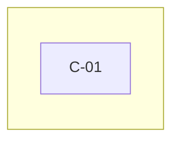

*Caption: <what the diagram shows>.*

### Assumptions and open questions

| ID | Assumption or question | Owner | Due | Status |
|---|---|---|---|---|
| Q-01 | <…> | <…> | <YYYY-MM-DD> | <Open / Closed> |

### Known limitations

> **Guide:** for example, a capability that is only partly delivered. Every `LIM-xx` also goes into SP-12. Write "No known limitations." if there are none.

| ID | Limitation | Impact | Workaround | Owner |
|---|---|---|---|---|
| LIM-01 | <…> | <…> | <… or None> | <…> |

### Change log

| Version | Date | Author | Summary | Approved by |
|---|---|---|---|---|
| 0.1 | <YYYY-MM-DD> | <Name> | First draft | — |

---

# templates/business/BUS-03-business-process-register.md

```yaml
id: BUS-03
title: Business Process Register
application: <Application name>
version: 0.1
status: Draft
owner: <Named person and role>
audience: [Process owners, Operations staff, Business owner, Support, Engineering, Agents]
level: <Foundation | Standard | Full>
depth: <D | D+>
contains: []        # at Standard, ENG-02 User Journeys is usually held here as a section
related: [BUS-02, BUS-04, BUS-05, BUS-06, ENG-02]
last_reviewed: <YYYY-MM-DD>
```
## <Application> – Business Process Register

> **How to use this template**
> - **Who writes it:** the producer with each process owner; validate with people who actually do the work.
> - **When it is due:** Draft and Accepted at stage 2 (Define). Update when a process, its roles or its statuses change.
> - **Depth S (Foundation):** a section `## BUS-03 Business Process Register` in BUS-01 holding the Process summary table (keep every linked column: `Capabilities`, `Roles`, `Statuses`, `Journeys`). Add a short numbered list of steps for the main process if it is not obvious. Drop the other sections.
> - **Depth D (Standard):** everything except sections marked (Full). At Standard, ENG-02 User Journeys is usually held in this file as a section `## ENG-02 User Journeys`.
> - **Depth D+ (Full):** everything, including sections marked (Full).
> - Delete this block and every `> **Guide:**` block before review, and replace every `<…>`.

### Purpose

Documents the end-to-end business processes <Application> supports, including the work done outside the system, so process owners, support and engineers share one picture of how the work is really done.

### Scope

Covers every business process (`W-xx`) from its trigger to its outcome. What the system can do is in BUS-02; the rules and statuses in BUS-05; a person's step-by-step interaction with the screens is in ENG-02 User Journeys.

> **Guide:** the difference from ENG-02: a business process (here) is how the work gets done, including phone calls, paper and decisions outside the system; a user journey (ENG-02) is one person's interaction with the system to reach a goal.

### Process summary

> **Guide:**
> - **One process = one trigger to one outcome**, with one owner and one status lifecycle. Split an entry that has several unrelated triggers, independently valuable outcomes, different owners or separate lifecycles.
> - **Keep every process at the same business level.** Describe business actions ("review the request"), never screen clicks ("click the Review tab"), and do not mix a detailed procedure with a summary.
> - **Capabilities:** `C-xx` IDs; the link must be two-way with BUS-02. **Roles:** `R-xx` IDs. **Statuses:** `ST-xx` IDs the process moves records through, or `None`. **Journeys:** `J-xx` IDs from ENG-02, or `None` when T1 is No; two-way with ENG-02.
> Prefer: "Review and decide a booking request". Avoid: "Booking admin screen".

| ID | Name | Trigger | Outcome | Owner | Roles | Capabilities | Statuses | Journeys | Manual steps outside the system |
|---|---|---|---|---|---|---|---|---|---|
| W-01 | <Verb + object> | <What starts it> | <What successful completion produces> | <Name, role> | <R-xx> | <C-xx> | <ST-xx, or None> | <J-xx, or None> | <… or None> |

### Process details

> **Guide:** one subsection per process, in ID order. Steps are business actions in order. **Actor** is a role ID, or `Automated` for a step the system performs with no person acting. Put work outside the system in the steps too, marked "Outside system" under Capability.

#### W-01 <Process name>

| Step | Actor | Action | Capability | Status after | Notes |
|---|---|---|---|---|---|
| 1 | <R-xx or Automated> | <Business action> | <C-xx, or Outside system> | <ST-xx or —> | <…> |

**Decision points**

| Decision | Options | Decided by | Resulting status or action |
|---|---|---|---|
| <…> | <Approve / Return / Reject> | <R-xx> | <ST-xx, next step> |

**Exceptions and alternate paths**

| Exception | Handling | Owner | Escalation path |
|---|---|---|---|
| <…> | <…> | <Name, role> | <…> |

### Process diagrams (Full)

> **Guide:** one Mermaid flowchart per process showing steps, decision points and exception paths, with swimlanes by role where it helps. Caption each in one sentence.

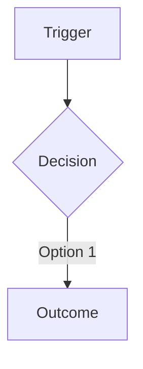

*Caption: <what the diagram shows>.*

### Responsibility matrix (Full)

> **Guide:** who is Responsible, Accountable, Consulted and Informed for each process. One A per process.

| Process | Responsible | Accountable | Consulted | Informed |
|---|---|---|---|---|
| <W-xx> | <R-xx> | <R-xx or Name> | <…> | <…> |

### Assumptions and open questions

| ID | Assumption or question | Owner | Due | Status |
|---|---|---|---|---|
| Q-01 | <…> | <…> | <YYYY-MM-DD> | <Open / Closed> |

### Known limitations

> **Guide:** for example, a step still done on paper. Every `LIM-xx` also goes into SP-12. Write "No known limitations." if there are none.

| ID | Limitation | Impact | Workaround | Owner |
|---|---|---|---|---|
| LIM-01 | <…> | <…> | <… or None> | <…> |

### Change log

| Version | Date | Author | Summary | Approved by |
|---|---|---|---|---|
| 0.1 | <YYYY-MM-DD> | <Name> | First draft | — |

---

# templates/business/BUS-04-roles-and-access-matrix.md

```yaml
id: BUS-04
title: Roles & Access Matrix
application: <Application name>
version: 0.1
status: Draft
owner: <Named person and role>
audience: [Business owner, Access approvers, Support, Auditors, Engineering]
level: <Foundation | Standard | Full>
depth: <D | D+>
contains: []
related: [BUS-02, BUS-03, BUS-05, ENG-03, ENG-08, SP-01]
last_reviewed: <YYYY-MM-DD>
```
## <Application> – Roles & Access Matrix

> **How to use this template**
> - **Who writes it:** the producer with the business owner and the access approvers; the support owner confirms the request and removal steps. Engineers confirm the permissions match the authorisation model in ENG-03.
> - **When it is due:** Draft at stage 2 (Define), Accepted at stage 4 (Verify). Update with every new role or permission.
> - **In scope only when T2 is Yes** (more than one role or permission level). When T2 is No, BUS-01 defines a single `R-01` role in one line instead.
> - **Depth S:** a section `## BUS-04 Roles & Access Matrix` in BUS-01 holding the Roles table, the Permissions matrix, and one line each for who approves access and how it is removed.
> - **Depth D (Standard):** everything except sections marked (Full).
> - **Depth D+ (Full):** everything, including sections marked (Full).
> - Delete this block and every `> **Guide:**` block before review, and replace every `<…>`.

### Purpose

Defines each role in <Application>, what it may do, who approves access to it, and how access is requested, removed and reviewed, so access decisions and audits can be made from this document.

### Scope

Covers every role (`R-xx`) used anywhere in the package: in capabilities, processes, journeys and transitions. How authentication and authorisation are built is in ENG-03; how support handles access requests day to day is in ENG-08.

### Roles

> **Guide:** one row per role. **Name** is the exact name used in prose, in the user interface and in SP-01. A role is a set of permissions and responsibilities, not a person or a team. Never include "System": automated actions are marked `Automated` in BUS-02, BUS-03 and BUS-05.

| ID | Name | Description | Typical users | Role owner | Access approver |
|---|---|---|---|---|---|
| R-01 | <Role name> | <What this role is for, in plain words> | <Job titles or groups> | <Name, role> | <Name, role> |

### Permissions matrix

> **Guide:** one row per role, Yes or No per action. Adjust the action columns to the application; keep them in business words. Where a permission is limited (for example, "only their own requests"), write the limit instead of Yes.

| Role | View | Create | Update | Approve / confirm | Return / reject | Cancel / delete | Manage setup | Manage users and roles | Generate reports | Notes |
|---|---|---|---|---|---|---|---|---|---|---|
| <R-xx> | <Yes / No / limit> | <…> | <…> | <…> | <…> | <…> | <…> | <…> | <…> | <…> |

> **Guide:** optionally add a capability view: one row per capability (`C-xx`) with the roles allowed to use it. It must agree with the `Roles` column in BUS-02.

### Access request

> **Guide:** numbered steps from "a person needs access" to "access works", naming who requests, who approves (the access approver from the Roles table) and who grants, with the expected time.

1. <…>
2. <…>
3. <…>

### Access removal

> **Guide:** numbered steps for routine removal (leaver, role change) and for **urgent removal** (suspected misuse, dismissal), with who triggers it, who performs it and how quickly. Say how removal is confirmed.

**Routine removal:**
1. <…>
2. <…>

**Urgent removal:**
1. <…>
2. <…>

### Periodic access review

> **Guide:** who reviews the list of users and roles, how often, what they check, and where the evidence is kept.

| Item | Value |
|---|---|
| Reviewer | <Name, role> |
| Frequency | <Quarterly / every 6 months> |
| What is checked | <Every user still needs their role; no leavers; sensitive roles justified> |
| Evidence kept in | <…> |

### Sensitive permissions and segregation

> **Guide:** list permissions that could cause harm if misused (administration, approval, export of personal data, deletion) and role combinations one person must not hold (for example, "submit and approve the same request"), with the control and its owner. Link risks in BUS-08.

| Permission or combination | Risk | Control | Owner |
|---|---|---|---|
| <…> | <…> | <…> | <Name, role> |

### Segregation of duties matrix (Full)

> **Guide:** a role-by-role grid marking which pairs of roles must not be held by the same person, and how the application or the process enforces it.

| Role | <R-01> | <R-02> | Enforced by |
|---|---|---|---|
| <R-01> | — | <Conflict / OK> | <Application check / periodic review> |

### Access review log (Full)

> **Guide:** record each completed access review.

| Date | Reviewer | Users reviewed | Changes made | Evidence |
|---|---|---|---|---|
| <YYYY-MM-DD> | <Name, role> | <n> | <…> | <link> |

### Assumptions and open questions

| ID | Assumption or question | Owner | Due | Status |
|---|---|---|---|---|
| Q-01 | <…> | <…> | <YYYY-MM-DD> | <Open / Closed> |

### Known limitations

> **Guide:** for example, a permission the application cannot restrict as finely as the business wants. Every `LIM-xx` also goes into SP-12. Write "No known limitations." if there are none.

| ID | Limitation | Impact | Workaround | Owner |
|---|---|---|---|---|
| LIM-01 | <…> | <…> | <… or None> | <…> |

### Change log

| Version | Date | Author | Summary | Approved by |
|---|---|---|---|---|
| 0.1 | <YYYY-MM-DD> | <Name> | First draft | — |

---

# templates/business/BUS-05-business-rules-and-status-lifecycle.md

```yaml
id: BUS-05
title: Business Rules & Status Lifecycle
application: <Application name>
version: 0.1
status: Draft
owner: <Named person and role>
audience: [Business owner, Engineering, Testers, Support, Agents]
level: <Foundation | Standard | Full>
depth: D            # BUS-05 is D at Standard and Full; a section in BUS-01 at Foundation
contains: []
related: [BUS-02, BUS-03, BUS-04, BUS-06, ENG-04, SP-01, SP-11]
last_reviewed: <YYYY-MM-DD>
```
## <Application> – Business Rules & Status Lifecycle

> **How to use this template**
> - **Who writes it:** the producer with the business owner and rule owners; engineers and testers check each rule and transition can be tested. Agents may draft from validation code and status enums, marking rows inferred.
> - **When it is due:** Draft at stage 2 (Define), Accepted at stage 4 (Verify). Update with every new or changed rule, status or transition.
> - **Depth S (Foundation):** a section `## BUS-05 Business Rules & Status Lifecycle` in BUS-01 holding the Rules, Statuses and Transitions tables with a few rows each. Drop the other sections.
> - **Depth D (Standard and Full):** everything. BUS-05 has no sections marked (Full).
> - **When T3 is No** (records do not move through statuses or approvals), delete Statuses, Transitions and Lifecycle diagram, and write one line: "Records in <Application> have no statuses."
> - Every rule and every transition gets a positive and a negative application acceptance criterion in SP-11, so write each one so it can be tested.
> - Delete this block and every `> **Guide:**` block before review, and replace every `<…>`.

### Purpose

Defines the rules <Application> must enforce, and every status and allowed status change of its records, in a form that can be tested, so the business, engineers, testers and support agree on what the application allows and forbids.

### Scope

Covers business rules and validations (`BR-xx`), statuses (`ST-xx`), transitions (`TR-xx`), exceptions and overrides. The records the statuses belong to are defined in BUS-06; how statuses are stored is in ENG-04; the criteria that test each rule and transition are in SP-11.

### Business rules

> **Guide:**
> - **Rule:** written as condition → action: "If <condition>, then <what the application does or prevents>." One rule per row.
> - **Type:** `Business` (a policy the business requires) or `Validation` (a check on data entered, which blocks or warns).
> - **Blocking:** for validations, whether the user is stopped (Yes) or warned (No).
> - **Owner:** the person or role who decides the rule. **Exception authority:** who may allow an exception, when `Exception allowed` is Yes.
> - **Processes:** `W-xx` IDs; **Capabilities:** `C-xx` IDs.
> Prefer: "If a room is already Confirmed for any night of the requested dates, then the request cannot be confirmed." Avoid: "Rooms must be available."

| ID | Type | Rule | Applies to | Blocking | Owner | Exception allowed | Exception authority | Processes | Capabilities |
|---|---|---|---|---|---|---|---|---|---|
| BR-01 | <Business / Validation> | If <condition>, then <action>. | <REC-xx or field> | <Yes / No / —> | <Name or role> | <Yes / No> | <Name or role, or —> | <W-xx> | <C-xx> |

### Statuses

> **Guide:** one row per status of each record. **Name** is the exact name shown to users and used in SP-01. **Meaning** is the business meaning; **Meaning for users** is what a user would understand when they see it, in their words (BUS-09 Concepts repeats it). **User-visible** says whether users see this status. **Terminal** is Yes when no transition leaves it.

| ID | Name | Record | Meaning | Meaning for users | User-visible | Terminal |
|---|---|---|---|---|---|---|
| ST-01 | <Status name> | <REC-xx> | <…> | <…> | <Yes / No> | <Yes / No> |

### Transitions

> **Guide:** one row per allowed status change. Anything not listed is not allowed. **From** and **To** are status IDs; **Roles** are the role IDs that may perform it, or `Automated` when the system does it (for example, on a timer). **Rule or condition** names the rules (`BR-xx`) that guard it.
> Check: every non-terminal status has at least one transition out, and every status except the first can be reached.

| ID | From | To | Roles | Trigger or action | Rule or condition | Processes |
|---|---|---|---|---|---|---|
| TR-01 | <ST-xx> | <ST-xx> | <R-xx, or Automated> | <Business action or event> | <BR-xx, or None> | <W-xx> |

### Lifecycle diagram

> **Guide:** optional but recommended when there are more than four statuses. A Mermaid state diagram generated from the Transitions table, with a one-sentence caption. The table is the source; the diagram must not add transitions.

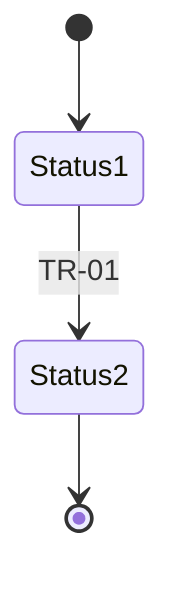

*Caption: <the statuses of REC-xx and the allowed transitions between them>.*

### Exceptions and overrides

> **Guide:** for each rule where an exception is allowed, say what may be overridden, who approves it, and what must be recorded for audit (who, when, why). Write "No overrides are allowed." if that is true.

| Exception | Normal rule | Allowed override | Approved by | Audit requirement |
|---|---|---|---|---|
| <…> | <BR-xx> | <…> | <Name or role> | <What is recorded, where, for how long> |

### Assumptions and open questions

| ID | Assumption or question | Owner | Due | Status |
|---|---|---|---|---|
| Q-01 | <…> | <…> | <YYYY-MM-DD> | <Open / Closed> |

### Known limitations

> **Guide:** for example, a rule enforced by staff rather than by the application. Every `LIM-xx` also goes into SP-12. Write "No known limitations." if there are none.

| ID | Limitation | Impact | Workaround | Owner |
|---|---|---|---|---|
| LIM-01 | <…> | <…> | <… or None> | <…> |

### Change log

| Version | Date | Author | Summary | Approved by |
|---|---|---|---|---|
| 0.1 | <YYYY-MM-DD> | <Name> | First draft | — |

---

# templates/business/BUS-06-data-reports-and-notifications.md

```yaml
id: BUS-06
title: Data, Reports & Notifications Register
application: <Application name>
version: 0.1
status: Draft
owner: <Named person and role>
audience: [Data owner, Compliance, Business owner, Support, Engineering]
level: <Foundation | Standard | Full>
depth: <D | D+>
contains: []
related: [BUS-03, BUS-05, BUS-08, ENG-04, ENG-08, SP-10]
last_reviewed: <YYYY-MM-DD>
```
## <Application> – Data, Reports & Notifications Register

> **How to use this template**
> - **Who writes it:** the producer with the data owner; the compliance or privacy contact confirms classification, purpose and retention for personal data. Engineers map each record to its entities in ENG-04.
> - **When it is due:** Draft at stage 2 (Define), Accepted at stage 4 (Verify). Update with every new record, report, export or notification, and every change in classification or retention.
> - **Depth S (Foundation):** a section `## BUS-06 Data, Reports & Notifications Register` in BUS-01 holding the Records table (keep `Core`, `Classification`, `Purpose`, `Retention`). Reports and notifications may be one line each if there are only one or two; otherwise keep their tables with the linked columns.
> - **Depth D (Standard):** everything except sections marked (Full).
> - **Depth D+ (Full):** everything, including sections marked (Full).
> - **When T4 is No**, write one line under Records: "No personal or confidential data." and still classify each record.
> - Delete this block and every `> **Guide:**` block before review, and replace every `<…>`.

### Purpose

Lists the business records <Application> holds, how each is classified and kept, and the reports, exports and notifications it produces, so the data owner, compliance and support know what data exists, why, for how long, and who relies on each output.

### Scope

Covers business records (`REC-xx`), reports, exports and dashboards (`REP-xx`), and notifications (`NTF-xx`). The technical entities and fields that store records are in ENG-04; statuses of records in BUS-05; output checks that confirm reports and records are correct in ENG-08 and SP-10 (L4).

### Records

> **Guide:**
> - **Name:** the exact name used in prose and in SP-01. **Required fields:** the business fields that must be present for the record to be valid.
> - **Core:** Yes when the business relies on the record being right (it drives decisions, money or reports). When T6 is Yes, every core record needs at least one output check in ENG-08.
> - **Classification:** Public / Internal / Confidential / Personal / Special-category (health, beliefs, biometrics and similar). Use the most sensitive field's class.
> - **Purpose:** for Personal and Special-category records, why the data is held and the lawful basis or policy that allows it. Write "—" for other records.
> - **Retention:** the period and the rationale ("7 years after the booking date: finance policy"). **Disposal:** how it is deleted or anonymised at the end, and by whom.
> Prefer: "Personal · Purpose: to contact the guest about their booking (contract) · Retention: 2 years after checkout, privacy policy section 4". Avoid: "Sensitive: Yes".

| ID | Name | Description | Required fields | Core | Classification | Purpose | Retention | Disposal | Owner | Processes |
|---|---|---|---|---|---|---|---|---|---|---|
| REC-01 | <Record name> | <…> | <…> | <Yes / No> | <Public / Internal / Confidential / Personal / Special-category> | <Purpose and lawful basis, or —> | <Period and rationale> | <Method and who> | <Name, role> | <W-xx> |

### Reports, exports and dashboards

> **Guide:** one row per report, export or dashboard others use. **Source:** the records (`REC-xx`) or system it is built from. **Official record:** Yes when the report itself is kept as evidence (for audit, finance or regulation). Reports others rely on need an output check in ENG-08 when T6 is Yes.

| ID | Name | Purpose | Audience | Frequency | Format | Source | Owner | Official record |
|---|---|---|---|---|---|---|---|---|
| REP-01 | <…> | <Decision or task it supports> | <Who reads it> | <…> | <Screen / PDF / spreadsheet / file feed> | <REC-xx or system> | <Name, role> | <Yes / No> |

### Notifications

> **Guide:** one row per message the application sends. **Trigger:** the event that sends it, usually a transition (`TR-xx`) or a schedule. **Expected action:** what the recipient should do, or "None, information only". Notifications that others rely on need a completeness check when T6 is Yes.

| ID | Name | Trigger | Recipient | Purpose | Expected action | Channel | Processes | Owner |
|---|---|---|---|---|---|---|---|---|
| NTF-01 | <…> | <TR-xx or event> | <R-xx or external party> | <…> | <…> | <Email / In-app / SMS / Chat> | <W-xx> | <Name, role> |

### Data subject requests (Full)

> **Guide:** required at Full level when there are Personal or Special-category records. Say how a person's request to see, correct, export or delete their data is received, who handles it, how it is carried out in the application, and the time limit.

| Request type | Received through | Handled by | How it is done | Time limit |
|---|---|---|---|---|
| <Access / Correction / Erasure / Export> | <…> | <Name, role> | <…> | <…> |

### Report lineage (Full)

> **Guide:** for each official or core report, the path from source records to the figures shown: filters, calculations and cut-off times, so a reconciliation can be designed and a disputed number traced.

| Report | Source records | Filters and calculations | Cut-off | Reconciled by |
|---|---|---|---|---|
| <REP-xx> | <REC-xx> | <…> | <…> | <OC-xx> |

### Assumptions and open questions

| ID | Assumption or question | Owner | Due | Status |
|---|---|---|---|---|
| Q-01 | <…> | <…> | <YYYY-MM-DD> | <Open / Closed> |

### Known limitations

> **Guide:** for example, a retention period not yet enforced automatically. Every `LIM-xx` also goes into SP-12. Write "No known limitations." if there are none.

| ID | Limitation | Impact | Workaround | Owner |
|---|---|---|---|---|
| LIM-01 | <…> | <…> | <… or None> | <…> |

### Change log

| Version | Date | Author | Summary | Approved by |
|---|---|---|---|---|
| 0.1 | <YYYY-MM-DD> | <Name> | First draft | — |

---

# templates/business/BUS-07-resource-and-cost-model.md

```yaml
id: BUS-07
title: Resource & Cost Model
application: <Application name>
version: 0.1
status: Draft
owner: <Named person and role>
audience: [Budget holder, Management, Business owner, Technical owner]
level: <Foundation | Standard | Full>
depth: <D | D+>
contains: []
related: [BUS-01, ENG-05, ENG-08]
last_reviewed: <YYYY-MM-DD>
```
## <Application> – Resource & Cost Model

> **How to use this template**
> - **Who writes it:** the producer with the budget holder and the technical owner; the support owner confirms support effort. Start with an estimate and refine it.
> - **When it is due:** initial estimate Draft at stage 1 (Initiate), refined through the build, Accepted at stage 5 (Go-live). Update when a dependency's cost, a licence or the support model changes.
> - **In scope only when T8 is Yes** (it costs something beyond an existing shared platform). When T8 is No, BUS-01 names the shared platform in one line instead.
> - **Depth S (Foundation):** a section `## BUS-07 Resource & Cost Model` in BUS-01 holding a few cost lines (one table, keeping `Basis`, `Dependency` and `Owner`), the yearly total and the budget holder.
> - **Depth D (Standard):** everything except sections marked (Full).
> - **Depth D+ (Full):** everything, including sections marked (Full).
> - Estimates are fine. Mark each line's `Basis` as Estimate, Quote or Actual, and say what the estimate is based on.
> - Delete this block and every `> **Guide:**` block before review, and replace every `<…>`.

### Purpose

Tells the business what it takes to deploy and run <Application>: people and effort, skills, infrastructure, services, licences, running costs, renewals and what retiring it would involve, so the budget holder can fund it and plan for it.

### Scope

Covers every cost and effort line (`COST-xx`), one-off and recurring. Dependencies and their renewal dates are defined in ENG-05; routine operations tasks in ENG-08. Every dependency marked `Cost` = Yes in ENG-05 appears here in a `Dependency` column.

> **Guide:** amounts are in <currency>, excluding or including tax as stated here: <…>. Every table that holds `COST-xx` lines has a `Dependency` column holding a `D-xx` ID or `None`.

### People and effort

> **Guide:** recurring effort to keep the application running: support, administration, data upkeep, access administration, releases, monitoring and output checks. Use ENG-08 routine tasks (`MT-xx`) and runbook duties as the list; name the tasks each line covers.

| ID | Role | Activity | Covers | Effort per month | Team | Skills needed | Cost per year | Basis | Dependency | Owner |
|---|---|---|---|---|---|---|---|---|---|---|
| COST-01 | <Role or job> | <…> | <MT-xx, or description> | <hours> | <…> | <…> | <amount> | <Estimate / Quote / Actual> | <D-xx or None> | <Name, role> |

### One-off deployment resources

> **Guide:** effort and spend needed once, to go live: build, data migration, training, cutover, early-life support.

| ID | Item | Effort or cost | When | Basis | Dependency | Owner |
|---|---|---|---|---|---|---|
| COST-02 | <…> | <hours or amount> | <stage or date> | <Estimate / Quote / Actual> | <D-xx or None> | <Name, role> |

### Infrastructure and services

> **Guide:** hosting, database, storage, email, domain, monitoring, backup. Give the sizing and number of environments, since these drive cost.

| ID | Item | Sizing | Environments | Monthly cost | Annual cost | Basis | Dependency | Owner |
|---|---|---|---|---|---|---|---|---|
| COST-03 | <…> | <…> | <ENV-xx> | <amount> | <amount> | <Estimate / Quote / Actual> | <D-xx> | <Name, role> |

### Licences and subscriptions

> **Guide:** every paid product or service, with renewal date and notice period so nothing lapses by surprise. Renewal dates must match ENG-05.

| ID | Item | Cost | Billing cycle | Renewal date | Notice period | Basis | Dependency | Owner |
|---|---|---|---|---|---|---|---|---|
| COST-04 | <…> | <amount> | <Monthly / Annual> | <YYYY-MM-DD> | <…> | <Estimate / Quote / Actual> | <D-xx> | <Name, role> |

### Running cost summary

> **Guide:** recurring totals by group, with the assumptions behind them. One-off costs are shown separately.

| Cost group | Monthly | Annual | Main assumptions |
|---|---|---|---|
| People and effort | <amount> | <amount> | <…> |
| Infrastructure and services | <amount> | <amount> | <…> |
| Licences and subscriptions | <amount> | <amount> | <…> |
| **Total recurring** | <amount> | <amount> | |
| One-off (deployment) | — | <amount> | <…> |

### Scaling assumptions

> **Guide:** what makes the cost grow (users, records, storage, messages sent), the current value and expected growth, and which cost lines change.
> Prefer: "Email cost grows with notifications sent: 2,000 a month today, about 5,000 expected next year (COST-03)." Avoid: "Costs may increase."

| Driver | Current | Expected | Effect on cost | Cost lines affected |
|---|---|---|---|---|
| <…> | <…> | <…> | <…> | <COST-xx> |

### Funding and ownership

| Item | Value |
|---|---|
| Budget holder | <Name, role> |
| Cost centre or budget line | <…> |
| Funding period | <…> |
| Next budget review | <YYYY-MM-DD> |

### End of life

> **Guide:** what retiring the application would involve: exporting or archiving data (respecting retention in BUS-06), notice to users and downstream systems, cancelling licences and their notice periods, decommissioning infrastructure, and the effort needed.

- <…>

### Cost scenarios (Full)

> **Guide:** low, expected and high cases for the next one to three years, with the assumptions that change between them.

| Scenario | Assumptions | Year 1 | Year 2 | Year 3 |
|---|---|---|---|---|
| <Expected> | <…> | <amount> | <amount> | <amount> |

### Total cost of ownership (Full)

> **Guide:** one-off plus recurring cost over the planned lifetime, compared with the benefits in BUS-01 where they can be valued.

| Item | Value |
|---|---|
| Planned lifetime | <years> |
| One-off total | <amount> |
| Recurring total over lifetime | <amount> |
| Total cost of ownership | <amount> |

### Assumptions and open questions

| ID | Assumption or question | Owner | Due | Status |
|---|---|---|---|---|
| Q-01 | <…> | <…> | <YYYY-MM-DD> | <Open / Closed> |

### Known limitations

> **Guide:** for example, a cost not yet quoted. Every `LIM-xx` also goes into SP-12. Write "No known limitations." if there are none.

| ID | Limitation | Impact | Workaround | Owner |
|---|---|---|---|---|
| LIM-01 | <…> | <…> | <… or None> | <…> |

### Change log

| Version | Date | Author | Summary | Approved by |
|---|---|---|---|---|
| 0.1 | <YYYY-MM-DD> | <Name> | First draft | — |

---

# templates/business/BUS-08-risk-and-controls-register.md

```yaml
id: BUS-08
title: Risk & Controls Register
application: <Application name>
version: 0.1
status: Draft
owner: <Named person and role>
audience: [Management, Business owner, Risk and audit, Support, Technical owner]
level: <Foundation | Standard | Full>
depth: <D | D+>
contains: []
related: [BUS-02, BUS-03, BUS-04, BUS-06, ENG-03, ENG-05, SP-12]
last_reviewed: <YYYY-MM-DD>
```
## <Application> – Risk & Controls Register

> **How to use this template**
> - **Who writes it:** the producer with the business owner, technical owner and support owner; risk, audit or privacy contacts review it. Derive risks from processes, access, data, reports, dependencies, support, known limitations, technical debt in ENG-03 and incidents.
> - **When it is due:** Draft at stage 4 (Verify), Accepted at stage 5 (Go-live). Update after every incident with a new failure mode and whenever a success measure is missed for two periods.
> - **At Foundation** BUS-08 is usually not needed: the main limitations and risks go in BUS-01 Known limitations.
> - **Depth S:** a section `## BUS-08 Risk & Controls Register` in BUS-01 holding the Risk register table with the High risks only, and one line on the privacy impact assessment when T4 is Yes.
> - **Depth D (Standard):** everything except sections marked (Full).
> - **Depth D+ (Full):** everything, including sections marked (Full).
> - Delete this block and every `> **Guide:**` block before review, and replace every `<…>`.

### Purpose

Records what can go wrong with <Application>, how likely and how bad each risk is, the controls that reduce it, who owns it, and what risk remains and who has accepted it.

### Scope

Covers application risks (`RISK-xx`) in every category below. Known limitations stay in their own documents and SP-12; a limitation that could cause harm is also raised here as a risk. Incident handling is in ENG-08; technical debt is described in ENG-03.

### Rating guidance

> **Guide:** rate likelihood and impact, then read the severity from the grid. Severity drives handling: a High risk must have a control and an owner, and either be mitigated or be formally accepted by a named owner with a date.

| Rating | Likelihood | Impact |
|---|---|---|
| High | Expected to happen within a year, or has happened | A business process stops, personal data is exposed, money is lost, or legal or reputational harm |
| Medium | Could happen within a year | Work is delayed or needs rework; a workaround exists |
| Low | Unlikely within a year | Minor inconvenience |

| Likelihood \ Impact | Low | Medium | High |
|---|---|---|---|
| **High** | Medium | High | High |
| **Medium** | Low | Medium | High |
| **Low** | Low | Low | Medium |

### Risk register

> **Guide:**
> - **Risk:** written as cause → event → consequence. Prefer: "If the email service is unavailable, confirmations are not sent, and guests arrive without a confirmed booking." Avoid: "Email risk".
> - **Category:** Operational / Access / Data / Privacy and compliance / Reporting / Dependency / Support / Technical / Financial.
> - **Affects:** the IDs at risk: `C`, `W`, `D`, `REC`, `REP`, `BR`, `LIM`.
> - **Control:** what reduces the likelihood or impact, existing or planned (say which). **Owner:** the person accountable for the control.
> - **Residual risk:** severity after the control. **Accepted by:** the named owner who accepted the residual risk, with date, or "—" while it is being mitigated.

| ID | Risk | Category | Affects | Likelihood | Impact | Severity | Control | Owner | Residual risk | Accepted by | Review cadence |
|---|---|---|---|---|---|---|---|---|---|---|---|
| RISK-01 | <Cause → event → consequence> | <…> | <C-xx, D-xx, REC-xx> | <High / Medium / Low> | <High / Medium / Low> | <High / Medium / Low> | <… (existing / planned)> | <Name, role> | <High / Medium / Low> | <Name, role, YYYY-MM-DD, or —> | <Quarterly> |

### Privacy impact assessment

> **Guide:** required when T4 is Yes (personal or confidential data). Answer: has a privacy impact assessment (or data protection impact assessment) been done? Link it with its date and outcome, or state why it is not needed and who decided. Raise any finding as a risk of category Privacy and compliance.

| Item | Value |
|---|---|
| Assessment status | <Done / Planned / Not needed> |
| Link and date | <… or —> |
| Outcome or reason not needed | <…> |
| Decided by | <Name, role> |

### Risk heat map (Full)

> **Guide:** the count of risks in each likelihood × impact cell, before and after controls, so management sees the overall exposure at a glance.

| Likelihood \ Impact | Low | Medium | High |
|---|---|---|---|
| **High** | <n> | <n> | <n> |
| **Medium** | <n> | <n> | <n> |
| **Low** | <n> | <n> | <n> |

### Control testing (Full)

> **Guide:** for each control on a High or Medium risk, how its operation is checked, how often, by whom, and the last result.

| Risk | Control | How tested | Frequency | Tested by | Last result and date |
|---|---|---|---|---|---|
| <RISK-xx> | <…> | <…> | <…> | <Name, role> | <Pass / Fail, YYYY-MM-DD> |

### Assumptions and open questions

| ID | Assumption or question | Owner | Due | Status |
|---|---|---|---|---|
| Q-01 | <…> | <…> | <YYYY-MM-DD> | <Open / Closed> |

### Known limitations

> **Guide:** for example, a risk category not yet assessed. Every `LIM-xx` also goes into SP-12. Write "No known limitations." if there are none.

| ID | Limitation | Impact | Workaround | Owner |
|---|---|---|---|---|
| LIM-01 | <…> | <…> | <… or None> | <…> |

### Change log

| Version | Date | Author | Summary | Approved by |
|---|---|---|---|---|
| 0.1 | <YYYY-MM-DD> | <Name> | First draft | — |

---

# templates/business/BUS-09-user-and-admin-guide.md

```yaml
id: BUS-09
title: User & Admin Guide
application: <Application name>
version: 0.1
status: Draft
owner: <Named person and role>
audience: [End users, Administrators, Support]
level: <Foundation | Standard | Full>
depth: <D | D+>
contains: []
related: [ENG-02, BUS-04, BUS-05, BUS-06, ENG-01, ENG-07, ENG-08]
last_reviewed: <YYYY-MM-DD>
```
## <Application> – User & Admin Guide

> **How to use this template**
> - **Who writes it:** the producer with a representative user and an administrator; support reviews the help and error sections. Agents may draft how-tos from ENG-02 journeys and screens; a real user then follows each one.
> - **When it is due:** Draft at stage 4 (Verify), Accepted at stage 5 (Go-live). Update with every new or changed feature, status, role or error message, and add release notes with every release.
> - **In scope only when T1 is Yes** (people use it through a screen).
> - **Depth S (Foundation):** a section `## BUS-09 User & Admin Guide` in BUS-01 holding a quick start: Getting started (how to get access, the first task in a few numbered steps) and Help (where to get help). Add the Accessibility statement when T11 is Yes.
> - **Depth D (Standard):** everything except sections marked (Full), as one guide.
> - **Depth D+ (Full):** everything, including sections marked (Full).
> - The guide is organised by what the reader is trying to do: get started, do a task, understand, look something up, get help, see what changed. Write in the user's words and never tell a user to do something their role does not allow (check BUS-04).
> - Delete this block and every `> **Guide:**` block before review, and replace every `<…>`.

### Purpose

Helps users and administrators of <Application> get started, complete their tasks, understand what they see, look things up, get help and keep up with changes.

### Scope

Covers every user-facing journey in ENG-02 as a how-to task, every user-visible status from BUS-05, and the administration tasks in BUS-04 and ENG-08. It does not cover technical operations (ENG-08) or deployment (ENG-07).

### Getting started

> **Guide:** a tutorial for a first-time user: how to get access, how to sign in, and one complete task from start to finish with what they should see at each step. A new user should succeed on the first try without help.

**Before you start**

| Item | Value |
|---|---|
| Who can use it | <Roles, in user words> |
| How to get access | <Request path; link to BUS-04 Access request> |
| Where to find it | <URL or entry point> |
| Where to get help | <Contact or link; see Help> |

**Your first <task>**

1. <…>
2. <…>
3. <…>

You should now see: <…>

### How-to tasks

> **Guide:** one task per user-facing journey in ENG-02, named by the user's goal ("Submit a booking request"), not the screen. Steps are short, numbered, and in plain words; say what the user should see when it worked. Separate user tasks from admin tasks (next section).

#### <Task name>

| Item | Value |
|---|---|
| Related journey | <J-xx> |
| Related process | <W-xx> |
| Required role | <R-xx, in user words> |

**Steps**

1. <…>
2. <…>
3. <…>

**Expected result:** <what the user sees, including the new status>

**Common mistakes:**
- <…>

**If something goes wrong:** <what the user sees, what to do, who to contact>

### Concepts

> **Guide:** explains how the application behaves, so users understand what they see. Explain every user-visible status from BUS-05 in the user's words (BUS-05 `Meaning for users`), why a request can be returned or refused, and how notifications work (when they arrive, from whom, what to do).

#### What the statuses mean

| Status | What it means for you | What happens next | Who acts next |
|---|---|---|---|
| <ST-xx Name> | <…> | <…> | <You / staff / automatic> |

#### How notifications work

| Notification | When you get it | What to do |
|---|---|---|
| <NTF-xx> | <…> | <…> |

#### <Other concept>

<…>

### Reference

> **Guide:** things users look up: field meanings and formats, error messages and what to do about each. Copy messages exactly as the application shows them.

#### Fields

| Field | Meaning | Required | Format or example |
|---|---|---|---|
| <…> | <…> | <Yes / No> | <…> |

#### Error and warning messages

| Message | What it means | What to do |
|---|---|---|
| "<Exact message text>" | <…> | <…> |

### Admin tasks

> **Guide:** tasks for administrators only, in the same format as how-to tasks, with the required role. Typical tasks: add a user and assign a role, remove access, change setup data, correct a record, run a report. Each must match a permission in BUS-04.

#### <Admin task name>

| Item | Value |
|---|---|
| Related capability or process | <C-xx / W-xx> |
| Required role | <R-xx> |

**Steps**

1. <…>
2. <…>

**Expected result:** <…>

**If something goes wrong:** <…>

### FAQ and help

> **Guide:** the questions users actually ask (take them from support tickets after go-live), and the support path: who to contact for which kind of problem, how, and when. The support path must match ENG-08.

| Question | Answer |
|---|---|
| <…> | <…> |

**Getting help**

| Problem | Contact | How | Hours |
|---|---|---|---|
| <Question about the process or a record> | <…> | <…> | <…> |
| <Access problem> | <…> | <…> | <…> |
| <Something is broken> | <…> | <…> | <…> |

### What's new

> **Guide:** release notes in user language, newest first: what changed for the user and what they need to do differently. Link the technical release in ENG-07. Write "First release." for the initial version.

| Version | Date | What changed for you | Release |
|---|---|---|---|
| <…> | <YYYY-MM-DD> | <…> | <ENG-07 release reference> |

### Accessibility statement

> **Guide:** required when T11 is Yes (public-facing), and recommended otherwise. State the target standard (for example WCAG 2.2 AA), how conformance was checked and when, known gaps with workarounds and target dates, and how to report an accessibility problem. Trace to the accessibility NFR in ENG-01. Write "Not required: internal application (T11 No)." if it does not apply.

| Item | Value |
|---|---|
| Target standard | <WCAG 2.2 AA> |
| Requirement | <NFR-xx> |
| How and when checked | <…> |
| Known gaps | <… with workaround and target date> |
| Report a problem | <contact> |

### Supported browsers and devices

> **Guide:** the browsers, versions and devices the application supports, traced to the compatibility NFR in ENG-01. Say what happens on an unsupported one.

| Browser or device | Supported versions | Requirement |
|---|---|---|
| <…> | <…> | <NFR-xx> |

### Keyboard and assistive technology notes (Full)

> **Guide:** keyboard shortcuts, screen-reader notes and any task that needs a different method for assistive technology users.

| Task or area | Keyboard or assistive method | Notes |
|---|---|---|
| <…> | <…> | <…> |

### Training materials (Full)

> **Guide:** training sessions, videos or exercises for each role, with where to find them and who keeps them current.

| Material | For role | Where | Owner | Last updated |
|---|---|---|---|---|
| <…> | <R-xx> | <…> | <Name, role> | <YYYY-MM-DD> |

### Assumptions and open questions

| ID | Assumption or question | Owner | Due | Status |
|---|---|---|---|---|
| Q-01 | <…> | <…> | <YYYY-MM-DD> | <Open / Closed> |

### Known limitations

> **Guide:** limitations users will notice, with the workaround in user words. Every `LIM-xx` also goes into SP-12. Write "No known limitations." if there are none.

| ID | Limitation | Impact | Workaround | Owner |
|---|---|---|---|---|
| LIM-01 | <…> | <…> | <… or None> | <…> |

### Change log

| Version | Date | Author | Summary | Approved by |
|---|---|---|---|---|
| 0.1 | <YYYY-MM-DD> | <Name> | First draft | — |

---

# templates/engineering/ENG-01-requirements-specification.md

```yaml
id: ENG-01
title: Requirements Specification
application: <Application name>
version: 0.1
status: Draft
owner: <Named person and role>
audience: [Engineering, Testers, Agents]
level: <Foundation | Standard | Full>
depth: <D | D+>
contains: []
related: [BUS-02, BUS-05, ENG-02, ENG-03, ENG-08, SP-11]
last_reviewed: <YYYY-MM-DD>
```
## <Application> – Requirements Specification

> **How to use this template**
> - **Who writes it:** the technical owner, with the business owner or product owner for priorities. An agent may draft from tickets, designs or code; mark drafted content as inferred until confirmed.
> - **When it is due:** Draft by stage 2 (Define); Accepted by stage 2 (Define), before the build starts.
> - **Depth S** (section `## ENG-01 Requirements Specification` in ENG-09): the functional requirements table for Must requirements only, and the non-functional requirements table for the key categories (at least availability, performance, security and recoverability with RTO and RPO). Keep every linked column (the linter checks them; other columns may be left out) and use level-3 subheadings named after this template's sections, so the section can later be promoted to its own file without restructuring.
> - **Depth D (Standard):** every section except those marked (Full).
> - **Depth D+ (Full):** every section, including (Full).
> - Delete this block and every `> **Guide:**` block before review, and replace every `<…>`.

### Purpose

<Two to four sentences. Example: "States what <Application> must do and how well it must do it, so engineers and agents build the right behaviour and testers can verify it. Every requirement traces to a capability in BUS-02 and is verified by an application acceptance criterion in SP-11.">

### Scope

<What this document covers and what it leaves to others. Example: "Covers functional requirements, non-functional requirements and constraints. Business rules are defined in BUS-05 and referenced here by ID; acceptance criteria and results live in SP-11; user journeys are in ENG-02.">

### Functional requirements

> **Guide:** Write one behaviour per row, as "The system shall…". A requirement an engineer could build two different ways and both be "right" is too vague; split it or add the rule it enforces. Trace every requirement to at least one capability (`C-xx`) and to the business rules (`BR-xx`) it enforces. Do not restate the rule's wording; link it.
>
> Good: "The system shall prevent confirmation of a booking whose dates overlap a confirmed booking for the same resource (BR-03)." Weak: "The system shall handle bookings correctly."
>
> **Priority** is MoSCoW: Must / Should / Could / Won't. Record Won't items so nobody builds them by accident.
> **Status:** Proposed (written, not agreed) → Agreed (owner accepted) → Built (merged and deployed to test) → Verified (its acceptance criteria in SP-11 pass).

| ID | Requirement | Capabilities | Rules | Priority | Status | Notes |
|---|---|---|---|---|---|---|
| FR-01 | The system shall <one observable behaviour> | <C-01> | <BR-01, or None> | <Must / Should / Could / Won't> | <Proposed / Agreed / Built / Verified> | <…> |

### Non-functional requirements

> **Guide:** Use the fixed categories below. Every NFR has a **measurable target** with a number, a unit and a timeframe or load, and a **measurement method** saying how the target is checked. An adjective ("fast", "secure", "highly available") is not a target.
>
> | Category | What a measurable target looks like |
> |---|---|
> | Availability | "99.5% monthly, measured 07:00–19:00 local time on working days" |
> | Performance | "p95 page load ≤ 2 s at 50 concurrent users" |
> | Capacity | "10 000 records per year; 200 concurrent sessions" |
> | Security | "All access requires single sign-on with multi-factor authentication"; "no High findings open in the latest scan" |
> | Privacy | "Personal data is deleted within 30 days of the retention period ending" |
> | Accessibility | "Meets WCAG 2.2 AA on every user-facing screen" |
> | Compatibility | "Latest two versions of <browsers>; screens from 360 px wide" |
> | Maintainability | "Automated test suite runs in ≤ 10 min; line coverage ≥ 70% on domain code" |
> | Observability | "Every request carries a correlation ID; errors visible on the dashboard within 1 min" |
> | Data retention | "Audit records are kept 7 years, then deleted" (period from BUS-06) |
> | Recoverability | RTO and RPO, see below |
>
> **RTO and RPO are recoverability NFRs.** RTO (recovery time objective) is the longest acceptable time to restore service after a failure; RPO (recovery point objective) is the most data, measured in time, that may be lost. ENG-08 backup, restore and disaster recovery sections must use the same values.
>
> List every category. If a category does not apply, say so in the line under the table with a reason; do not leave it out silently.

| ID | Category | Requirement | Target | Measurement method | Priority | Status |
|---|---|---|---|---|---|---|
| NFR-01 | <Availability> | <The service is available during business hours> | <99.5% monthly, 07:00–19:00 working days> | <Uptime monitor on the health check, monthly report> | <Must> | <Proposed> |
| NFR-02 | Recoverability | Recovery time objective (RTO) | <≤ 4 h from declared outage to service restored> | <Timed restore test, see ENG-08> | <Must> | <Proposed> |
| NFR-03 | Recoverability | Recovery point objective (RPO) | <≤ 24 h of data loss> | <Backup frequency and restore test, see ENG-08> | <Must> | <Proposed> |

Categories not applicable: <Category: reason, or "None">.

> **Guide:** The plain-language summary of the top NFRs ("available during office hours, 99.5%") lives in BUS-01; keep the values identical. L3 success measures in SP-10 usually restate availability and performance NFRs as SLI/SLO pairs; link them by ID rather than restating different numbers.

### Constraints

> **Guide:** Constraints are decisions already made for you: mandated technology, hosting, budget, regulation, deadlines, organisational standards. Each one should say where it comes from, so an agent knows not to "improve" it. A constraint that results from a team decision belongs in ENG-10 as an ADR instead.

| Constraint | Type | Source | Impact on design |
|---|---|---|---|
| <Must run on the organisation's shared hosting platform> | <Technology / Hosting / Budget / Regulatory / Schedule / Organisational> | <Policy, contract or person> | <…> |

### Verification rule

Every FR and NFR has at least one application acceptance criterion in SP-11 whose `Verifies` column lists its ID. A requirement cannot move to **Verified** until those criteria pass. A Must FR or any NFR without a criterion fails X-19 and blocks acceptance.

> **Guide:** Do not copy acceptance criteria here. SP-11 holds them and links back by ID.

### Requirement sources and rationale (Full)

> **Guide:** For audited or long-lived applications, record where each requirement came from and why, so later changes can be judged against the original intent.

| Requirement | Source | Rationale | Agreed by | Date |
|---|---|---|---|---|
| <FR-01> | <Stakeholder interview, policy, ticket, regulation> | <…> | <Name and role> | <YYYY-MM-DD> |

### NFR verification plan (Full)

> **Guide:** Say when and how each NFR target is proven before go-live and kept true afterwards (load test, accessibility audit, penetration test, restore test, monitoring). Link the evidence once it exists.

| Requirement | Before go-live | In operation | Evidence |
|---|---|---|---|
| <NFR-01> | <Load test at 2× expected peak> | <Monthly availability report from ENG-08 monitoring> | <Link, or "Not yet run"> |

### Assumptions and open questions

| ID | Assumption or question | Owner | Due | Status |
|---|---|---|---|---|
| Q-01 | <…> | <…> | <YYYY-MM-DD> | <Open / Closed> |

### Known limitations

| ID | Limitation | Impact | Workaround | Owner |
|---|---|---|---|---|
| LIM-01 | <…> | <…> | <…, or None> | <…> |

### Change log

| Version | Date | Author | Summary | Approved by |
|---|---|---|---|---|
| 0.1 | <YYYY-MM-DD> | <Name> | First draft | — |

---

# templates/engineering/ENG-02-user-journeys.md

```yaml
id: ENG-02
title: User Journeys
application: <Application name>
version: 0.1
status: Draft
owner: <Named person and role>
audience: [Engineering, Designers, Testers, Agents]
level: <Foundation | Standard | Full>
depth: <D | D+>
contains: []
related: [BUS-03, BUS-04, BUS-05, BUS-09, ENG-01, ENG-03, SP-11]
last_reviewed: <YYYY-MM-DD>
```
## <Application> – User Journeys

> **How to use this template**
> - **Who writes it:** the product owner or designer, with an engineer for system responses. An agent may draft from screens, routes and tests; mark drafted content as inferred until confirmed.
> - **When it is due:** Draft by stage 2 (Define); Accepted by stage 5 (Go-live). Only in scope when trigger T1 is Yes (people use the application through a screen).
> - **Depth S** (section `## ENG-02 User Journeys` in BUS-03, the default parent): the journey summary table only, one row per main role goal, with the linked columns filled in. Add a one-line error path in Exit state where it matters.
> - **Depth D (Standard):** every section.
> - **Depth D+ (Full):** the same as D. No section is marked (Full), and the depth matrix never sets this item to D+.
> - Delete this block and every `> **Guide:**` block before review, and replace every `<…>`.

### Purpose

<Two to four sentences. Example: "Describes how each role uses <Application> to reach its goals, step by step, including what goes wrong and what the user sees. Engineers build screens and responses from it, testers derive journey tests from it, and BUS-09 how-tos are written from it.">

### Scope

<Example: "Covers each person's interaction with the system. The business process around it, including manual steps outside the system, is in BUS-03. Statuses and transitions are defined in BUS-05; requirements in ENG-01.">

**Difference from BUS-03:** BUS-03 describes how the work is done, including steps outside the system; this document describes only what a person does *in the system* and how the system responds.

### Journey summary

> **Guide:** One journey per main goal of each role. A journey has one entry point and one successful exit state; if it has two goals, split it. Keep the number small: five to fifteen journeys covers most applications.
> - **Roles:** R IDs from BUS-04 (or R-01 in BUS-01 when there is one role).
> - **Processes:** the BUS-03 processes this journey serves (W IDs). The process must list this journey back in its `Journeys` column (X-16).
> - **Requirements:** the ENG-01 FR IDs the journey exercises.
> - **Transitions:** the BUS-05 transitions the journey causes (TR IDs), or `None`.

| ID | Journey | Roles | Goal | Entry point | Processes | Requirements | Transitions | Exit state |
|---|---|---|---|---|---|---|---|---|
| J-01 | <Role verb object, e.g. "Requester submits a request"> | <R-01> | <What the person wants to achieve> | <URL, menu item, email link> | <W-01> | <FR-01, FR-02> | <TR-01, or None> | <What is true at the end, e.g. "Request is Submitted (ST-01) and acknowledgement shown"> |

### Journey details

> **Guide:** Repeat this block for each journey in the summary table. Write steps from the user's point of view, in the order they happen. The system response says what the user sees or receives, not how it is implemented. Every step that changes a status names the transition.

#### J-01 <Journey name>

**Role:** <R-01> · **Goal:** <…> · **Entry point:** <…> · **Preconditions:** <What must be true before the journey starts, e.g. "User is signed in with role R-01">

| Step | User action | System response | Transition / status |
|---|---|---|---|
| 1 | <Opens the request form> | <Shows the form with required fields marked> | <None> |
| 2 | <Completes the form and selects Submit> | <Validates; saves the request; shows confirmation with reference number; sends acknowledgement NTF-01> | <TR-01 → ST-01> |

**Alternative and error paths**

> **Guide:** Include every path a tester should try: validation failure, permission denied, conflicting data, dependency down, timeout, cancel. Say exactly what the user sees, in their words, and where they end up. These paths become negative application acceptance criteria in SP-11.

| Path | Condition | What the user sees | System behaviour | Ends in |
|---|---|---|---|---|
| <2a> | <A required field is empty> | <"Enter a date" next to the field; form keeps entered values> | <Nothing saved> | <Step 2> |
| <2b> | <Email service unavailable> | <Confirmation shown as normal> | <Request saved; acknowledgement queued for retry (see ENG-05, ENG-08)> | <Exit state> |

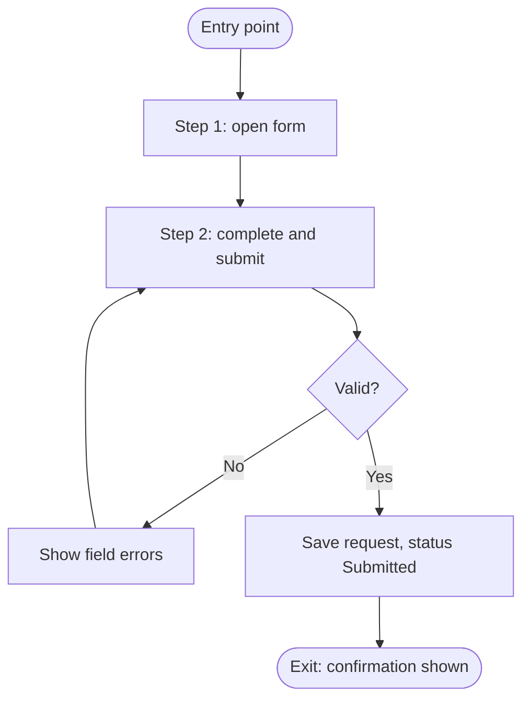

*Caption: <One sentence saying what this diagram shows, e.g. "Happy path and validation loop for J-01 Submit request".>*

### Assumptions and open questions

| ID | Assumption or question | Owner | Due | Status |
|---|---|---|---|---|
| Q-01 | <…> | <…> | <YYYY-MM-DD> | <Open / Closed> |

### Known limitations

| ID | Limitation | Impact | Workaround | Owner |
|---|---|---|---|---|
| LIM-01 | <…> | <…> | <…, or None> | <…> |

### Change log

| Version | Date | Author | Summary | Approved by |
|---|---|---|---|---|
| 0.1 | <YYYY-MM-DD> | <Name> | First draft | — |

---

# templates/engineering/ENG-03-architecture-and-design.md

```yaml
id: ENG-03
title: Architecture & Design
application: <Application name>
version: 0.1
status: Draft
owner: <Named person and role>
audience: [Engineering, Technical operators, Agents]
level: <Foundation | Standard | Full>
depth: <D | D+>
contains: []
related: [BUS-04, BUS-06, BUS-08, ENG-01, ENG-02, ENG-04, ENG-05, ENG-06, ENG-10]
last_reviewed: <YYYY-MM-DD>
```
## <Application> – Architecture & Design

> **How to use this template**
> - **Who writes it:** the technical owner or lead engineer. For an existing system an agent may draft from the code, infrastructure files and configuration; mark drafted content as inferred until confirmed.
> - **When it is due:** context and containers drafted by stage 2 (Define); complete and Accepted by stage 3 (Build).
> - **Depth S** (section `## ENG-03 Architecture & Design` in ENG-09): one context diagram, and the containers table cut down to a stack list (ID, Container, Technology, Responsibility). When T4 or T11 is Yes, add the security section as a few lines. Keep every linked column (the linter checks them; other columns may be left out) and use level-3 subheadings named after this template's sections, so the section can later be promoted to its own file without restructuring.
> - **Depth D (Standard):** every section except those marked (Full).
> - **Depth D+ (Full):** every section, including (Full).
> - This is a cut-down arc42 outline with C4 diagrams (context, containers, and components for critical containers). Draw diagrams in Mermaid; the C4 levels matter more than the notation.
> - Delete this block and every `> **Guide:**` block before review, and replace every `<…>`.

### Purpose

<Two to four sentences. Example: "Explains how <Application> is built and how it behaves at run time, so engineers and agents can change it without breaking its design, and operators know where each part runs.">

### Scope

<Example: "Covers the system context, containers, runtime behaviour of the main journeys, deployment, cross-cutting concepts, quality goals, security and technical debt. The data model is in ENG-04, interface contracts in ENG-05, environments and configuration in ENG-06, and the reasons for decisions in ENG-10.">

### Context (C4 level 1)

> **Guide:** Show the application as one box, the people (by role) who use it, and every external system it talks to. Every integration in ENG-05 must appear here (X-29). Label each arrow with what flows.

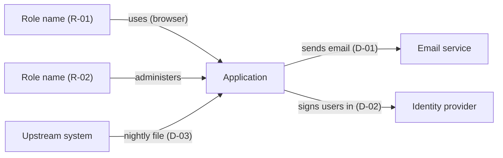

*Caption: <One sentence, e.g. "The application, its users and the external systems it depends on".>*

### Containers (C4 level 2)

> **Guide:** A container is anything separately deployed or run: web front end, API, worker, scheduled job, database, queue, file store. List every one. **Stores data** lists the ENG-04 entities held there (ENT IDs), or `None`; every container that stores data must map to entities (X-29).

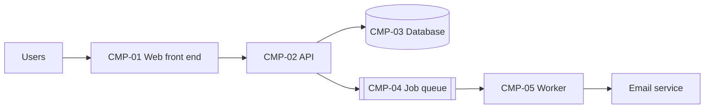

*Caption: <One sentence, e.g. "Deployable parts of the application and how they communicate".>*

| ID | Container | Technology | Responsibility | Stores data | Owner |
|---|---|---|---|---|---|
| CMP-01 | <Web front end> | <Framework and version> | <What it does> | <ENT-01, or None> | <Team or person> |

### Components of critical containers (Full)

> **Guide:** Only for containers where a change is risky or the internal structure is not obvious from the code layout. Show the main modules and how they depend on each other. Components also use `CMP` IDs.

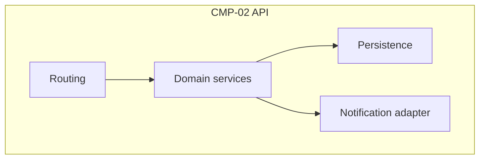

*Caption: <One sentence, e.g. "Main components inside the API and their dependencies".>*

| ID | Component | Container | Responsibility | Code location |
|---|---|---|---|---|
| CMP-10 | <Domain services> | <CMP-02> | <…> | <src/domain/> |

### Runtime view

> **Guide:** One sequence diagram for each of the 3–5 most important journeys in ENG-02: the ones that carry the core business value, change status, or touch an external system. Show how a request moves through the containers, where data is written, and what happens when an external call fails. The steps must match the journey (X-29).

#### <J-01 Journey name>

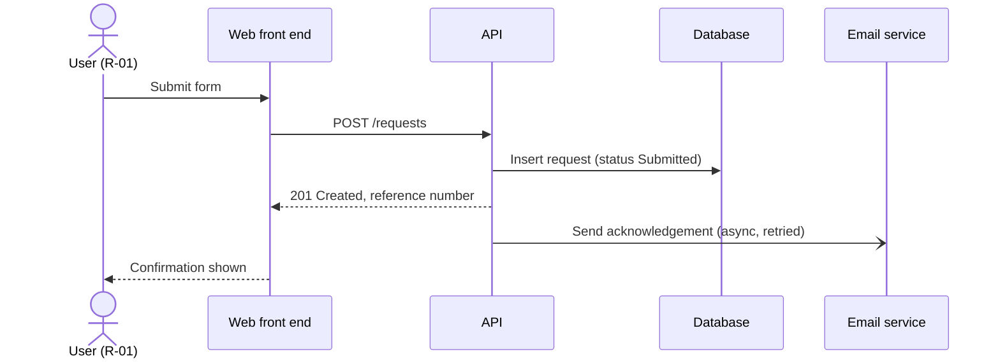

*Caption: <One sentence, e.g. "How a submitted request is validated, stored and acknowledged".>*

<Notes on failure handling for this flow, e.g. "If the email call fails, the job is retried 5 times over 1 h, then raises ALR-02.">

### Deployment view

> **Guide:** Show where each container runs in production, the network boundaries between them, and how users and external systems reach it. Name environments by their ENG-06 `ENV` IDs. Note anything that differs in non-production environments.

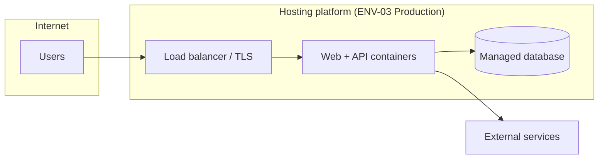

*Caption: <One sentence, e.g. "Production deployment and network boundaries".>*

| Container | Runs on | Region or site | Scaling | Environment notes |
|---|---|---|---|---|
| <CMP-01> | <Platform, service or server> | <…> | <Instances, autoscale rule> | <Differences in ENV-01, ENV-02> |

### Cross-cutting concepts

> **Guide:** One row per concept. Say what the approach is and where in the code it is implemented, so an agent reuses the pattern instead of inventing a second one. Write "Not used" rather than deleting a row.

| Concept | Approach | Where implemented | Notes |
|---|---|---|---|
| Authentication | <Method, e.g. single sign-on via the identity provider> | <path> | <…> |
| Authorisation | <Model, e.g. role-based; roles and permissions as in BUS-04> | <path> | <…> |
| Logging | <Format, levels, correlation ID, where logs go> | <path> | <No personal data in logs> |
| Error handling | <How errors are caught, shown to users and reported> | <path> | <…> |
| Auditing | <Which actions are recorded, where, for how long> | <path> | <…> |
| Caching | <What is cached, where, expiry> | <path> | <…> |
| Time zones and dates | <Stored in UTC; displayed in <zone>; date-only fields> | <path> | <…> |
| Internationalisation | <Languages, formats, how text is externalised> | <path> | <…> |
| <Other: validation, file handling, background jobs> | <…> | <…> | <…> |

### Quality goals

> **Guide:** The top three NFRs from ENG-01 that the design optimises for, in priority order, and how the design achieves each. When two goals conflict, this table says which wins.

| Priority | Quality goal | NFR | How the design achieves it |
|---|---|---|---|
| 1 | <Availability during business hours> | <NFR-01> | <…> |

### Security

> **Guide:** Required when T4 (personal or confidential data) or T11 (public-facing) is Yes, and at depth D+. Otherwise write one line: "No personal or confidential data and not public-facing; security follows <platform standard>." A threat model summary is required at D+ and whenever T4 or T11 is Yes.

**Authentication method:** <e.g. single sign-on with multi-factor authentication; service accounts for jobs>

**Authorisation model:** <e.g. role-based, roles and permissions as defined in BUS-04; enforced in <layer>>

**Trust boundaries:** <Where data crosses from less to more trusted zones, e.g. internet → load balancer, API → external service. Show them on the deployment view.>

**Encryption:** in transit <TLS version, where it terminates>; at rest <database, file store, backups>.

**Audit logging:** <Security-relevant events recorded: sign-in, permission change, data export, record deletion; where kept and for how long>

**Data classification by store:**

| Store | Highest classification held | Entities | Protection |
|---|---|---|---|
| <CMP-03 Database> | <Public / Internal / Confidential / Personal / Special-category> | <ENT-01, ENT-02> | <Encryption, access restriction, backup encryption> |

**Threat model summary:**

> **Guide:** List the main threats (for example using STRIDE: spoofing, tampering, repudiation, information disclosure, denial of service, elevation of privilege) against each trust boundary, and the control for each. Link residual risks to BUS-08 by `RISK` ID.

| Threat | Boundary or asset | Control | Residual risk |
|---|---|---|---|
| <Session hijacking> | <Browser → API> | <Secure cookies, short session lifetime> | <RISK-01, or None> |

### Technical risks and debt

> **Guide:** Things in the design that are known to be weak, temporary or risky. Each risk that could affect the business is also in BUS-08; give its `RISK` ID instead of repeating the assessment there. Debt is something you would do differently with time; say what triggers paying it off.

| Item | Type | Impact | Plan or trigger | Risk |
|---|---|---|---|---|
| <Single database instance, no replica> | <Risk / Debt> | <Outage during database maintenance> | <Add replica if availability target rises> | <RISK-02, or None> |

### Assumptions and open questions

| ID | Assumption or question | Owner | Due | Status |
|---|---|---|---|---|
| Q-01 | <…> | <…> | <YYYY-MM-DD> | <Open / Closed> |

### Known limitations

| ID | Limitation | Impact | Workaround | Owner |
|---|---|---|---|---|
| LIM-01 | <…> | <…> | <…, or None> | <…> |

### Change log

| Version | Date | Author | Summary | Approved by |
|---|---|---|---|---|
| 0.1 | <YYYY-MM-DD> | <Name> | First draft | — |

---

# templates/engineering/ENG-04-data-model.md

```yaml
id: ENG-04
title: Data Model
application: <Application name>
version: 0.1
status: Draft
owner: <Named person and role>
audience: [Engineering, Data owner, Agents]
level: <Foundation | Standard | Full>
depth: <D | D+>
contains: []
related: [BUS-05, BUS-06, ENG-03, ENG-07, ENG-08]
last_reviewed: <YYYY-MM-DD>
```
## <Application> – Data Model

> **How to use this template**
> - **Who writes it:** the lead engineer, with the data owner confirming classification and retention. An agent may draft from the schema, migrations and models; mark drafted content as inferred until confirmed.
> - **When it is due:** Draft by stage 3 (Build); Accepted by stage 3 (Build).
> - **Depth S** (section `## ENG-04 Data Model` in ENG-09): the entity table only, with the linked columns filled in (ID, Entity, Records, Classification, Retention). Keep every linked column (the linter checks them; other columns may be left out) and use level-3 subheadings named after this template's sections, so the section can later be promoted to its own file without restructuring.
> - **Depth D (Standard):** every section except those marked (Full).
> - **Depth D+ (Full):** every section, including (Full).
> - Delete this block and every `> **Guide:**` block before review, and replace every `<…>`.

### Purpose

<Two to four sentences. Example: "Describes the entities <Application> stores, their fields, keys and relationships, how they map to the business records in BUS-06, and how they are classified and kept. Engineers and agents use it to change the schema safely.">

### Scope

<Example: "Covers persistent entities in <stores>. Business meaning, ownership and retention rationale of records are in BUS-06; statuses in BUS-05; where each store runs in ENG-03; how migrations are deployed in ENG-07.">

### Entities

> **Guide:** One row per persistent entity (table, collection, document type, file set). Every entity stores at least one BUS-06 record (`Records`), and every record is stored by at least one entity (X-17). Join and log tables that hold no business record still list the record they support.
> - **System of record:** Yes when this application is the authoritative source; otherwise name the system that is (by `D` ID).
> - **Classification:** Public / Internal / Confidential / Personal / Special-category; at least as high as the records it holds.
> - **Retention:** the period from BUS-06, and how it is enforced (purge job, manual, archive).

| ID | Entity | Records | Description | System of record | Classification | Retention | Owner |
|---|---|---|---|---|---|---|---|
| ENT-01 | <request> | <REC-01> | <One sentence> | <Yes / No: D-03> | <Personal> | <7 years after closure; nightly purge job> | <Data owner> |

### Entity relationships

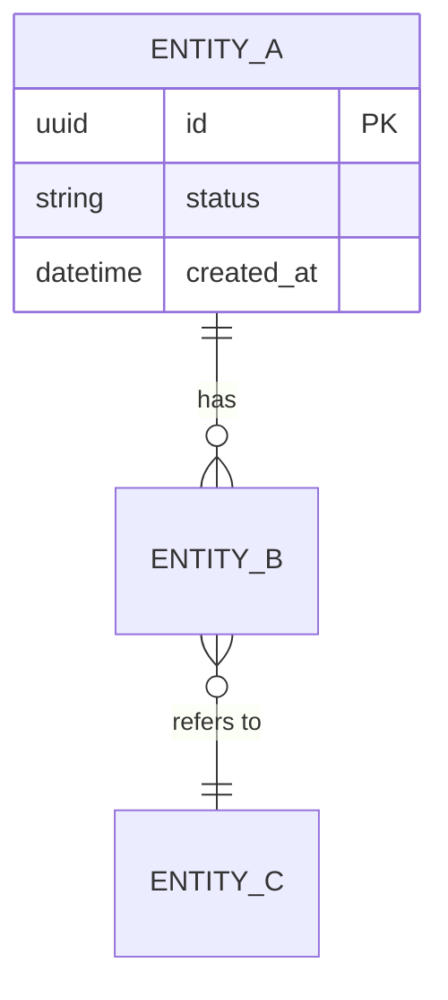

*Caption: <One sentence, e.g. "Main entities and their relationships".>*

### Entity details

> **Guide:** Repeat this block for each entity. List every field an engineer or agent might read or change. **Key** is PK, FK (with target), UK (unique) or blank. **Classification** is per field; mark the personal or confidential fields explicitly so logs, exports and test data can exclude them. A **status field** lists the BUS-05 status IDs it may hold, so lifecycle and data agree.

#### ENT-01 <Entity name>

**Store:** <CMP-03> · **Table or collection:** <name> · **Approximate volume:** <rows now, growth per year>

| Field | Type | Required | Constraints | Key | Classification | Notes |
|---|---|---|---|---|---|---|
| <id> | <uuid> | Yes | <…> | PK | Internal | <…> |
| <status> | <string> | Yes | <One of ST-01, ST-02, ST-03> | | Internal | <Changed only by transitions in BUS-05> |
| <customer_id> | <uuid> | Yes | <…> | FK → <ENT-02> | Internal | <…> |
| <email> | <string> | No | <Valid email, ≤ 254 chars> | | Personal | <Not written to logs> |

**Indexes:** <name: fields, purpose>

### Migrations

> **Guide:** Say how schema changes are written, named, reviewed, applied and reversed, so an agent writing a migration follows the same pattern. Deployment steps are in ENG-07; link rather than repeat.

| Item | Approach |
|---|---|
| Tool | <Migration tool and version> |
| Location | <path/to/migrations> |
| Naming | <e.g. timestamp_description> |
| How to create | <exact command, as in ENG-09> |
| How applied | <Automatically in the pipeline step, see ENG-07> |
| Reversibility | <Every migration has a down step / forward-only with a compensating migration> |
| Data migrations | <How data backfills are written and tested> |
| Destructive changes | <e.g. two-step: stop writing, then drop in a later release> |

### Reference data

> **Guide:** Lists, codes and settings that the business maintains (for example locations, categories, rates). Each needs an owner and an update process, or it silently goes stale.

| Reference data | Entity | Source | Owner | Update process | Frequency |
|---|---|---|---|---|---|
| <Resource list> | <ENT-03> | <Admin screen / seed file / upstream D-03> | <Role or person> | <…> | <…> |

### Data lifecycle and deletion (Full)

> **Guide:** For applications with personal or regulated data: how retention is enforced, how a deletion or subject-access request is fulfilled, what happens to backups, and how test environments are kept free of real personal data.

| Entity | Retention trigger | Deletion method | Backups | Evidence |
|---|---|---|---|---|
| <ENT-01> | <Closure date + 7 years> | <Nightly purge job; hard delete> | <Expires with backup retention, 35 days> | <Purge log, MT-03 in ENG-08> |

### Assumptions and open questions

| ID | Assumption or question | Owner | Due | Status |
|---|---|---|---|---|
| Q-01 | <…> | <…> | <YYYY-MM-DD> | <Open / Closed> |

### Known limitations

| ID | Limitation | Impact | Workaround | Owner |
|---|---|---|---|---|
| LIM-01 | <…> | <…> | <…, or None> | <…> |

### Change log

| Version | Date | Author | Summary | Approved by |
|---|---|---|---|---|
| 0.1 | <YYYY-MM-DD> | <Name> | First draft | — |

---

# templates/engineering/ENG-05-integrations-and-dependencies.md

```yaml
id: ENG-05
title: Integrations & Dependencies Register
application: <Application name>
version: 0.1
status: Draft
owner: <Named person and role>
audience: [Engineering, Support, Business owner, Agents]
level: <Foundation | Standard | Full>
depth: <D | D+>
contains: []
related: [BUS-02, BUS-07, BUS-08, ENG-03, ENG-04, ENG-06, ENG-08]
last_reviewed: <YYYY-MM-DD>
```
## <Application> – Integrations & Dependencies Register

> **How to use this template**
> - **Who writes it:** the technical owner, with the support owner and business owner for owners, impact and workarounds. An agent may draft from configuration, client libraries and infrastructure files; mark drafted content as inferred until confirmed.
> - **When it is due:** Draft by stage 3 (Build); Accepted by stage 4 (Verify).
> - **Depth S** (section `## ENG-05 Integrations & Dependencies Register` in ENG-09): the dependency register with its linked columns (ID, Dependency, Type, Owner, Criticality, Impact, Support path, Workaround, Runbook, Cost) and, when T5 is Yes, one interface row per integration. Keep every linked column (the linter checks them; other columns may be left out) and use level-3 subheadings named after this template's sections, so the section can later be promoted to its own file without restructuring.
> - **Depth D (Standard):** every section except those marked (Full).
> - **Depth D+ (Full):** every section, including (Full).
> - This document replaces DOC-07 Application Dependencies Register; its columns are kept.
> - Delete this block and every `> **Guide:**` block before review, and replace every `<…>`.

### Purpose

<Two to four sentences. Example: "Lists everything <Application> relies on and everything that relies on it, with owners, impact if unavailable, support paths and workarounds, and the contract for every data exchange. Support uses it during incidents; engineers use it when changing an integration; owners use it for renewals and costs.">

### Scope

<Example: "Covers systems, services, accounts, data, people, vendors and funding the application depends on, and downstream systems that depend on it. Runbook entries are in ENG-08, cost lines in BUS-07, connection settings and secret locations in ENG-06.">

### Dependency types

> **Guide:** Use exactly one of these values in the `Type` column (X-20).

| Type | Use for | Examples |
|---|---|---|
| Hosting | Website, platform, servers, containers, database service | Cloud platform, shared web hosting |
| Domain | Domain names, DNS, certificates | Registrar, DNS provider, TLS certificate |
| Email | Sending or receiving email and messages | Email delivery service, SMS gateway |
| Identity | Sign-in, user accounts, directory | Single sign-on provider, directory service |
| Integration | Another system the application exchanges data with; needs an interface entry | Finance system, partner API, file feed |
| Data | Business data the application uses but does not own | Reference lists, master data |
| Vendor | Third-party product or service provider not covered above | Reporting tool, payment provider support |
| Network | Connectivity, VPN, firewall rules | Office network, VPN to partner |
| People | A team or person whose work the application needs | Data steward, operations team |
| Process | A business or support process the application relies on | Access approval process, month-end close |
| Funding | Budget, subscription or contract that keeps it running | Annual licence, hosting budget |

### Dependency register

> **Guide:**
> - **Criticality:** High (a Must capability stops), Medium (degraded, workaround exists), Low (inconvenience).
> - **Impact:** what users and the business experience if it is unavailable, not the technical error.
> - **Support path:** who to contact and how (team, queue, phone, contract reference).
> - **Workaround:** what the business does meanwhile, or `None` stated explicitly.
> - **Runbook:** the ENG-08 runbook entry (RB IDs). Every High dependency needs one (X-21).
> - **Cost:** Yes when it costs money; it then needs a BUS-07 cost line (X-24).
> - **Renewal:** the next renewal or expiry date; it must match the BUS-07 licence and subscription line and the ENG-08 maintenance calendar.
> - **Capabilities affected:** must agree with the `Dependencies` column of BUS-02 (every High dependency is listed there by at least one capability, X-09).
> - **Direction:** Upstream (the application relies on it) or Downstream (it relies on the application).

| ID | Dependency | Type | Purpose | Owner | Criticality | Impact | Support path | Capabilities affected | Workaround | Runbook | Cost | Renewal | Direction | Notes |
|---|---|---|---|---|---|---|---|---|---|---|---|---|---|---|
| D-01 | <Email delivery service> | <Email> | <Sends notifications> | <Named person or team> | <High / Medium / Low> | <Requesters get no acknowledgement; staff not alerted> | <Vendor support portal, contract ref; internal: platform team> | <C-01, C-04> | <Staff phone requesters from the queue, or None> | <RB-01, or None> | <Yes / No> | <YYYY-MM-DD, or None> | <Upstream / Downstream> | <…> |

### Interfaces

> **Guide:** Required when T5 is Yes. One row per data exchange with another system: every dependency of type Integration has at least one (X-20). Never write a secret, password or token; name the secret by its ENG-06 `SEC` ID.
> - **Endpoint or location:** base URL, queue or folder, non-secret.
> - **Data exchanged:** ENG-04 entities (ENT IDs) and, briefly, which fields.
> - **Error and retry behaviour:** what happens on timeout, rejection or bad data, how many retries over what time, and where failures surface (ALR ID).
> - **Contract:** link to the OpenAPI document, schema, file specification or agreement.

| ID | Dependency | Direction | Protocol | Endpoint or location | Data exchanged | Trigger / frequency | Authentication | Error and retry behaviour | Contract | Other-side owner |
|---|---|---|---|---|---|---|---|---|---|---|
| INT-01 | <D-03> | <In / Out> | <REST / SOAP / file / SFTP / email / SSO / message queue> | <https://api.example.org/v2, or /exports/daily/> | <ENT-01: id, status, dates> | <On submit / nightly 02:00 / on demand> | <OAuth client credentials, SEC-02> | <3 retries with backoff over 15 min; then ALR-03> | <Link to schema or agreement> | <Team, contact> |

### Downstream consumers

> **Guide:** Systems, reports or teams that rely on this application. They are dependencies with Direction Downstream. Operators need to know whom to warn before maintenance and during an outage.

| Dependency | What they consume | Impact on them if this application fails | How they are told | Contact |
|---|---|---|---|---|
| <D-04> | <Daily export of confirmed records (INT-02)> | <Their monthly report is incomplete> | <Email to their support list; see ENG-08 Communication> | <Team, contact> |

### Interface details (Full)

> **Guide:** For integrations where a change on either side could break the other: versioning, limits and guarantees.

| Interface | Version and change policy | Rate limits | Idempotency | Ordering and duplicates | Service level from the other side | Test environment |
|---|---|---|---|---|---|---|
| <INT-01> | <v2; 90 days' notice of breaking change> | <100 requests/min> | <Idempotency key per request> | <…> | <99.9%, support hours> | <Sandbox URL, ENV-02> |

### Exit and substitution (Full)

> **Guide:** For High dependencies on a vendor or external platform: what it would take to replace it, and how data is recovered if the contract ends.

| Dependency | Data held by the vendor | How to export | Alternatives | Notice period | Effort to switch |
|---|---|---|---|---|---|
| <D-01> | <Delivery logs only> | <API export> | <…> | <30 days> | <2 person-days> |

### Assumptions and open questions

| ID | Assumption or question | Owner | Due | Status |
|---|---|---|---|---|
| Q-01 | <…> | <…> | <YYYY-MM-DD> | <Open / Closed> |

### Known limitations

| ID | Limitation | Impact | Workaround | Owner |
|---|---|---|---|---|
| LIM-01 | <…> | <…> | <…, or None> | <…> |

### Change log

| Version | Date | Author | Summary | Approved by |
|---|---|---|---|---|
| 0.1 | <YYYY-MM-DD> | <Name> | First draft | — |

---

# templates/engineering/ENG-06-configuration-and-environments.md

```yaml
id: ENG-06
title: Configuration & Environments
application: <Application name>
version: 0.1
status: Draft
owner: <Named person and role>
audience: [Engineering, Technical operators, Agents]
level: <Foundation | Standard | Full>
depth: <D | D+>
contains: []
related: [ENG-03, ENG-05, ENG-07, ENG-08, ENG-09]
last_reviewed: <YYYY-MM-DD>
```
## <Application> – Configuration & Environments

> **How to use this template**
> - **Who writes it:** the technical owner or lead engineer. An agent may draft from environment files, infrastructure code and the configuration loader; mark drafted content as inferred until confirmed.
> - **When it is due:** Draft by stage 3 (Build); Accepted by stage 5 (Go-live).
> - **Depth S** (section `## ENG-06 Configuration & Environments` in ENG-09, the default at Foundation and Standard): the environments table, and the secrets table with locations and owners. List configuration items and feature flags only if there are any that an operator would change. Keep every linked column (the linter checks them; other columns may be left out) and use level-3 subheadings named after this template's sections, so the section can later be promoted to its own file without restructuring.
> - **Depth D (Standard):** every section.
> - **Depth D+ (Full):** the same as D. No section is marked (Full), and the depth matrix never sets this item to D+.
> - **Never write a secret value** (password, key, token, connection string with credentials) in this or any document. Record where it is stored and who owns it.
> - Delete this block and every `> **Guide:**` block before review, and replace every `<…>`.

### Purpose

<Two to four sentences. Example: "Lists the environments <Application> runs in and the configuration, secrets and feature flags it reads, so operators and agents can run, configure and promote it without guessing. Secret values are never recorded; only where they are kept.">

### Scope

<Example: "Covers all environments from local development to production. How code moves between environments is in ENG-07; where each container runs is in ENG-03; local setup commands are in ENG-09.">

### Environments

> **Guide:** One row per environment, including local development if it is shared or scripted. **Data** must say whether it holds real data; an environment with real personal data needs the same access control as production.

| ID | Environment | Purpose | URL | Data | Access | Hosting | Deployed from |
|---|---|---|---|---|---|---|---|
| ENV-01 | <Development> | <Shared integration testing> | <https://dev.example.org> | <Synthetic / Copy of production, masked / Real> | <Engineering team via SSO> | <Platform, account or project> | <main branch, on merge> |

### Configuration items

> **Guide:** Every setting the application reads at start-up or run time that is not a secret. **Value source** says where each environment's value comes from (environment variable, configuration file path, parameter store key), not the value itself when it differs per environment. **Who may change** names a role; changing production configuration is a change under ENG-08 Change management.

| ID | Name | Purpose | Default | Value source per environment | Who may change | Restart needed |
|---|---|---|---|---|---|---|
| CFG-01 | <APP_BASE_URL> | <Public base URL used in emails> | <http://localhost:3000> | <ENV-01: pipeline variable; ENV-03: parameter store /app/prod/base_url> | <Technical owner> | <Yes / No> |

### Secrets

> **Guide:** Name and location only. **Stored in** is the vault, secret manager or pipeline secret store and the key path. **Rotation** gives the interval and how it is done (or a runbook entry). Rotation dates that must not be missed also go in the ENG-08 maintenance calendar.

| ID | Name | Purpose | Stored in | Used by | Rotation | Owner | Last rotated |
|---|---|---|---|---|---|---|---|
| SEC-01 | <DATABASE_URL> | <Database connection for the API> | <Secret manager: /app/prod/db_url> | <CMP-02> | <Every 90 days; RB-05> | <Named person> | <YYYY-MM-DD> |

### Feature flags

> **Guide:** Every flag is temporary unless stated. **Removal criteria** says when the flag and its dead code path are deleted; a flag with no removal criteria becomes permanent configuration and should be listed as a configuration item instead. Write "No feature flags." if there are none.

| ID | Flag | Purpose | Owner | Default | State per environment | Removal criteria | Added |
|---|---|---|---|---|---|---|---|
| FLAG-01 | <new_review_screen> | <Gradual rollout of the redesigned review screen> | <Product owner> | <Off> | <ENV-01 On; ENV-03 Off> | <Remove 2 weeks after 100% rollout with no Sev1–Sev2 incidents> | <YYYY-MM-DD> |

### Promotion and parity

> **Guide:** How a configuration change reaches each environment, and the known differences between environments that can make something pass in test and fail in production.

<How configuration changes are made and promoted, e.g. "Pull request to infrastructure repository; applied by pipeline; production requires technical owner approval".>

| Difference | Environments | Why | Risk |
|---|---|---|---|
| <Email sending disabled; messages captured instead> | <ENV-01, ENV-02> | <Avoid emailing real users> | <Email templates not tested end to end before production> |

### Assumptions and open questions

| ID | Assumption or question | Owner | Due | Status |
|---|---|---|---|---|
| Q-01 | <…> | <…> | <YYYY-MM-DD> | <Open / Closed> |

### Known limitations

| ID | Limitation | Impact | Workaround | Owner |
|---|---|---|---|---|
| LIM-01 | <…> | <…> | <…, or None> | <…> |

### Change log

| Version | Date | Author | Summary | Approved by |
|---|---|---|---|---|
| 0.1 | <YYYY-MM-DD> | <Name> | First draft | — |

---

# templates/engineering/ENG-07-deployment-and-release.md

```yaml
id: ENG-07
title: Deployment & Release Guide
application: <Application name>
version: 0.1
status: Draft
owner: <Named person and role>
audience: [Technical operators, Release managers, Engineering, Agents]
level: <Foundation | Standard | Full>
depth: <D | D+>
contains: []
related: [BUS-09, ENG-04, ENG-06, ENG-08, ENG-09, SP-11, SP-12]
last_reviewed: <YYYY-MM-DD>
```
## <Application> – Deployment & Release Guide

> **How to use this template**
> - **Who writes it:** the technical owner or release manager. An agent may draft from pipeline definitions and deployment scripts; mark drafted content as inferred until confirmed. Someone who did not write it must dry-run it before it is Accepted.
> - **When it is due:** Draft by stage 4 (Verify); Accepted by stage 5 (Go-live). Never dropped: how to run and deploy the application is always in scope.
> - **Depth S** (section `## ENG-07 Deployment & Release Guide` in ENG-09): how to deploy to production as numbered steps, the smoke test that proves it worked, when to roll back and the rollback steps, and the dry-run record. Keep every linked column (the linter checks them; other columns may be left out) and use level-3 subheadings named after this template's sections, so the section can later be promoted to its own file without restructuring.
> - **Depth D (Standard):** every section except those marked (Full).
> - **Depth D+ (Full):** every section, including (Full).
> - Delete this block and every `> **Guide:**` block before review, and replace every `<…>`.

### Purpose

<Two to four sentences. Example: "Explains how a change gets from a merged commit to production for <Application>, how to check it worked, and how to roll it back. An operator who did not build the system must be able to follow it.">

### Scope

<Example: "Covers the build and release pipeline, versioning, deployment to each environment, verification, rollback, database migrations and release notes. Environments and configuration are in ENG-06; incident handling after a failed release is in ENG-08.">

### Pipeline

> **Guide:** Every step from merge to production, in order. Say what triggers it, what it does, who must approve, and what happens if it fails. Link the pipeline definition file.

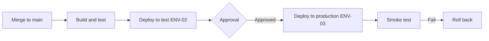

*Caption: <One sentence, e.g. "Release pipeline from merge to production, with the approval gate and rollback path".>*

| Step | Trigger | What it does | Approval | Where defined | On failure |
|---|---|---|---|---|---|
| <1 Build and test> | <Merge to main> | <Runs lint, unit and integration tests; builds image tagged with version> | <None> | <path/to/pipeline.yml> | <Pipeline stops; author fixes> |

### Versioning

<Scheme and where the version is visible, e.g. "Semantic versioning MAJOR.MINOR.PATCH; tag vX.Y.Z on main; version shown in the page footer and the /health response".>

### Pre-deployment checklist

> **Guide:** Things a person must confirm before a production deployment. Remove items that do not apply; add ones that bit you before.

- [ ] All Must application acceptance criteria affected by the change pass in the test environment (SP-11).
- [ ] Database migrations reviewed, tested on a copy of production data, and their rollback understood (below).
- [ ] Configuration, secret and feature flag changes are in place in ENG-06 and in the target environment.
- [ ] Release notes written (below).
- [ ] Users and downstream consumers told about downtime or visible changes (ENG-08 Communication, ENG-05 Downstream consumers).
- [ ] A person able to roll back is available for the monitoring window.
- [ ] <Other: change approval reference, freeze calendar checked>

### Deployment steps

> **Guide:** One block per environment, starting with production. Steps are numbered, exact, and copy-pasteable where they are commands. Each environment ends with **verification**: smoke tests a person or script runs to prove the deployment worked, with the expected result.

#### Deploy to <ENV-03 Production>

1. <Exact step, e.g. "Approve the 'deploy-production' job in the pipeline for tag vX.Y.Z.">
2. <…>

**Verification (smoke tests):**

| Check | How | Expected result |
|---|---|---|
| <Health check> | <`curl https://app.example.org/health`> | <HTTP 200, body shows version X.Y.Z> |
| <Core journey works> | <Create a test request as the smoke-test user (J-01)> | <Request reaches Submitted (ST-01) and acknowledgement email is captured> |

#### Deploy to <ENV-02 Test>

<Steps, or "Automatic on merge to main; verification as for production using the test URL".>

### Rollback

> **Guide:** Decide the criteria before you need them, so nobody argues during an incident. Rollback steps must be exact and end with verification.

**Roll back when any of these is true:**

| Signal | Threshold | Decision |
|---|---|---|
| <Smoke test fails> | <Any check fails> | <Roll back immediately> |
| <Error rate> | <Above 2% of requests for 5 min within the monitoring window> | <Roll back; declare incident per ENG-08> |
| <Core journey broken for users> | <Any confirmed report> | <Roll back unless a fix can ship within 30 min> |

**Who decides:** <Role on duty during the deployment; escalate to technical owner>

**Steps:**

1. <Exact step, e.g. "Re-run the 'deploy-production' job for the previous tag vX.Y.(Z-1).">
2. <Database: see Database migrations below before rolling back code that changed the schema.>
3. <…>

**Verification after rollback:** <Run the production smoke tests above; confirm version shown is the previous one; post the outcome per ENG-08 Communication.>

### Database migrations

> **Guide:** How migrations run during deployment and how they are reversed. Say plainly whether code can be rolled back without reversing the migration (backward-compatible changes) and what to do when it cannot. The migration approach itself is in ENG-04.

| Item | Approach |
|---|---|
| When migrations run | <Pipeline step before new code starts> |
| Compatibility rule | <Each migration works with the previous release's code, so code rollback never needs a schema rollback> |
| How to reverse | <Exact command, or "forward-only: write a compensating migration"> |
| Data-changing migrations | <Take an on-demand backup first (ENG-08 Backup and restore)> |

### Release notes

> **Guide:** Release notes are the source for the "What's new" section of BUS-09, which links each version to its entry here in its `Release` column. Write them for users, not engineers: what changed, what they need to do differently.

**Location:** <e.g. `CHANGELOG.md` in the repository, and BUS-09 What's new>

**Format:**

```markdown
## vX.Y.Z – YYYY-MM-DD
### New
- <What users can now do, in their words>
### Changed
- <Behaviour that is different, and what to do now>
### Fixed
- <Problem that no longer happens>
### For administrators and support
- <Configuration, access or support changes>
```

### Post-deployment monitoring

<Length of the monitoring window and what to watch, e.g. "For 60 minutes after a production deployment, the deploying engineer watches the dashboard in ENG-08: error rate, p95 latency, job queue age. Any rollback criterion met → roll back.">

### Emergency release (Full)

> **Guide:** The shortened path for an urgent fix: which steps may be skipped, who must approve, and what must be done afterwards. Must match the emergency change type in ENG-08 Change management.

<…>

### Progressive delivery (Full)

> **Guide:** If releases are rolled out gradually (feature flags, canary, blue-green), describe the stages, how far each goes, and the signal to proceed or stop.

| Stage | Exposure | Duration | Proceed when | Stop when |
|---|---|---|---|---|
| <Canary> | <5% of traffic> | <30 min> | <Error rate ≤ baseline> | <Any rollback criterion met> |

### Dry-run record

> **Guide:** Before go-live, someone who did not write this guide performs a deployment and a rollback in a non-production environment by following it exactly. Record it honestly; this is the evidence SP-12 and gate G6 need. Never fill in a dry run that did not happen.

| Procedure | Performed by | Date | Environment | Result | Issues found | Evidence |
|---|---|---|---|---|---|---|
| <Deployment> | <Name, role> | <YYYY-MM-DD> | <ENV-02> | <Pass / Fail> | <…, or None> | <Link to log or recording> |
| <Rollback> | <Name, role> | <YYYY-MM-DD> | <ENV-02> | <Pass / Fail> | <…, or None> | <…> |

### Assumptions and open questions

| ID | Assumption or question | Owner | Due | Status |
|---|---|---|---|---|
| Q-01 | <…> | <…> | <YYYY-MM-DD> | <Open / Closed> |

### Known limitations

| ID | Limitation | Impact | Workaround | Owner |
|---|---|---|---|---|
| LIM-01 | <…> | <…> | <…, or None> | <…> |

### Change log

| Version | Date | Author | Summary | Approved by |
|---|---|---|---|---|
| 0.1 | <YYYY-MM-DD> | <Name> | First draft | — |

---

# templates/engineering/ENG-08-operations-and-support-runbook.md

```yaml
id: ENG-08
title: Operations & Support Runbook
application: <Application name>
version: 0.1
status: Draft
owner: <Named person and role>
audience: [Support desk, Technical operators, Business owner, Agents]
level: <Foundation | Standard | Full>
depth: <D | D+>
contains: []
related: [BUS-01, BUS-04, BUS-06, BUS-08, BUS-09, ENG-01, ENG-03, ENG-05, ENG-06, ENG-07, SP-10, SP-12]
last_reviewed: <YYYY-MM-DD>
```
## <Application> – Operations & Support Runbook

> **How to use this template**
> - **Who writes it:** the support owner, with the technical owner for monitoring, runbook entries, backup and recovery, and the business owner for business support and communication. Validate it with the people who will actually do the support.
> - **When it is due:** Draft by stage 4 (Verify); Accepted by stage 5 (Go-live). Never dropped: who supports the application, and how to reach them, is always in scope.
> - **Depth S** (section `## ENG-08 Operations & Support Runbook` in ENG-09): the ownership model, support intake (how users get help), the triage guide with dependency checks, the health check and where to look when it fails, backup and restore with the last restore test, and a runbook entry for each High dependency. Add output checks when T6 is Yes and scheduled job monitoring when T7 is Yes. Keep every linked column (the linter checks them; other columns may be left out) and use level-3 subheadings named after this template's sections, so the section can later be promoted to its own file without restructuring.
> - **Depth D (Standard):** every section except those marked (Full).
> - **Depth D+ (Full):** every section, including (Full).
> - This document replaces DOC-08 Support and Operations Guide; all its sections are kept.
> - Delete this block and every `> **Guide:**` block before review, and replace every `<…>`.

### Purpose

<Two to four sentences. Example: "Tells support staff and operators how <Application> is supported and kept running after go-live: who handles what, how issues are triaged and escalated, what is monitored, what to do when something fails, how data is backed up and restored, and how we check its outputs are right.">

### Scope

<Example: "Covers business support, technical support, monitoring, incidents, runbook entries, backup, recovery, maintenance, output checks and change management. Dependencies are defined in ENG-05, deployment and rollback in ENG-07, user instructions in BUS-09, access rules in BUS-04.">

### Ownership model

> **Guide:** Separate business support (questions about the process, decisions, data meaning) from technical support (the system is broken). Name people or teams, not "the team". Every area needs a backup owner and an escalation owner.

| Area | Primary owner | Backup owner | Escalation owner | Notes |
|---|---|---|---|---|
| Business process questions | <…> | <…> | <…> | <…> |
| User access and roles | <…> | <…> | <…> | <Follows BUS-04> |
| Record correction | <…> | <…> | <…> | <…> |
| System issue | <…> | <…> | <…> | <…> |
| Reports and outputs | <…> | <…> | <…> | <…> |
| Dependencies | <…> | <…> | <…> | <See ENG-05 support paths> |

### Support intake

> **Guide:** How a user gets help. Give the real channel (address, form, queue, phone) and what the user must include so the first responder does not have to ask.

| Issue type | First contact | Required information | Expected handling | Escalation path |
|---|---|---|---|---|
| <Cannot sign in> | <Service desk form, link> | <User name, time, screenshot of the error> | <Access owner checks role within 1 working day> | <Technical owner if SSO fault> |

### Service levels

> **Guide:** Support hours and response and resolution targets per incident severity (defined below), plus the operational service level objectives (SLOs). SLOs are the L3 success measures in SP-10: every L3 measure has one row here, referenced by `SM` ID with the same numbers, and names the alert that fires on breach.

**Support hours:** <e.g. Monday–Friday 08:00–17:00 local time, excluding public holidays. Outside hours: best effort, or the on-call rota.>

| Severity | Response target | Update interval | Resolution or workaround target |
|---|---|---|---|
| Sev1 | <30 min in support hours> | <Every 1 h> | <4 h> |
| Sev2 | <2 h> | <Every 4 h> | <1 working day> |
| Sev3 | <1 working day> | <On change> | <5 working days> |
| Sev4 | <3 working days> | <On change> | <Next planned release> |

| Measure | SLI | SLO | Window | Alert |
|---|---|---|---|---|
| <SM-05> | <Successful requests ÷ all requests at the load balancer> | <≥ 99.5%> | <Rolling 30 days> | <ALR-01> |

### Triage guide

> **Guide:** One row per category of issue a support person will meet. **Initial checks** are things the first responder can do without engineering access. **Dependencies** names the ENG-05 dependencies to check, by `D` ID, or `None` (X-15). **Escalate when** is a concrete condition, not "if needed".

| Category | Examples | Owner | Initial checks | Dependencies | Escalate when |
|---|---|---|---|---|---|
| Access issue | <Cannot sign in; missing menu item> | <…> | <User's role in the admin screen; account active> | <D-02> | <Role is correct and the problem persists> |
| Data correction | <Wrong date on a record> | <…> | <Record history; who changed it> | <None> | <Correction needs a status the user cannot set> |
| Process question | <Why was my request returned?> | <…> | <BUS-09 Concepts; record history> | <None> | <Rule seems wrong (BUS-05 rule owner)> |
| System error | <Error page; page will not load> | <…> | <Health check; status page; recent deployment> | <D-…> | <Health check fails or more than one user affected> |
| Notification issue | <Email not received> | <…> | <Spam folder; notification log> | <D-01> | <Several users affected> |
| Report issue | <Totals look wrong> | <…> | <Run the related output check (OC)> | <…> | <Output check fails> |

### Dependency checks during incidents

> **Guide:** A symptom map: when users see this, check these dependencies first. Each row points to the runbook entry that says what to do.

| Symptom | Dependencies | Owner | Runbook | Notes |
|---|---|---|---|---|
| <No emails being received> | <D-01> | <…> | <RB-01> | <Check provider status page first> |

### Access support

> **Guide:** How support handles account creation, role changes and access removal, following BUS-04. Include urgent removal (for example when someone leaves suddenly).

| Request | Who may request | Who approves | Who performs | How | Target time |
|---|---|---|---|---|---|
| <New account> | <Line manager> | <Access approver from BUS-04> | <Administrator R-…> | <BUS-09 admin task> | <2 working days> |
| <Urgent removal> | <Manager, security> | <None needed> | <…> | <…> | <1 h in support hours> |

### Monitoring and alerting

> **Guide:** What "normal" looks like and where to look. Every alert has an owner and links to at least one runbook entry (X-21); an alert with no runbook entry is noise. Prefer few, actionable alerts.

**Health check:** <URL or command, what it checks, expected response>

**Dashboards:** <Link and what each shows>

**Logs:** <Where they are, how to search them, retention, how to find one request by correlation ID>

| Signal | Source | Normal range | Where to see it |
|---|---|---|---|
| <Error rate> | <Load balancer logs> | <Below 0.5% of requests> | <Dashboard link> |

| ID | Alert | Threshold | Meaning | Severity | Owner | Notifies | Runbook |
|---|---|---|---|---|---|---|---|
| ALR-01 | <High error rate> | <Above 2% 5xx responses over 5 min> | <Users are seeing errors> | <Sev2> | <…> | <Channel, on-call> | <RB-02> |

### Scheduled jobs

> **Guide:** Required when T7 is Yes; otherwise write "No scheduled jobs." Every job needs a way to tell it ran and succeeded, an alert when it does not, and a runbook entry for re-running it safely.

| Job | Schedule | Purpose | Component | Success signal | Alert | Runbook |
|---|---|---|---|---|---|---|
| <Nightly export> | <02:00 daily> | <Sends confirmed records to D-04> | <CMP-05> | <Export file present, row count logged> | <ALR-03> | <RB-03> |

### Incident management

> **Guide:** Shared definitions so everyone agrees how bad something is. Examples make the definitions usable.

| Severity | Definition | Examples | Who is told |
|---|---|---|---|
| Sev1 | <Service unavailable or data loss or breach, many users affected> | <Nobody can sign in; data exposed> | <Business owner, technical owner, users> |
| Sev2 | <A Must capability is unavailable or wrong; workaround is hard> | <Requests cannot be submitted> | <Business owner, technical owner> |
| Sev3 | <Degraded; workaround exists> | <Reports delayed> | <Support owner> |
| Sev4 | <Minor or cosmetic> | <Typo on a screen> | <Logged only> |

**Who declares an incident:** <Any support person or operator can declare Sev3–Sev4; Sev1–Sev2 by the named on-call or support owner.>

**Communication templates:**

```text
Initial: [Sev<n>] <Application> – <what users see>. Started <time>. We are investigating. Next update by <time>.
Update:  [Sev<n>] <Application> – <what we know, what we are doing, workaround>. Next update by <time>.
Resolved:[Sev<n>] <Application> – resolved at <time>. Cause: <one line>. <Any action users need to take>.
```

**Post-incident review:** <Required for every Sev1 and Sev2 within 5 working days; blameless; records timeline, cause, impact, actions with owners. New failure modes get a runbook entry here and a risk in BUS-08. Store reviews at <location>.>

### Runbook entries

> **Guide:** One entry per alert, per High dependency (X-21), per scheduled job and per failure mode learned from incidents. Write for an operator at 03:00 who has never seen the code: exact commands, exact places to look, and how to tell the fix worked. Every entry ends with a **verification** step and an **escalation** contact.

| ID | Failure mode | Triggered by | Dependencies | Owner |
|---|---|---|---|---|
| RB-01 | <Emails not being delivered> | <ALR-02, triage "Notification issue"> | <D-01> | <…> |

#### RB-01 <Failure mode>

- **Symptom:** <What users or monitoring see>
- **Diagnosis:**
  1. <Check, with exact command or link, and what each result means>
  2. <…>
- **Fix:**
  1. <Exact step>
  2. <…>
- **Verification:** <How to prove it is fixed, e.g. "Send a test notification; it arrives within 2 min; ALR-02 clears.">
- **Escalation:** <Who, how, after how long; vendor support path from ENG-05>

### Backup and restore

> **Guide:** What is backed up and how to get it back. A backup that has never been restored is a hope, not a backup: record the last restore test honestly, including failures. Frequency and retention must meet the RPO in ENG-01.

| Data or store | Method | Frequency | Retention | Location | Encrypted | Owner |
|---|---|---|---|---|---|---|
| <CMP-03 Database> | <Managed snapshots + point-in-time log> | <Daily + continuous> | <35 days> | <Separate account or region> | <Yes> | <…> |

#### Restore procedure

1. <Exact step, e.g. "Create a new database instance from the snapshot or point in time.">
2. <…>
3. **Verification:** <e.g. "Record counts for ENT-01 match the last known count within the RPO; open the application and find a known recent record.">

#### Restore tests

| Date | Performed by | What was restored | Environment | Time taken | Result | Evidence |
|---|---|---|---|---|---|---|
| <YYYY-MM-DD, or "Not yet tested"> | <Name> | <Full database to point in time> | <ENV-02> | <1 h 20 min> | <Pass / Fail> | <Link> |

### Disaster recovery and continuity

> **Guide:** RTO and RPO here must be identical to the recoverability NFRs in ENG-01; reference them by ID. The **manual business fallback** is what the business does while the system is down, drawn from the ENG-05 workarounds.

| Objective | Value | Requirement |
|---|---|---|
| Recovery time objective (RTO) | <≤ 4 h> | <NFR-02> |
| Recovery point objective (RPO) | <≤ 24 h> | <NFR-03> |

**Manual business fallback:** <What users do while the application is unavailable, who decides to invoke it, and how data captured meanwhile is entered afterwards.>

#### Disaster recovery procedure (Full)

> **Guide:** Steps to rebuild the service in a different location or from nothing (lost account, region outage, ransomware), in order, with the expected time per step. Total must fit within the RTO.

1. <…>

#### Disaster recovery tests (Full)

**Cadence:** <e.g. yearly, and after any major architecture change>

| Date | Scenario | Performed by | Achieved RTO | Achieved RPO | Result | Actions |
|---|---|---|---|---|---|---|
| <YYYY-MM-DD> | <Region loss> | <…> | <…> | <…> | <Pass / Fail> | <…> |

### Routine operations

> **Guide:** Day-to-day or weekly tasks that keep the application useful (clearing queues, reviewing stuck records, answering access requests). Calendar items with due dates go in the maintenance calendar below. Routine tasks and calendar tasks share the `MT` numbering, so BUS-07 can count the effort of each one by ID.

| ID | Task | Frequency | Owner | Procedure | Evidence of completion |
|---|---|---|---|---|---|
| MT-01 | <Review records stuck in a status for more than 5 days> | <Weekly> | <…> | <BUS-09 admin task or RB ID> | <Ticket or log entry> |

### Maintenance calendar

> **Guide:** Tasks that must happen on a date or a cycle, or something expires. Include every certificate, domain, licence and secret rotation that can lapse, with the next due date. Missed renewals are a common cause of outages. Renewal dates must match ENG-05 `Renewal` and the BUS-07 licence lines.

| ID | Task | Type | Frequency | Next due | Owner | Procedure | Evidence |
|---|---|---|---|---|---|---|---|
| MT-02 | <Renew TLS certificate for app domain> | <Patching / Certificate / Domain / Licence / Dependency upgrade / Access review / Data purge / Secret rotation> | <Yearly, or automatic> | <YYYY-MM-DD> | <…> | <RB ID or link> | <Where completion is recorded> |

### Output checks

> **Guide:** Required when T6 is Yes; otherwise write "No outputs others rely on." These are the L4 output-correctness checks from SP-10: repeatable checks that what the application produces is right, not only that it is running. Every record with `Core` = Yes in BUS-06 is covered by at least one check (X-23).
>
> **Type:** Invariant (a rule that must always hold, from BUS-05) · Reconciliation (two sources must agree) · Completeness (everything that should exist does) · Sample audit (a person checks a sample against the source) · Golden data (a fixed input must give a known output).

| ID | Check | Type | Records | Procedure | Frequency | Owner | On failure |
|---|---|---|---|---|---|---|---|
| OC-01 | <No resource is confirmed twice for overlapping dates> | <Invariant> | <REC-01> | <Run query `checks/double_booking.sql`; expect zero rows> | <Daily, automated> | <…> | <Raise ALR-04; follow RB-04; tell the record owner> |

### Known issues

> **Guide:** Open defects or operational quirks support should know about, with the workaround to give users. Permanent limitations go in Known limitations below (and SP-12).

| Issue | Symptom | Workaround | Owner | Target date | Tracking |
|---|---|---|---|---|---|
| <…> | <…> | <…> | <…> | <YYYY-MM-DD> | <Ticket link> |

### Communication

> **Guide:** Who tells users and stakeholders about outages, planned maintenance, changes and completed fixes, through which channel, and how far in advance. Include downstream consumers from ENG-05.

| Event | Who communicates | To whom | Channel | When |
|---|---|---|---|---|
| <Planned maintenance> | <Support owner> | <All users, downstream consumers> | <Email, banner> | <3 working days before> |
| <Incident Sev1–Sev2> | <Incident lead> | <Affected users, business owner> | <Status page, email> | <Within response target, then per update interval> |

### Change management

> **Guide:** How changes after go-live are requested, assessed, approved and communicated. Releases follow ENG-07; this section decides whether a change may go ahead.

| Change type | Definition | Examples | Approval | Lead time | Communication |
|---|---|---|---|---|---|
| Standard | <Pre-approved, low-risk, repeatable> | <Add a reference data value; rotate a secret> | <None beyond the procedure> | <None> | <None, or log> |
| Normal | <Anything else> | <New feature, schema change> | <Technical owner; business owner if user-visible> | <n working days> | <Release notes; user notice if visible> |
| Emergency | <Fix needed to resolve a Sev1–Sev2> | <Hotfix> | <Named role, recorded afterwards> | <None> | <Incident updates; review afterwards> |

**How to request a change:** <Channel, required information, who assesses it>

### Assumptions and open questions

| ID | Assumption or question | Owner | Due | Status |
|---|---|---|---|---|
| Q-01 | <…> | <…> | <YYYY-MM-DD> | <Open / Closed> |

### Known limitations

| ID | Limitation | Impact | Workaround | Owner |
|---|---|---|---|---|
| LIM-01 | <…> | <…> | <…, or None> | <…> |

### Change log

| Version | Date | Author | Summary | Approved by |
|---|---|---|---|---|
| 0.1 | <YYYY-MM-DD> | <Name> | First draft | — |

---

# templates/engineering/ENG-09-developer-and-agent-guide.md

```yaml
id: ENG-09
title: Developer & Agent Guide
application: <Application name>
version: 0.1
status: Draft
owner: <Named person and role>
audience: [Developers, Agents, Technical operators]
level: <Foundation | Standard | Full>
depth: <D | D+>
contains: []
related: [BUS-01, ENG-01, ENG-03, ENG-04, ENG-06, ENG-07, ENG-10, SP-01, SP-11]
last_reviewed: <YYYY-MM-DD>
```
## <Application> – Developer & Agent Guide

> **How to use this template**
> - **Who writes it:** the technical owner or lead developer. An agent may draft it from the repository, but every command must then be run and its "Verified on" date filled in by whoever ran it.
> - **When it is due:** Draft by stage 3 (Build); Accepted by stage 5 (Go-live).
> - **Where it lives:** at **Foundation** level this document *is* the root `AGENTS.md`, and it also holds the other engineering items the Scope Record sets to S (see "Documents held as sections" below). At **Standard** and **Full** it is `docs/ENG-09-developer-and-agent-guide.md`, and the root `AGENTS.md` is the short pointer shown below.
> - **Depth S** is not used for this item. When trigger T10 is No, this may be a short README with the commands, the repository map and the update-trigger table.
> - **Depth D (Standard):** every section; this item is always at least D (floor rule F3 and trigger T10).
> - **Depth D+ (Full):** the same as D. No section is marked (Full).
> - Keep it short enough that an agent reads all of it before every task: link to other documents for detail.
> - Delete this block and every `> **Guide:**` block before review, and replace every `<…>`.

### Purpose

<Two to four sentences. Example: "The first thing a developer or AI agent reads before changing <Application>. It explains where things are, the exact commands to build, run and test, the conventions to follow, how to make a change safely, what an agent may and may not do alone, and which documents to update with each kind of change.">

### Scope

<Example: "Covers working on the code in this repository. What the application is for is in BUS-01; how it is designed in ENG-03; deployment in ENG-07; operations in ENG-08.">

### What this application is

> **Guide:** One paragraph: what it does, for whom, and the one or two things that make it unusual. Link BUS-01 for the full picture.

<One paragraph.> See BUS-01 for the business case and owners.

### Repository map

> **Guide:** The directories a newcomer needs, one line each. Skip generated and vendored folders, but say they are generated so nobody edits them.

```text
<repo>/
  AGENTS.md            This guide (Foundation) or a pointer to it
  docs/                Application documentation (see ENG-09 "Where to find things")
  src/<…>/             <What lives here>
  tests/               <Unit and integration tests; how they are organised>
  migrations/          <Database migrations, see ENG-04>
  <infra/>             <Infrastructure and pipeline definitions, see ENG-07>
  <build/>             Generated – do not edit
```

### Prerequisites

| Tool | Version | How to get it | Notes |
|---|---|---|---|
| <Runtime> | <x.y> | <Install link or version manager file> | <…> |
| <Database> | <x.y> | <Local container: `docker compose up db`> | <…> |

<Accounts or access needed, e.g. "Read access to the secret store for ENV-01; ask <owner>.">

### Commands

> **Guide:** Exact, copy-pasteable commands run from the repository root. **Verified on** is the date someone last ran the command and it worked, with their name. A command that has not been run is written `Not verified` and gets a `Q-xx`. Agents rely on these literally: an out-of-date command costs every future task.

| Task | Command | Expected result | Verified on |
|---|---|---|---|
| Install | <`npm ci`> | <Exits 0> | <YYYY-MM-DD, name> |
| Run locally | <`npm run dev`> | <App on http://localhost:3000> | <YYYY-MM-DD, name> |
| Test | <`npm test`> | <All tests pass in ≤ 5 min> | <YYYY-MM-DD, name> |
| Lint and format | <`npm run lint`> | <No errors> | <YYYY-MM-DD, name> |
| Build | <`npm run build`> | <Output in build/> | <YYYY-MM-DD, name> |
| Migrate | <`npm run db:migrate`> | <Schema up to date> | <YYYY-MM-DD, name> |
| <Seed test data> | <…> | <…> | <YYYY-MM-DD, name> |
| <Lint documentation> | <`python3 tools/doclint.py package .`> | <No High or Medium findings> | <YYYY-MM-DD, name> |

### Coding conventions and patterns

> **Guide:** The rules a reviewer would enforce, each with a short example from this codebase, so an agent copies the house pattern instead of inventing one. Point to one good existing file per pattern. Choices that look odd but are deliberate need an ADR in ENG-10; link it.

| Topic | Rule | Example to copy | Avoid |
|---|---|---|---|
| <Layering> | <Controllers call services; only services touch the database> | <src/requests/service.ts> | <Queries in controllers> |
| <Naming> | <…> | <…> | <…> |
| <Errors> | <Throw domain errors; the handler maps them to responses (ENG-03 Cross-cutting concepts)> | <…> | <…> |
| <Status changes> | <Only through the transition function, which checks BUS-05 rules> | <…> | <Setting the status field directly> |
| <Tests> | <One test file per module; acceptance tests named after AC IDs> | <tests/…> | <…> |

```<language>
// <Short example of the most important pattern, e.g. performing a guarded status transition>
```

### How to make a change safely

1. <Create a branch from `main` named `<type>/<short-description>`.>
2. <Write or update tests first for the behaviour you are changing; acceptance tests reference their `AC` IDs from SP-11.>
3. <Make the change following the conventions above.>
4. Update the documents listed for your kind of change in the update-trigger table below, in the same pull request.
5. <Run test, lint and the documentation linter locally.>
6. <Open a pull request; describe the change, the documents updated and any new IDs.>
7. <Get review from <role>; changes in "Needs a human" below need that person's approval.>

**Definition of done:**

- [ ] Behaviour matches the requirement (ENG-01) and its acceptance criteria (SP-11) pass.
- [ ] Tests added or updated; the full suite passes.
- [ ] Lint and the documentation linter pass.
- [ ] Every document required by the update-trigger table is updated in the same pull request.
- [ ] Any significant technical decision has an ADR in ENG-10.
- [ ] Release notes entry written if users or administrators will notice (ENG-07).
- [ ] <Other team rules>

### Where to find things

| You need | Look in |
|---|---|
| What the application is for, who owns it | BUS-01 |
| Words and names to use | SP-01 Glossary |
| Requirements | ENG-01 |
| How it is built, components, runtime flows | ENG-03 |
| Entities, fields, status fields, migrations | ENG-04 |
| External systems and their contracts | ENG-05 |
| Environments, configuration, secret locations, flags | ENG-06 |
| Deploying and rolling back | ENG-07 |
| Alerts, runbooks, backups | ENG-08 |
| Why something is the way it is | ENG-10 |
| Application acceptance criteria and tests | SP-11 |
| Business rules and statuses | BUS-05 |

### Agent rules

> **Guide:** Be specific to this repository. The three lists together should let an agent decide alone whether it may go ahead. Anything not listed needs a human.

**May change without asking:**

- <Code and tests within an assigned task, following the conventions above>
- <Documentation updates required by the update-trigger table>
- <Dependency patch versions when tests pass>

**Needs a human (stop and ask the <role>):**

- <Database schema changes and data migrations>
- <Anything touching authentication, authorisation or roles (BUS-04)>
- <Changing a business rule, status or transition (BUS-05)>
- <Adding or removing an external dependency or integration (ENG-05)>
- <Configuration or feature flags in production (ENG-06)>
- <Reversing or contradicting an Accepted ADR in ENG-10>
- <Marking any document Accepted or recording any sign-off>

**Never:**

- Write a secret value into code, configuration committed to the repository, documentation, logs or a pull request.
- Invent a value, an owner, a test result or an approval in documentation; write `TBD` with an owner and a `Q-xx` instead.
- <Deploy to production / run migrations against production / delete data>
- <Disable or skip failing tests to make a build pass>

### Documentation update triggers

Source: 00_documentation_model.md, "Update triggers", in the documentation framework. Keep this table identical to the source and refresh it when the framework changes.

| Change | Documents to update |
|---|---|
| New or changed feature | BUS-02, ENG-01, SP-11, BUS-09, release notes (ENG-07) |
| New status or transition | BUS-05, ENG-04, ENG-02, BUS-09 (Concepts), SP-11 |
| New or changed business rule | BUS-05, ENG-01, SP-11 |
| New role or permission | BUS-04, SP-01, BUS-09 |
| New record, field classification or retention change | BUS-06, ENG-04 |
| New report, export or notification | BUS-06, SP-10 or ENG-08 output checks if others rely on it |
| New integration or dependency | ENG-05, ENG-03, ENG-08, BUS-07 if cost changes, SP-00 (re-score D4) |
| Architecture or technology decision | ENG-10, ENG-03 |
| New configuration item, secret or feature flag | ENG-06 |
| Deployment or release process change | ENG-07 |
| Incident with a new failure mode | ENG-08 (runbook entry), BUS-08 |
| Success measure missed for two periods | SP-10 (review), BUS-08 |
| New user group, data type or regulatory exposure | SP-00 (re-score) |

A pull request that changes behaviour without updating the listed documents fails review. Documents out of scope in the Scope Record (SP-00) are skipped; S items are updated in their parent section.

### Root AGENTS.md pointer

> **Guide:** At Standard and Full level, put this short file at the repository root so any agent finds the guide. It has no front-matter; the linter accepts it as a pointer. At Foundation level delete this section, because this document is the root `AGENTS.md`.

```markdown
# AGENTS.md

Read docs/ENG-09-developer-and-agent-guide.md before making any change.
It holds the build, run and test commands, the coding conventions, the agent
rules, and the table of documents to update with each kind of change.
The full documentation for this application is in docs/; start with
docs/BUS-01-overview-and-business-case.md for what the application is for.
```

### Documents held as sections

> **Guide:** List the engineering items the Scope Record (SP-00) sets to depth S with this document as parent, and add each one to `contains` in the front-matter. At Foundation this is usually ENG-01, ENG-03, ENG-04, ENG-05, ENG-06, ENG-07 and ENG-08 (plus ENG-10 when T10 is Yes); at Standard usually only ENG-06. Keep the skeletons below for the items listed and delete the rest. Each one keeps every linked column of its own template and uses level-3 subheadings named after that template's sections, cut down to what answers the question, so it can later be lifted into its own file. Write "None." if this file holds no sections.

This file holds: <ENG-01, ENG-03, ENG-04, ENG-05, ENG-06, ENG-07, ENG-08, or None>.

### ENG-01 Requirements Specification

Must requirements and key non-functional requirements. Each one is verified by an application acceptance criterion in SP-11.

#### Functional requirements

| ID | Requirement | Capabilities | Rules | Priority | Status |
|---|---|---|---|---|---|
| FR-01 | The system shall <…> | <C-01> | <BR-01, or None> | Must | <Proposed / Agreed / Built / Verified> |

#### Non-functional requirements

| ID | Category | Requirement | Target | Measurement method | Priority |
|---|---|---|---|---|---|
| NFR-01 | Availability | <…> | <99.5% monthly in business hours> | <Uptime monitor> | Must |
| NFR-02 | Recoverability | Recovery time objective (RTO) | <≤ 1 working day> | <Restore test, ENG-08> | Must |
| NFR-03 | Recoverability | Recovery point objective (RPO) | <≤ 24 h> | <Backup frequency and restore test> | Must |

### ENG-03 Architecture & Design

#### Context (C4 level 1)

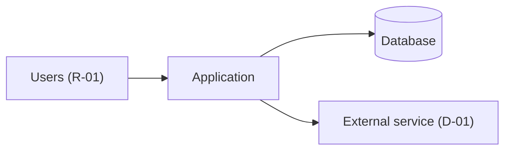

*Caption: <The application, its users, its data store and the external services it uses.>*

#### Containers (C4 level 2)

| ID | Container | Technology | Responsibility | Stores data |
|---|---|---|---|---|
| CMP-01 | <Web application> | <Framework and version> | <…> | <None> |
| CMP-02 | <Database> | <Engine and version> | <…> | <ENT-01> |

#### Security

<When T4 or T11 is Yes: authentication method, authorisation model, encryption in transit and at rest, where personal data is stored, and the main threats with their controls, in three to six lines. Otherwise one line: "No personal or confidential data and not public-facing.">

### ENG-04 Data Model

#### Entities

| ID | Entity | Records | Classification | Retention | Owner |
|---|---|---|---|---|---|
| ENT-01 | <…> | <REC-01> | <Public / Internal / Confidential / Personal / Special-category> | <Period, how enforced> | <…> |

### ENG-05 Integrations & Dependencies Register

#### Dependency register

| ID | Dependency | Type | Purpose | Owner | Criticality | Impact | Support path | Capabilities affected | Workaround | Runbook | Cost | Renewal |
|---|---|---|---|---|---|---|---|---|---|---|---|---|
| D-01 | <…> | <Hosting / Domain / Email / Identity / Integration / Data / Vendor / Network / People / Process / Funding> | <…> | <…> | <High / Medium / Low> | <…> | <…> | <C-01, …> | <…, or None> | <RB-01, or None> | <Yes / No> | <YYYY-MM-DD, or None> |

#### Interfaces

<Required when T5 is Yes: one row per integration.>

| ID | Dependency | Direction | Protocol | Data exchanged | Authentication | Error and retry behaviour |
|---|---|---|---|---|---|---|
| INT-01 | <D-01> | <In / Out> | <…> | <ENT-01> | <SEC-01> | <…> |

### ENG-06 Configuration & Environments

#### Environments

| ID | Environment | Purpose | URL | Data | Access | Hosting |
|---|---|---|---|---|---|---|
| ENV-01 | <Production> | <…> | <…> | <Real> | <…> | <…> |

#### Secrets

| ID | Name | Purpose | Stored in | Rotation | Owner |
|---|---|---|---|---|---|
| SEC-01 | <…> | <…> | <Secret store and path, never the value> | <…> | <…> |

### ENG-07 Deployment & Release Guide

#### Deployment steps

1. <Exact step or command>
2. <…>

**Verification (smoke tests):** <Check, how to run it, expected result.>

#### Rollback

**Roll back when:** <Criteria, e.g. a smoke test fails or users cannot complete the main journey.>

1. <Exact rollback step>
2. <Repeat the smoke tests and confirm the previous version is running.>

#### Release notes

<Where release notes are kept; BUS-09 What's new links to them by version.>

#### Dry-run record

| Procedure | Performed by | Date | Environment | Result | Evidence |
|---|---|---|---|---|---|
| Deployment | <Name, role> | <YYYY-MM-DD> | <ENV-01> | <Pass / Fail> | <…> |
| Rollback | <Name, role> | <YYYY-MM-DD> | <ENV-01> | <Pass / Fail> | <…> |

### ENG-08 Operations & Support Runbook

#### Ownership model

| Area | Primary owner | Backup owner | Escalation owner |
|---|---|---|---|
| Business process questions | <…> | <…> | <…> |
| User access and roles | <…> | <…> | <…> |
| System issue | <…> | <…> | <…> |

#### Support intake

<How users get help: the channel and what to include.>

#### Triage guide

| Category | Examples | Owner | Initial checks | Dependencies | Escalate when |
|---|---|---|---|---|---|
| <System error> | <…> | <…> | <Health check; recent deployment> | <D-01> | <…> |

#### Monitoring and alerting

**Health check:** <URL or command, expected response; where logs are.>

| ID | Alert | Threshold | Meaning | Owner | Runbook |
|---|---|---|---|---|---|
| ALR-01 | <…> | <…> | <…> | <…> | <RB-01> |

#### Runbook entries

| ID | Failure mode | Triggered by | Dependencies | Owner |
|---|---|---|---|---|
| RB-01 | <Failure of a High dependency> | <ALR-01> | <D-01> | <…> |

**RB-01:** Symptom <…> · Diagnosis <…> · Fix <…> · Verification <…> · Escalation <…>

#### Backup and restore

<What is backed up, how often, where, retention.>

**Restore procedure:** <Steps, ending with a verification step.>

**Last restore test:** <YYYY-MM-DD and result, or "Not yet tested" with a Q-xx.>

#### Maintenance calendar

| ID | Task | Type | Frequency | Next due | Owner | Evidence |
|---|---|---|---|---|---|---|
| MT-01 | <Renew domain> | <Domain> | <Yearly> | <YYYY-MM-DD> | <…> | <…> |

#### Output checks

<Required when T6 is Yes.>

| ID | Check | Type | Records | Procedure | Frequency | Owner | On failure |
|---|---|---|---|---|---|---|---|
| OC-01 | <…> | <Invariant / Reconciliation / Completeness / Sample audit / Golden data> | <REC-01> | <…> | <…> | <…> | <…> |

### Assumptions and open questions

| ID | Assumption or question | Owner | Due | Status |
|---|---|---|---|---|
| Q-01 | <…> | <…> | <YYYY-MM-DD> | <Open / Closed> |

### Known limitations

| ID | Limitation | Impact | Workaround | Owner |
|---|---|---|---|---|
| LIM-01 | <…> | <…> | <…, or None> | <…> |

### Change log

| Version | Date | Author | Summary | Approved by |
|---|---|---|---|---|
| 0.1 | <YYYY-MM-DD> | <Name> | First draft | — |

---

# templates/engineering/ENG-10-decision-log.md

```yaml
id: ENG-10
title: Decision Log
application: <Application name>
version: 0.1
status: Draft
owner: <Named person and role>
audience: [Engineering, Agents, Future maintainers]
level: <Foundation | Standard | Full>
depth: <D | D+>
contains: []
related: [ENG-01, ENG-03, ENG-09, BUS-08]
last_reviewed: <YYYY-MM-DD>
```
## <Application> – Decision Log

> **How to use this template**
> - **Who writes it:** whoever makes the decision (engineer, technical owner or agent proposing it), approved by the deciders named in the record. Kept current during the build, not written at the end.
> - **When it is due:** Draft by stage 3 (Build), with ADRs added as decisions are made; Accepted by stage 5 (Go-live). In scope when trigger T10 is Yes, and at Standard and Full.
> - **Depth S** (section `## ENG-10 Decision Log` in ENG-09): the ADR index and, for each decision, a short record with context, decision, alternatives and consequences in a few lines.
> - **Depth D (Standard):** every section. At Standard, "light" ADRs of five to ten lines each are enough.
> - **Depth D+ (Full):** the same as D. No section is marked (Full), and the depth matrix never sets this item to D+.
> - Delete this block and every `> **Guide:**` block before review, and replace every `<…>`.

### Purpose

<Two to four sentences. Example: "Records the significant technical and product decisions for <Application> as architecture decision records (ADRs): what was decided, why, what was rejected and what follows. It exists so that nobody, human or agent, undoes a deliberate choice without knowing why it was made.">

### Scope

<Example: "Covers decisions about technology, structure, data, security, hosting and deliberate omissions. Requirements and constraints imposed from outside are in ENG-01; the resulting design is described in ENG-03.">

### When to write an ADR

> **Guide:** Write an ADR for every choice an agent or a new engineer might otherwise "fix". If a reasonable person could look at the code and think "this is wrong, I'll change it", and it is deliberate, it needs an ADR. Typical cases:
> - Framework, language, data store and hosting choices.
> - Authentication and authorisation approach.
> - Deliberate omissions ("no caching", "no soft delete", "no mobile app").
> - A pattern that looks inefficient or odd but is intended (for example a denormalised table, a synchronous call, a manual step).
> - A trade-off between two NFRs (see ENG-03 Quality goals).
> - Anything that reverses or replaces an earlier ADR.
>
> Do not write an ADR for choices that follow directly from the coding conventions in ENG-09.

### Decision index

> **Guide:** One row per ADR, oldest first; IDs use three digits and are never reused. **Status:** Proposed (under discussion) · Accepted (in force) · Superseded by ADR-xxx (replaced; keep the old record, never delete it). A rejected proposal stays in the index with status `Rejected` so the discussion is not repeated.

| ID | Title | Status | Date | Deciders |
|---|---|---|---|---|
| ADR-001 | <Use a relational database for all business records> | <Proposed / Accepted / Superseded by ADR-00x / Rejected> | <YYYY-MM-DD> | <Names and roles> |

### Decision records

> **Guide:** Repeat this block for each ADR in the index. Write it so someone joining in two years understands the situation without asking. Keep it short: context and decision in a few sentences each. Alternatives must be real options that were considered, each with why it was not chosen. Consequences include the bad ones.
>
> **One file per ADR (optional):** a team may instead keep each record as `docs/decisions/ADR-001-<kebab-title>.md`, starting with `# ADR-001 <Title>` and using the same headings below. The index table in this document still defines every ADR ID and must link each file.

#### ADR-001 <Title>

- **Status:** <Proposed / Accepted / Superseded by ADR-00x / Rejected>
- **Date:** <YYYY-MM-DD>
- **Deciders:** <Names and roles>

**Context**

<The problem or force that required a decision: requirement, constraint, incident or cost. Link IDs, e.g. NFR-02, RISK-03.>

**Decision**

<What was decided, stated as a rule someone can follow: "We will … ".>

**Alternatives considered**

| Option | Advantages | Disadvantages | Why not chosen |
|---|---|---|---|
| <Option A> | <…> | <…> | <…> |
| <Option B> | <…> | <…> | <…> |

**Consequences**

- Positive: <…>
- Negative: <…, including what becomes harder>
- Follow-up: <Work this creates, e.g. "Add runbook entry for failover (ENG-08)".>

**Links:** <ENG-03 section, requirements, risks, pull requests, the ADR this supersedes or is superseded by>

### Assumptions and open questions

| ID | Assumption or question | Owner | Due | Status |
|---|---|---|---|---|
| Q-01 | <…> | <…> | <YYYY-MM-DD> | <Open / Closed> |

### Known limitations

| ID | Limitation | Impact | Workaround | Owner |
|---|---|---|---|---|
| LIM-01 | <…> | <…> | <…, or None> | <…> |

### Change log

| Version | Date | Author | Summary | Approved by |
|---|---|---|---|---|
| 0.1 | <YYYY-MM-DD> | <Name> | First draft | — |

---

# rubrics/00_universal_rubric.md

## Universal Documentation Review Rubric

Apply these criteria to every document **file** in a package. Sections held at depth S inside a parent are covered by the parent's universal review; they are judged only on their own critical artifact criteria. Result values, which criteria apply at each depth, and how results turn into a decision are defined in [04_decision_rules.md](04_decision_rules.md).

These are documentation review criteria: they judge the document, not the application.

| ID | Criterion | Pass condition | Fail condition | Critical |
|---|---|---|---|---|
| U-01 | Identity | Front-matter is complete and valid as defined in [conventions §3](../02_conventions.md#3-front-matter): id, title, application, version, status, owner, audience, level, depth, contains, related, last_reviewed. | A key is missing or invalid, or the document cannot be identified. | Yes |
| U-02 | Purpose | The Purpose section says why the document exists and what decision or operation it supports, specific to this application. | Purpose is missing or generic boilerplate. | Yes |
| U-03 | Scope | The Scope section says what is covered and which other documents (by ID) cover the rest. | The reader cannot tell what is covered. | No |
| U-04 | Required structure | The standard sections (Purpose, Scope, Assumptions and open questions, Known limitations, Change log) and the template's core body sections for its depth are present; empty ones say so in one line. | A required section is missing. | Yes |
| U-05 | Specificity | Uses real names, IDs, values and owners, or `TBD` with an owner and a `Q-xx` entry. Numbers have units and timeframes. | Vague wording ("fast", "the team", "as needed") stands in for facts. | No |
| U-06 | Language for its readers | Business and spine documents are plain language a manager or support person can follow. Engineering documents may be technical, and every specialist term is in SP-01 Glossary. | The intended readers could not follow it. | No |
| U-07 | Traceability | Links to related items by ID as the template requires, and every ID referenced exists. | It cannot be connected to the rest of the package, or references IDs that do not exist. | Yes |
| U-08 | Usable for its readers | A reader in the stated audience can use it to do their job: decide, build, operate, support, use or accept. | It is informational only; a reader would still have to ask the author. | Yes |
| U-09 | Limitations and unknowns visible | Assumptions, open questions and known limitations are listed with IDs; inferred content is marked as inferred. | Gaps are hidden, or the document implies completeness it does not have. | No |
| U-10 | Ownership | The document owner and the owners of its major items (rules, records, dependencies, risks, measures) are named. | No accountable owner for the document or its major items. | Yes |
| U-11 | Consistency | Names, statuses, roles and IDs match their home documents and SP-01; nothing contradicts another document. | Contradicts another document, or uses names inconsistently. | No |
| U-12 | Acceptance readiness | The status is honest, the change log records every version, and the approver of an Accepted version is named with a date. | No status or review path, or status Accepted without a recorded approval. | Yes |
| U-13 | Says it once | Content held in another document is linked by ID, not copied. | Material is duplicated so that the two copies can drift. | No |

---

# rubrics/01_business_rubrics.md

## Business Layer Rubrics

These are documentation review criteria for the business-layer documents, BUS-01 to BUS-09. They judge the documents, not the application. Apply them together with the [universal rubric](00_universal_rubric.md). Result values, which criteria apply at each depth, and how the **Critical** and **Full only** flags turn results into a decision are defined only in the [decision rules](04_decision_rules.md). Mechanical cross-document rules (X-xx) are checked by the linter and are not repeated here; a criterion below that touches one asks the reviewer to judge what the linter cannot.

The templates are in `templates/business/`. "Full only" criteria correspond to the template sections marked *(Full)*. The critical criteria of each document are the essentials an S section is judged on.

### BUS-01 Application Overview & Business Case

| ID | Criterion | Pass condition | Critical | Full only |
|---|---|---|---|---|
| BUS-01.1 | Purpose and what it does | Explains in plain business language what the application does, for whom, and why it exists. | Yes | No |
| BUS-01.2 | Ownership | Names the business owner, support owner and technical owner as people with roles, matching ENG-08 and SP-12. | Yes | No |
| BUS-01.3 | Users and stakeholders | Identifies the main user groups and stakeholders and what each needs, referring to roles by ID; when T2 is No, defines the single role `R-01` and who has access. | No | No |
| BUS-01.4 | Scope | States what is in scope and what people might expect but is out of scope. | No | No |
| BUS-01.5 | Access point | Gives the URL or entry point, the access method and how to get access. | No | No |
| BUS-01.6 | Impact if unavailable | Explains what stops, who is affected, how quickly it hurts, and the manual workaround. | Yes | No |
| BUS-01.7 | Package map | Lists every document in scope with its depth and location, matching SP-00. | No | No |
| BUS-01.8 | Problem statement | Describes the current situation, who is affected and what it costs, in numbers where possible, or `TBD` with an owner and a question ID. | No | No |
| BUS-01.9 | Benefits measured | Every benefit has an ID, a beneficiary and a benefit owner, and names a success measure in SP-10 with a baseline (or a capture date) and a target with a date. | Yes | No |
| BUS-01.10 | What success looks like | A section headed "What success looks like" gives three to five plain, observable sentences consistent with the benefits. | Yes | No |
| BUS-01.11 | Strategic fit | Names the business objective, plan or policy the application supports. | No | No |
| BUS-01.12 | Non-functional commitments | States the top non-functional commitments in plain words with numbers, each linked to its NFR in ENG-01. | No | No |
| BUS-01.13 | Resources and costs | Summarises people, running costs and budget holder in one paragraph linking BUS-07, or names the shared platform when T8 is No. | No | No |
| BUS-01.14 | Sections held here | At Foundation, each S item placed in BUS-01 by the Scope Record is a section headed with its document ID and title, uses its template's core tables, and is listed in `contains`. | No | No |
| BUS-01.15 | Options considered | The alternatives weighed are listed with cost, benefit and the reason for the choice. | No | Yes |
| BUS-01.16 | Stakeholder communication | Who is told about changes, outages and benefit results, how and how often, is stated. | No | Yes |

### BUS-02 Capabilities Register

| ID | Criterion | Pass condition | Critical | Full only |
|---|---|---|---|---|
| BUS-02.1 | Unique IDs | Every capability has a unique `C-xx` ID that is never reused. | Yes | No |
| BUS-02.2 | Business language | Capability names use business verbs and describe what users or the business can do, not screens, buttons, tables or endpoints. | No | No |
| BUS-02.3 | Description | Every capability explains what the system enables. | No | No |
| BUS-02.4 | Outcome | Every capability states a business or operational outcome. | Yes | No |
| BUS-02.5 | Roles | Every capability lists the roles that use or oversee it by role ID; no non-role actor such as "System" appears in `Roles`. | No | No |
| BUS-02.6 | Owner | Every High-criticality capability has a named owner. | No | No |
| BUS-02.7 | Process mapping | Every capability maps to at least one business process, or is marked `Admin/support only`, and the mapping agrees with BUS-03. | Yes | No |
| BUS-02.8 | Coverage | User, admin, access, support, reporting, notification, audit and automated capabilities are covered where they apply, or the coverage check says why not. | No | No |
| BUS-02.9 | Non-duplication | No capability is repeated under a different name. | No | No |
| BUS-02.10 | Dependency visibility | High-criticality capabilities list the dependencies they rely on, or `None`. | No | No |
| BUS-02.11 | Automated actions marked | Every action the system performs with no person acting is a capability with `Automated` = Yes. | No | No |
| BUS-02.12 | Criticality | Every capability is rated High, Medium or Low, and the launch-critical ones are clear. | No | No |
| BUS-02.13 | Capability map | A captioned diagram groups all capabilities by business area. | No | Yes |

### BUS-03 Business Process Register

| ID | Criterion | Pass condition | Critical | Full only |
|---|---|---|---|---|
| BUS-03.1 | Unique IDs | Every process has a unique `W-xx` ID. | No | No |
| BUS-03.2 | Trigger | Every process states what starts it. | Yes | No |
| BUS-03.3 | Outcome | Every process states what successful completion produces. | Yes | No |
| BUS-03.4 | Roles | Every process names its participating roles by role ID. | Yes | No |
| BUS-03.5 | Capabilities used | Every process maps to the capabilities it uses, and the mapping agrees with BUS-02. | Yes | No |
| BUS-03.6 | Steps | The main steps of each process are in order, each with an actor (a role ID or `Automated`) and a business action. | No | No |
| BUS-03.7 | Decision points | Approve, reject, return, cancel, escalate and other decisions are documented with who decides and the result, where relevant. | No | No |
| BUS-03.8 | Statuses | The statuses each process moves records through are listed by ID and agree with the BUS-05 lifecycle. | No | No |
| BUS-03.9 | Manual steps | Work done outside the system is disclosed. | No | No |
| BUS-03.10 | Exceptions | Common failure and alternate paths are included, with handling, owner and escalation. | No | No |
| BUS-03.11 | Boundary and cohesion | Each process covers one primary trigger-to-outcome flow with clear boundaries and one owner. Entries with several unrelated triggers, independently valuable outcomes, different owners or separate status lifecycles are split. | No | No |
| BUS-03.12 | One level of detail | Steps describe business-level actions consistently. No entry mixes screen-click instructions with process summaries, and all entries are at the same business-process level. | No | No |
| BUS-03.13 | Journeys linked | When T1 is Yes, each process lists the user journeys that carry it out, and the links agree with ENG-02. | No | No |
| BUS-03.14 | Process diagrams | Each process has a captioned diagram showing steps, decisions and exception paths. | No | Yes |
| BUS-03.15 | Responsibility matrix | Each process has exactly one accountable party, with responsible, consulted and informed parties named. | No | Yes |

### BUS-04 Roles & Access Matrix

| ID | Criterion | Pass condition | Critical | Full only |
|---|---|---|---|---|
| BUS-04.1 | Role definitions | Every role has an ID, a name matching SP-01, a plain-language description, typical users and a role owner. | No | No |
| BUS-04.2 | Permissions | Each role states its view, create, update, approve, return, cancel or delete, setup, user management and reporting permissions where they apply, with any limits. | Yes | No |
| BUS-04.3 | Access approver | Every role names who approves its assignment. | Yes | No |
| BUS-04.4 | Access request | The access request steps are documented, from request to working access, with who requests, approves and grants. | No | No |
| BUS-04.5 | Access removal | Routine and urgent access removal are documented, with who triggers and performs each, how fast, and how removal is confirmed. | Yes | No |
| BUS-04.6 | Sensitive permissions and segregation | Administrative and risky permissions, and role combinations one person must not hold, are identified with a control and an owner. | No | No |
| BUS-04.7 | Alignment with processes | Every role used in capabilities, processes, journeys and transitions appears here, and the permissions agree with the actions those documents give each role. | No | No |
| BUS-04.8 | Support alignment | Support roles and access-support responsibilities agree with ENG-08. | No | No |
| BUS-04.9 | Periodic access review | The reviewer, frequency, what is checked and where evidence is kept are stated. | No | No |
| BUS-04.10 | Segregation of duties matrix | Conflicting role pairs are marked with how each conflict is enforced. | No | Yes |
| BUS-04.11 | Access review log | Completed access reviews are recorded with date, reviewer, changes and evidence. | No | Yes |

### BUS-05 Business Rules & Status Lifecycle

| ID | Criterion | Pass condition | Critical | Full only |
|---|---|---|---|---|
| BUS-05.1 | Testable rules | Every rule is written as a condition and an action, clearly enough that a positive and a negative test could be written from it. | Yes | No |
| BUS-05.2 | Rule owner | Every rule has an owner or decision authority. | No | No |
| BUS-05.3 | Exceptions and overrides | Where exceptions are allowed, the exception authority, the allowed override and the audit requirement are documented. | No | No |
| BUS-05.4 | Status definitions | Every status has an ID, a name matching SP-01, the record it belongs to, a business meaning and whether it is terminal. | Yes | No |
| BUS-05.5 | Status transitions | Every allowed transition is listed with its from and to statuses; anything not listed is understood as not allowed. | Yes | No |
| BUS-05.6 | Who changes status | Every transition names the roles that may perform it, or `Automated`, and the rule that guards it where one applies. | No | No |
| BUS-05.7 | Validation rules | Required data, date, availability, amount and submission checks are documented as validation rules, with whether each blocks or warns. | No | No |
| BUS-05.8 | Process linkage | Rules and transitions reference the processes and capabilities they affect. | No | No |
| BUS-05.9 | Meaning for users | Every user-visible status has a meaning written in the user's words. | No | No |
| BUS-05.10 | Lifecycle complete | Every non-terminal status has a way out, every status except the first can be reached, and any diagram matches the transitions table. | No | No |
| BUS-05.11 | Consistency with processes | No rule, status or transition contradicts the process steps and decisions in BUS-03. | No | No |

### BUS-06 Data, Reports & Notifications Register

| ID | Criterion | Pass condition | Critical | Full only |
|---|---|---|---|---|
| BUS-06.1 | Main records | The major business records are identified with an ID, a name matching SP-01 and a description. | No | No |
| BUS-06.2 | Required fields | The required business fields of each core record are listed. | No | No |
| BUS-06.3 | Classification | Every record is classified as Public, Internal, Confidential, Personal or Special-category, consistent with the most sensitive data it holds. | Yes | No |
| BUS-06.4 | Data ownership | Every record has a named owner. | Yes | No |
| BUS-06.5 | Reports | The standard reports, dashboards and exports others use are documented, with frequency and format. | No | No |
| BUS-06.6 | Report purpose | Every report has an audience, a purpose, an owner and a source, and official records are identified. | No | No |
| BUS-06.7 | Notifications | Every notification has a trigger, a recipient, a purpose and an expected action. | Yes | No |
| BUS-06.8 | Retention | Every record has a retention period with its rationale and a disposal method, even if provisional. | No | No |
| BUS-06.9 | Personal data justified | Every Personal or Special-category record states the purpose and lawful basis for holding it, a retention period with rationale, and how it is disposed of. | Yes | No |
| BUS-06.10 | Core records marked | Records the business relies on being right are marked `Core` = Yes, so output checks can be planned when T6 is Yes. | No | No |
| BUS-06.11 | Data subject requests | How requests to see, correct, export or delete personal data are received, handled and completed, with time limits, is stated. | No | Yes |
| BUS-06.12 | Report lineage | Each official or core report traces from source records through filters and calculations to its figures. | No | Yes |

### BUS-07 Resource & Cost Model

| ID | Criterion | Pass condition | Critical | Full only |
|---|---|---|---|---|
| BUS-07.1 | People and effort | Every recurring activity (support, administration, data upkeep, access administration, releases, routine tasks in ENG-08) has a role, an effort per month and an owner. | Yes | No |
| BUS-07.2 | Cost lines owned and based | Every cost line has an ID, an owner and a basis (Estimate, Quote or Actual), and estimates say what they are based on. | Yes | No |
| BUS-07.3 | Dependency costs present | Every dependency that costs money appears in a cost line, and the cost lines name their dependency or `None`. | No | No |
| BUS-07.4 | One-off deployment | Build, migration, training, cutover and early-life support effort or spend are stated. | No | No |
| BUS-07.5 | Running cost summary | Monthly and annual recurring totals are given by group, with their assumptions, and one-off costs are shown separately. | Yes | No |
| BUS-07.6 | Licences and renewals | Every licence and subscription has its cost, billing cycle, renewal date, notice period and owner, matching ENG-05. | No | No |
| BUS-07.7 | Scaling assumptions | The drivers that make cost grow are named with current and expected values and the cost lines they affect. | No | No |
| BUS-07.8 | Funding and ownership | The budget holder, cost centre and funding period are named. | No | No |
| BUS-07.9 | End of life | What retiring the application would involve is described, including data export within retention rules and licence notice periods. | No | No |
| BUS-07.10 | Cost scenarios | Low, expected and high cost cases for the next one to three years are given with their assumptions. | No | Yes |
| BUS-07.11 | Total cost of ownership | One-off and recurring costs are totalled over the planned lifetime. | No | Yes |

### BUS-08 Risk & Controls Register

| ID | Criterion | Pass condition | Critical | Full only |
|---|---|---|---|---|
| BUS-08.1 | Risk coverage | Operational, access, data, privacy and compliance, reporting, dependency, support and technical risks are considered, drawing on processes, dependencies, known limitations, technical debt and incidents. | No | No |
| BUS-08.2 | Control mapping | Every risk has at least one control or mitigation, marked existing or planned. | Yes | No |
| BUS-08.3 | Owner | Every risk and its control have an accountable owner. | Yes | No |
| BUS-08.4 | Severity | Every risk has likelihood, impact and severity rated consistently with the rating guidance. | No | No |
| BUS-08.5 | Residual risk | The risk remaining after controls is stated. | No | No |
| BUS-08.6 | Review cadence | Every risk has a review cadence. | No | No |
| BUS-08.7 | Traceability | Risks name the capabilities, processes, dependencies, records, rules or limitations they affect, by ID. | No | No |
| BUS-08.8 | High risks handled | Every High risk is either mitigated to a lower residual risk or formally accepted by a named owner with a date. | Yes | No |
| BUS-08.9 | Privacy impact assessment | When T4 is Yes, the privacy impact assessment status is recorded: done (with link, date and outcome), planned (with owner and date), or not needed (with reason and who decided); findings are raised as Privacy and compliance risks. | Yes | No |
| BUS-08.10 | Clear risk statements | Each risk states a cause, an event and a consequence, not just a topic. | No | No |
| BUS-08.11 | Heat map | The count of risks by likelihood and impact is shown before and after controls. | No | Yes |
| BUS-08.12 | Control testing | Each control on a High or Medium risk has a test method, frequency, tester and last result. | No | Yes |

### BUS-09 User & Admin Guide

| ID | Criterion | Pass condition | Critical | Full only |
|---|---|---|---|---|
| BUS-09.1 | Audience separation | User tasks and admin tasks are clearly separated. | No | No |
| BUS-09.2 | Journey coverage | Every user-facing journey in ENG-02 has a how-to task that names it, or its exclusion is explained. | No | No |
| BUS-09.3 | Step clarity | Steps are short, numbered, in plain language and in the user's words. | No | No |
| BUS-09.4 | Expected result | Each task states what the user should see when it worked. | No | No |
| BUS-09.5 | Error handling | Each task gives common mistakes and what to do if something goes wrong. | No | No |
| BUS-09.6 | Support path | The guide tells users where to get help for each kind of problem, matching ENG-08. | Yes | No |
| BUS-09.7 | Role alignment | No task tells a user to do something their role does not allow in BUS-04, and each task names its required role. | Yes | No |
| BUS-09.8 | Getting started | A new user can get access and complete a first task end to end from the getting-started section, with what they should see. | Yes | No |
| BUS-09.9 | Statuses explained | Every user-visible status in BUS-05 is explained in the user's words, with what happens next, and how notifications work is explained. | No | No |
| BUS-09.10 | Reference | Field meanings and every error or warning message a user can see are listed, with what to do. | No | No |
| BUS-09.11 | Release notes | A What's new section gives changes per release in user language, linked to ENG-07, or states "First release". | No | No |
| BUS-09.12 | Accessibility statement | When T11 is Yes, the statement gives the target standard, how and when conformance was checked, known gaps with workarounds, and how to report a problem, traced to an NFR. | No | No |
| BUS-09.13 | Supported browsers and devices | Supported browsers, versions and devices are listed and traced to an NFR. | No | No |
| BUS-09.14 | Keyboard and assistive technology | Keyboard and assistive-technology methods are given for the main tasks. | No | Yes |
| BUS-09.15 | Training materials | Training materials for each role are listed with location and owner. | No | Yes |

### Mapping from the 2026-06-30 criteria

DEP-xx (DOC-07) and SO-xx (DOC-08) moved to the engineering layer (ENG-05 and ENG-08); see the engineering rubrics.

| Old ID | New ID |
|---|---|
| AO-01 Purpose and business value | BUS-01.1 (business value now also BUS-01.8 and BUS-01.9) |
| AO-02 Ownership | BUS-01.2 |
| AO-03 Users | BUS-01.3 |
| AO-04 Scope | BUS-01.4 |
| AO-05 Access point | BUS-01.5 |
| AO-06 Operational importance | BUS-01.6 |
| AO-07 Related artifacts | BUS-01.7 (package map) |
| CAP-01 Unique IDs | BUS-02.1 |
| CAP-02 Business language | BUS-02.2 |
| CAP-03 Description | BUS-02.3 |
| CAP-04 Outcome | BUS-02.4 |
| CAP-05 Primary users | BUS-02.5 (roles by ID; "System" not allowed) |
| CAP-06 Owner | BUS-02.6 |
| CAP-07 Workflow mapping | BUS-02.7 |
| CAP-08 Coverage | BUS-02.8 |
| CAP-09 Non-duplication | BUS-02.9 |
| CAP-10 Dependency visibility | BUS-02.10 |
| WF-01 Unique IDs | BUS-03.1 |
| WF-02 Trigger | BUS-03.2 |
| WF-03 Outcome | BUS-03.3 |
| WF-04 Roles | BUS-03.4 |
| WF-05 Capabilities used | BUS-03.5 |
| WF-06 Steps | BUS-03.6 |
| WF-07 Decision points | BUS-03.7 |
| WF-08 Statuses | BUS-03.8 |
| WF-09 Manual steps | BUS-03.9 |
| WF-10 Exceptions | BUS-03.10 |
| WF-11 Workflow boundary and cohesion | BUS-03.11 |
| WF-12 Appropriate level of detail | BUS-03.12 |
| RA-01 Role definitions | BUS-04.1 |
| RA-02 Permissions | BUS-04.2 |
| RA-03 Access approval | BUS-04.3 |
| RA-04 Access request | BUS-04.4 |
| RA-05 Access removal | BUS-04.5 (now includes urgent removal) |
| RA-06 Sensitive permissions | BUS-04.6 (now includes segregation) |
| RA-07 Workflow alignment | BUS-04.7 |
| RA-08 Support alignment | BUS-04.8 |
| BR-01 Testable rules | BUS-05.1 |
| BR-02 Rule owner | BUS-05.2 |
| BR-03 Exceptions | BUS-05.3 |
| BR-04 Status definitions | BUS-05.4 |
| BR-05 Status transitions | BUS-05.5 |
| BR-06 Actor permissions | BUS-05.6 |
| BR-07 Validation rules | BUS-05.7 |
| BR-08 Workflow linkage | BUS-05.8 |
| DRN-01 Main records | BUS-06.1 |
| DRN-02 Required fields | BUS-06.2 |
| DRN-03 Sensitive data | BUS-06.3 (Yes/No replaced by a five-level classification) |
| DRN-04 Data ownership | BUS-06.4 |
| DRN-05 Reports | BUS-06.5 |
| DRN-06 Report purpose | BUS-06.6 |
| DRN-07 Notifications | BUS-06.7 |
| DRN-08 Retention | BUS-06.8 (personal data also BUS-06.9) |
| RC-01 Risk coverage | BUS-08.1 (adds privacy and compliance, and technical) |
| RC-02 Control mapping | BUS-08.2 |
| RC-03 Owner | BUS-08.3 |
| RC-04 Severity | BUS-08.4 |
| RC-05 Residual risk | BUS-08.5 |
| RC-06 Review cadence | BUS-08.6 |
| RC-07 Traceability | BUS-08.7 |
| UG-01 Audience separation | BUS-09.1 |
| UG-02 Workflow coverage | BUS-09.2 (now coverage of ENG-02 journeys) |
| UG-03 Step clarity | BUS-09.3 |
| UG-04 Expected result | BUS-09.4 |
| UG-05 Error handling | BUS-09.5 |
| UG-06 Support path | BUS-09.6 |
| UG-07 Role alignment | BUS-09.7 |
| DEP-01 to DEP-08 | Moved to ENG-05 (engineering rubrics) |
| SO-01 to SO-09 | Moved to ENG-08 (engineering rubrics) |

---

# rubrics/02_engineering_rubrics.md

## Engineering Layer Rubrics

These are the documentation review criteria for the engineering-layer documents ENG-01 to ENG-10. They judge the documents, not the application. Apply them together with the [universal rubric](00_universal_rubric.md). Which criteria apply to an item at depth S, D or D+, what the result values mean, how the **Critical** and **Full only** flags are used, and how results turn into a decision are defined only in the [decision rules](04_decision_rules.md).

Where a criterion names a cross-document rule (`X-xx`), the [linter](../review/05_linter_spec.md) checks the mechanical part of that rule and its output is authoritative; the criterion judges what the linter cannot see (meaning, completeness, usability). Do not report the same linter finding again as a criterion failure. Criteria that depend on a trigger say so; when the Scope Record answers that trigger No, the result is Not in scope.

Templates: [templates/engineering/](../templates/engineering/). Criterion IDs follow [conventions §7](../02_conventions.md#7-rubric-criterion-ids).

### ENG-01 Requirements Specification

| ID | Criterion | Pass condition | Critical | Full only |
|---|---|---|---|---|
| ENG-01.1 | Functional requirement form | Every FR is written as "The system shall…", states one observable behaviour, and could not reasonably be built two different ways that both satisfy it. | No | No |
| ENG-01.2 | Traces to capability | Every FR lists at least one capability in `Capabilities`, and the business rules it enforces in `Rules` by ID, without restating the rule text. At depth D or D+, every capability not marked `Admin/support only` is covered by at least one FR (X-18). | Yes | No |
| ENG-01.3 | Must coverage | Every Must capability in BUS-02 has its Must FRs; nothing the application must do for launch is missing. Won't items are recorded so they are not built by accident. | No | No |
| ENG-01.4 | Measurable NFR targets | Every NFR has a `Target` with a number, unit and timeframe or load (for example "p95 ≤ 2 s at 50 concurrent users"), and a measurement method saying how it is checked. No target is an adjective. | Yes | No |
| ENG-01.5 | NFR categories covered | Every fixed category (availability, performance, capacity, security, privacy, accessibility, compatibility, maintainability, observability, data retention, recoverability) has at least one NFR or is listed as not applicable with a reason. RTO and RPO are stated as recoverability NFRs. | No | No |
| ENG-01.6 | Priority and status | Every FR and NFR has `Priority` (Must / Should / Could / Won't) and a status (Proposed / Agreed / Built / Verified). No requirement is Verified unless its application acceptance criteria in SP-11 have passed. | No | No |
| ENG-01.7 | Verifiable | Every FR and NFR is specific enough that a tester could write its application acceptance criterion without asking the author, and each is in the `Verifies` column of at least one SP-11 criterion (X-19 checks Must FRs and all NFRs). | No | No |
| ENG-01.8 | Constraints | Technology, hosting, budget, regulatory and schedule constraints are listed with their source and impact on the design, or the document states there are none. | No | No |
| ENG-01.9 | Agrees with business layer | NFR values match the plain-language summary in BUS-01; rules are referenced from BUS-05, not redefined; L3 measures in SP-10 use the same numbers as the NFRs they restate. | No | No |
| ENG-01.10 | Sources and rationale | Each requirement has a recorded source, rationale, approver and date. | No | Yes |
| ENG-01.11 | NFR verification plan | Each NFR says how it is proven before go-live and kept true in operation, with evidence linked once it exists. | No | Yes |

### ENG-02 User Journeys

| ID | Criterion | Pass condition | Critical | Full only |
|---|---|---|---|---|
| ENG-02.1 | Journey coverage | There is a journey for each main goal of every role that uses the application through a screen; no main role goal in BUS-03 or BUS-09 is missing. | Yes | No |
| ENG-02.2 | Traceability | Every journey names its `Roles`, `Processes`, `Requirements` and `Transitions` (or `None`) by ID; process links are two-way with BUS-03 (X-16), and the transitions are ones defined in BUS-05. | Yes | No |
| ENG-02.3 | Goal, entry and exit | Each journey states the goal, the entry point and the exit state in terms a tester can check (including the resulting status). | No | No |
| ENG-02.4 | Steps and responses | Each journey has numbered steps, each with the user action and the system response, and names the transition at every step that changes a status. | No | No |
| ENG-02.5 | Alternative and error paths | Validation, permission, conflict, dependency-failure and cancel paths are given where they can occur, each saying exactly what the user sees and where the journey ends. | No | No |
| ENG-02.6 | Flow diagram | Each journey has a Mermaid flow diagram with a caption that matches its steps and paths. | No | No |
| ENG-02.7 | Boundary with BUS-03 | Journeys describe only interaction with the system; manual work outside the system is left to BUS-03 and not repeated. | No | No |

### ENG-03 Architecture & Design

| ID | Criterion | Pass condition | Critical | Full only |
|---|---|---|---|---|
| ENG-03.1 | Context view | A C4 level 1 diagram shows the application, its user roles and every external system it exchanges data with; every integration in ENG-05 appears (X-29), and arrows say what flows. | Yes | No |
| ENG-03.2 | Containers and stack | Every separately deployed or run part (front end, API, worker, job, database, queue, file store) is listed with technology and version, responsibility and owner; every container that stores data lists its ENG-04 entities (X-29). At depth S a stack list with technology and responsibility is enough. | Yes | No |
| ENG-03.3 | Runtime view | Sequence diagrams cover the 3–5 most important journeys, show where data is written and what happens when an external call fails, and match the steps in ENG-02 (X-29). | No | No |
| ENG-03.4 | Deployment view | Shows where each container runs in production, the environments by ENG-06 `ENV` ID, network and trust boundaries, and how users and external systems reach it. | No | No |
| ENG-03.5 | Cross-cutting concepts | Authentication, authorisation (linked to BUS-04), logging, error handling, auditing, caching, time zones and internationalisation each have an approach and the code location, or say "Not used". | No | No |
| ENG-03.6 | Quality goals | The top three NFRs are named by ID in priority order, each with how the design achieves it. | No | No |
| ENG-03.7 | Security section | When T4 or T11 is Yes, or at depth D+: states the authentication method, authorisation model, trust boundaries, encryption in transit and at rest, audit logging, and the highest data classification held in each store. Otherwise Not in scope, with the one-line statement present. | Yes | No |
| ENG-03.8 | Threat model summary | When T4 or T11 is Yes, or at depth D+: lists the main threats per trust boundary or asset with the control for each, and links residual risks to BUS-08 by `RISK` ID. | No | No |
| ENG-03.9 | Technical risks and debt | Known weaknesses and debt are listed with impact and plan or trigger; each that could affect the business is linked to a BUS-08 risk by ID. | No | No |
| ENG-03.10 | Diagrams usable and current | Diagrams are Mermaid with captions, agree with each other and with the code; content derived from code is marked inferred until confirmed. | No | No |
| ENG-03.11 | Component views | Each critical container has a C4 level 3 component view with responsibilities and code locations. | No | Yes |

### ENG-04 Data Model

| ID | Criterion | Pass condition | Critical | Full only |
|---|---|---|---|---|
| ENG-04.1 | Records mapped to entities | Every entity lists the BUS-06 records it stores in `Records`, and every record is stored by at least one entity (X-17). | Yes | No |
| ENG-04.2 | Classification and retention | Every entity has a `Classification` at least as high as its records, and a retention period matching BUS-06 with how it is enforced; personal and confidential fields are marked at field level. | Yes | No |
| ENG-04.3 | System of record and owner | Each entity says whether this application is the system of record (or names the one that is) and who owns the data. | No | No |
| ENG-04.4 | Field detail | Each entity lists its fields with type, required, constraints and keys, enough for an engineer or agent to write a correct query or migration without reading the schema. | No | No |
| ENG-04.5 | Status fields | Every status field lists the BUS-05 status IDs it may hold, and these match the BUS-05 status table. | No | No |
| ENG-04.6 | Relationships | An ER diagram with a caption shows the entities and relationships, consistent with the keys in the field tables. | No | No |
| ENG-04.7 | Migrations | The migration tool, location, naming, how to create, apply and reverse, and the approach to destructive and data migrations are stated. | No | No |
| ENG-04.8 | Reference data | Each set of reference data has a source, an owner and an update process. | No | No |
| ENG-04.9 | Data lifecycle and deletion | For each entity with personal or regulated data: retention trigger, deletion method, effect on backups and evidence of purges. | No | Yes |

### ENG-05 Integrations & Dependencies Register

| ID | Criterion | Pass condition | Critical | Full only |
|---|---|---|---|---|
| ENG-05.1 | Dependency coverage | Hosting, domain, email, identity, integrations, data, vendors, network, people, process and funding dependencies are listed where they apply, and downstream consumers are included; nothing a support person would need to check during an outage is missing. | No | No |
| ENG-05.2 | Purpose | Each dependency says why the application needs it. | No | No |
| ENG-05.3 | Owner | Each dependency has a named owner (X-09). | Yes | No |
| ENG-05.4 | Impact | Each dependency states what users and the business experience if it is unavailable, not only the technical error (X-09). | Yes | No |
| ENG-05.5 | Criticality and type | Each dependency has a `Criticality` (High / Medium / Low) consistent with its impact, and a `Type` from the fixed list (X-20). | No | No |
| ENG-05.6 | Support path | Each dependency has a support or escalation path a support person can actually use: team, channel and contract or account reference (X-09). | Yes | No |
| ENG-05.7 | Traceability | High and Medium dependencies list the capabilities affected, consistent with the `Dependencies` column of BUS-02 (X-09). | No | No |
| ENG-05.8 | Workaround | Each High dependency has a business workaround, or explicitly states `None` (X-09). | No | No |
| ENG-05.9 | Interfaces | When T5 is Yes: every integration has an interface entry (X-20) giving direction, protocol, non-secret endpoint or location, data exchanged by `ENT` ID, trigger or frequency, authentication (by `SEC` ID, never a value), error and retry behaviour, contract link and the owner on the other side. | No | No |
| ENG-05.10 | Runbook, cost and renewal | Every High dependency names its ENG-08 runbook entry (X-21); every dependency that costs money is marked `Cost` Yes and has a BUS-07 cost line (X-24); renewal dates are given where something can lapse. | No | No |
| ENG-05.11 | Direction and downstream impact | Every dependency is marked Upstream or Downstream; each downstream consumer states what it consumes, the impact on it if this application fails, and how it is told. | No | No |
| ENG-05.12 | Interface details | Each integration where a change on either side could break the other has its version and change policy, rate limits, idempotency, ordering, other-side service level and test environment. | No | Yes |
| ENG-05.13 | Exit and substitution | Each High vendor or external platform dependency states the data it holds, how to export it, alternatives, notice period and effort to switch. | No | Yes |

### ENG-06 Configuration & Environments

| ID | Criterion | Pass condition | Critical | Full only |
|---|---|---|---|---|
| ENG-06.1 | Environments | Every environment has an `ENV` entry with purpose, URL, whether data is real, synthetic or masked, who has access, and hosting. | Yes | No |
| ENG-06.2 | Secrets by location only | Every secret the application uses is listed with where it is stored, what uses it, rotation and owner, and no secret value appears in this or any other document. | Yes | No |
| ENG-06.3 | Configuration items | Every non-secret setting the application reads has name, purpose, default, value source per environment and who may change it. | No | No |
| ENG-06.4 | Feature flags | Every flag has purpose, owner, default, state per environment and removal criteria, or the document says there are none. | No | No |
| ENG-06.5 | Real data protected | Any non-production environment holding real personal or confidential data is identified, with access controls equal to production or a reason and a BUS-08 risk. | No | No |
| ENG-06.6 | Promotion and parity | How configuration changes reach each environment is stated, and known differences between environments are listed with the risk they create. | No | No |
| ENG-06.7 | Matches the code | The configuration items and secrets match what the code actually reads; an operator could configure a new environment from this document alone. | No | No |

### ENG-07 Deployment & Release Guide

| ID | Criterion | Pass condition | Critical | Full only |
|---|---|---|---|---|
| ENG-07.1 | Pipeline | Every step from merge to production is listed with trigger, action, approval, where it is defined and what happens on failure. | No | No |
| ENG-07.2 | Deployment steps with verification | Deployment to production (and to each other environment that is not fully automatic) is given as exact, numbered steps, each ending with smoke tests that state how to run them and the expected result. | Yes | No |
| ENG-07.3 | Rollback | Rollback has decision criteria with thresholds, who decides, exact steps (including what to do about database changes), and verification after rollback. | Yes | No |
| ENG-07.4 | Pre-deployment checklist | A checklist covers application acceptance criteria, migrations, configuration and flags, release notes, user and downstream communication, and rollback cover. | No | No |
| ENG-07.5 | Database migrations | States when migrations run, the compatibility rule between code and schema, how to reverse a migration, and when to take a backup first. | No | No |
| ENG-07.6 | Versioning | The versioning scheme is stated, and where the running version can be seen. | No | No |
| ENG-07.7 | Release notes | Release notes have a location and a format written for users, and feed the BUS-09 What's new section. | No | No |
| ENG-07.8 | Post-deployment monitoring | The monitoring window after a production deployment, who watches, and what is watched are stated, tied to the rollback criteria. | No | No |
| ENG-07.9 | Dry-run record | A deployment and a rollback have been performed from this document by someone other than its author, with date, environment, result, issues and evidence; nothing is recorded that did not happen. | No | No |
| ENG-07.10 | Emergency release | The shortened path for an urgent fix states which steps may be skipped, who approves and what follows, consistent with ENG-08 emergency changes. | No | Yes |
| ENG-07.11 | Progressive delivery | Where releases are rolled out gradually, each stage has exposure, duration and proceed and stop signals; or the document states releases are not staged. | No | Yes |

### ENG-08 Operations & Support Runbook

| ID | Criterion | Pass condition | Critical | Full only |
|---|---|---|---|---|
| ENG-08.1 | Support ownership | Business, application and technical support are separated; every area in the ownership model has a named primary, backup and escalation owner. | Yes | No |
| ENG-08.2 | Intake process | Users can tell how to get help: the real channel and the information to include. | No | No |
| ENG-08.3 | Triage | Issue categories have examples, an owner, initial checks a first responder can do, and the dependencies to check by `D` ID (X-15). | No | No |
| ENG-08.4 | Escalation | Every category and support area has a concrete escalation condition and an escalation owner, so a support person could route a real issue (X-10). | Yes | No |
| ENG-08.5 | Routine operations | Recurring support and administration tasks are listed with an `MT` ID, frequency, owner, procedure and evidence of completion, so BUS-07 can count their effort. | No | No |
| ENG-08.6 | Known issues | Open known issues are listed with symptom, workaround and owner, or the document states none are known. | No | No |
| ENG-08.7 | Dependency checks | Symptoms map to the ENG-05 dependencies to check and to the runbook entry to follow. | Yes | No |
| ENG-08.8 | Access support | Account creation, role changes and access removal, including urgent removal, are explained with who requests, approves and performs them, consistent with BUS-04. | No | No |
| ENG-08.9 | Communication | Who communicates what to users, stakeholders and downstream consumers, through which channel and when, is defined for incidents, planned maintenance, changes and fixes. | No | No |
| ENG-08.10 | Service levels | Support hours, and response, update and resolution targets per severity, are stated; every SP-10 L3 measure has an SLO row, referenced by ID with the same numbers and naming the alert that fires on breach. | No | No |
| ENG-08.11 | Monitoring and alerting | The health check, dashboards, logs and normal ranges are stated with locations; every alert has a threshold, meaning, severity, owner and at least one runbook entry (X-21). | No | No |
| ENG-08.12 | Runbook entries | Every alert, every High dependency (X-21), every scheduled job and every failure mode from past incidents has a runbook entry with symptom, diagnosis, fix, verification and escalation, written so an operator who did not build the system can follow it. | No | No |
| ENG-08.13 | Incident management | Sev1–Sev4 are defined with examples, who declares an incident is stated, communication templates exist, and a post-incident review is required for the higher severities. | No | No |
| ENG-08.14 | Backup and restore | What is backed up, how often, for how long and where is stated; the restore procedure has exact steps and a verification step; the last restore test is recorded with date and result, or "Not yet tested" with a `Q-xx`. | Yes | No |
| ENG-08.15 | Recovery objectives and fallback | RTO and RPO are stated and identical to the recoverability NFRs in ENG-01; backup frequency meets the RPO; a manual business fallback is described. | No | No |
| ENG-08.16 | Maintenance calendar | Every certificate, domain, licence and secret rotation that can lapse, and patching, dependency upgrades, access reviews and data purges, has an `MT` entry with owner, frequency or next due date, and evidence. | No | No |
| ENG-08.17 | Output checks | When T6 is Yes: output checks of the stated types cover every core record (X-23), and each has `Records`, `Procedure`, `Frequency`, `Owner` and what to do on failure. | No | No |
| ENG-08.18 | Scheduled job monitoring | When T7 is Yes: every scheduled job has a schedule, a success signal, an alert and a runbook entry; when T7 is No, the one-line statement is present. | No | No |
| ENG-08.19 | Change management | Standard, normal and emergency changes are defined with examples, approval, lead time and communication, and how to request a change is stated. | No | No |
| ENG-08.20 | Disaster recovery procedure | A step-by-step procedure rebuilds the service after loss of its location or account, with expected times that fit within the RTO. | No | Yes |
| ENG-08.21 | Disaster recovery tests | A test cadence is set, and tests are recorded with scenario, achieved RTO and RPO, result and actions. | No | Yes |

### ENG-09 Developer & Agent Guide

| ID | Criterion | Pass condition | Critical | Full only |
|---|---|---|---|---|
| ENG-09.1 | Exact, verified commands | Install, run, test, lint, build and migrate commands are exact and copy-pasteable from the repository root, each with its expected result and a "verified on" date and name; unverified commands are marked with a `Q-xx`. | Yes | No |
| ENG-09.2 | Agent rules | Specific lists state what an agent may change without asking, what needs a human (naming the role), and what it must never do, including never writing secret values and never inventing approvals or results. | Yes | No |
| ENG-09.3 | Update-trigger table | The update-trigger table is identical to the one in the documentation model, cites it as the source, and states that a pull request changing behaviour without the listed documents fails review. | Yes | No |
| ENG-09.4 | What the application is | One paragraph says what the application does and for whom, and links BUS-01. | No | No |
| ENG-09.5 | Repository map and prerequisites | Key directories are mapped, generated folders are marked, and prerequisites are listed with versions and how to obtain access. | No | No |
| ENG-09.6 | Conventions with examples | Coding conventions and patterns are stated as rules, each with an example or exemplar file to copy and what to avoid; deliberate unusual choices link to ENG-10. | No | No |
| ENG-09.7 | Safe change and definition of done | The steps to make and ship a change (branch, tests, review) and a definition of done that includes the documentation updates are given. | No | No |
| ENG-09.8 | Where to find things | Links to ENG-03, ENG-04, SP-11, SP-01 and the other documents in scope resolve, and say what each is used for. | No | No |
| ENG-09.9 | Placement and held sections | At Foundation the root `AGENTS.md` is this document and holds, as `## <DOC-ID> <Title>` sections listed in `contains`, every item the Scope Record places in it; at Standard and Full the root `AGENTS.md` points to this document. | No | No |

### ENG-10 Decision Log

| ID | Criterion | Pass condition | Critical | Full only |
|---|---|---|---|---|
| ENG-10.1 | ADR format | Every decision record states status, date, deciders, context, the decision as a rule, at least one real alternative considered with why it was not chosen, and consequences including the negative ones. | Yes | No |
| ENG-10.2 | Index and status | Every ADR is in the index with a three-digit `ADR` ID, title, status (Proposed / Accepted / Superseded by ADR-xxx / Rejected), date and deciders; per-file ADRs are linked from the index. | No | No |
| ENG-10.3 | Decision coverage | ADRs exist for the choices an agent or new engineer might otherwise "fix": framework, data store, authentication approach, hosting, deliberate omissions, and patterns that look wrong but are intended. | Yes | No |
| ENG-10.4 | Supersession | Superseded ADRs are kept, and old and new records link to each other; no ADR has been deleted or its ID reused. | No | No |
| ENG-10.5 | Consistent with design | Accepted ADRs agree with ENG-03 and the code; where they no longer do, the ADR is superseded or the gap is raised as a `Q-xx`. | No | No |
| ENG-10.6 | Linked | Each ADR links the requirements, constraints, risks or incidents that drove it, and the ENG-03 sections it shapes. | No | No |

### Mapping from the 2026-06-30 criteria

The 2026-06-30 release reviewed DOC-07 Application Dependencies Register and DOC-08 Support and Operations Guide. Their criteria are kept in ENG-05 and ENG-08 with the same numbering.

| 2026-06-30 criterion | New criterion | Change |
|---|---|---|
| DEP-01 Dependency coverage | ENG-05.1 | Adds downstream consumers. |
| DEP-02 Purpose | ENG-05.2 | Unchanged. |
| DEP-03 Owner | ENG-05.3 | Now Critical. |
| DEP-04 Impact | ENG-05.4 | Now Critical; impact stated in business terms. |
| DEP-05 Criticality | ENG-05.5 | Adds the fixed `Type` list. |
| DEP-06 Support path | ENG-05.6 | Now Critical. |
| DEP-07 Traceability | ENG-05.7 | Maps to capabilities (BUS-02); workflows are reached through capabilities. |
| DEP-08 Workaround | ENG-05.8 | Unchanged. |
| — | ENG-05.9 to ENG-05.13 | New: interfaces, runbook and cost links, direction, interface details, exit. |
| SO-01 Support ownership | ENG-08.1 | Now Critical; adds backup and escalation owners. |
| SO-02 Intake process | ENG-08.2 | Unchanged. |
| SO-03 Triage | ENG-08.3 | Dependencies referenced by `D` ID. |
| SO-04 Escalation | ENG-08.4 | Now Critical. |
| SO-05 Routine operations | ENG-08.5 | Adds `MT` IDs and evidence of completion. |
| SO-06 Known issues | ENG-08.6 | Permanent limitations move to the standard Known limitations section and SP-12. |
| SO-07 Dependency checks | ENG-08.7 | Now Critical; links to runbook entries. |
| SO-08 Access support | ENG-08.8 | Adds urgent removal. |
| SO-09 Communication | ENG-08.9 | Adds downstream consumers. |
| — | ENG-08.10 to ENG-08.21 | New: service levels, monitoring, runbooks, incidents, backup and restore, recovery, maintenance, output checks, jobs, change management, disaster recovery. |

---

# rubrics/03_spine_rubrics.md

## Spine Rubrics

These are documentation review criteria for the spine documents: SP-00 Scope Record, SP-01 Glossary, SP-10 Success Measures Register, SP-11 Acceptance Criteria & Verification Register and SP-12 Acceptance & Handover Record. They judge the documents, not the application. Apply them together with the [universal rubric](00_universal_rubric.md). Result values, which criteria apply at each depth, and how the **Critical** and **Full only** flags turn results into a decision are defined only in the [decision rules](04_decision_rules.md). Mechanical cross-document rules (X-xx) are checked by the linter and are not repeated here; a criterion below that touches one asks the reviewer to judge what the linter cannot.

Each document's templates are in `templates/spine/`. "Full only" criteria correspond to the template sections marked *(Full)*.

### SP-00 Scope Record

| ID | Criterion | Pass condition | Critical | Full only |
|---|---|---|---|---|
| SP-00.1 | Scores with reasons | Every dimension D1–D7 has a score from 0 to 3 and a one-line reason specific to this application that a second scorer could check; the total is correct and the level follows the thresholds. | Yes | No |
| SP-00.2 | Floor rules | Floor rules F1–F3 are each marked as applying or not, consistently with the scores, and the final level reflects them. The final level equals `level` in every front-matter. | Yes | No |
| SP-00.3 | Triggers answered | Every trigger T1–T11 is answered Yes or No with a reason, and each answer is consistent with what the rest of the package describes (for example, T4 is Yes if any record is Personal). | Yes | No |
| SP-00.4 | Item table complete and correct | All 24 items are listed. Each depth matches the depth matrix for the final level after triggers, or is listed as a deviation. Every S item names its parent; every — item has a reason, including the one-line replacement a trigger requires. | Yes | No |
| SP-00.5 | Never-dropped minimum | What success looks like, at least one success measure, criteria for every Must feature, how to run and deploy, and who supports it are all in scope at some depth. | Yes | No |
| SP-00.6 | Deviations justified | Every depth or parent that differs from the matrix is listed with a reason, who agreed and the date. Any lowering is agreed by the business owner. | No | No |
| SP-00.7 | Approval recorded | The business owner and technical owner are named with their decision and date. Nothing is pre-filled. | Yes | No |
| SP-00.8 | Re-scope log kept | The record has been re-scored at each stage gate passed and after each update trigger that adds a role, integration, data type or user group, with a log row for each; lowered levels or depths show the business owner's approval. | No | No |

### SP-01 Glossary

| ID | Criterion | Pass condition | Critical | Full only |
|---|---|---|---|---|
| SP-01.1 | Home names covered | Every role, status and record name from BUS-04, BUS-05 and BUS-06 appears as a `Term`, spelled exactly as in its home table. | Yes | No |
| SP-01.2 | Clear definitions | Every term has a one-sentence definition in plain language that a new team member, a support person or an agent can understand, and that does not define the term with itself. | Yes | No |
| SP-01.3 | One name per concept | No concept has two terms and no term has two meanings; terms used differently by different teams are resolved or raised as open questions. | No | No |
| SP-01.4 | Synonyms to avoid | Synonyms people actually use are listed for the terms that have them, and the rest of the package does not use those synonyms. | No | No |
| SP-01.5 | Points to home | Every term with a home document gives the document and ID in `Defined in`, and the definition agrees with the home. | No | No |
| SP-01.6 | Technical terms | Specialist and technical terms used in the engineering layer that a newcomer would not know are defined. | No | No |
| SP-01.7 | Abbreviations | Every abbreviation used in the package is expanded. | No | No |

### SP-10 Success Measures Register

| ID | Criterion | Pass condition | Critical | Full only |
|---|---|---|---|---|
| SP-10.1 | Measures exist at the right number | At least one success measure exists; at Foundation 1–3 in total; at Standard and Full each level L1–L4 has at least one (L4 only when T6 is Yes). | Yes | No |
| SP-10.2 | L1 measures complete | Every L1 measure has a `Baseline` (a value with its date, or "Not measured – capture by <date>" with an owner), a `Target` with a timeframe, a `Source` and a named `Owner`, and links the benefit it measures. | Yes | No |
| SP-10.3 | Precise definitions | Every measure's definition says exactly how the number is calculated (numerator, denominator, filters, time window), so two people would get the same value. | No | No |
| SP-10.4 | Action threshold and frequency | Every measure has a threshold at which the owner must act and a measurement frequency. | No | No |
| SP-10.5 | Benefits measured | Every benefit in BUS-01 has at least one measure that would genuinely show whether the benefit is happening, not a proxy for activity. | No | No |
| SP-10.6 | L2 from acceptance results | L2 measures are based on SP-11 results (for example, pass rate of Must criteria) and defects, with targets. | No | No |
| SP-10.7 | L3 as SLO | Every L3 measure is written as an SLI with an SLO target over a stated window, and ENG-08 monitors it. | No | No |
| SP-10.8 | L4 output checks | When T6 is Yes, every L4 measure links an output check (`OC-xx`), and every core record in BUS-06 is covered by at least one output check, using a suitable check type (invariant, reconciliation, completeness, sample audit, golden data). | Yes | No |
| SP-10.9 | Review arranged | Who reviews which levels, how often and where results are reported is stated, with the date of the first L1 review. | No | No |
| SP-10.10 | Review log | Each L1 review is recorded with values against target and the decision taken. | No | Yes |
| SP-10.11 | Source data quality | Each source's known quality issues and their mitigation are stated. | No | Yes |

### SP-11 Acceptance Criteria & Verification Register

| ID | Criterion | Pass condition | Critical | Full only |
|---|---|---|---|---|
| SP-11.1 | Coverage | Every Must functional requirement and every NFR has at least one criterion; every business rule and every transition has at least one positive and one negative criterion. At Foundation, every Must feature (and every transition when T3 is Yes) is covered. | Yes | No |
| SP-11.2 | Well-formed Given/When/Then | Each criterion gives the starting state and the actor by role, one action or event, and an observable outcome with concrete values; a third party could say Pass or Fail without asking the author. | Yes | No |
| SP-11.3 | One behaviour each | Each criterion tests one behaviour, and contains no implementation detail unless that detail is the requirement. | No | No |
| SP-11.4 | Verification method | Every criterion has a `Method` (Automated test, Manual test, Inspection, Demonstration or Measurement) that can actually show its outcome. | Yes | No |
| SP-11.5 | Evidence for results | Every result other than Not run has evidence that can be followed (test ID, path or link), who verified it and the date. No result is recorded that did not happen. | Yes | No |
| SP-11.6 | Priority inherited | Each criterion's priority matches the requirement, rule or transition it verifies. | No | No |
| SP-11.7 | Waivers and failures honest | Every Waived criterion names its approver and reason; every Fail has a defect or follow-up reference and an owner. | No | No |
| SP-11.8 | Summary matches | The results summary counts match the register and the date and environment of the last run are stated. | No | No |
| SP-11.9 | Traceability matrix | Every requirement, rule, transition and Must journey is shown with its criteria and combined result, with no gaps. | No | Yes |
| SP-11.10 | Re-verification | Which criteria are re-run after go-live, when, how and by whom is stated. | No | Yes |

### SP-12 Acceptance & Handover Record

| ID | Criterion | Pass condition | Critical | Full only |
|---|---|---|---|---|
| SP-12.1 | Delivered scope | What was delivered is listed by capability or process ID, with the evidence that each was accepted. | No | No |
| SP-12.2 | Deferred scope | Deferred items and open issues are listed with reason, owner and target, or the record says explicitly that nothing was deferred. | No | No |
| SP-12.3 | Acceptance results honest | Counts match SP-11. The record is not Accepted while any Must criterion is Not run or Fail, unless an owner has waived it, named with a date. | Yes | No |
| SP-12.4 | Success baseline | Each success measure shows whether its baseline is captured, missing baselines have a capture date, and the date and owner of the first L1 review are given. | No | No |
| SP-12.5 | Dry-run evidence | A deploy, a rollback and a restore have each been performed from the documents by someone who did not write them, with date, environment, result and evidence. | Yes | No |
| SP-12.6 | Accepted areas | Acceptance of the business processes, the roles and access model (definitions, permissions, request, removal) and the support model (intake, escalation, routine tasks, dependency support) is recorded with who accepted each. | No | No |
| SP-12.7 | Known limitations consolidated | Every known limitation raised anywhere in the package is listed with where it was raised, its impact and workaround, and who accepted it. | Yes | No |
| SP-12.8 | Accepted risks | Every High risk in BUS-08, and every Medium risk accepted rather than mitigated, is listed with its residual risk, who accepted it and when it is reviewed again. | No | No |
| SP-12.9 | Conditions owned | Every condition and open item has an ID, an owner, a target date and the owner who agreed to go live with it open. | No | No |
| SP-12.10 | Ownership after handover | A named person, team and support path is given for business ownership, business support, technical support, hosting, access administration, data ownership, releases and success-measure reporting, and they match BUS-01 and ENG-08. | Yes | No |
| SP-12.11 | Sign-off | The business owner, support owner and technical owner decisions are recorded by those people with dates. Nothing is pre-filled, and `status` is Accepted only when all three have accepted. | Yes | No |
| SP-12.12 | Early-life support | The early-life support period, arrangements, exit criteria and post-go-live review date are stated. | No | Yes |

### Mapping from the 2026-06-30 criteria

The 2026-06-30 release had no spine documents except DOC-11. SP-00, SP-01, SP-10 and SP-11 are new.

| Old ID | New ID |
|---|---|
| AH-01 Delivered scope | SP-12.1 |
| AH-02 Deferred scope | SP-12.2 |
| AH-03 Accepted workflows | Merged into SP-12.6 (business processes accepted) |
| AH-04 Accepted access model | Merged into SP-12.6 |
| AH-05 Accepted support model | Split: acceptance into SP-12.6, ownership into SP-12.10 |
| AH-06 Known limitations | SP-12.7 (accepted risks now also SP-12.8) |
| AH-07 Operational readiness | Replaced by SP-12.5 (dry-run evidence) and SP-12.6 |
| AH-08 Sign-off | SP-12.11 |

---

# rubrics/04_decision_rules.md

## Decision Rules

This file is the **only** place where review decisions, result scales, severity and the use of critical criteria are defined. Rubrics, gates, the audit template, the review process and agent prompts refer to it and never restate its conditions.

### 1. Criterion results

Each criterion in the [universal rubric](00_universal_rubric.md) and the artifact rubrics gets one result.

| Result | Meaning |
|---|---|
| **Pass** | Satisfied, with evidence the reviewer can point to. |
| **Partial** | Partly satisfied: a gap, an ambiguity or weak evidence. |
| **Fail** | Missing, contradicted or unusable. |
| **Not in scope** | The Scope Record sets this item or section to —, or the criterion is Full only and the item's depth is not D+. Cite the Scope Record line. |
| **Not applicable** | The criterion cannot apply to this application, with a one-line reason (for example, "no reports produced"). |

### 2. Which criteria apply

Depth comes from the Scope Record (SP-00).

| Item depth | Universal criteria | Artifact criteria |
|---|---|---|
| — | None | None |
| **S** (section in a parent) | Applied to the parent file, not to the section | The item's **Critical = Yes** criteria only |
| **D** | All | All with **Full only = No** |
| **D+** | All | All |

An S item has no status or decision of its own. Its criterion results and findings count toward the decision on the parent file.

### 3. Critical criteria

- A criterion is critical when its rubric row says **Critical = Yes**. Every artifact rubric marks at least two.
- The critical universal criteria are U-01 Identity, U-02 Purpose, U-04 Required structure, U-07 Traceability, U-08 Usability for its readers, U-10 Ownership and U-12 Acceptance readiness. They are marked in the universal rubric table.

### 4. Severity

Every Bug and Risk finding carries a severity from this table.

| Severity | A Bug is this severe when… | A Risk is this severe when… |
|---|---|---|
| **High** | A reader following the document would make a wrong operational, access, data or acceptance decision; or a critical criterion cannot pass; or the document contradicts another Accepted document; or it claims acceptance, completeness or a test result without evidence. | It is likely to cause a service outage, a data or privacy breach, financial loss, or a failed handover if not addressed. |
| **Medium** | The document is usable but incomplete or ambiguous in a way that needs follow-up with the author. | It could cause delay, rework or support confusion, and a workaround exists. |
| **Low** | Cosmetic, formatting or wording, with no effect on any decision. A Stale document (past its review interval) with no other issue is Low. | Minor inconvenience; unlikely to happen. |

Ideas carry a **Value** (High / Medium / Low) instead of a severity and never affect a decision.

### 5. Document decision

Apply the first row whose conditions are all true, reading from the top.

| Decision | All of these are true |
|---|---|
| **Reject** | Any one of: it is the wrong document; it cannot be used by its readers; it contradicts an Accepted document or the Scope Record; it claims acceptance, completeness or a test result without evidence; it hides a known limitation, an owner or a support path. |
| **Accept** | Every applicable critical criterion is Pass · no more than three Partial results, all on non-critical criteria, each with a logged fix · no open High or Medium Bug · every High or Medium Risk is mitigated or formally accepted by a named owner · every applicable cross-document rule passes · the accepting owner is named. |
| **Accept with Conditions** | No applicable critical criterion is Fail (a critical Partial is allowed only as a condition) · no open High Bug · every High Risk is mitigated or formally accepted · each remaining Medium Bug, Medium Risk and critical Partial is a condition with an owner, a target date and a `COND-xx` entry in SP-12 open items · the accepting owner has agreed to the conditions · the document remains usable for its readers. |
| **Revise and Resubmit** | None of the above. |

### 6. Package decision

The package decision is computed from the [package gates](../review/03_package_gates.md); it is never decided separately.

First, give each gate a result. A gate contains cross-document rules and documents, as listed in [03_package_gates.md](../review/03_package_gates.md). Rules and documents that are out of scope are ignored.

| Gate result | When |
|---|---|
| **Pass** | Every rule in the gate passes, and every document in the gate is Accept. |
| **Conditional** | Every failed rule in the gate is Medium or Low and logged as a `COND-xx` condition in SP-12, and every document in the gate is Accept or Accept with Conditions. |
| **Fail** | Anything else, including any High rule failure or any document at Revise and Resubmit or Reject. |

Then:

| Package decision | When |
|---|---|
| **Accept** | Every gate result is Pass. |
| **Accept with Conditions** | Every gate result is Pass or Conditional, no rule in G1 Completeness, G3 Traceability or G8 Handover has failed, and the business owner and support owner have agreed to the conditions recorded in SP-12. |
| **Revise and Resubmit** | Any gate result is Fail, or any rule in G1, G3 or G8 has failed. |

A package is never Rejected as a whole; individual documents are.

### 7. Evidence

Every Bug and Risk cites evidence: a quote, a table row, an ID, a linter output line, or the absence of something required ("No access removal process found in BUS-04"). A finding without evidence is not counted.

### 8. Honesty rules for producers

These are Reject conditions when broken, whoever the producer is:

- Unknown but required details are written `TBD` with an owner and a `Q-xx` entry. They are never invented.
- No sign-off, approval, test result or measurement is recorded unless it happened, with who and when.
- Content an agent inferred from code or other material is marked as inferred until a person confirms it.
- Limitations are never hidden: each appears in its document and in SP-12.

---

# review/01_audit_result_template.md

## Audit Result: <Application> – <DOC-ID> <Title>

> **Guide:** one audit result per document review, or one per package review (then section 3 lists every document). Store it outside `/docs`, for example in the pull request or `docs/reviews/`. Findings use the Bug / Risk / Idea format and IDs `A-BUG-xx`, `A-RISK-xx`, `A-IDEA-xx` ([conventions §8](../02_conventions.md#8-review-finding-ids)). Results and decisions follow [rubrics/04_decision_rules.md](../rubrics/04_decision_rules.md); do not invent other categories.

### 1. Review scope

| Field | Value |
|---|---|
| Application | |
| Document reviewed | <DOC-ID> <Title>, version <x.y> |
| Depth in Scope Record | S / D / D+ (SP-00 version <x.y>) |
| Review type | Stage <n> review / Go-live package review / Change review / Stale re-review |
| Reviewer | <name or agent and run reference> |
| Date | |
| Related documents read | <DOC-IDs and versions> |
| Linter run | `python3 tools/doclint.py package <path>` on <commit or date> |

### 2. Rubric summary

Universal: <n> Pass · <n> Partial · <n> Fail · <n> Not in scope or not applicable
Artifact: <n> Pass · <n> Partial · <n> Fail · <n> Not in scope or not applicable
Critical criteria not passing: <n> (<IDs>)
Open findings: <n> High · <n> Medium · <n> Low

### 3. Universal rubric results

> **Guide:** for an S-depth item, write "Covered by the parent's review" and skip to section 4.

| ID | Criterion | Result | Evidence |
|---|---|---|---|
| U-01 | Identity | | |
| U-02 | Purpose | | |
| U-03 | Scope | | |
| U-04 | Required structure | | |
| U-05 | Specificity | | |
| U-06 | Language for its readers | | |
| U-07 | Traceability | | |
| U-08 | Usable for its readers | | |
| U-09 | Limitations and unknowns visible | | |
| U-10 | Ownership | | |
| U-11 | Consistency | | |
| U-12 | Acceptance readiness | | |
| U-13 | Says it once | | |

### 4. Artifact rubric results

| ID | Criterion | Critical | Result | Evidence |
|---|---|---|---|---|
| <DOC-ID>.1 | | Yes / No | | |

### 5. Cross-document rules

> **Guide:** copy mechanical results from the linter; judge only the Judgment rules.

| Rule | Type | Result | Evidence |
|---|---|---|---|
| X-xx | Mechanical / Judgment | Pass / Fail / Not in scope | |

### 6. Findings

Severity definitions: [decision rules §4](../rubrics/04_decision_rules.md#4-severity).

#### Bugs

| ID | Finding | Severity | Evidence | Required action |
|---|---|---|---|---|
| A-BUG-01 | | High / Medium / Low | | |

#### Risks

| ID | Finding | Severity | Evidence | Mitigation or required action |
|---|---|---|---|---|
| A-RISK-01 | | High / Medium / Low | | |

#### Ideas

| ID | Finding | Value | Evidence | Suggested action |
|---|---|---|---|---|
| A-IDEA-01 | | High / Medium / Low | | |

### 7. Required fixes

| Finding | Fix | Owner |
|---|---|---|
| | | |

### 8. Proposed conditions

> **Guide:** only for Accept with Conditions. Each condition becomes a `COND-xx` row in SP-12 with owner, target date and the accepting owner's agreement.

| Finding | Condition | Owner | Target date |
|---|---|---|---|
| | | | |

### 9. Decision

Decision: **Accept / Accept with Conditions / Revise and Resubmit / Reject**

Decision rule applied: <row of the decision table in rubrics/04_decision_rules.md §5 or §6, and why it applies>

Next action: <who does what next>

### 10. Framework feedback (optional, never affects the decision)

<Blind spots in the framework noticed during this review.>

---

# review/02_cross_document_rules.md

## Cross-Document Rules

These rules check that the documents in a package agree with each other. Each rule is tagged:

- **Mechanical:** an exact check on IDs, columns and front-matter. The [linter](05_linter_spec.md) runs it, and its output is authoritative. A reviewer does not re-judge a mechanical rule; they copy the linter's findings.
- **Judgment:** needs a reader. The review agent or human reviewer applies it.

Each rule belongs to exactly one gate in [03_package_gates.md](03_package_gates.md). Column names in "Check" are the linked columns defined in [conventions §6](../02_conventions.md#6-linked-columns).

A rule whose subject is out of scope (the Scope Record sets the item to —) passes automatically. A rule that needs a document held only as an S section is checked against that section.

Severity of a failure is set by [04_decision_rules.md §4](../rubrics/04_decision_rules.md#4-severity); the column below gives the usual severity as guidance for the linter.

| Rule | Check | Type | Usual severity | Gate |
|---|---|---|---|---|
| X-01 | Every capability (`C`) lists at least one process in `Processes`, or says `Admin/support only`. | Mechanical | Medium | G3 |
| X-02 | Capability↔process links are two-way: if `C-xx` lists `W-yy`, then `W-yy` lists `C-xx` in `Capabilities`, and the reverse. Every process lists at least one capability. | Mechanical | High | G3 |
| X-03 | Every role ID used in any `Roles` column exists in BUS-04 (or the R-01 line in BUS-01 when T2 is No). Only role IDs or `Automated` appear in `Roles` columns. | Mechanical | High | G3 |
| X-04 | Every status ID used anywhere exists in the BUS-05 status table. | Mechanical | High | G3 |
| X-05 | Every transition's `From` and `To` are defined statuses; every transition ID used in journeys or application acceptance criteria exists in BUS-05. | Mechanical | High | G3 |
| X-06 | Every business rule (`BR`) has an `Owner`. | Mechanical | Medium | G4 |
| X-07 | Every report (`REP`) has `Audience`, `Purpose`, `Owner` and `Source`. | Mechanical | Medium | G4 |
| X-08 | Every notification (`NTF`) has `Trigger`, `Recipient`, `Purpose` and `Expected action`. | Mechanical | Medium | G4 |
| X-09 | Every dependency (`D`) has `Owner`, `Criticality`, `Impact` and `Support path`; every High dependency has a `Workaround` (or `None`) and is listed in the `Dependencies` column of at least one capability; a dependency's `Capabilities affected` agrees with the capabilities that list it. | Mechanical | High | G6 |
| X-10 | Every support category in ENG-08 has an owner and an escalation path, and a support person could route a real issue using it. | Judgment | Medium | G6 |
| X-11 | Every High risk (`RISK`) has `Control` and `Owner`, and either a mitigation or a recorded formal acceptance. | Mechanical | High | G4 |
| X-12 | Every known limitation (`LIM`) raised in any document appears in SP-12. | Mechanical | High | G8 |
| X-13 | When SP-01 is in scope, every role, status and record name from its home table appears as a term in SP-01; prose elsewhere uses those names, not synonyms SP-01 says to avoid. | Mechanical (terms present) | Medium | G4 |
| X-14 | `application` and `level` are identical in every front-matter; the access point and owners named in BUS-01 match those in ENG-06, ENG-08 and SP-12. | Mechanical (front-matter) and Judgment (owners) | Medium | G1 |
| X-15 | The ENG-08 triage table references dependencies by `D` ID in its `Dependencies` column. | Mechanical | Medium | G6 |
| X-16 | Process↔journey links are two-way (`W` `Journeys` ↔ `J` `Processes`); every journey lists at least one process. | Mechanical | Medium | G3 |
| X-17 | Every record (`REC`) has `Classification` and `Retention`; Personal and Special-category records have a purpose; every entity (`ENT`) lists at least one record, and every record is stored by at least one entity when ENG-04 is in scope. | Mechanical | High | G4 |
| X-18 | Every functional requirement (`FR`) lists at least one capability; every capability not marked `Admin/support only` is covered by at least one FR when ENG-01 is at depth D or D+. | Mechanical | Medium | G3 |
| X-19 | Coverage: every Must FR, every NFR, every business rule and every transition is in the `Verifies` column of at least one application acceptance criterion; every NFR has a `Target`; every application acceptance criterion has a `Method`. | Mechanical | High | G7 |
| X-20 | Every interface (`INT`) names a defined dependency; every dependency of `Type` Integration has at least one interface. | Mechanical | High | G5 |
| X-21 | Every alert (`ALR`) names at least one runbook entry; every High dependency names a runbook entry in `Runbook`. | Mechanical | High | G6 |
| X-22 | At least one success measure exists. Every L1 measure has `Baseline`, `Target`, `Source` and `Owner`; every benefit names a measure in `Measure`. | Mechanical | High | G7 |
| X-23 | When T6 is Yes: every record with `Core` = Yes is in the `Records` column of at least one output check; every output check has `Procedure`, `Frequency` and `Owner`; every L4 measure links to an output check. | Mechanical | High | G7 |
| X-24 | Every dependency with `Cost` = Yes appears in the `Dependency` column of a BUS-07 cost line. | Mechanical | Medium | G2 |
| X-25 | Every file has complete, valid front-matter; every `related` and `contains` ID resolves; every content ID matches its format and is defined exactly once. | Mechanical | High | G1 |
| X-26 | SP-12 is not `Accepted` while any Must application acceptance criterion has `Result` Not run or Fail; every Waived criterion names its approver. | Mechanical | High | G8 |
| X-27 | Every Scope Record item at depth S, D or D+ exists as a section or file; every item at — has a reason; no document exists that the Scope Record marks —; the never-dropped minimum is present. | Mechanical | High | G1 |
| X-28 | No document's `last_reviewed` is older than the review interval for its level. | Mechanical | Low | G1 |
| X-29 | The architecture, data model and integrations agree: every integration in ENG-05 appears in the ENG-03 context view, every container that stores data maps to entities in ENG-04, and the runtime view's steps match the journeys. | Judgment | Medium | G5 |
| X-30 | The application acceptance criteria are well formed: observable and binary, concrete values, one behaviour each, actor and starting state given, and both a positive and a negative criterion for each rule and transition. | Judgment | High | G7 |

---

# review/03_package_gates.md

## Package Gates

The package is judged through eight gates. Each gate is a named set of cross-document rules and documents. Every cross-document rule and every document belongs to exactly one gate. How a gate result (Pass, Conditional, Fail) and the package decision are computed is defined only in [rubrics/04_decision_rules.md §6](../rubrics/04_decision_rules.md#6-package-decision).

Items the Scope Record marks — are left out of their gate. Items held as S sections count through their critical criteria.

| Gate | What it shows | Cross-document rules | Documents (judged by their own rubric) | Also checks |
|---|---|---|---|---|
| **G1 Completeness** | The package is what the Scope Record says it is. | X-14, X-25, X-27, X-28 | SP-00 | The Scope Record is approved by the business owner and technical owner. |
| **G2 Business understanding** | A business reader can answer B1–B4. | X-24 | BUS-01, BUS-07 | BUS-01 has "What success looks like". |
| **G3 Capability and journey traceability** | What the system does, how it is used and what it must do all line up. | X-01, X-02, X-03, X-04, X-05, X-16, X-18 | BUS-02, BUS-03, ENG-01, ENG-02 | — |
| **G4 Governance and control** | Rules, access, data and risk are defined and owned. | X-06, X-07, X-08, X-11, X-13, X-17 | SP-01, BUS-04, BUS-05, BUS-06, BUS-08 | — |
| **G5 Engineering readiness** | An engineer or agent can understand how the system is built and change it safely (E1, E2, E6). | X-20, X-29 | ENG-03, ENG-04, ENG-05, ENG-06, ENG-09, ENG-10 | — |
| **G6 Operational readiness** | It can be deployed, run, supported and recovered (E4). | X-09, X-10, X-15, X-21 | ENG-07, ENG-08, BUS-09 | A deploy, a rollback and a restore have been dry-run from the documents, with evidence in SP-12. |
| **G7 Success measurability** | Success can be measured and the application objectively accepted (S1–S3). | X-19, X-22, X-23, X-30 | SP-10, SP-11 | — |
| **G8 Handover** | Acceptance is honest and ownership is clear after go-live. | X-12, X-26 | SP-12 | Business owner, support owner and technical owner decisions are recorded. |

### Checks that are not cross-document rules

The "Also checks" column holds three package checks that need evidence rather than a table lookup. Each is judged by the verifier as Pass or Fail and counts as a High rule in its gate when it fails.

### Order of work

1. Run the linter. Its findings fill the mechanical rules.
2. Review each document in scope against its rubric.
3. Apply the judgment rules.
4. Give each gate a result, then compute the package decision.

---

# review/04_review_process.md

## Review Process

### Purpose

This process says who reviews application documentation, when, in what order, and what each step produces. The criteria themselves live elsewhere: the [universal rubric](../rubrics/00_universal_rubric.md), the artifact rubrics ([business](../rubrics/01_business_rubrics.md), [engineering](../rubrics/02_engineering_rubrics.md), [spine](../rubrics/03_spine_rubrics.md)), the [cross-document rules](02_cross_document_rules.md), the [package gates](03_package_gates.md) and the [decision rules](../rubrics/04_decision_rules.md).

### Roles

| Role | Does | Never does |
|---|---|---|
| Producer (person or agent) | Drafts and updates documents from people, code and existing material | Reviews its own output; records sign-offs or results that did not happen |
| Linter | Checks the mechanical cross-document rules exactly | Judges quality |
| Reviewer (person or agent) | Applies the rubrics and judgment rules; writes findings with evidence | Edits the document under review |
| Verifier (person or agent) | Applies the decision rules and gates to the review results; returns a decision | Re-reviews content or changes the rules |
| Business, support and technical owners | Confirm accuracy, agree conditions, sign off | Delegate sign-off to an agent |

### When reviews happen

Reviews follow the [stages](../00_documentation_model.md#stages), not one big review at the end.

| Event | What is reviewed | Decision needed |
|---|---|---|
| End of each stage | Every document due Accepted at that stage | Document decisions; the stage passes when they are Accept or Accept with Conditions |
| Go-live | The whole package against the Scope Record | Package decision |
| Any pull request that changes behaviour | The documents named by the [update triggers](../00_documentation_model.md#update-triggers) | The pull request reviewer confirms the listed documents were updated; the linter must show no new High or Medium findings |
| Review interval passes (Stale) | The stale document | Re-review; update `last_reviewed` and the change log |
| Re-scope | SP-00 and any document whose depth went up | Document decisions for the changed items |

### Review steps for a document

1. **Load scope.** Read SP-00 to find the document's depth and any items marked — or S. Out-of-scope criteria are recorded as Not in scope. If there is no Scope Record (for example, auditing documentation written before this framework), review at depth D and say so in the audit result.
2. **Run the linter** on the whole package. Copy its findings for this document into the audit result. They are authoritative for mechanical rules.
3. **Structure and rubric pass.** Apply the universal rubric (for files) and the artifact rubric (for the document's depth) criterion by criterion, with evidence.
4. **Coherence pass.** Read the related documents named in front-matter. Apply the judgment cross-document rules that touch this document. Look for contradictions the linter cannot see (a role that exists but whose permissions contradict a journey, a runbook that would not work).
5. **Readers' test.** Ask the questions the document must answer (from the [register](../01_document_set_register.md)) as its intended reader would. Any question the document cannot answer is a finding.
6. **Write the audit result** using the [audit result template](01_audit_result_template.md), classify findings as Bug, Risk or Idea with severity and evidence, and recommend a decision under the decision rules.
7. **Verify.** The verifier checks the audit result against the decision rules and issues the decision. Where the reviewer's recommendation and the rules disagree, the rules win and the verifier says why.
8. **Close.** Fixes go back to the producer. Conditions get `COND-xx` entries in SP-12 with owner and date. The owner records approval in the document's change log.

### Package review

After every document in scope has a decision:

1. Run the linter on the package.
2. Give each gate a result and compute the package decision, both as defined in the [decision rules](../rubrics/04_decision_rules.md#6-package-decision).
3. Confirm the three evidence checks in the gates table: approved Scope Record, dry-run of deploy, rollback and restore, and recorded owner decisions.

### Finding types

| Type | Meaning | Example |
|---|---|---|
| **Bug** | Something in the documentation is incorrect, inconsistent, missing or unusable. | Process W-04 uses role R-06, which BUS-04 does not define. |
| **Risk** | Something that may cause an operational, governance, support or acceptance failure. | High dependency D-04 has no runbook entry, so an outage would be handled ad hoc. |
| **Idea** | A non-blocking improvement. | Add a Mermaid state diagram to BUS-05. |

Severity is defined in the [decision rules](../rubrics/04_decision_rules.md#4-severity). Every Bug and Risk cites evidence.

### Framework feedback

If a reviewer finds that the framework itself has a blind spot (a criterion that misses a real problem, or a template that forces busywork), they note it in the optional **Framework feedback** section of the audit result. It never affects the decision. Framework changes go through this repository's pull requests and [CHANGELOG.md](../CHANGELOG.md).

---

# review/05_linter_spec.md

## Linter Specification

### Purpose

Most cross-document rules are ID lookups. A script checks them exactly and the same way every time, so review agents spend their effort on judgment. The linter runs **before** any review; its findings are authoritative for every rule tagged Mechanical in [02_cross_document_rules.md](02_cross_document_rules.md).

The reference implementation is [tools/doclint.py](../tools/doclint.py): Python 3.9 or later, standard library only.

### Usage

```text
python3 tools/doclint.py package <repo-root> [--docs docs] [--today YYYY-MM-DD] [--format text|json]
python3 tools/doclint.py framework <framework-root>
```

- `package` lints one application's documentation: every `.md` file under `<repo-root>/<docs>` plus `<repo-root>/AGENTS.md` if it exists. Files without front-matter are ignored, except that a front-matter-less `AGENTS.md` is accepted as a pointer file.
- `framework` lints this framework repository itself (section 6).
- Exit code `0` when there are no High or Medium findings, `1` when there are, `2` on a usage or parse error.

### 1. Reading the package

1. **Front-matter:** the YAML block between the first two `---` lines. Only the simple forms used in [conventions §3](../02_conventions.md#3-front-matter) need to be parsed: `key: value` and `key: [a, b]`. Text after `#` is a comment.
2. **Documents and sections:** each file is the document named by its `id`. Inside a file, a level-2 heading of the form `## <DOC-ID> <Title>` starts an **S section** for that document ID, which runs until the next level-2 heading. Everything else belongs to the file's own document.
3. **Code and guidance:** fenced code blocks are skipped entirely, and so are blockquotes beginning `> **Guide:**` or `> **How to use this template**`.
4. **Tables:** GitHub-style pipe tables. The first row is the header. Cells are trimmed. A cell's ID list is every ID token in it.
5. **ID tokens:** `\b(BEN|C|W|R|BR|ST|TR|REC|REP|NTF|COST|RISK|FR|NFR|J|CMP|ENT|D|INT|ENV|CFG|SEC|FLAG|ALR|RB|OC|MT|SM|AC|T|COND|LIM|Q)-\d{2,}\b` and `\bADR-\d{3,}\b`. Document IDs are `\b(SP|BUS|ENG)-\d{2}\b`.
6. **Definitions:** a table whose first header cell is `ID` defines the ID in the first cell of each row. Its rows are the **items** of that prefix; other cells are read by header name using the linked columns in [conventions §6](../02_conventions.md#6-linked-columns). Header matching is exact after trimming and ignores case.
7. **References:** every ID token anywhere else (prose, other cells) is a reference.

### 2. Reading the Scope Record

SP-00, as a file or as a section, must contain these tables. Columns are matched by header name; other columns are allowed (the template adds `Question` to the Triggers table).

| Table | Header row |
|---|---|
| Triggers | `Trigger` · `Answer` · `Reason` (Trigger cells are `T1` … `T11`; Answer is `Yes` or `No`) |
| Items | `Item` · `Depth` · `Parent` · `Reason` (Item cells start with a document ID; Depth is `—`, `-`, `S`, `D` or `D+`) |

The level is read from the SP-00 front-matter, or the parent's when SP-00 is a section.

### 3. Checks

Each check reports findings tagged with the rule it implements. Usual severity is from the rule table.

| Check | Rules | What is checked |
|---|---|---|
| Front-matter | X-25, X-14 | All keys present; `status` in Draft / In Review / Accepted / Superseded; `level` in Foundation / Standard / Full; `depth` in D / D+; `related` and `contains` entries are document IDs that exist as a file or section; `application` and `level` identical across files. |
| Standard sections | X-25 | Each file has level-2 headings Purpose, Scope, Assumptions and open questions, Known limitations, Change log. (`AGENTS.md` pointer files are exempt.) |
| IDs | X-25 | Every defined ID matches its format; no ID is defined twice; every referenced ID is defined somewhere (reported per reference, once per ID per file). `T-xx` references are exempt from "must be defined" (tests live in code). |
| Scope | X-27 | Every item at S has a section `## <ID>` in its parent (or any file); every item at D or D+ has a file with that `id`; every item at — has a non-empty Reason and no file or section; every one of the 24 document IDs appears in the Items table; the never-dropped minimum is present (a "What success looks like" heading in BUS-01, at least one `SM`, at least one `AC`, ENG-07 not —, ENG-08 not —). |
| Capabilities and processes | X-01, X-02 | As in the rule table. |
| Roles, statuses, transitions | X-03, X-04, X-05 | Every `R`, `ST`, `TR` referenced is defined; `Roles` cells contain only R IDs or `Automated`; transition `From` and `To` are defined statuses. |
| Rules, reports, notifications | X-06, X-07, X-08 | Named columns are present and non-empty (and not `TBD` without a `Q-xx` in the same row). |
| Dependencies | X-09, X-15, X-20, X-21, X-24 | As in the rule table. |
| Risks | X-11 | High risks (any of `Severity`, `Rating` or `Risk level` = High) have non-empty `Control` and `Owner`. |
| Limitations | X-12 | Every `LIM` defined or referenced outside SP-12 appears in a `Limitation` cell of SP-12's "Consolidated known limitations" table. |
| Glossary | X-13 | When SP-01 is in scope, the name in the `Name` column of every `R`, `ST` and `REC` row appears in an SP-01 table cell under `Term`. |
| Journeys | X-16 | As in the rule table. |
| Records and entities | X-17 | As in the rule table. |
| Requirements and coverage | X-18, X-19 | As in the rule table. Must is read from `Priority`. |
| Success measures | X-22, X-23 | As in the rule table. `Level` cells start with `L1` … `L4`. T6 is read from the Scope Record. |
| Handover | X-26 | If SP-12 front-matter `status` is Accepted, no Must `AC` has `Result` Not run or Fail; Waived rows mention an approver (any non-empty `Approver`, `Waived by` or `Verified by` cell). |
| Staleness | X-28 | `last_reviewed` older than 12 / 6 / 3 months for Foundation / Standard / Full, compared with `--today`. |

Rules out of scope pass silently: a check whose home document is — in the Scope Record is skipped, and so are checks gated by a trigger answered No (T3 for transitions, T5 for interfaces, T6 for output checks, T1 for journeys).

### 4. Output

Text output is a markdown table in the [audit result](01_audit_result_template.md) findings format, so it can be pasted into a review:

```text
| ID | Rule | Severity | Location | Finding |
|---|---|---|---|---|
| A-BUG-01 | X-02 | High | BUS-02-capabilities-register.md:14 | C-03 lists W-03, but W-03 does not list C-03 in Capabilities. |
```

followed by a summary line: `Linter: <n> High · <n> Medium · <n> Low · rules checked: X-01, X-02, …`.

JSON output is a list of objects with keys `id`, `rule`, `severity`, `file`, `line`, `message`.

### 5. Limits

The linter checks structure, not meaning. It cannot tell whether a capability is described well, whether a criterion is testable, or whether a runbook would work. Those are judgment rules and rubric criteria for the reviewer.

### 6. Framework self-check

`framework` mode lints this repository so the framework obeys its own rules:

| Check | Fails when |
|---|---|
| Template front-matter | A template under `templates/` lacks a front-matter key from conventions §3. |
| Template sections | A template lacks one of the five standard sections. |
| Template related | A template's `related` lists something other than a valid document ID. |
| Rubric coverage | A document ID in the register has no rubric section, or a rubric row lacks a Critical or Full only value, or a rubric has fewer than two Critical = Yes rows. |
| Example names | `LHC` or `ITS` (whole word, case-sensitive) appears outside `examples/`, `CHANGELOG.md` and `releases/`. |
| Consolidated guide | `consolidated_guide.md` differs from what `build/build_consolidated.py` would produce, or the manifest misses a markdown file. |
| Examples | Each package under `examples/` (a folder containing `docs/`) lints with no High or Medium findings, except packages under `examples/review_training/`, whose findings must equal their `expected_findings.json`. |

---

# agent_prompts/scoping.md

## Scoping Agent Prompt

Use this prompt to draft an application's Scope Record (SP-00) for its owners to approve. Run it before any other document is produced, and again at each stage gate or when the application changes.

### Files to load

- `03_scoping_guide.md` (the method: dimensions, floor rules, triggers, depth matrix, never-dropped minimum)
- `templates/spine/SP-00-scope-record.md` (the output layout)
- `02_conventions.md` (front-matter and naming)
- Any existing SP-00 for this application (when re-scoping)

### Prompt

```text
You are drafting the Scope Record (SP-00) for one application, using the framework files provided.

Application: <name>
Material available: <project brief, repository path, existing docs, notes from the owners>
Business owner: <name>    Technical owner: <name>

Do this:
1. Score D1–D7 using the descriptions in 03_scoping_guide.md. For each score give a one-line reason
   that cites the material. If the material does not tell you, score the more cautious option and
   add a Q-xx open question for the owner.
2. Total the scores, pick the level, then apply the floor rules F1–F3 and say which applied.
3. Answer T1–T11 with Yes or No and a one-line reason each.
4. Fill the Items table for all 24 documents from the depth matrix, applying the triggers. Give the
   parent for every S item and a reason for every —. Check the never-dropped minimum is in scope.
5. List any place where you recommend a depth different from the matrix as a Deviation, with the
   reason. Do not apply it; the owners decide.
6. Leave the Approval section empty. Set status: Draft. Never record an approval.

Output the complete SP-00 document as markdown, following the template exactly, then a short list of
the questions the owners must answer before approving it.
```

---

# agent_prompts/producer_forward.md

## Producer Agent Prompt: Forward (application being designed or built)

Use this prompt to draft or update one document for an application that is being designed or built. For an application that already exists, use [producer_reverse.md](producer_reverse.md).

### Files to load

Always:
- `02_conventions.md` (front-matter, layout, IDs, linked columns, writing style)
- The application's approved `SP-00` Scope Record (depth and parent for this item)
- The template for the document: `templates/<spine|business|engineering>/<DOC-ID>-*.md`
- The document's section in `01_document_set_register.md` (purpose, how to produce, questions to answer)
- The document's section in the matching rubric: `rubrics/01_business_rubrics.md`, `rubrics/02_engineering_rubrics.md` or `rubrics/03_spine_rubrics.md`
- The application's `SP-01` Glossary, if in scope

As needed: every document listed in the template's `related` front-matter that already exists in the application's `/docs`.

### Prompt

```text
You are producing one document of an application's documentation package, following the framework
files provided. Your output will be reviewed against the rubric provided, so meet it.

Application: <name>
Document: <DOC-ID> <title>
Depth from the Scope Record: <S in <parent DOC-ID> | D | D+>
Source material: <notes, interviews, requirements, designs, tickets, existing documents>

Rules:
- Follow the template's structure and the column headers exactly. At depth S, write only a
  "## <DOC-ID> <Title>" section for the parent, using the template's core tables cut down to what
  answers the question. At D, omit sections marked (Full). At D+, include them.
- Answer every question listed for this document in the register, or record why it does not apply.
- Use IDs in the formats in 02_conventions.md. Reuse existing IDs from the related documents; define
  new ones only for items this document owns. Never reuse a retired ID.
- Use names exactly as in SP-01 and the home tables.
- Unknown but required details: write TBD with an owner and add a Q-xx row. Never invent values,
  owners, dates, test results, measurements or sign-offs.
- Put every limitation in Known limitations with a LIM-xx ID.
- Link instead of repeating content that belongs to another document.
- Business and spine documents: plain language for a manager or support person.
  Engineering documents: technical language is fine; add new terms to a "Terms to add to SP-01" list.
- Set status: Draft. Add a change-log row for this version with "Approved by" left empty.

Output the document as markdown, then a list of: new IDs defined, IDs referenced that do not exist
yet, open questions, and terms to add to SP-01.
```

---

# agent_prompts/producer_reverse.md

## Producer Agent Prompt: Reverse (documenting an existing application)

Use this prompt to draft documents for an application that already exists, from its repository and other material. People then review and correct the drafts instead of writing from scratch.

### Files to load

The same framework files as [producer_forward.md](producer_forward.md), plus read access to the application's repository.

### Prompt

```text
You are documenting an existing application from its repository and other material, following the
framework files provided. Your drafts will be reviewed by the application's owners.

Application: <name>
Repository: <path or URL>
Documents to draft: <DOC-IDs with depth from the Scope Record>
Other material: <tickets, wiki pages, runbooks, interviews>

Work in this order, because later documents reuse earlier IDs:
ENG-09 (repository map and exact commands: run them and record the date they worked) → ENG-03
(context, containers, runtime and deployment views from the code, configuration and infrastructure
files) → ENG-04 (from schema, migrations or models) → ENG-05 (from outbound calls, SDKs, environment
variables, infrastructure) → ENG-06 (from configuration and environment files; record secret names
and storage locations, never values) → ENG-07 and ENG-08 (from pipelines, scripts, dashboards and
alerts) → ENG-01 and the business layer (from routes, screens, validations and state machines) →
SP-11 (from existing tests: map each test to what it verifies).

Rules:
- Everything you derive from code is marked "Inferred from <file path>; confirm with <owner>" until a
  person confirms it. Business intent (benefits, owners, success measures, costs) is never inferred
  from code: write TBD with a Q-xx question for the business owner.
- Never copy a secret value, credential, personal data or production data into a document.
- When code and other material disagree, record both and add a Q-xx question; do not pick one.
- Existing tests become verification evidence in SP-11 only for behaviour they actually assert.
- Follow every rule in producer_forward.md (templates, IDs, TBDs, limitations, status Draft).

Output each document as markdown, then one combined list of open questions grouped by owner.
```

---

# agent_prompts/reviewer.md

## Reviewer Agent Prompt

Use this prompt to review one document, or a whole package, and produce an audit result. The reviewer judges the documents, not the application.

### Files to load

- `review/04_review_process.md` (the steps to follow)
- `review/01_audit_result_template.md` (the output layout)
- `rubrics/00_universal_rubric.md`
- The document's section in `rubrics/01_business_rubrics.md`, `rubrics/02_engineering_rubrics.md` or `rubrics/03_spine_rubrics.md`
- `rubrics/04_decision_rules.md` (results, which criteria apply at each depth, severity, decisions)
- `review/02_cross_document_rules.md`
- `01_document_set_register.md` (the questions the document must answer)
- From the application: SP-00 Scope Record, the document under review, the documents in its `related` front-matter, and the linter output

### Prompt

```text
You are reviewing application documentation against the framework files provided. You produce an
audit result; you do not edit the document.

Application: <name>
Document under review: <DOC-ID> <title>, version <x.y> (or: whole package at go-live)
Linter output: <paste output of: python3 tools/doclint.py package <repo>>

Follow review/04_review_process.md steps 1–6:
- Take the depth from SP-00. Criteria that do not apply at that depth are "Not in scope" (cite SP-00).
- Copy linter findings for this document into the audit result; they are authoritative for
  Mechanical rules. Judge only the Judgment rules yourself.
- For each applicable criterion give Pass, Partial or Fail with evidence: quote, row, ID, or the
  absence of something required.
- Ask the register's questions for this document as its intended reader would; any question it
  cannot answer is a finding.
- Classify findings as Bugs, Risks or Ideas with IDs A-BUG-xx, A-RISK-xx, A-IDEA-xx and the severity
  defined in rubrics/04_decision_rules.md section 4. Every Bug and Risk must have evidence that is
  true of the document; check each one before you write it.
- Recommend the decision by applying the decision table in rubrics/04_decision_rules.md, naming
  the row that applies.
- Put any blind spot you notice in the framework itself under "Framework feedback" only.

Output the audit result as markdown in the template's layout.
```

---

# agent_prompts/verifier.md

## Verifier Agent Prompt

Use this prompt after a reviewer has produced an audit result. The verifier applies the decision rules and gates mechanically; it does not re-review content.

### Files to load

- `rubrics/04_decision_rules.md` (the only source of decision conditions)
- `review/03_package_gates.md` (for package decisions)
- `review/02_cross_document_rules.md`
- From the application: SP-00 Scope Record, SP-12 (open conditions), the audit result(s), and fresh linter output

### Prompt

```text
You are the verifier. You decide whether a document or package passes, using only the decision
rules provided. You do not rewrite documents or re-judge content.

Scope: <one document: DOC-ID and version | whole package>
Audit result(s): <paste>
Linter output: <paste output of: python3 tools/doclint.py package <repo>, run now>

Do this:
1. Run the linter first. If its findings differ from those in the audit result, the linter is
   authoritative for Mechanical rules; note every difference.
2. Check that each criterion result in the audit result has evidence and that the criteria applied
   match the depth in SP-00. List any result without evidence; it does not count.
3. For one document: apply the decision table in rubrics/04_decision_rules.md section 5, top row
   first, and name the row that applies and the facts that make it apply.
   For a package: give each gate in review/03_package_gates.md a result using section 6, then
   compute the package decision.
4. Accept with Conditions only if every condition has an owner, a target date, a COND-xx entry in
   SP-12 and the accepting owner's recorded agreement; otherwise the decision is Revise and Resubmit.
5. If the reviewer's recommendation differs from your decision, say why.

Output:
1. Decision
2. Rule or gate results that decided it
3. Blocking items (what must change for the next decision up)
4. Conditions, if any, with owner and date
5. Next action and who takes it
```

---

# CHANGELOG.md

## Changelog

### 2.0.0 – 2026-10-07

A rewrite of the 2026-06-30 release, based on two reviews of it: an assessment of the framework against recommended documentation practice, and a resolution report that set out the fix for each finding. The 2026-06-30 release is kept in [releases/](releases/) and in git history.

#### What changed, in short

- **Purpose made explicit.** The framework tells teams how to document an application, requires the documentation to define success measures and application acceptance criteria, and supplies documentation review criteria for the documents themselves. The two kinds of criteria are named separately everywhere.
- **Engineering layer added** (ENG-01 to ENG-10): requirements, user journeys, architecture and design, data model, integrations and dependencies, configuration and environments, deployment and release, operations and support runbook, developer and agent guide, decision log.
- **Success spine added:** Scope Record, Glossary, Success Measures (four levels, including output correctness), Acceptance Criteria & Verification (Given/When/Then), and an extended Acceptance & Handover Record.
- **Business layer extended:** business case with benefits, baselines and targets and "What success looks like"; new Resource & Cost Model; data classification, purpose and retention; privacy risk category; a user guide organised by what the reader is trying to do.
- **Scoping instead of a fixed set:** seven scored dimensions give Foundation, Standard or Full; eleven triggers add or drop items; a depth matrix sets each item to not needed, section, document or document with extras; a Scope Record is approved by the owners and becomes what the package is reviewed against. A never-dropped minimum applies at every level.
- **Lifecycle:** documents due by build stage, update triggers tied to pull requests, review cadence by level, change log in every document, docs stored in the application repository.
- **Rules consolidated:** one decision table, defined severity, a Critical flag on every rubric row, cross-document rules tagged Mechanical or Judgment, and eight gates that compute the package decision. Each rule lives in one file.
- **Tooling:** a linter for the mechanical rules, a framework self-check, a generated consolidated guide, and agent prompts that name the files to load.
- **Examples rebuilt:** a Foundation example, a Standard example with its Scope Record, and review-training material with expected findings.

#### Document ID mapping

| 2026-06-30 | 2.0.0 | Notes |
|---|---|---|
| DOC-01 Application Overview | BUS-01 Application Overview & Business Case | Extended with business case and "What success looks like" |
| DOC-02 Capabilities Register | BUS-02 Capabilities Register | `Automated` column replaces "System" as a user |
| DOC-03 Workflow Register | BUS-03 Business Process Register | Same content; journeys split out to ENG-02 |
| DOC-04 Roles and Access Matrix | BUS-04 Roles & Access Matrix | Adds periodic access review |
| DOC-05 Business Rules and Status Lifecycle | BUS-05 Business Rules & Status Lifecycle | Statuses and transitions get IDs |
| DOC-06 Data, Reports, and Notifications Register | BUS-06 Data, Reports & Notifications Register | Classification, purpose, retention and disposal replace "Sensitive? Yes/No" |
| DOC-07 Application Dependencies Register | ENG-05 Integrations & Dependencies Register | Adds interface contracts, runbook and cost links |
| DOC-08 Support and Operations Guide | ENG-08 Operations & Support Runbook | Adds service levels, monitoring, incidents, runbook entries, backup and restore, continuity, maintenance, output checks, change management |
| DOC-09 Risk and Controls Register | BUS-08 Risk & Controls Register | Adds privacy and technical categories |
| DOC-10 User and Admin Guide | BUS-09 User & Admin Guide | Restructured: getting started, how-to, concepts, reference, help, what's new, accessibility |
| DOC-11 Acceptance and Handover Record | SP-12 Acceptance & Handover Record | Adds acceptance results, success baselines and dry-run evidence |
| — | SP-00, SP-01, SP-10, SP-11, BUS-07, ENG-01 to ENG-04, ENG-06, ENG-07, ENG-09, ENG-10 | New |

Content ID formats changed from `C01`, `W01`, `D01` to `C-01`, `W-01`, `D-01`; see [conventions §5](02_conventions.md#5-content-ids). Rubric criteria changed from `AO-01`-style IDs to `<DOC-ID>.<n>`; each rubric file ends with its mapping table.

#### Files

| 2026-06-30 | 2.0.0 |
|---|---|
| `01_documentation_model.md` | `00_documentation_model.md` |
| `02_document_set_register.md` | `01_document_set_register.md` |
| — | `02_conventions.md`, `03_scoping_guide.md` |
| `templates/01` … `11` | `templates/spine/`, `templates/business/`, `templates/engineering/` |
| `rubrics/01_artifact_specific_rubrics.md` | `rubrics/01_business_rubrics.md`, `02_engineering_rubrics.md`, `03_spine_rubrics.md` |
| `rubrics/02_acceptance_thresholds.md`, `review/02_verifier_control_rules.md` (decision parts) | `rubrics/04_decision_rules.md` |
| `review/02_verifier_control_rules.md` (cross-document rules) | `review/02_cross_document_rules.md` |
| `review/03_package_acceptance_gates.md` | `review/03_package_gates.md` |
| — | `review/05_linter_spec.md`, `tools/doclint.py`, `build/` |
| `agent_prompts/01` … `03` | `agent_prompts/scoping.md`, `producer_forward.md`, `producer_reverse.md`, `reviewer.md`, `verifier.md` |
| `examples/lhc_booking_system_example.md` | `examples/lhc_booking_system/`, `examples/small_tool/`, `examples/review_training/` |
| `consolidated_guide.md` (hand-maintained) | `consolidated_guide.md` (generated) |

#### Review findings resolved

Every finding in the assessment, and its fix in the resolution report, is addressed in this release. The traceability from finding to file is in the pull request that introduced 2.0.0.

### Calibration

Record each project scored with the [scoping guide](03_scoping_guide.md): the scores, the level the method gave, and the level the owners agreed. Adjust the thresholds or the dimension wording when they disagree.

| Date | Project | D1–D7 | Total | Method level | Agreed level | Notes |
|---|---|---|---|---|---|---|
| 2026-10-07 | Stock Count Sheets (small_tool example) | 1,1,1,1,1,1,1 | 7 | Foundation | Foundation | Worked example, not a live project; top of the Foundation band |
| 2026-10-07 | Booking system (example) | 3,2,2,1,3,2,1 | 14 | Standard | Standard | Worked example; calibrate on 3–4 live projects next |

### 2026-06-30

First release: business and governance handover standard (DOC-01 to DOC-11), rubrics, verifier rules, gates and an example.
