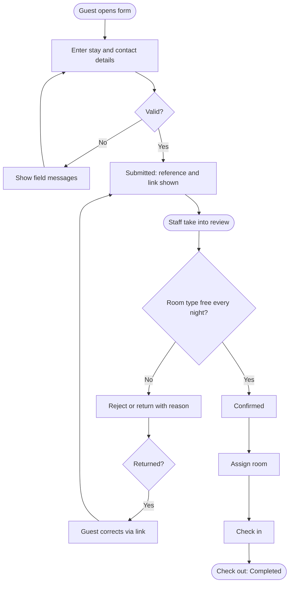

# LHC Booking System – Business Process Register

## Purpose

Documents the end-to-end business processes the LHC Booking System supports, including the work done outside the system (phone calls, the front desk, management approvals), so process owners, support and engineers share one picture of how the work is really done. It also holds the user journeys (ENG-02) as a section.

## Scope

Covers every business process from its trigger to its outcome. What the system can do is in BUS-02; the rules and statuses in BUS-05; each person's step-by-step interaction with the screens is in the ENG-02 User Journeys section below.

## Process summary

| ID | Name | Trigger | Outcome | Owner | Roles | Capabilities | Statuses | Journeys | Manual steps outside the system |
|---|---|---|---|---|---|---|---|---|---|
| W-01 | Submit a booking request | A guest wants to stay at LHC (including resending a request LHC returned for correction) | A Submitted request with a reference, acknowledged to the guest | Daniel Reyes, LHC Front Office Supervisor | R-01, R-02 | C-01, C-11, C-12, C-16 | ST-01, ST-02, ST-04 | J-01, J-02, J-03 | Staff take phone and walk-in requests and enter them on the same form |
| W-02 | Review and decide a booking request | A request reaches Submitted | The request is Confirmed or Rejected, or Returned to the guest (and Expired if not corrected), and the guest is told | Daniel Reyes, LHC Front Office Supervisor | R-02, R-03 | C-02, C-03, C-04, C-05, C-11, C-12, C-16, C-18 | ST-02, ST-03, ST-04, ST-05, ST-06, ST-10 | J-02, J-04 | Staff may phone the guest to clarify before deciding |
| W-03 | Assign a room and host the stay | A booking is Confirmed | The guest has stayed in an assigned room and the booking is Completed | Daniel Reyes, LHC Front Office Supervisor | R-02, R-03 | C-02, C-10, C-11, C-12, C-16, C-17 | ST-06, ST-07, ST-08 | J-05 | Key handover, payment and housekeeping at the front desk |
| W-04 | Modify or cancel a booking | A guest or LHC needs to change or call off a Confirmed booking | The booking reflects the new details, or is Cancelled and its room released | Daniel Reyes, LHC Front Office Supervisor | R-01, R-02, R-03 | C-02, C-06, C-07, C-10, C-11, C-12, C-16 | ST-06, ST-09 | J-06 | Guests ask by email or phone |
| W-05 | Maintain rooms and rates | A room is added, changed or taken out of use, or LHC Management approves new rates | The room list and rate card in the application match reality | Daniel Reyes, LHC Front Office Supervisor | R-03, R-04 | C-08, C-09, C-16 | None | J-07 | LHC Management approves rate changes in writing |
| W-06 | Review booking activity | The first working day of the month, or a management request | LHC Management has reviewed occupancy and response times and decided any action | Grace Tan, LHC Manager | R-03, R-04 | C-11, C-14 | None | J-08 | The report is discussed at the monthly management meeting |
| W-07 | Grant, change or remove staff access | A staff member joins, changes job or leaves | The right people hold the right roles, and leavers have no access | Daniel Reyes, LHC Front Office Supervisor | R-03, R-04, R-05 | C-13, C-16 | None | J-09 | Line manager's request by email; Entra ID account managed by ITS |
| W-08 | Handle a support issue | A user reports a problem, or monitoring raises an alert | The issue is resolved, or escalated to its owner with the evidence | Mark Lim, ITS Service Desk Lead | R-02, R-03, R-05 | C-11, C-15, C-16 | None | None | Issues are logged and tracked in the ITS service desk tool |

## Process details

### W-01 Submit a booking request

| Step | Actor | Action | Capability | Status after | Notes |
|---|---|---|---|---|---|
| 1 | R-01 | Opens the booking form from the LHC website or the direct address, and enters stay dates, room type, number of guests and contact details | C-01 | — | Staff (R-02) do the same for phone and walk-in requests |
| 2 | R-01 | Optionally saves the form to finish later, using the link shown on screen | C-01 | ST-01 | |
| 3 | R-01 | Submits the request | C-01 | ST-02 | Blocked until BR-01, BR-02 and BR-03 are met |
| 4 | Automated | Records the submission and sends the acknowledgement to the guest and the new-request alert to LHC | C-12, C-16 | ST-02 | NTF-01, NTF-02 |
| 5 | R-01 | Checks progress at any time through the booking link | C-11 | ST-02 | |
| 6 | R-01 | If LHC returns the request: opens it from the booking link, corrects what was asked and resubmits | C-01 | ST-02 | From ST-04; the corrected request goes back to W-02 step 1 |

**Decision points**

| Decision | Options | Decided by | Resulting status or action |
|---|---|---|---|
| Is every required field present and valid? | Yes: submit; No: correct the fields shown | R-01 (the application blocks until BR-01 to BR-03 are met) | ST-02, or stays on the form |

**Exceptions and alternate paths**

| Exception | Handling | Owner | Escalation path |
|---|---|---|---|
| The acknowledgement email fails | The request is still Submitted; the email is retried, then listed as failed for staff to phone the guest (ENG-08 RB-03) | Daniel Reyes, LHC Front Office Supervisor | ITS Service Desk if more than 5 emails fail in an hour |
| A guest submits the same stay twice | The reviewer rejects the duplicate in W-02 with the reason "Duplicate of LHC-reference" | Daniel Reyes, LHC Front Office Supervisor | None |
| The form is unavailable | Staff take the request by phone on the paper form and enter it when service returns (BUS-01 Impact if unavailable) | Daniel Reyes, LHC Front Office Supervisor | ITS Service Desk |

### W-02 Review and decide a booking request

| Step | Actor | Action | Capability | Status after | Notes |
|---|---|---|---|---|---|
| 1 | R-02 | Takes the oldest Submitted request from the queue into review | C-03 | ST-03 | Target: within 1 working day of submission (SM-01) |
| 2 | R-02 | Checks availability of the requested room type for every night | C-02 | ST-03 | |
| 3 | R-02 | Checks guest details and special requests; phones the guest if something is unclear | C-03, Outside system | ST-03 | |
| 4a | R-02 | Confirms the request | C-04 | ST-06 | Only if BR-04 holds; the current rate is recorded (BR-10) |
| 4b | R-02 | Returns the request, saying what the guest must correct | C-05 | ST-04 | Reason required (BR-06) |
| 4c | R-02 | Rejects the request, saying why | C-05 | ST-05 | Reason required (BR-06) |
| 5 | Automated | Records the decision and emails the guest | C-12, C-16 | ST-06, ST-04 or ST-05 | NTF-05, NTF-03 or NTF-04 |
| 6 | Automated | Each night: reminds guests whose request was Returned 7 days ago, and expires those Returned 14 days ago | C-18, C-12 | ST-04 or ST-10 | NTF-06, NTF-07; BR-07 |

**Decision points**

| Decision | Options | Decided by | Resulting status or action |
|---|---|---|---|
| Is a room of the requested type free for every night? | Yes: continue; No: reject, or phone the guest to offer other dates and return the request | R-02 | Continue, ST-05 or ST-04 |
| Is the request complete and acceptable? | Confirm / Return / Reject | R-02 | ST-06, ST-04 or ST-05 |

**Exceptions and alternate paths**

| Exception | Handling | Owner | Escalation path |
|---|---|---|---|
| The guest does not correct a Returned request | Reminder at 7 days; Expired at 14 days by the nightly job | Daniel Reyes, LHC Front Office Supervisor | None |
| The reviewer is absent with a request Under Review | LHC Admin reassigns it to another reviewer (MT-01) | Daniel Reyes, LHC Front Office Supervisor | Grace Tan, LHC Manager |
| The guest disputes a rejection | LHC Admin reviews the reason with the guest; a new request may be submitted | Daniel Reyes, LHC Front Office Supervisor | Grace Tan, LHC Manager |

### W-03 Assign a room and host the stay

| Step | Actor | Action | Capability | Status after | Notes |
|---|---|---|---|---|---|
| 1 | R-02 | Before arrival, assigns a free room of the booked type | C-10, C-02 | ST-06 | BR-05; may be changed until check-in |
| 2 | Automated | Records the assignment and emails the guest their room and arrival details | C-12, C-16 | ST-06 | NTF-08 |
| 3 | R-02 | On arrival, checks the guest in | C-17 | ST-07 | BR-08 |
| 4 | R-02 | Hands over keys and takes any payment | Outside system | ST-07 | |
| 5 | R-02 | On departure, checks the guest out | C-17 | ST-08 | |
| 6 | R-02 | Views the stay history if a question arises later | C-11 | ST-08 | |

**Decision points**

| Decision | Options | Decided by | Resulting status or action |
|---|---|---|---|
| Is a room of the booked type free to assign? | Assign it; or ask LHC Admin to decide an upgrade | R-02, R-03 for upgrades | Room assigned, ST-06 unchanged |

**Exceptions and alternate paths**

| Exception | Handling | Owner | Escalation path |
|---|---|---|---|
| The guest does not arrive | Staff cancel the booking the next morning with reason "No-show" (W-04) | Daniel Reyes, LHC Front Office Supervisor | None |
| The assigned room becomes unusable before arrival | Staff assign another free room; if none, LHC Admin decides an upgrade | Daniel Reyes, LHC Front Office Supervisor | Grace Tan, LHC Manager |

### W-04 Modify or cancel a booking

| Step | Actor | Action | Capability | Status after | Notes |
|---|---|---|---|---|---|
| 1 | R-01 | Asks LHC by email or phone to change or cancel a Confirmed booking | Outside system | ST-06 | LIM-01 |
| 2 | R-02 | Checks availability for any new dates or room type | C-02 | ST-06 | |
| 3a | R-02 | Changes the booking details | C-06 | ST-06 | BR-02, BR-04, BR-05 re-checked |
| 3b | R-02 | Cancels the booking with a reason | C-07 | ST-09 | BR-09 releases the room |
| 4 | R-02 | Re-assigns a room if the change released it | C-10 | ST-06 | |
| 5 | Automated | Records the change and emails the guest | C-12, C-16 | ST-06 or ST-09 | NTF-08 or NTF-09 |
| 6 | R-01 | Checks the updated booking through the booking link | C-11 | ST-06 or ST-09 | |

**Decision points**

| Decision | Options | Decided by | Resulting status or action |
|---|---|---|---|
| Can the new dates or room type be accommodated? | Yes: change; No: offer other dates or keep the booking as it is | R-02 | ST-06 |
| Change or cancel? | Change / Cancel | R-01 asks; R-02 records | ST-06 or ST-09 |

**Exceptions and alternate paths**

| Exception | Handling | Owner | Escalation path |
|---|---|---|---|
| A cancellation is asked for after check-in | Not a cancellation: staff check the guest out early (W-03 step 5) | Daniel Reyes, LHC Front Office Supervisor | Grace Tan, LHC Manager for refunds |
| The guest disputes the rate after a change | The confirmed rate stands (BR-10) unless LHC Management approves an exception | Daniel Reyes, LHC Front Office Supervisor | Grace Tan, LHC Manager |

### W-05 Maintain rooms and rates

| Step | Actor | Action | Capability | Status after | Notes |
|---|---|---|---|---|---|
| 1 | R-04 | Approves new rates, or LHC Facilities reports a room change | Outside system | — | Written approval kept in the LHC rates folder |
| 2 | R-03 | Adds, edits, activates or deactivates the room | C-08 | — | BR-11 |
| 3 | R-03 | Enters the new rate for each room type with its start date | C-09 | — | Existing Confirmed bookings keep their rate (BR-10) |
| 4 | Automated | Records the change in the audit trail | C-16 | — | |

**Decision points**

| Decision | Options | Decided by | Resulting status or action |
|---|---|---|---|
| Deactivate a room that has future assignments? | Reassign the bookings first, then deactivate | R-03 | Room inactive after reassignment |

**Exceptions and alternate paths**

| Exception | Handling | Owner | Escalation path |
|---|---|---|---|
| The LHC Admin is absent when a room must be taken out of use | Staff stop assigning that room; ITS Support deactivates it on the LHC Manager's written request (LIM-02) | Grace Tan, LHC Manager | ITS Service Desk |

### W-06 Review booking activity

| Step | Actor | Action | Capability | Status after | Notes |
|---|---|---|---|---|---|
| 1 | R-03 | Generates the monthly booking and occupancy report for the previous month | C-14 | — | REP-02, first working day of the month |
| 2 | R-03 | Runs the monthly reconciliation before sending it | Outside system | — | OC-02 in ENG-08 |
| 3 | R-04 | Reviews occupancy, response times and open requests | C-14, C-11 | — | |
| 4 | R-04 | Decides actions at the management meeting | Outside system | — | May start W-05 (rates) |

**Decision points**

| Decision | Options | Decided by | Resulting status or action |
|---|---|---|---|
| Does the report need action? | Yes: assign an action; No: file the report | R-04 | Action recorded in meeting minutes |

**Exceptions and alternate paths**

| Exception | Handling | Owner | Escalation path |
|---|---|---|---|
| The reconciliation does not match | The report is not sent; LHC Admin raises a support issue (W-08) | Daniel Reyes, LHC Front Office Supervisor | ITS Service Desk |

### W-07 Grant, change or remove staff access

| Step | Actor | Action | Capability | Status after | Notes |
|---|---|---|---|---|---|
| 1 | R-04 | The line manager emails the LHC Admin to request, change or remove a role | Outside system | — | BUS-04 Access request |
| 2 | R-03 | Checks the request against BUS-04 and the approver | Outside system | — | |
| 3 | R-03 | Gives, changes or removes the role for the staff user account | C-13 | — | Urgent removal may be done by R-05 |
| 4 | Automated | Records the access change | C-16 | — | |

**Decision points**

| Decision | Options | Decided by | Resulting status or action |
|---|---|---|---|
| Is the role approved by the access approver in BUS-04? | Yes: grant; No: refuse and tell the requester | R-03 | Role granted or request refused |

**Exceptions and alternate paths**

| Exception | Handling | Owner | Escalation path |
|---|---|---|---|
| Urgent removal (suspected misuse or sudden departure) | ITS Support removes the role and disables sign-in within 1 hour, then informs LHC | Mark Lim, ITS Service Desk Lead | Grace Tan, LHC Manager |

### W-08 Handle a support issue

| Step | Actor | Action | Capability | Status after | Notes |
|---|---|---|---|---|---|
| 1 | R-02 | Reports the issue to the ITS Service Desk, or monitoring raises an alert | Outside system | — | ENG-08 Support intake |
| 2 | R-05 | Triages it using ENG-08 and looks at the booking, its history and its notification log | C-15, C-11, C-16 | — | Read-only view |
| 3a | R-03 | Corrects a business record when the issue is a data or process matter | Outside system | — | Through W-04 or W-05 |
| 3b | R-05 | Fixes a technical fault using the ENG-08 runbook entries | Outside system | — | |
| 4 | R-05 | Records the resolution in the service desk ticket and tells the reporter | Outside system | — | |

**Decision points**

| Decision | Options | Decided by | Resulting status or action |
|---|---|---|---|
| Is it a business or a technical issue? | Business: LHC Admin; Technical: ITS application team | R-05 | Routed per ENG-08 Triage guide |

**Exceptions and alternate paths**

| Exception | Handling | Owner | Escalation path |
|---|---|---|---|
| ITS cannot reproduce the issue | LHC Admin supplies the booking reference and time; ITS checks logs by correlation ID | Mark Lim, ITS Service Desk Lead | Priya Nair, ITS Application Lead |
| The issue recurs after a fix | Treated as a problem record with a root-cause review; new failure modes get a runbook entry | Mark Lim, ITS Service Desk Lead | Priya Nair, ITS Application Lead |

## ENG-02 User Journeys

Each journey is one person's interaction with the system to reach one goal. The business process around it is in the Process details above; screens and system responses are built from this table, and BUS-09 has a how-to for each journey.

### Journey summary

| ID | Journey | Roles | Goal | Entry point | Processes | Requirements | Transitions | Exit state |
|---|---|---|---|---|---|---|---|---|
| J-01 | Guest submits a booking request | R-01, R-02 | Ask for a room for given dates | booking.lhc.example.org | W-01 | FR-01, FR-02, FR-03 | TR-01 | REC-01 in ST-02 Submitted; reference and booking link shown; NTF-01 sent |
| J-02 | Guest checks booking status | R-01 | Know where the request stands | Booking link in any LHC email | W-01, W-02 | FR-22 | None | Current status and its meaning shown |
| J-03 | Guest corrects a returned request | R-01 | Fix what LHC asked for and resend | Booking link in NTF-03 or NTF-06 | W-01 | FR-09 | TR-06 | REC-01 back in ST-02 Submitted; NTF-02 sent to LHC |
| J-04 | Staff review and decide a request | R-02, R-03 | Give the guest a decision | Staff queue at /staff | W-02 | FR-04, FR-05, FR-06, FR-07, FR-08 | TR-02, TR-03, TR-04, TR-05 | REC-01 in ST-06, ST-04 or ST-05; guest notified |
| J-05 | Staff assign a room and check the guest in and out | R-02, R-03 | Put the guest in a room and close the stay | Daily arrivals list (REP-01) | W-03 | FR-11, FR-12 | TR-08, TR-09 | Room assigned; REC-01 in ST-07, then ST-08 |
| J-06 | Staff modify or cancel a booking | R-02, R-03 | Record a change the guest asked for | Booking search at /staff | W-04 | FR-13, FR-14 | TR-10 | REC-01 updated in ST-06, or in ST-09 with its room released |
| J-07 | Admin updates rooms and rates | R-03 | Keep rooms and rates current | /staff/setup | W-05 | FR-15, FR-16 | None | Room or rate saved and audited |
| J-08 | Admin or manager produces the monthly report | R-03, R-04 | Get last month's figures | /staff/reports | W-06 | FR-20 | None | REP-02 downloaded as a spreadsheet |
| J-09 | Admin grants, changes or removes staff access | R-03, R-05 | Give the right person the right role | /staff/access | W-07 | FR-19 | None | Role saved; change audited; takes effect at next sign-in |

### Key error paths

| Journey | Condition | What the user sees | Ends in |
|---|---|---|---|
| J-01 | A required field is missing or invalid (BR-01 to BR-03) | The message next to the field, for example "Enter an email address"; entered values are kept | Form, ST-01 or no record |
| J-01 | Email service unavailable | The confirmation screen as normal; the email is retried | ST-02 |
| J-01 | More than 10 submissions from one address in an hour (NFR-06) | "Too many requests from your connection. Please try again in an hour or phone LHC on +1 555 0100." | No record |
| J-03 | The request has already Expired | "This request has expired. Please submit a new request." | ST-10 |
| J-04 | No room of the type is free on a night (BR-04) | "No Standard Twin room is available on 4 May." Confirm is refused | ST-03 |
| J-04 | Return or reject without a reason (BR-06) | "Enter a reason of at least 10 characters." | ST-03 |
| J-05 | The room is held by another booking on a night (BR-05) | "Room 12 is not available on 4 May." | ST-06, no room assigned |
| J-05 | Check-in with no room assigned or before the arrival date (BR-08) | "Assign a room before checking in." or "Check-in opens on 3 May." | ST-06 |
| J-06 | New dates not available (BR-04) | "No Standard Twin room is available on 10 May." The booking keeps its old dates | ST-06 |
| J-09 | The user has never signed in | "No account found. Ask the person to sign in once, then try again." | No change |

*Caption: The main path through J-01, J-03, J-04 and J-05, with the validation, availability and return loops.*

## Assumptions and open questions

No open questions.

## Known limitations

No known limitations beyond LIM-01 (BUS-02) and LIM-02 (BUS-04), which affect W-04 and W-05.

## Change log

| Version | Date | Author | Summary | Approved by |
|---|---|---|---|---|
| 0.1 | 2026-03-30 | Priya Nair | First draft from the earlier single-file example; capability lists made two-way with BUS-02; "System" actors replaced by Automated | — |
| 0.2 | 2026-04-14 | Priya Nair | W-03 now starts after confirmation and covers check-in and check-out; ENG-02 journeys added as a section | — |
| 1.0 | 2026-04-20 | Priya Nair | Accepted at stage 2 | Daniel Reyes, LHC Front Office Supervisor, 2026-04-20; Grace Tan, LHC Manager, 2026-04-20 |
| 1.0 | 2026-09-11 | Priya Nair | Reviewed at go-live; error-path messages checked against the released screens, no changes | Daniel Reyes, LHC Front Office Supervisor, 2026-09-11 |
