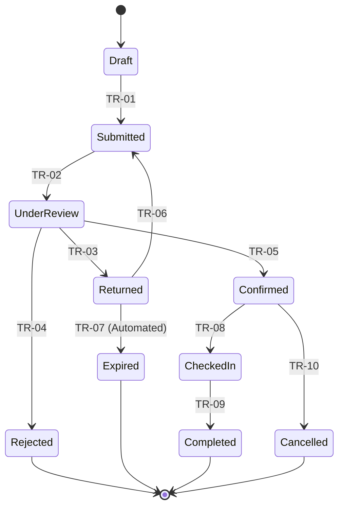

# LHC Booking System – Business Rules & Status Lifecycle

## Purpose

Defines the rules the LHC Booking System must enforce, and the one booking lifecycle with every status and allowed status change, in a form that can be tested. The business, engineers, testers and support use it to agree on what the application allows and forbids; every other document uses these status names and IDs.

## Scope

Covers business rules and validations, the statuses of a Booking (REC-01), its transitions, and the one allowed override. The records the statuses belong to are defined in BUS-06; how statuses are stored is in ENG-04 (ENT-01); the criteria that test each rule and transition are in SP-11. Rooms have an active flag, not a lifecycle, so only bookings have statuses.

## Business rules

| ID | Type | Rule | Applies to | Blocking | Owner | Exception allowed | Exception authority | Processes | Capabilities |
|---|---|---|---|---|---|---|---|---|---|
| BR-01 | Validation | If guest name, email, phone, check-in date, check-out date, room type or number of guests is missing, or the email or phone is not in a valid format, then the request cannot be submitted and each problem field is marked. | REC-01 | Yes | Daniel Reyes, LHC Front Office Supervisor | No | — | W-01 | C-01 |
| BR-02 | Validation | If the check-out date is not after the check-in date, the check-in date is before today, the check-in date is more than 365 days ahead, or the stay is longer than 30 nights, then the request cannot be submitted or changed to those dates. | REC-01 | Yes | Daniel Reyes, LHC Front Office Supervisor | No | — | W-01, W-04 | C-01, C-06 |
| BR-03 | Validation | If the number of guests is more than the capacity of the requested room type, then the request cannot be submitted or changed. | REC-01 | Yes | Daniel Reyes, LHC Front Office Supervisor | No | — | W-01, W-04 | C-01, C-06 |
| BR-04 | Business | If, on any night of the stay, the number of Confirmed and Checked In bookings of the requested room type already equals the number of active rooms of that type, then the booking cannot be confirmed, or changed to those nights or that room type. | REC-01, REC-02 | Yes | Grace Tan, LHC Manager | No | — | W-02, W-04 | C-02, C-04, C-06 |
| BR-05 | Business | If a room is already assigned to another Confirmed or Checked In booking for any of the same nights, then it cannot be assigned to this booking. | REC-01, REC-02 | Yes | Grace Tan, LHC Manager | No | — | W-03, W-04 | C-02, C-10 |
| BR-06 | Business | If staff return or reject a request, then they must enter a reason of at least 10 characters, and the reason is included in the email to the guest. | REC-01 | Yes | Daniel Reyes, LHC Front Office Supervisor | No | — | W-02 | C-05 |
| BR-07 | Business | If a request has been Returned for 7 days, then the guest is sent one reminder; if it has been Returned for 14 days without being resubmitted, then it becomes Expired and can no longer be resubmitted. | REC-01 | — | Grace Tan, LHC Manager | No | — | W-02 | C-18 |
| BR-08 | Business | If a Confirmed booking has no room assigned, or today is before its check-in date, then the guest cannot be checked in. | REC-01 | Yes | Daniel Reyes, LHC Front Office Supervisor | No | — | W-03 | C-17 |
| BR-09 | Business | If staff cancel a Confirmed booking, then they must enter a cancellation reason, and any room assignment is removed so the room is free for those nights. | REC-01 | Yes | Daniel Reyes, LHC Front Office Supervisor | No | — | W-04 | C-07 |
| BR-10 | Business | If the room rate for a room type changes after a booking is Confirmed, then the booking keeps the rate recorded when it was confirmed. | REC-01, REC-03 | — | Grace Tan, LHC Manager | Yes | R-04 | W-04, W-05 | C-04, C-09 |
| BR-11 | Business | If a room is assigned to a Confirmed or Checked In booking for any night from today onwards, then the room cannot be deactivated. | REC-02 | Yes | Daniel Reyes, LHC Front Office Supervisor | No | — | W-05 | C-08 |

## Statuses

All statuses belong to the Booking record (REC-01). Room assignment is not a status: it is an action on a Confirmed booking that can be repeated until check-in (ADR-004).

| ID | Name | Record | Meaning | Meaning for users | User-visible | Terminal |
|---|---|---|---|---|---|---|
| ST-01 | Draft | REC-01 | Saved after the first form step ("Your stay") but not yet submitted. Drafts unchanged for 30 days are deleted by the nightly job. | You have started a request but not sent it to LHC yet. | Yes | No |
| ST-02 | Submitted | REC-01 | Sent to LHC and waiting in the queue for a reviewer. | LHC has your request and will look at it within one working day. | Yes | No |
| ST-03 | Under Review | REC-01 | An LHC Staff member has taken the request and is checking it. | Someone at LHC is checking your request now. | Yes | No |
| ST-04 | Returned | REC-01 | LHC needs the guest to correct or complete the request before deciding. | LHC needs more information from you. Open your booking link, make the changes asked for and send it again within 14 days. | Yes | No |
| ST-05 | Rejected | REC-01 | LHC cannot accept the request; the reason was sent to the guest. | LHC cannot accept this request. The email tells you why. | Yes | Yes |
| ST-06 | Confirmed | REC-01 | Accepted; a room of the requested type is held for every night at the recorded rate. A specific room may or may not be assigned yet. | Your stay is booked. We will tell you your room before you arrive. | Yes | No |
| ST-07 | Checked In | REC-01 | The guest has arrived and is in the assigned room. | You are checked in. Enjoy your stay. | Yes | No |
| ST-08 | Completed | REC-01 | The guest has checked out. | Your stay is finished. Thank you for staying with us. | Yes | Yes |
| ST-09 | Cancelled | REC-01 | A Confirmed booking was called off; its room is free again. | This booking is cancelled. | Yes | Yes |
| ST-10 | Expired | REC-01 | A Returned request was not corrected within 14 days. | This request expired because it was not completed in time. Please send a new request. | Yes | Yes |

## Transitions

Anything not listed is not allowed. In particular, a Submitted request cannot be withdrawn or cancelled online and a Checked In booking cannot be cancelled (LIM-01; early departure is a check-out).

| ID | From | To | Roles | Trigger or action | Rule or condition | Processes |
|---|---|---|---|---|---|---|
| TR-01 | ST-01 | ST-02 | R-01, R-02 | Submit request | BR-01, BR-02, BR-03 | W-01 |
| TR-02 | ST-02 | ST-03 | R-02, R-03 | Take into review | None | W-02 |
| TR-03 | ST-03 | ST-04 | R-02, R-03 | Return for correction | BR-06 | W-02 |
| TR-04 | ST-03 | ST-05 | R-02, R-03 | Reject | BR-06 | W-02 |
| TR-05 | ST-03 | ST-06 | R-02, R-03 | Confirm | BR-04, BR-10 (rate recorded) | W-02 |
| TR-06 | ST-04 | ST-02 | R-01 | Resubmit corrected request through the booking link | BR-01, BR-02, BR-03; only before BR-07 expiry | W-01 |
| TR-07 | ST-04 | ST-10 | Automated | Nightly job finds the request Returned for 14 days | BR-07 | W-02 |
| TR-08 | ST-06 | ST-07 | R-02, R-03 | Check in | BR-08 | W-03 |
| TR-09 | ST-07 | ST-08 | R-02, R-03 | Check out | None | W-03 |
| TR-10 | ST-06 | ST-09 | R-02, R-03 | Cancel booking | BR-09 | W-04 |

## Lifecycle diagram

*Caption: The statuses of a Booking (REC-01) and the ten allowed transitions; "UnderReview" and "CheckedIn" are the diagram labels for Under Review and Checked In.*

## Exceptions and overrides

| Exception | Normal rule | Allowed override | Approved by | Audit requirement |
|---|---|---|---|---|
| Change the rate of a Confirmed booking (for example a goodwill discount) | BR-10 | A user with R-04 sets a new nightly rate on that booking with a reason of at least 10 characters | R-04 | Old rate, new rate, reason, user and time recorded as an Audit event (REC-06), kept 3 years |

No other overrides are allowed.

## Assumptions and open questions

No open questions.

## Known limitations

No known limitations beyond LIM-01 (BUS-02): guests cannot withdraw or change a request themselves.

## Change log

| Version | Date | Author | Summary | Approved by |
|---|---|---|---|---|
| 0.1 | 2026-04-14 | Priya Nair | First draft: one lifecycle replacing the "pending, modified, room assigned, closed" wording of the earlier single-file example | — |
| 0.2 | 2026-06-15 | Priya Nair | BR-07 reminder at 7 days added; Draft clean-up after 30 days noted | — |
| 1.0 | 2026-08-21 | Priya Nair | Accepted at stage 4 | Grace Tan, LHC Manager, 2026-08-21 |
| 1.0 | 2026-09-11 | Priya Nair | Reviewed at go-live, no changes | Grace Tan, LHC Manager, 2026-09-11 |
