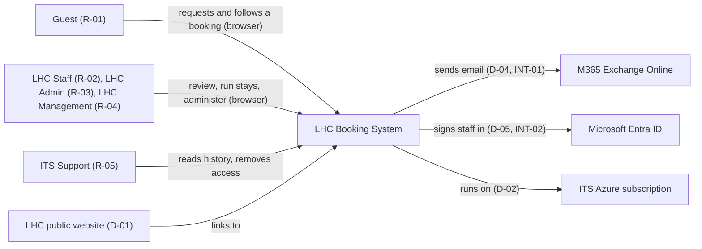
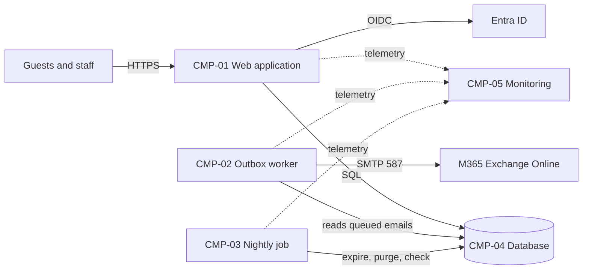
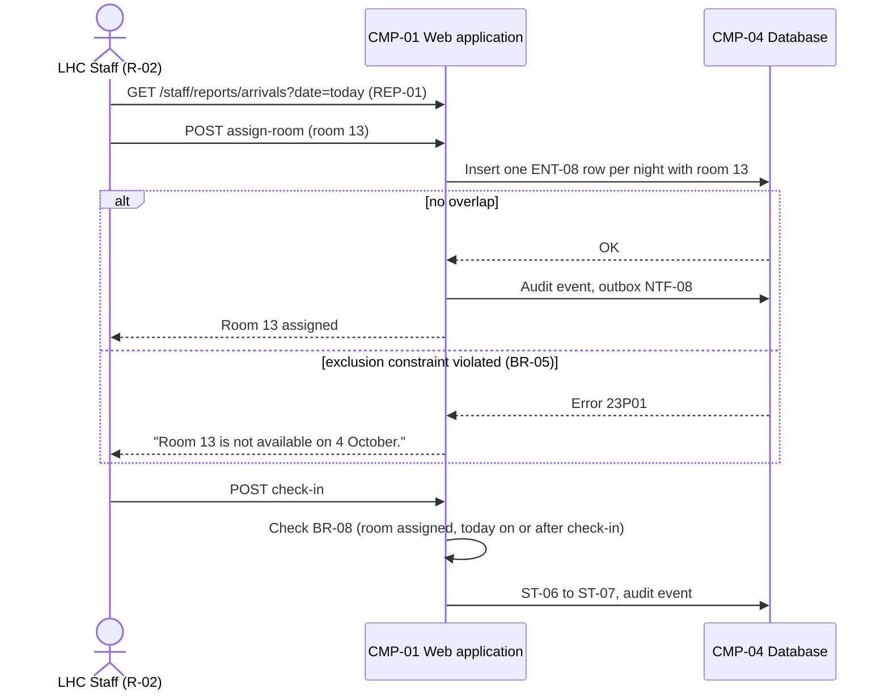
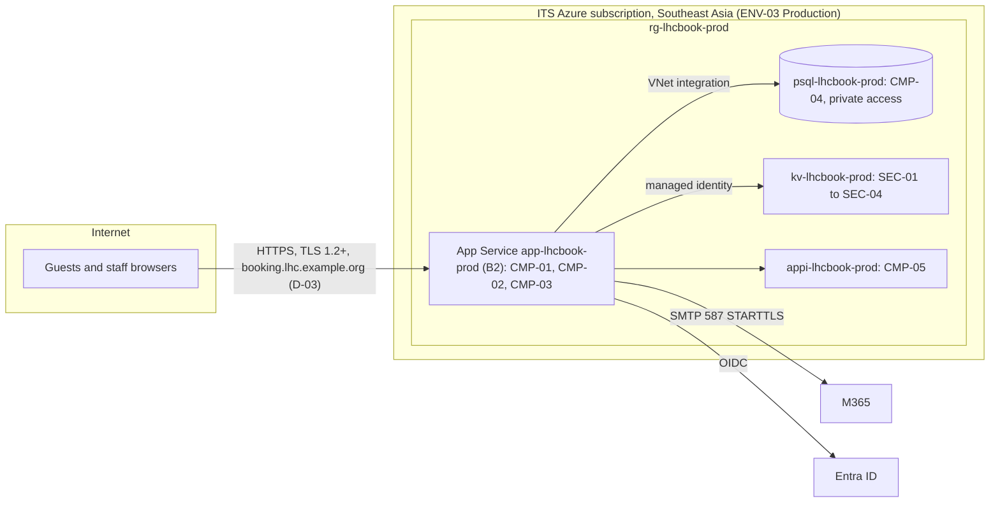

# LHC Booking System – Architecture & Design

## Purpose

Explains how the LHC Booking System is built and how it behaves at run time, so engineers and agents can change it without breaking its design, and operators know where each part runs.

## Scope

Covers the system context, containers, runtime behaviour of the three main journeys, deployment, cross-cutting concepts, quality goals, security and technical debt. The data model is in ENG-04, interface contracts in ENG-05, environments and configuration in the ENG-06 section of ENG-09, and the reasons for decisions in ENG-10.

## Context (C4 level 1)



*Caption: The application, its users and the external systems it depends on.*

## Containers (C4 level 2)



*Caption: The deployable parts of the application and how they communicate.*

| ID | Container | Technology | Responsibility | Stores data | Owner |
|---|---|---|---|---|---|
| CMP-01 | Web application | Python 3.12, Django 5.1, server-rendered templates, Gunicorn; container image | Guest form and status page, staff screens, reports, rules BR-01 to BR-11, writes emails to the outbox | None (stateless) | ITS Application Team (Priya Nair) |
| CMP-02 | Outbox worker | Same image, `manage.py run_worker`, continuous WebJob | Sends queued notifications through INT-01 with 5 retries over 1 hour; writes each attempt | None | ITS Application Team (Priya Nair) |
| CMP-03 | Nightly job | Same image, `manage.py nightly`, triggered WebJob at 01:30 | Reminders and expiry (BR-07), Draft deletion and anonymisation (NFR-07), retention deletes (NFR-12), output checks OC-01, OC-03, OC-05 | None | ITS Application Team (Priya Nair) |
| CMP-04 | Database | Azure Database for PostgreSQL Flexible Server 16 | All application data | ENT-01, ENT-02, ENT-03, ENT-04, ENT-05, ENT-06, ENT-07, ENT-08 (and the operational table jobs_nightlyrun, ENG-04) | ITS Application Team (Priya Nair) |
| CMP-05 | Monitoring | Application Insights `appi-lhcbook-prod`, Log Analytics, availability test | Request, error and job telemetry; alerts ALR-01 to ALR-07 | Logs only, no personal data | ITS Application Team (Priya Nair) |

One codebase and one image run all three processes (ADR-001). Emails are never sent inside a web request: the web application writes an outbox row in the same transaction as the change, and the worker sends it (ADR-005).

## Runtime view

### J-01 Guest submits a booking request

```mermaid
sequenceDiagram
    actor G as Guest (R-01)
    participant WEB as CMP-01 Web application
    participant DB as CMP-04 Database
    participant WK as CMP-02 Outbox worker
    participant MAIL as M365 (INT-01)
    G->>WEB: POST /book/stay (dates, room type, guests)
    WEB->>DB: Insert booking ST-01 Draft with token
    WEB-->>G: "Your details" step and Draft link
    G->>WEB: POST /book/submit (name, email, phone)
    WEB->>WEB: Rate limit (NFR-06); validate BR-01, BR-02, BR-03
    WEB->>DB: One transaction: status ST-02, reference, audit event, outbox rows NTF-01 and NTF-02
    WEB-->>G: "Request received", reference and booking link
    WK->>DB: Poll outbox (every 30 s)
    WK->>MAIL: Send NTF-01 and NTF-02
    WK->>DB: Record attempt and result (ENT-05)
```

*Caption: How a request is validated, stored and acknowledged.*

A validation failure returns the form with field messages and no change. If M365 refuses or times out, the worker retries 5 times over 1 hour and then marks the entry Failed, which appears on the failed-email list and counts towards ALR-03. The guest's confirmation screen never waits for email.

### J-04 Staff review and confirm a request

```mermaid
sequenceDiagram
    actor S as LHC Staff (R-02)
    participant WEB as CMP-01 Web application
    participant DB as CMP-04 Database
    participant ENTRA as Entra ID (INT-02)
    S->>WEB: GET /staff
    WEB->>ENTRA: Redirect to sign-in (if no session)
    ENTRA-->>WEB: ID token (name, email, object ID)
    WEB->>DB: Load role (ENT-06); queue of ST-02 and ST-03 bookings
    S->>WEB: POST take-into-review
    WEB->>DB: ST-02 to ST-03, reviewer, audit event
    S->>WEB: POST confirm
    WEB->>DB: Lock room type; count Confirmed and Checked In nights (BR-04)
    alt every night has a free room
        WEB->>DB: ST-03 to ST-06, nightly rate from ENT-04 (BR-10), audit event, outbox NTF-05
        WEB-->>S: Booking confirmed
    else a night is full
        WEB-->>S: "No Standard Twin room is available on 4 October."
    end
```

*Caption: How a reviewer takes a request and confirms it against availability.*

The availability count and the status change run in one transaction holding a row lock on the room type (`SELECT ... FOR UPDATE` on ENT-03), so two reviewers confirming the last room at the same moment cannot both succeed. Every action checks the user's role on the server; hidden buttons are not the control.

### J-05 Staff assign a room and check the guest in



*Caption: How a room is assigned under the database's no-overlap rule, and the guest checked in.*

The exclusion constraint on ENT-08 (ADR-002) is the last line of defence: even if two staff assign the same room at the same moment, or a defect bypasses the screen check, the database refuses the second row.

## Deployment view



*Caption: Production deployment and network boundaries; the trust boundaries are internet to App Service, and App Service to M365 and Entra ID.*

| Container | Runs on | Region or site | Scaling | Environment notes |
|---|---|---|---|---|
| CMP-01 | Azure App Service for Linux, plan B2, container from the ITS registry | Southeast Asia | 1 instance; scale to B3 above 30 concurrent users (BUS-07) | ENV-02: B1; ENV-01: `manage.py runserver` |
| CMP-02 | Continuous WebJob in the same App Service | Southeast Asia | 1 instance only; the outbox locks rows so a second instance would be safe | ENV-01: `manage.py run_worker` in a second terminal |
| CMP-03 | Triggered WebJob "nightly" in the same App Service, 01:30 Asia/Singapore | Southeast Asia | 1 run a night | ENV-02: runs at 02:30 against test data |
| CMP-04 | Azure Database for PostgreSQL Flexible Server B1ms, 32 GB | Southeast Asia; geo-redundant backups in East Asia | Vertical only | ENV-01: PostgreSQL 16 in Docker |
| CMP-05 | Application Insights and Log Analytics | Southeast Asia | Managed | ENV-02 has its own instance |

## Cross-cutting concepts

| Concept | Approach | Where implemented | Notes |
|---|---|---|---|
| Authentication | Staff: Entra ID OpenID Connect with MFA enforced by conditional access (ADR-003). Guests: no account; a random 128-bit token in the booking link | `lhcbooking/auth/` | Staff sessions expire after 8 hours or 60 minutes idle |
| Authorisation | Role-based, one role per staff user account, permissions exactly as in BUS-04; a decorator on every staff view and action checks the role on the server | `lhcbooking/auth/permissions.py` | Unit test compares the permission table with BUS-04 |
| Logging | JSON logs to Application Insights with a correlation ID per request, shown on error pages (NFR-11) | `lhcbooking/observability/` | Name, email, phone and special requests are never logged; a log filter strips them |
| Error handling | Rule failures return the form with field messages; unexpected errors show "Something went wrong" with the correlation ID and are reported to Application Insights | `lhcbooking/web/errors.py` | No stack traces shown to users |
| Auditing | Every status change, room assignment, booking change, room, rate and role change writes an ENT-07 row in the same transaction (FR-23) | `lhcbooking/audit/` | Kept 3 years (NFR-12) |
| Background work | Transactional outbox for emails (ADR-005); one nightly job whose steps are idempotent | `lhcbooking/notifications/`, `lhcbooking/jobs/` | Each nightly step records its count in the jobs_nightlyrun table |
| Business rules | All rules BR-01 to BR-11 live in the domain layer, never in templates; BR-05 is also enforced by the database (ADR-002) | `lhcbooking/bookings/rules.py` | Rule IDs appear in code comments and test names |
| Statuses | Status values and allowed transitions TR-01 to TR-10 are one table in code; any other change is refused | `lhcbooking/bookings/lifecycle.py` | Must match BUS-05 |
| Time zones and dates | Timestamps stored in UTC; displayed and "today" computed in Asia/Singapore; stay dates are date-only | `lhcbooking/core/clock.py` | Tests use a fixed clock |
| Internationalisation | English only; dates shown as "3 Oct 2026" | Django templates | Text in templates, not code |
| Rate limiting | 10 submissions an hour per client IP (NFR-06), counted in process memory | `lhcbooking/web/ratelimit.py` | See technical debt |

## Quality goals

| Priority | Quality goal | NFR | How the design achieves it |
|---|---|---|---|
| 1 | A room is never given to two guests | None (BR-05) | Exclusion constraint (ADR-002); row lock during confirmation; OC-01 nightly |
| 2 | Guest data is protected and kept only as long as allowed | NFR-04, NFR-07 | SSO with MFA; unguessable booking tokens; log filter; nightly anonymisation |
| 3 | Guests and staff can always submit and decide | NFR-01, NFR-02 | Small stateless web tier; email sent asynchronously so M365 outages do not block pages |
| 4 | Recoverable within 4 hours, losing at most 1 hour | NFR-13, NFR-14 | Managed PostgreSQL point-in-time restore; stateless app redeployable from the registry |
| 5 | Usable by everyone on any common browser | NFR-08, NFR-09 | Server-rendered HTML with progressive enhancement; accessible form components tested in CI |

## Security

**Authentication method:** staff sign in through Entra ID single sign-on with MFA (INT-02); there are no local staff passwords. Guests use a booking link with a 128-bit random token; the token is stored hashed. The nightly job and worker run inside the App Service and use its managed identity for Key Vault.

**Authorisation model:** role-based, with roles R-02 to R-05 and permissions as defined in BUS-04; enforced on the server in the view layer and re-checked in the domain service for every state change. Guests can see and resubmit only the booking whose token they hold.

**Trust boundaries:** internet to App Service (TLS terminates at App Service); App Service to the database (private VNet access only, no public endpoint); App Service to M365 and Entra ID (outbound TLS). Shown on the deployment view.

**Encryption:** in transit TLS 1.2 or higher on every connection, HSTS on the site; at rest Azure-managed encryption for the database, backups and Key Vault.

**Audit logging:** staff sign-ins (Entra ID sign-in logs, kept by ITS for 30 days), role changes, every booking, room and rate change, and rate overrides by LHC Management are recorded as ENT-07 audit events and kept 3 years.

**Data classification by store:**

| Store | Highest classification held | Entities | Protection |
|---|---|---|---|
| CMP-04 Database | Personal | ENT-01, ENT-05, ENT-06, ENT-07 | Private network access only; encryption at rest; nightly anonymisation; encrypted geo-redundant backups |
| CMP-05 Monitoring | Internal | None (logs and metrics) | Log filter removes personal fields; access limited to the ITS Application Team |
| Key Vault kv-lhcbook-prod | Confidential (secrets) | None | Access by managed identity and two named ITS administrators; soft delete |

**Threat model summary:**

| Threat | Boundary or asset | Control | Residual risk |
|---|---|---|---|
| A booking link is guessed or shared, exposing a guest's details | Internet to App Service; ENT-01 | 128-bit random token, stored hashed; status page shows no other booking; 404 for a wrong token (AC-53) | RISK-01 |
| Automated mass submissions through the public form | Internet to App Service | Per-IP rate limit, honeypot field, App Service access restrictions | RISK-06 |
| Cross-site request forgery or scripting on staff screens | Browser to App Service | Django CSRF protection, auto-escaping templates, Content-Security-Policy header; penetration test PT-2026-031 | None |
| A staff session is hijacked | Browser to App Service | Secure, HttpOnly, SameSite cookies; 8-hour lifetime; MFA at sign-in | None |
| A leaver keeps access | ENT-06 | Entra ID account disabled by HR process; role removal; quarterly review | RISK-10 |
| SQL injection | App Service to database | Django ORM with parameterised queries; no raw SQL except the reviewed output checks | None |
| Secrets leak from code or configuration | Repository; App Service settings | All secrets in Key Vault by reference (ENG-06); secret scanning in CI | None |

## Technical risks and debt

| Item | Type | Impact | Plan or trigger | Risk |
|---|---|---|---|---|
| Single region; paired-region restore never tested | Risk | Regional outage could exceed the 4-hour RTO | Test a paired-region restore at a quarterly restore test (MT-11) | RISK-07 |
| One nightly job runs every scheduled step in sequence; a failing step stops the steps after it | Debt | Anonymisation or expiry can be skipped for a night; only one alert (ALR-05) | Split into separate WebJobs with their own alerts at the next normal release after 2026-12-31, or earlier if ALR-05 fires twice in a quarter | RISK-02 |
| Rate-limit counter is held in process memory | Debt | Counts reset on restart and would not be shared if the app scaled to two instances | Move the counter to a database table before scaling out to a second instance | RISK-06 |

## Assumptions and open questions

No open questions.

## Known limitations

No known limitations.

## Change log

| Version | Date | Author | Summary | Approved by |
|---|---|---|---|---|
| 0.1 | 2026-03-20 | Priya Nair | Context, containers and main decisions at stage 2 | — |
| 0.2 | 2026-07-30 | Leo Santos | Runtime views, security and threat model from the build | — |
| 1.0 | 2026-09-11 | Priya Nair | Accepted at go-live after the penetration test | Priya Nair, ITS Application Lead; Tom Rivera, ITS Infrastructure Manager, 2026-09-11 |
