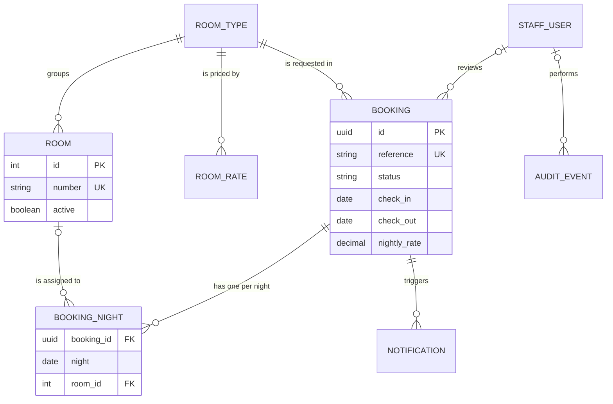

# LHC Booking System – Data Model

## Purpose

Describes the entities the LHC Booking System stores, their fields, keys and relationships, how they map to the business records in BUS-06, and how they are classified and kept. Engineers and agents use it to change the schema safely.

## Scope

Covers every persistent entity in the PostgreSQL database (CMP-04). Business meaning, ownership and retention rationale of records are in BUS-06; statuses in BUS-05; where the database runs in ENG-03; how migrations are deployed in ENG-07.

## Entities

| ID | Entity | Records | Description | System of record | Classification | Retention | Owner |
|---|---|---|---|---|---|---|---|
| ENT-01 | booking | REC-01 | One guest's request and stay, from Draft to its final status | Yes | Personal | Drafts deleted 30 days after last change; personal fields anonymised 2 years after the final status; row deleted 7 years after the final status (nightly job; MT-12) | Daniel Reyes, LHC Front Office Supervisor |
| ENT-02 | room | REC-02 | One bookable room | Yes | Internal | Kept while active; deleted 7 years after deactivation on the LHC Admin's request | Daniel Reyes, LHC Front Office Supervisor |
| ENT-03 | room_type | REC-02 | A group of identical rooms with a capacity | Yes | Internal | Kept while any room or booking refers to it | Daniel Reyes, LHC Front Office Supervisor |
| ENT-04 | room_rate | REC-03 | The nightly rate for a room type from a start date | Yes | Internal | Deleted 7 years after a later rate replaces it (MT-12) | Grace Tan, LHC Manager |
| ENT-05 | notification | REC-04 | One email in the outbox and every attempt to send it | Yes | Personal | Deleted 2 years after it was sent (nightly job) | Daniel Reyes, LHC Front Office Supervisor |
| ENT-06 | staff_user | REC-05 | A staff member's account and role, created at first sign-in | No: D-05 Entra ID holds the identity | Personal | Deactivated when access is removed; deleted 3 years after last sign-in (nightly job) | Daniel Reyes, LHC Front Office Supervisor |
| ENT-07 | audit_event | REC-06 | Who changed what, when, with old and new values | Yes | Personal | Deleted 3 years after the event (nightly job) | Priya Nair, ITS Application Lead |
| ENT-08 | booking_night | REC-01 | One night of a booking's stay with its assigned room; enforces BR-05 | Yes | Internal | Deleted with its booking | Daniel Reyes, LHC Front Office Supervisor |

Operational tables that hold no business record are listed under Operational tables below, not as entities.

## Entity relationships

*Caption: Main entities and their relationships; audit events refer to any record by type and ID.*

## Entity details

### ENT-01 booking

**Store:** CMP-04 · **Table or collection:** bookings_booking · **Approximate volume:** about 2,400 rows a year; 10,000 active and 50,000 anonymised rows tested (NFR-03)

| Field | Type | Required | Constraints | Key | Classification | Notes |
|---|---|---|---|---|---|---|
| id | uuid | Yes | Generated | PK | Internal | |
| reference | varchar(16) | On submit | LHC-YYYY-nnnn, unique, assigned at TR-01 | UK | Internal | Shown to guests and staff |
| token_hash | char(64) | Yes | SHA-256 of the 128-bit booking link token, unique | UK | Confidential | The token itself is never stored (NFR-04) |
| status | varchar(16) | Yes | One of ST-01, ST-02, ST-03, ST-04, ST-05, ST-06, ST-07, ST-08, ST-09, ST-10, stored as the status name | | Internal | Changed only by transitions TR-01 to TR-10 in BUS-05 (`lifecycle.py`) |
| room_type_id | int | Yes | | FK → ENT-03 | Internal | |
| check_in | date | Yes | ≥ today and ≤ today + 365 days at submit (BR-02) | | Internal | |
| check_out | date | Yes | > check_in; ≤ check_in + 30 days (BR-02) | | Internal | |
| guests | smallint | Yes | 1 to room type capacity (BR-03) | | Internal | |
| guest_name | varchar(120) | On submit | Not blank (BR-01) | | Personal | Replaced with "Anonymised" after 2 years |
| guest_email | varchar(254) | On submit | Valid email (BR-01) | | Personal | Not written to logs |
| guest_phone | varchar(32) | On submit | E.164 format (BR-01) | | Personal | Not written to logs |
| special_requests | text | No | ≤ 1,000 characters | | Personal | Anonymised after 2 years |
| reviewer_id | uuid | No | Set at TR-02 | FK → ENT-06 | Internal | |
| decision_reason | text | No | ≥ 10 characters at TR-03 and TR-04 (BR-06); required at TR-10 (BR-09) | | Internal | Sent to the guest |
| nightly_rate | numeric(8,2) | At TR-05 | Copied from ENT-04 at confirmation (BR-10) | | Internal | Changed later only by R-04 with a reason (FR-17) |
| submitted_at, returned_at, decided_at, final_status_at | timestamptz | No | UTC | | Internal | returned_at drives BR-07; final_status_at drives anonymisation |
| created_at, updated_at | timestamptz | Yes | UTC | | Internal | updated_at drives Draft deletion |

**Indexes:** `booking_status_submitted_idx` on (status, submitted_at) for the queue; `booking_check_in_idx` on (check_in) for the arrivals list; `booking_returned_idx` on (returned_at) where status = 'Returned', for the nightly job.

### ENT-02 room

**Store:** CMP-04 · **Table or collection:** rooms_room · **Approximate volume:** 28 rows; at most 40 expected

| Field | Type | Required | Constraints | Key | Classification | Notes |
|---|---|---|---|---|---|---|
| id | int | Yes | Generated | PK | Internal | |
| number | varchar(8) | Yes | Unique | UK | Internal | Shown on the arrivals list |
| room_type_id | int | Yes | | FK → ENT-03 | Internal | |
| active | boolean | Yes | Cannot become false while BR-11 is broken | | Internal | |

### ENT-03 room_type

**Store:** CMP-04 · **Table or collection:** rooms_roomtype · **Approximate volume:** 3 rows

| Field | Type | Required | Constraints | Key | Classification | Notes |
|---|---|---|---|---|---|---|
| id | int | Yes | Generated | PK | Internal | Locked with `FOR UPDATE` during confirmation (ENG-03) |
| name | varchar(40) | Yes | Unique | UK | Internal | Standard Single, Standard Twin, Family Room |
| capacity | smallint | Yes | 1 to 6 | | Internal | Used by BR-03 |

### ENT-04 room_rate

**Store:** CMP-04 · **Table or collection:** rooms_roomrate · **Approximate volume:** about 6 rows a year

| Field | Type | Required | Constraints | Key | Classification | Notes |
|---|---|---|---|---|---|---|
| id | int | Yes | Generated | PK | Internal | |
| room_type_id | int | Yes | Unique with start_date | FK → ENT-03 | Internal | |
| start_date | date | Yes | | | Internal | The rate with the latest start_date on or before check-in applies (FR-16) |
| nightly_rate | numeric(8,2) | Yes | > 0 | | Internal | USD |
| approved_by | varchar(120) | Yes | | | Internal | Name of the LHC Management approver |

### ENT-05 notification

**Store:** CMP-04 · **Table or collection:** notifications_notification · **Approximate volume:** about 3,600 rows a year

| Field | Type | Required | Constraints | Key | Classification | Notes |
|---|---|---|---|---|---|---|
| id | uuid | Yes | Generated | PK | Internal | |
| booking_id | uuid | No | | FK → ENT-01 | Internal | |
| type | varchar(8) | Yes | One of NTF-01 to NTF-09 | | Internal | |
| recipient | varchar(254) | Yes | Valid email | | Personal | |
| status | varchar(8) | Yes | Queued, Sent or Failed | | Internal | Notification delivery state, not a booking status |
| attempts | smallint | Yes | 0 to 5 | | Internal | FR-18 |
| last_error | text | No | | | Internal | Shown on /staff/notifications |
| created_at, sent_at | timestamptz | created_at Yes | UTC | | Internal | |

**Indexes:** `notification_queued_idx` on (status, created_at) where status = 'Queued', for the worker.

### ENT-06 staff_user

**Store:** CMP-04 · **Table or collection:** auth_staffuser · **Approximate volume:** about 20 rows

| Field | Type | Required | Constraints | Key | Classification | Notes |
|---|---|---|---|---|---|---|
| id | uuid | Yes | Generated | PK | Internal | |
| entra_object_id | uuid | Yes | Unique; from the ID token (INT-02) | UK | Internal | |
| name, email | varchar | Yes | From the ID token | | Personal | |
| role | varchar(16) | No | One of R-02, R-03, R-04, R-05, stored as the role name; empty means no access | | Internal | Changed only through FR-19 |
| active | boolean | Yes | | | Internal | |
| last_sign_in | timestamptz | No | UTC | | Internal | Drives deletion after 3 years |

### ENT-07 audit_event

**Store:** CMP-04 · **Table or collection:** audit_auditevent · **Approximate volume:** about 15,000 rows a year

| Field | Type | Required | Constraints | Key | Classification | Notes |
|---|---|---|---|---|---|---|
| id | bigint | Yes | Generated | PK | Internal | |
| at | timestamptz | Yes | UTC | | Internal | |
| user_id | uuid | No | Empty for Automated actions (the nightly job) | FK → ENT-06 | Internal | |
| action | varchar(40) | Yes | For example status_change, room_assigned, rate_override, role_change | | Internal | |
| record_type, record_id | varchar, varchar | Yes | | | Internal | Booking, room, rate or staff user |
| old_value, new_value | jsonb | No | | | Personal | May contain guest details; anonymised with the booking |
| reason | text | No | Required for rate_override | | Internal | |

Rows are insert-only: the application has no update or delete path except the retention delete.

### ENT-08 booking_night

**Store:** CMP-04 · **Table or collection:** bookings_bookingnight · **Approximate volume:** about 6,000 rows a year

| Field | Type | Required | Constraints | Key | Classification | Notes |
|---|---|---|---|---|---|---|
| booking_id | uuid | Yes | | PK, FK → ENT-01 | Internal | |
| night | date | Yes | check_in ≤ night < check_out | PK | Internal | |
| room_id | int | No | Exclusion constraint `no_double_booking`: no two rows with the same room_id and night while the booking is Confirmed or Checked In (ADR-002) | FK → ENT-02 | Internal | Empty until a room is assigned |
| holds_room | boolean | Yes | True while the booking is in ST-06 or ST-07 | | Internal | Maintained with the booking status; part of the constraint |

## Operational tables

These tables support running the application and hold no business record or personal data, so they have no `ENT` ID.

| Table | Purpose | Retention | Owner |
|---|---|---|---|
| jobs_nightlyrun | One row per nightly job run with the count and result of each step; read by ALR-05 and shown on /health/jobs | Deleted after 1 year | Priya Nair, ITS Application Lead |
| django_session | Staff sessions | Expire after 8 hours | Priya Nair, ITS Application Lead |
| django_migrations | Applied migrations | Kept | Priya Nair, ITS Application Lead |

**jobs_nightlyrun fields:**

| Field | Type | Required | Constraints | Key | Classification | Notes |
|---|---|---|---|---|---|---|
| id | bigint | Yes | Generated | PK | Internal | |
| started_at, finished_at | timestamptz | started_at Yes | UTC | | Internal | |
| status | varchar(8) | Yes | Running, Success or Failed | | Internal | Job state, not a booking status; read by ALR-05 |
| step_counts | jsonb | No | Count per step and per output check | | Internal | Shown on /health/jobs |
| error | text | No | | | Internal | |

## Migrations

| Item | Approach |
|---|---|
| Tool | Django migrations (Django 5.1) |
| Location | `lhcbooking/*/migrations/` |
| Naming | Django's sequential numbering with a short description, for example `0007_booking_returned_idx` |
| How to create | `python manage.py makemigrations <app> --name <description>` (ENG-09) |
| How applied | `python manage.py migrate` runs as a one-off pipeline job with the new image, before the app is switched to that image (ENG-07) |
| Reversibility | Each schema migration must be compatible with the previous release's code, so switching back to the previous image works without reversing it |
| Data migrations | Written as `RunPython` with a reverse function, tested against a masked copy of production in ENV-02 |
| Destructive changes | Two releases: stop reading and writing the column, then drop it in a later release |

## Reference data

| Reference data | Entity | Source | Owner | Update process | Frequency |
|---|---|---|---|---|---|
| Room types and capacities | ENT-03 | Seed migration; changes by ITS on request | Daniel Reyes, LHC Front Office Supervisor | Normal change (ENG-08) | Rarely |
| Rooms | ENT-02 | Admin screen /staff/setup, from the Facilities notice (D-06) | Daniel Reyes, LHC Front Office Supervisor | BUS-09 "Update rooms and rates" | When Facilities change a room |
| Rates | ENT-04 | Admin screen /staff/setup, from the approved rate card (D-07) | Grace Tan, LHC Manager | BUS-09 "Update rooms and rates" | Yearly, by 1 December |

## Assumptions and open questions

No open questions.

## Known limitations

No known limitations.

## Change log

| Version | Date | Author | Summary | Approved by |
|---|---|---|---|---|
| 0.1 | 2026-04-02 | Leo Santos | First schema at stage 3 | — |
| 0.2 | 2026-06-10 | Leo Santos | booking_night and the exclusion constraint added (ADR-002) | — |
| 1.0 | 2026-09-11 | Priya Nair | Accepted at go-live | Priya Nair, ITS Application Lead, 2026-09-11 |
