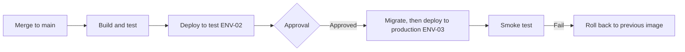

# LHC Booking System – Deployment & Release Guide

## Purpose

Explains how a change gets from a merged commit to production for the LHC Booking System, how to check it worked, and how to roll it back. An ITS operator who did not build the system must be able to follow it.

## Scope

Covers the build and release pipeline, versioning, deployment to ENV-02 and ENV-03, verification, rollback, database migrations and release notes. Environments, configuration and secrets are in the ENG-06 section of ENG-09; incident handling after a failed release is in ENG-08. Commands are illustrative of the ITS Azure setup.

## Pipeline



*Caption: Release pipeline from merge to production, with the approval gate and rollback path.*

| Step | Trigger | What it does | Approval | Where defined | On failure |
|---|---|---|---|---|---|
| 1 Build and test | Pull request and merge to main | Lint (ruff), unit, integration and accessibility tests against PostgreSQL 16; dependency and secret scan; builds the image `lhcbooking:<git sha>` and pushes it to the ITS registry | None | `.github/workflows/ci.yml` | Pipeline stops; the author fixes |
| 2 Deploy to test | Merge to main | Runs migrations in ENV-02, points app-lhcbook-test at the new image, restarts, runs the smoke tests | None | `.github/workflows/deploy.yml`, job `deploy-test` | Pipeline stops; ENV-02 is rolled back by the same job |
| 3 Release tag | Tag `vX.Y.Z` pushed on main | Re-tags the tested image as `lhcbooking:X.Y.Z` | Priya Nair, ITS Application Lead (tag permission) | `.github/workflows/release.yml` | No production deployment |
| 4 Deploy to production | Approval of job `deploy-production` for the tag | Runs migrations against ENV-03, points app-lhcbook-prod at `lhcbooking:X.Y.Z`, restarts, runs the smoke tests | Priya Nair, ITS Application Lead, or Leo Santos, ITS Developer, in the GitHub environment "production" | `.github/workflows/deploy.yml`, job `deploy-production` | Automatic rollback to the previous image; deployer follows Rollback |

## Versioning

Semantic versioning MAJOR.MINOR.PATCH, with a tag `vX.Y.Z` on main. The version is shown in the staff page footer and in the `/health` response. The first production release is 1.0.0 (2026-09-14).

## Pre-deployment checklist

- [ ] All Must acceptance criteria affected by the change pass in ENV-02 (SP-11).
- [ ] Database migrations reviewed, tested on a masked copy of production data in ENV-02, and compatible with the previous release's code (below).
- [ ] Configuration, secret and feature flag changes are recorded in ENG-06 and already set in ENV-03.
- [ ] Release notes written in `CHANGELOG.md` and BUS-09 What's new (below).
- [ ] LHC staff told about visible changes; deployments with a restart happen in the Sunday 22:00–24:00 window or before 07:00 (ENG-08 Communication).
- [ ] A person able to roll back is available for the 60-minute monitoring window.
- [ ] Normal changes have an approved ITS change record (ENG-08 Change management).

## Deployment steps

### Deploy to ENV-03 Production

1. Check the ENV-02 deployment of the same commit is green and its smoke tests passed.
2. Create the tag: `git tag v1.0.1 && git push origin v1.0.1`. Wait for `release.yml` to finish.
3. In GitHub, Actions, "deploy", open the run for the tag and approve the `deploy-production` job.
4. The job runs, in order:
   1. `az webapp config container show -g rg-lhcbook-prod -n app-lhcbook-prod` and records the current image tag as the rollback target in the job summary.
   2. The one-off migration container: `python manage.py migrate --noinput` with the new image and the production DATABASE_URL (SEC-01).
   3. `az webapp config container set -g rg-lhcbook-prod -n app-lhcbook-prod --docker-custom-image-name <registry>/lhcbooking:1.0.1`, then `az webapp restart`. The site is unavailable for about 1 minute.
   4. The smoke tests below.
5. Add a line to the release log (`docs/releases.md`): version, date, deployer, change record, result.

**Verification (smoke tests):**

| Check | How | Expected result |
|---|---|---|
| Health check | `curl https://booking.lhc.example.org/health` | HTTP 200, `"version":"1.0.1"`, `"db":"ok"` |
| Guest submission (J-01) | `python manage.py smoke_test --submit` submits a request as the smoke-test guest "Smoke Test" (smoke-test@lhc.example.org) | Booking reaches ST-02 Submitted; an NTF-01 notification is logged as Sent within 2 minutes; the smoke booking is then deleted |
| Staff sign-in (J-04) | The deployer signs in at /staff | The queue opens |
| Background jobs | Open /health/jobs | Worker heartbeat within the last 60 s; last nightly run Success |

### Deploy to ENV-02 Test

Automatic on every merge to main (pipeline step 2), with the same steps and smoke tests against https://booking-test.lhc.example.org.

## Rollback

**Roll back when any of these is true:**

| Signal | Threshold | Decision |
|---|---|---|
| Smoke test fails | Any check fails | Roll back immediately (the job does this automatically) |
| Error rate | Above 2% of requests for 5 minutes within the monitoring window | Roll back; declare an incident (ENG-08) |
| A core journey broken for users | Any confirmed report of J-01, J-04 or J-05 failing | Roll back unless a fix can ship within 30 minutes |

**Who decides:** the deployer on duty; escalate to Priya Nair, ITS Application Lead (ext. 4120).

**Steps:**

1. Read the rollback target (previous image tag) from the deployment job summary, or from the release log.
2. Run `az webapp config container set -g rg-lhcbook-prod -n app-lhcbook-prod --docker-custom-image-name <registry>/lhcbooking:<previous version>` and `az webapp restart -g rg-lhcbook-prod -n app-lhcbook-prod`.
3. Do not reverse migrations: every migration is compatible with the previous release (below). If a data-changing migration went wrong, follow ENG-08 Backup and restore to the on-demand backup taken before it.
4. If the release changed a feature flag, set it back in ENG-06 and in App Service configuration.

**Verification after rollback:** run the production smoke tests; confirm `/health` shows the previous version; record the rollback in the release log and tell LHC staff (ENG-08 Communication).

## Database migrations

| Item | Approach |
|---|---|
| When migrations run | In the deployment job, as a one-off container with the new image, before the app is switched to it |
| Compatibility rule | Each migration works with the previous release's code, so a code rollback never needs a schema rollback; destructive changes take two releases (ENG-04) |
| How to reverse | Not reversed in production; write a compensating migration in a new release |
| Data-changing migrations | Take an on-demand backup first: `az postgres flexible-server backup create -g rg-lhcbook-prod -n psql-lhcbook-prod --backup-name pre-<version>` |

## Release notes

**Location:** `CHANGELOG.md` in the repository, and BUS-09 What's new for anything users notice.

**Format:**

```markdown
## vX.Y.Z – YYYY-MM-DD
### New
- What users can now do, in their words
### Changed
- Behaviour that is different, and what to do now
### Fixed
- Problem that no longer happens
### For administrators and support
- Configuration, access or support changes
```

## Post-deployment monitoring

For 60 minutes after a production deployment, the deployer watches the "LHC Booking – Operations" workbook (ENG-08): error rate, p95 response time and oldest queued email. Any rollback criterion met means roll back. If the release touches the nightly job, the deployer checks /health/jobs after the next 01:30 run the following morning.

## Dry-run record

| Procedure | Performed by | Date | Environment | Result | Issues found | Evidence |
|---|---|---|---|---|---|---|
| Deployment of 1.0.0-rc3 following "Deploy to ENV-03 Production" with ENV-02 as the target | Joel Park, ITS Operations Engineer | 2026-08-27 | ENV-02 | Pass | Step 4.1 did not say where the rollback target is shown; the job summary line was added | ITS change record CHG-2026-0838; job log in GitHub Actions |
| Rollback from 1.0.0-rc3 to 1.0.0-rc2 following "Rollback" | Joel Park, ITS Operations Engineer | 2026-08-27 | ENV-02 | Pass | None; 4 minutes to verified service | ITS change record CHG-2026-0838 |

Joel Park did not write this guide and used only this document. SP-12 records both dry runs.

## Assumptions and open questions

No open questions.

## Known limitations

No known limitations.

## Change log

| Version | Date | Author | Summary | Approved by |
|---|---|---|---|---|
| 0.1 | 2026-07-15 | Leo Santos | Pipeline and steps drafted | — |
| 0.2 | 2026-08-27 | Leo Santos | Rollback target step clarified after the dry run | — |
| 1.0 | 2026-09-11 | Priya Nair | Accepted at go-live | Priya Nair, ITS Application Lead; Mark Lim, ITS Service Desk Lead, 2026-09-11 |
