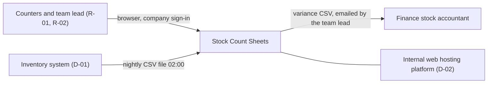

# Stock Count Sheets – Developer & Agent Guide

## Purpose

The first thing a developer or AI agent reads before changing Stock Count Sheets. It gives the repository map, the exact commands, the conventions, what an agent may do alone, which documents to update with each change, and, as sections, how the tool is built, deployed and supported.

## Scope

Covers working on and running the code in this repository. What the tool is for, its owners, rules, roles and acceptance criteria are in BUS-01 (`docs/README.md`).

## What this application is

A small Flask web app for one warehouse team: it imports the inventory system's nightly CSV export, prints blind count sheets per shelf location, stores the counted quantities and exports a variance CSV for finance. The unusual part is that the sheets must never show the system quantity (BR-02). See BUS-01 for the business case and owners.

## Repository map

```text
AGENTS.md              This guide (ENG-09)
docs/README.md         Business overview and spine (BUS-01)
stockcount/            Flask app: views/, importer.py, export.py, checks.py, models.py
migrations/            Alembic migrations (ENG-04)
tests/                 pytest tests named after AC IDs; tests/manual/ holds manual scripts
tests/data/            Sample export files for local runs and tests
platform.yaml          Hosting platform app definition and nightly schedule (ENG-07)
```

## Prerequisites

| Tool | Version | How to get it | Notes |
|---|---|---|---|
| Python | 3.12 | `.python-version` | |
| PostgreSQL | 16 | `docker compose up -d db` | Local database on port 5432 |
| appctl | 2.x | IT platform self-service page | Needed only to deploy; ask Jun Park for access |

## Commands

Run from the repository root.

| Task | Command | Expected result | Verified on |
|---|---|---|---|
| Install | `python -m venv .venv && . .venv/bin/activate && pip install -r requirements-dev.txt` | Exits 0 | 2026-09-15, Tomás Berg |
| Migrate | `flask --app stockcount db upgrade` | "Running upgrade … head" | 2026-09-15, Tomás Berg |
| Seed sample data | `flask --app stockcount import-stock tests/data/stock_sample.csv` | "120 rows read, 120 rows loaded" | 2026-09-15, Tomás Berg |
| Run locally | `flask --app stockcount run --debug` | App on http://localhost:5000 | 2026-09-15, Tomás Berg |
| Test | `pytest` | All tests pass in under 1 minute | 2026-09-15, Tomás Berg |
| Lint and format | `ruff check . && ruff format --check .` | No errors | 2026-09-15, Tomás Berg |
| Build | `docker build -t stockcount .` | Image `stockcount:latest` | 2026-09-15, Tomás Berg |
| Lint documentation | `python3 tools/doclint.py package .` | No High or Medium findings | 2026-09-30, Tomás Berg |

## Coding conventions and patterns

| Topic | Rule | Example to copy | Avoid |
|---|---|---|---|
| Blind count | Templates for R-01 pages never receive the system quantity; pass `SheetLine`, not `SnapshotLine` | `stockcount/views/sheets.py` | Hiding the quantity with CSS |
| Import | All file checks live in `importer.validate()`; a failed check raises `ImportRejected` and changes nothing | `stockcount/importer.py` | Partial loads |
| Database | Migrations are additive only, so a rollback never needs a down-migration | `migrations/versions/0003_add_unit_cost.py` | Dropping or renaming columns in the same release |
| Tests | One test per AC, named in its docstring (`"""AC-07"""`) | `tests/test_export.py` | Tests with no AC link for Must behaviour |

## How to make a change safely

1. Branch from `main` as `<type>/<short-description>`.
2. Write or update the test for the AC you are changing first.
3. Make the change; run test, lint and the documentation linter.
4. Update the documents the table below lists for your kind of change, in the same pull request.
5. Open a pull request; Tomás Berg reviews. Changes in "Needs a human" need his approval before merge.

**Definition of done:** the AC tests pass; the full suite, lint and documentation linter pass; the documents in the update-trigger table are updated; a release note line is added to `CHANGELOG.md` if users will notice.

## Where to find things

| You need | Look in |
|---|---|
| What the tool is for, owners, roles, rules, records | BUS-01 (`docs/README.md`) |
| Acceptance criteria and their tests | SP-11 in `docs/README.md` |
| Requirements, architecture, data, dependencies | ENG-01, ENG-03, ENG-04, ENG-05 below |
| Environments, deploying, support | ENG-06, ENG-07, ENG-08 below |

## Agent rules

**May change without asking:** code and tests within an assigned task, following the conventions above; documentation updates the update-trigger table requires; dependency patch versions when tests pass.

**Needs a human (stop and ask Tomás Berg, technical owner):** database migrations; the import file format or validation (BR-01); anything about roles or directory groups (BUS-04); changing a business rule (BUS-05); the nightly schedule or `platform.yaml`; adding a dependency (ENG-05); marking any document Accepted or recording a sign-off.

**Never:** write a secret value anywhere in the repository, documentation, logs or a pull request; invent a value, owner, test result or approval (write `TBD` with an owner and a `Q-xx`); deploy to ENV-01 or run commands against its database; skip or disable failing tests; show the system quantity on any R-01 page.

## Documentation update triggers

Source: 00_documentation_model.md, "Update triggers", in the documentation framework. Keep this table identical to the source and refresh it when the framework changes.

| Change | Documents to update |
|---|---|
| New or changed feature | BUS-02, ENG-01, SP-11, BUS-09, release notes (ENG-07) |
| New status or transition | BUS-05, ENG-04, ENG-02, BUS-09 (Concepts), SP-11 |
| New or changed business rule | BUS-05, ENG-01, SP-11 |
| New role or permission | BUS-04, SP-01, BUS-09 |
| New record, field classification or retention change | BUS-06, ENG-04 |
| New report, export or notification | BUS-06, SP-10 or ENG-08 output checks if others rely on it |
| New integration or dependency | ENG-05, ENG-03, ENG-08, BUS-07 if cost changes, SP-00 (re-score D4) |
| Architecture or technology decision | ENG-10, ENG-03 |
| New configuration item, secret or feature flag | ENG-06 |
| Deployment or release process change | ENG-07 |
| Incident with a new failure mode | ENG-08 (runbook entry), BUS-08 |
| Success measure missed for two periods | SP-10 (review), BUS-08 |
| New user group, data type or regulatory exposure | SP-00 (re-score) |

A pull request that changes behaviour without updating the listed documents fails review. Documents out of scope in the Scope Record (SP-00) are skipped; S items are updated in their parent section.

## Documents held as sections

This file holds: ENG-01, ENG-03, ENG-04, ENG-05, ENG-06, ENG-07, ENG-08.

## ENG-01 Requirements Specification

### Functional requirements

| ID | Requirement | Capabilities | Rules | Priority | Status |
|---|---|---|---|---|---|
| FR-01 | The system shall import the nightly export file and replace the stock snapshot when the file passes validation | C-01 | BR-01 | Must | Verified |
| FR-02 | The system shall generate one printable blind count sheet per shelf location for a chosen month | C-02 | BR-02 | Must | Verified |
| FR-03 | The system shall store one counted quantity per SKU, location and month, with who entered it and when | C-03 | BR-03 | Must | Verified |
| FR-04 | The system shall export a variance CSV with system quantity, counted quantity, variance and variance value per line | C-04 | BR-04 | Must | Verified |

### Non-functional requirements

| ID | Category | Requirement | Target | Measurement method | Priority |
|---|---|---|---|---|---|
| NFR-01 | Availability | Available in warehouse hours | ≥ 99% of minutes, Mon–Fri 07:00–17:00, per calendar month | Platform uptime monitor on `/healthz` | Must |
| NFR-02 | Performance | Count sheets for the whole warehouse | Ready in ≤ 20 s for 420 locations and 4,000 lines | Timed run in ENV-02 | Must |
| NFR-03 | Security | Count entry and export limited to R-02 | 100% of R-02-only pages refused to R-01 | Automated access test | Must |
| NFR-04 | Recoverability | Recovery time objective (RTO) | ≤ 1 working day | Restore test (ENG-08) | Must |
| NFR-05 | Recoverability | Recovery point objective (RPO) | ≤ 24 h of entries lost | Nightly backup and restore test | Must |

## ENG-03 Architecture & Design

### Context (C4 level 1)



*Caption: the tool, its two roles, the inventory export it reads, the finance file it produces and the platform it runs on.*

### Containers (C4 level 2)

| ID | Container | Technology | Responsibility | Stores data |
|---|---|---|---|---|
| CMP-01 | Web app | Python 3.12, Flask 3.0, gunicorn | Sheets, count entry, variance export, health check | None |
| CMP-02 | Import job | Same image, `flask import-stock`, platform scheduler 02:30 | Validates and loads the nightly file; deletes data past retention | None |
| CMP-03 | Database | PostgreSQL 16, platform-managed | Snapshots, counts, import log | ENT-01, ENT-02, ENT-03 |

### Security

T4 and T11 are No: no personal or confidential data and not public-facing. Sign-in uses the company sign-in (D-03); the role comes from the directory group (BUS-04).

## ENG-04 Data Model

### Entities

| ID | Entity | Records | Classification | Retention |
|---|---|---|---|---|
| ENT-01 | snapshot_line | REC-01 | Internal | 400 days, deleted by CMP-02 |
| ENT-02 | count_line | REC-02 | Internal | 24 months, deleted by CMP-02 |
| ENT-03 | import_run | REC-01 | Internal | 400 days, deleted by CMP-02 |

## ENG-05 Integrations & Dependencies Register

### Dependency register

| ID | Dependency | Type | Owner | Criticality | Impact | Support path | Capabilities affected | Workaround | Runbook | Cost |
|---|---|---|---|---|---|---|---|---|---|---|
| D-01 | Inventory system nightly export | Integration | Kim Novak, Inventory system team | High | Sheets and variances use an old snapshot | Service desk queue "Inventory system" | C-01 | Inventory team writes the file again by hand; R-02 re-runs the import | RB-01 | No |
| D-02 | Internal web hosting platform | Hosting | Jun Park, IT platform | High | Tool unavailable | Service desk queue "Web hosting platform" | C-01, C-02, C-03, C-04 | Old spreadsheet method (BUS-01) | RB-02 | No |
| D-03 | Company sign-in | Identity | IT identity team | Medium | Nobody can sign in | Service desk queue "Sign-in" | C-02, C-03, C-04 | Old spreadsheet method (BUS-01) | None | No |

### Interfaces

| ID | Dependency | Direction | Protocol | Data exchanged | Authentication | Error and retry behaviour |
|---|---|---|---|---|---|---|
| INT-01 | D-01 | In | CSV file on share `//files/exports/stock/stock_YYYYMMDD.csv`, written by 02:00 | ENT-01 (sku, location, description, unit, quantity, unit_cost) | SEC-01 | Rejected file keeps the old snapshot (BR-01) and raises ALR-01; no automatic retry |

## ENG-06 Configuration & Environments

### Environments

| ID | Environment | Purpose | URL | Data | Access | Hosting |
|---|---|---|---|---|---|---|
| ENV-01 | Production | Live use | https://stockcount.apps.internal.example | Real | Directory groups (BUS-04) | Internal web hosting platform |
| ENV-02 | Test | UAT, dry runs, restore tests | https://stockcount-test.apps.internal.example | Copy of a real export | Tomás Berg, Priya Shah, Jun Park | Internal web hosting platform |

### Secrets

| ID | Name | Purpose | Stored in | Used by | Rotation | Owner |
|---|---|---|---|---|---|---|
| SEC-01 | Export share account | Read the export file share | Platform secret store `stockcount/<env>/export-share` | CMP-02 | Yearly, each August | Tomás Berg |
| SEC-02 | Database URL | Database connection | Injected by the platform as `DATABASE_URL` | CMP-01, CMP-02 | Managed by the platform | Jun Park |

### Configuration items

| ID | Name | Purpose | Default | Value source per environment |
|---|---|---|---|---|
| CFG-01 | `IMPORT_DIR` | Where the import job looks for the export file | `//files/exports/stock` | `platform.yaml` |

## ENG-07 Deployment & Release Guide

### Deployment steps

1. Merge to `main`; CI runs `pytest` and `ruff`.
2. Tag the release: `git tag v1.4.0 && git push origin v1.4.0`. The platform pipeline builds the image and deploys it to ENV-02.
3. Run the smoke test on ENV-02 (below).
4. Promote: `appctl promote stockcount --from test --to prod --version v1.4.0`.
5. Run the smoke test on ENV-01.

**Smoke test:** `curl -fsS https://stockcount.apps.internal.example/healthz` returns `{"status": "ok", "version": "v1.4.0", "last_import": "<today>"}`; then sign in as R-02 and open Print count sheets for the current month.

### Rollback

**Roll back when** the smoke test fails, or R-02 cannot print sheets or export variances. Tomás Berg decides (Jun Park if he is away).

1. `appctl rollback stockcount --env prod --to <previous version>`.
2. No database step: migrations are additive only.
3. Repeat the smoke test and confirm `version` shows the previous release.

### Release notes

`CHANGELOG.md` in the repository, one entry per tag.

### Dry-run record

| Procedure | Performed by | Date | Environment | Result | Evidence |
|---|---|---|---|---|---|
| Deployment | Jun Park, Platform engineer | 2026-09-22 | ENV-02 | Pass | Pipeline run 1187 |
| Rollback | Jun Park, Platform engineer | 2026-09-22 | ENV-02 | Pass | Pipeline run 1188 |

## ENG-08 Operations & Support Runbook

### Ownership model

| Area | Primary owner | Backup owner | Escalation owner |
|---|---|---|---|
| Count process questions | Priya Shah, Team lead | Sam Ortiz, Deputy team lead | Morgan Lee, Warehouse manager |
| Access and roles | Morgan Lee, Warehouse manager | Priya Shah, Team lead | Morgan Lee, Warehouse manager |
| System issue | Tomás Berg, Applications developer | Jun Park, Platform engineer | Lena Fischer, IT applications manager |

### Support intake

Count questions go to Priya Shah in person. System problems go to the IT service desk queue "Stock Count Sheets" with the page, the time and a screenshot.

### Triage guide

| Category | Examples | Owner | Initial checks | Dependencies | Escalate when |
|---|---|---|---|---|---|
| Old snapshot | Banner shows yesterday's date | Tomás Berg | Import log on the Admin page; is today's file on the share? | D-01 | File missing after 05:00 (RB-01) |
| Cannot sign in or missing page | "This page is for team leads" for a team lead | Morgan Lee | Directory group membership | D-03 | Group is correct and it still fails |
| System error | Error page, page will not load | Tomás Berg | Health check; recent deployment | D-02 | Health check fails (RB-02) |
| Variance looks wrong | Finance questions a line | Priya Shah | Run OC-01 for the month | None | OC-01 reports a mismatch |

### Monitoring and alerting

**Health check:** `curl -fsS https://stockcount.apps.internal.example/healthz`, expected `"status": "ok"` and `last_import` equal to today. Logs: `appctl logs stockcount --env prod`.

| ID | Alert | Threshold | Meaning | Owner | Runbook |
|---|---|---|---|---|---|
| ALR-01 | Nightly import failed or not run | No successful import by 05:00 | Sheets would show an old snapshot | Tomás Berg (email also to Priya Shah) | RB-01 |

### Scheduled jobs

| Job | Schedule | Purpose | Component | Success signal | Alert | Runbook |
|---|---|---|---|---|---|---|
| Nightly import | 02:30 daily | Load the export, delete data past retention | CMP-02 | Import log "rows read = rows loaded" | ALR-01 | RB-01 |

### Runbook entries

| ID | Failure mode | Triggered by | Dependencies | Owner |
|---|---|---|---|---|
| RB-01 | Nightly import failed or file missing | ALR-01 | D-01 | Tomás Berg |
| RB-02 | Platform outage | Health check fails | D-02 | Tomás Berg |

**RB-01:** Symptom: ALR-01 email, or the banner shows an older date · Diagnosis: the import log says "Rejected: …" (bad file) or "No file" · Fix: for a missing or bad file, ask the inventory system team (service desk queue "Inventory system") to write it again, then run `appctl run stockcount --env prod -- flask import-stock --latest` · Verification: health check shows today's `last_import` · Escalation: Kim Novak if no file by 07:00; on count day tell Priya Shah to delay printing.

**RB-02:** Symptom: health check fails · Diagnosis: `appctl status stockcount --env prod` and the platform status page · Fix: if the platform is down, raise a Priority 2 ticket in "Web hosting platform"; if only this app is down, `appctl restart stockcount --env prod` · Verification: health check passes · Escalation: Jun Park; on count day Priya Shah switches to the old spreadsheet method.

### Backup and restore

The platform backs up the whole CMP-03 database nightly at 01:00 to its backup store in the second data centre and keeps each backup for 30 days.

**Restore procedure:** `appctl db restore stockcount --env test --from-backup <date>` (or `--env prod` with Tomás Berg's approval), then run the health check and open Enter counts for the current month to confirm the latest counts are present.

**Last restore test:** 2026-09-22, ENV-02, Pass in 2 h 10 min (AC-12).

### Output checks

| ID | Check | Type | Records | Procedure | Frequency | Owner | On failure |
|---|---|---|---|---|---|---|---|
| OC-01 | Variance file matches snapshot and counts | Reconciliation | REC-01, REC-02 | Select **Check variance file** (or `flask check-variance --month YYYY-MM`): recomputes every variance from REC-01 and REC-02 and checks the file has one row per sheet line; result "OK" or a list of mismatches, saved with the file | Monthly, before the file is sent | Priya Shah, Team lead | Do not send; raise with Tomás Berg |
| OC-02 | Import loaded every row | Completeness | REC-01 | Import job compares data rows in the file with rows loaded and rejects the file if they differ | Nightly, automatic | Tomás Berg | ALR-01, then RB-01 |

## Assumptions and open questions

No open questions beyond Q-01 in BUS-01.

## Known limitations

| ID | Limitation | Impact | Workaround | Owner |
|---|---|---|---|---|
| LIM-02 | Stock moved between the 02:00 export and the count is not in the snapshot | Variances for lines picked on count morning | No picking from a location until it is counted (BUS-03 step 2) | Tomás Berg |

## Change log

| Version | Date | Author | Summary | Approved by |
|---|---|---|---|---|
| 0.1 | 2026-08-18 | Tomás Berg | First draft | — |
| 1.0 | 2026-09-30 | Tomás Berg | Accepted at go-live review | Morgan Lee, Warehouse manager, 2026-09-30 |
