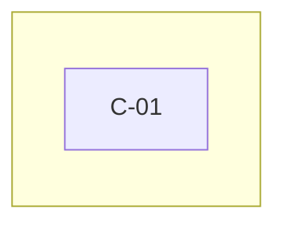

# <Application> – Capabilities Register

> **How to use this template**
> - **Who writes it:** the producer with the business owner; validate against the business processes (BUS-03) and with the support owner. Agents may draft from the code and screens and mark rows inferred.
> - **When it is due:** Draft and Accepted at stage 2 (Define). Update with every new or changed feature.
> - **Depth S (Foundation):** a section `## BUS-02 Capabilities Register` in BUS-01 holding the Capability register table with the columns ID, Name, Outcome, Roles, Processes, Dependencies, Automated and Criticality. Keep every linked column (`Roles`, `Processes`, `Dependencies`); the linter checks them. Drop the other sections.
> - **Depth D (Standard):** everything except sections marked (Full).
> - **Depth D+ (Full):** everything, including sections marked (Full).
> - Delete this block and every `> **Guide:**` block before review, and replace every `<…>`.

## Purpose

Lists what <Application> can do, in business language, with the outcome of each capability, who uses it, who owns it, how critical it is and which processes use it. It is the reference for scope, requirements (ENG-01), access (BUS-04) and support.

## Scope

Covers every capability (`C-xx`) the application offers to users, administrators, support and other systems, including automated actions. How capabilities are used in real work is in BUS-03; detailed requirements are in ENG-01; dependencies are defined in ENG-05.

## Capability register

> **Guide:**
> - **Name:** a business verb and object: Submit, Review, Approve, Assign, Track, Manage, Notify, Report, Reconcile, Escalate, Archive, Audit. Not a screen, button or table.
> - **Outcome:** the business or operational result when the capability is used.
> - **Roles:** the role IDs (`R-xx`) that use or oversee it. Never write "System" or "Admin" as a role. For a capability that runs with no person acting, set `Automated` = Yes and write `Automated` in `Roles`, or the role that oversees it.
> - **Processes:** the process IDs (`W-xx`) that use it, or `Admin/support only`. The link must be two-way: each process listed must list this capability back.
> - **Dependencies:** the dependency IDs (`D-xx`) from ENG-05 it relies on, or `None`. Every High dependency must appear against at least one capability.
> - **Criticality:** High (launch-critical; the business process stops without it) / Medium / Low.
> Prefer: "Review booking request". Avoid: "Admin page" or "Approve button".

| ID | Name | Description | Outcome | Roles | Processes | Dependencies | Automated | Criticality | Owner | Notes |
|---|---|---|---|---|---|---|---|---|---|---|
| C-01 | <Verb + object> | <What the system enables> | <Business result> | <R-xx, or Automated> | <W-xx, or Admin/support only> | <D-xx, or None> | <Yes / No> | <High / Medium / Low> | <Name, role> | <…> |

## Coverage check

> **Guide:** before review, confirm each kind of capability is covered where it applies, or say why it does not. This catches the administrative and support capabilities that are easy to forget.

| Kind | Covered by | Or why not needed |
|---|---|---|
| Core user tasks | <C-xx> | <…> |
| Administration and setup | <C-xx> | <…> |
| Access and role management | <C-xx> | <…> |
| Support and correction | <C-xx> | <…> |
| Reporting and export | <C-xx> | <…> |
| Notifications | <C-xx> | <…> |
| Audit and history | <C-xx> | <…> |
| Automated and scheduled actions | <C-xx> | <…> |

## Capability map (Full)

> **Guide:** a Mermaid diagram grouping capabilities by business area, so a reader sees the whole application on one page. Caption it in one sentence.

*Caption: <what the diagram shows>.*

## Assumptions and open questions

| ID | Assumption or question | Owner | Due | Status |
|---|---|---|---|---|
| Q-01 | <…> | <…> | <YYYY-MM-DD> | <Open / Closed> |

## Known limitations

> **Guide:** for example, a capability that is only partly delivered. Every `LIM-xx` also goes into SP-12. Write "No known limitations." if there are none.

| ID | Limitation | Impact | Workaround | Owner |
|---|---|---|---|---|
| LIM-01 | <…> | <…> | <… or None> | <…> |

## Change log

| Version | Date | Author | Summary | Approved by |
|---|---|---|---|---|
| 0.1 | <YYYY-MM-DD> | <Name> | First draft | — |
