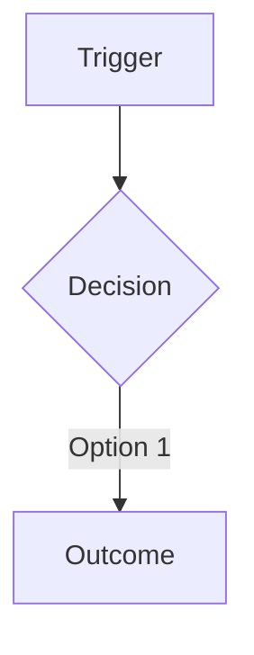

# <Application> – Business Process Register

> **How to use this template**
> - **Who writes it:** the producer with each process owner; validate with people who actually do the work.
> - **When it is due:** Draft and Accepted at stage 2 (Define). Update when a process, its roles or its statuses change.
> - **Depth S (Foundation):** a section `## BUS-03 Business Process Register` in BUS-01 holding the Process summary table (keep every linked column: `Capabilities`, `Roles`, `Statuses`, `Journeys`). Add a short numbered list of steps for the main process if it is not obvious. Drop the other sections.
> - **Depth D (Standard):** everything except sections marked (Full). At Standard, ENG-02 User Journeys is usually held in this file as a section `## ENG-02 User Journeys`.
> - **Depth D+ (Full):** everything, including sections marked (Full).
> - Delete this block and every `> **Guide:**` block before review, and replace every `<…>`.

## Purpose

Documents the end-to-end business processes <Application> supports, including the work done outside the system, so process owners, support and engineers share one picture of how the work is really done.

## Scope

Covers every business process (`W-xx`) from its trigger to its outcome. What the system can do is in BUS-02; the rules and statuses in BUS-05; a person's step-by-step interaction with the screens is in ENG-02 User Journeys.

> **Guide:** the difference from ENG-02: a business process (here) is how the work gets done, including phone calls, paper and decisions outside the system; a user journey (ENG-02) is one person's interaction with the system to reach a goal.

## Process summary

> **Guide:**
> - **One process = one trigger to one outcome**, with one owner and one status lifecycle. Split an entry that has several unrelated triggers, independently valuable outcomes, different owners or separate lifecycles.
> - **Keep every process at the same business level.** Describe business actions ("review the request"), never screen clicks ("click the Review tab"), and do not mix a detailed procedure with a summary.
> - **Capabilities:** `C-xx` IDs; the link must be two-way with BUS-02. **Roles:** `R-xx` IDs. **Statuses:** `ST-xx` IDs the process moves records through, or `None`. **Journeys:** `J-xx` IDs from ENG-02, or `None` when T1 is No; two-way with ENG-02.
> Prefer: "Review and decide a booking request". Avoid: "Booking admin screen".

| ID | Name | Trigger | Outcome | Owner | Roles | Capabilities | Statuses | Journeys | Manual steps outside the system |
|---|---|---|---|---|---|---|---|---|---|
| W-01 | <Verb + object> | <What starts it> | <What successful completion produces> | <Name, role> | <R-xx> | <C-xx> | <ST-xx, or None> | <J-xx, or None> | <… or None> |

## Process details

> **Guide:** one subsection per process, in ID order. Steps are business actions in order. **Actor** is a role ID, or `Automated` for a step the system performs with no person acting. Put work outside the system in the steps too, marked "Outside system" under Capability.

### W-01 <Process name>

| Step | Actor | Action | Capability | Status after | Notes |
|---|---|---|---|---|---|
| 1 | <R-xx or Automated> | <Business action> | <C-xx, or Outside system> | <ST-xx or —> | <…> |

**Decision points**

| Decision | Options | Decided by | Resulting status or action |
|---|---|---|---|
| <…> | <Approve / Return / Reject> | <R-xx> | <ST-xx, next step> |

**Exceptions and alternate paths**

| Exception | Handling | Owner | Escalation path |
|---|---|---|---|
| <…> | <…> | <Name, role> | <…> |

## Process diagrams (Full)

> **Guide:** one Mermaid flowchart per process showing steps, decision points and exception paths, with swimlanes by role where it helps. Caption each in one sentence.

*Caption: <what the diagram shows>.*

## Responsibility matrix (Full)

> **Guide:** who is Responsible, Accountable, Consulted and Informed for each process. One A per process.

| Process | Responsible | Accountable | Consulted | Informed |
|---|---|---|---|---|
| <W-xx> | <R-xx> | <R-xx or Name> | <…> | <…> |

## Assumptions and open questions

| ID | Assumption or question | Owner | Due | Status |
|---|---|---|---|---|
| Q-01 | <…> | <…> | <YYYY-MM-DD> | <Open / Closed> |

## Known limitations

> **Guide:** for example, a step still done on paper. Every `LIM-xx` also goes into SP-12. Write "No known limitations." if there are none.

| ID | Limitation | Impact | Workaround | Owner |
|---|---|---|---|---|
| LIM-01 | <…> | <…> | <… or None> | <…> |

## Change log

| Version | Date | Author | Summary | Approved by |
|---|---|---|---|---|
| 0.1 | <YYYY-MM-DD> | <Name> | First draft | — |
