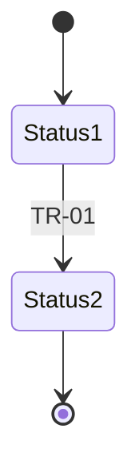

# <Application> – Business Rules & Status Lifecycle

> **How to use this template**
> - **Who writes it:** the producer with the business owner and rule owners; engineers and testers check each rule and transition can be tested. Agents may draft from validation code and status enums, marking rows inferred.
> - **When it is due:** Draft at stage 2 (Define), Accepted at stage 4 (Verify). Update with every new or changed rule, status or transition.
> - **Depth S (Foundation):** a section `## BUS-05 Business Rules & Status Lifecycle` in BUS-01 holding the Rules, Statuses and Transitions tables with a few rows each. Drop the other sections.
> - **Depth D (Standard and Full):** everything. BUS-05 has no sections marked (Full).
> - **When T3 is No** (records do not move through statuses or approvals), delete Statuses, Transitions and Lifecycle diagram, and write one line: "Records in <Application> have no statuses."
> - Every rule and every transition gets a positive and a negative application acceptance criterion in SP-11, so write each one so it can be tested.
> - Delete this block and every `> **Guide:**` block before review, and replace every `<…>`.

## Purpose

Defines the rules <Application> must enforce, and every status and allowed status change of its records, in a form that can be tested, so the business, engineers, testers and support agree on what the application allows and forbids.

## Scope

Covers business rules and validations (`BR-xx`), statuses (`ST-xx`), transitions (`TR-xx`), exceptions and overrides. The records the statuses belong to are defined in BUS-06; how statuses are stored is in ENG-04; the criteria that test each rule and transition are in SP-11.

## Business rules

> **Guide:**
> - **Rule:** written as condition → action: "If <condition>, then <what the application does or prevents>." One rule per row.
> - **Type:** `Business` (a policy the business requires) or `Validation` (a check on data entered, which blocks or warns).
> - **Blocking:** for validations, whether the user is stopped (Yes) or warned (No).
> - **Owner:** the person or role who decides the rule. **Exception authority:** who may allow an exception, when `Exception allowed` is Yes.
> - **Processes:** `W-xx` IDs; **Capabilities:** `C-xx` IDs.
> Prefer: "If a room is already Confirmed for any night of the requested dates, then the request cannot be confirmed." Avoid: "Rooms must be available."

| ID | Type | Rule | Applies to | Blocking | Owner | Exception allowed | Exception authority | Processes | Capabilities |
|---|---|---|---|---|---|---|---|---|---|
| BR-01 | <Business / Validation> | If <condition>, then <action>. | <REC-xx or field> | <Yes / No / —> | <Name or role> | <Yes / No> | <Name or role, or —> | <W-xx> | <C-xx> |

## Statuses

> **Guide:** one row per status of each record. **Name** is the exact name shown to users and used in SP-01. **Meaning** is the business meaning; **Meaning for users** is what a user would understand when they see it, in their words (BUS-09 Concepts repeats it). **User-visible** says whether users see this status. **Terminal** is Yes when no transition leaves it.

| ID | Name | Record | Meaning | Meaning for users | User-visible | Terminal |
|---|---|---|---|---|---|---|
| ST-01 | <Status name> | <REC-xx> | <…> | <…> | <Yes / No> | <Yes / No> |

## Transitions

> **Guide:** one row per allowed status change. Anything not listed is not allowed. **From** and **To** are status IDs; **Roles** are the role IDs that may perform it, or `Automated` when the system does it (for example, on a timer). **Rule or condition** names the rules (`BR-xx`) that guard it.
> Check: every non-terminal status has at least one transition out, and every status except the first can be reached.

| ID | From | To | Roles | Trigger or action | Rule or condition | Processes |
|---|---|---|---|---|---|---|
| TR-01 | <ST-xx> | <ST-xx> | <R-xx, or Automated> | <Business action or event> | <BR-xx, or None> | <W-xx> |

## Lifecycle diagram

> **Guide:** optional but recommended when there are more than four statuses. A Mermaid state diagram generated from the Transitions table, with a one-sentence caption. The table is the source; the diagram must not add transitions.

*Caption: <the statuses of REC-xx and the allowed transitions between them>.*

## Exceptions and overrides

> **Guide:** for each rule where an exception is allowed, say what may be overridden, who approves it, and what must be recorded for audit (who, when, why). Write "No overrides are allowed." if that is true.

| Exception | Normal rule | Allowed override | Approved by | Audit requirement |
|---|---|---|---|---|
| <…> | <BR-xx> | <…> | <Name or role> | <What is recorded, where, for how long> |

## Assumptions and open questions

| ID | Assumption or question | Owner | Due | Status |
|---|---|---|---|---|
| Q-01 | <…> | <…> | <YYYY-MM-DD> | <Open / Closed> |

## Known limitations

> **Guide:** for example, a rule enforced by staff rather than by the application. Every `LIM-xx` also goes into SP-12. Write "No known limitations." if there are none.

| ID | Limitation | Impact | Workaround | Owner |
|---|---|---|---|---|
| LIM-01 | <…> | <…> | <… or None> | <…> |

## Change log

| Version | Date | Author | Summary | Approved by |
|---|---|---|---|---|
| 0.1 | <YYYY-MM-DD> | <Name> | First draft | — |
