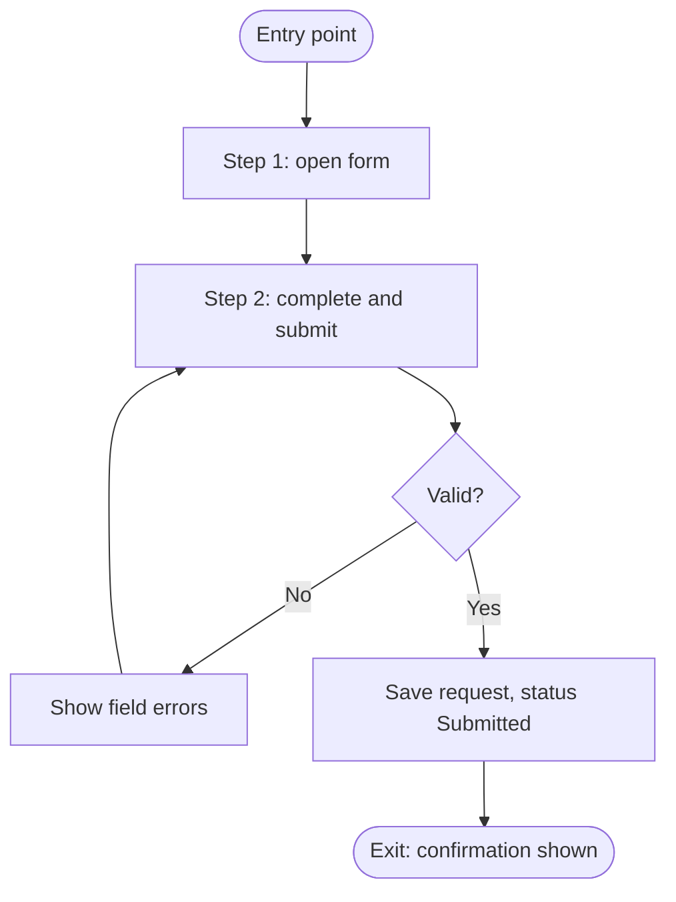

# <Application> – User Journeys

> **How to use this template**
> - **Who writes it:** the product owner or designer, with an engineer for system responses. An agent may draft from screens, routes and tests; mark drafted content as inferred until confirmed.
> - **When it is due:** Draft by stage 2 (Define); Accepted by stage 5 (Go-live). Only in scope when trigger T1 is Yes (people use the application through a screen).
> - **Depth S** (section `## ENG-02 User Journeys` in BUS-03, the default parent): the journey summary table only, one row per main role goal, with the linked columns filled in. Add a one-line error path in Exit state where it matters.
> - **Depth D (Standard):** every section.
> - **Depth D+ (Full):** the same as D. No section is marked (Full), and the depth matrix never sets this item to D+.
> - Delete this block and every `> **Guide:**` block before review, and replace every `<…>`.

## Purpose

<Two to four sentences. Example: "Describes how each role uses <Application> to reach its goals, step by step, including what goes wrong and what the user sees. Engineers build screens and responses from it, testers derive journey tests from it, and BUS-09 how-tos are written from it.">

## Scope

<Example: "Covers each person's interaction with the system. The business process around it, including manual steps outside the system, is in BUS-03. Statuses and transitions are defined in BUS-05; requirements in ENG-01.">

**Difference from BUS-03:** BUS-03 describes how the work is done, including steps outside the system; this document describes only what a person does *in the system* and how the system responds.

## Journey summary

> **Guide:** One journey per main goal of each role. A journey has one entry point and one successful exit state; if it has two goals, split it. Keep the number small: five to fifteen journeys covers most applications.
> - **Roles:** R IDs from BUS-04 (or R-01 in BUS-01 when there is one role).
> - **Processes:** the BUS-03 processes this journey serves (W IDs). The process must list this journey back in its `Journeys` column (X-16).
> - **Requirements:** the ENG-01 FR IDs the journey exercises.
> - **Transitions:** the BUS-05 transitions the journey causes (TR IDs), or `None`.

| ID | Journey | Roles | Goal | Entry point | Processes | Requirements | Transitions | Exit state |
|---|---|---|---|---|---|---|---|---|
| J-01 | <Role verb object, e.g. "Requester submits a request"> | <R-01> | <What the person wants to achieve> | <URL, menu item, email link> | <W-01> | <FR-01, FR-02> | <TR-01, or None> | <What is true at the end, e.g. "Request is Submitted (ST-01) and acknowledgement shown"> |

## Journey details

> **Guide:** Repeat this block for each journey in the summary table. Write steps from the user's point of view, in the order they happen. The system response says what the user sees or receives, not how it is implemented. Every step that changes a status names the transition.

### J-01 <Journey name>

**Role:** <R-01> · **Goal:** <…> · **Entry point:** <…> · **Preconditions:** <What must be true before the journey starts, e.g. "User is signed in with role R-01">

| Step | User action | System response | Transition / status |
|---|---|---|---|
| 1 | <Opens the request form> | <Shows the form with required fields marked> | <None> |
| 2 | <Completes the form and selects Submit> | <Validates; saves the request; shows confirmation with reference number; sends acknowledgement NTF-01> | <TR-01 → ST-01> |

**Alternative and error paths**

> **Guide:** Include every path a tester should try: validation failure, permission denied, conflicting data, dependency down, timeout, cancel. Say exactly what the user sees, in their words, and where they end up. These paths become negative application acceptance criteria in SP-11.

| Path | Condition | What the user sees | System behaviour | Ends in |
|---|---|---|---|---|
| <2a> | <A required field is empty> | <"Enter a date" next to the field; form keeps entered values> | <Nothing saved> | <Step 2> |
| <2b> | <Email service unavailable> | <Confirmation shown as normal> | <Request saved; acknowledgement queued for retry (see ENG-05, ENG-08)> | <Exit state> |

*Caption: <One sentence saying what this diagram shows, e.g. "Happy path and validation loop for J-01 Submit request".>*

## Assumptions and open questions

| ID | Assumption or question | Owner | Due | Status |
|---|---|---|---|---|
| Q-01 | <…> | <…> | <YYYY-MM-DD> | <Open / Closed> |

## Known limitations

| ID | Limitation | Impact | Workaround | Owner |
|---|---|---|---|---|
| LIM-01 | <…> | <…> | <…, or None> | <…> |

## Change log

| Version | Date | Author | Summary | Approved by |
|---|---|---|---|---|
| 0.1 | <YYYY-MM-DD> | <Name> | First draft | — |
