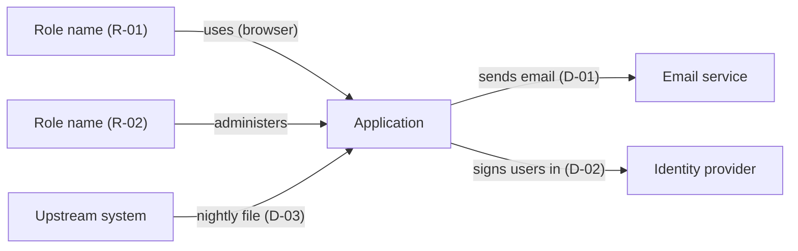
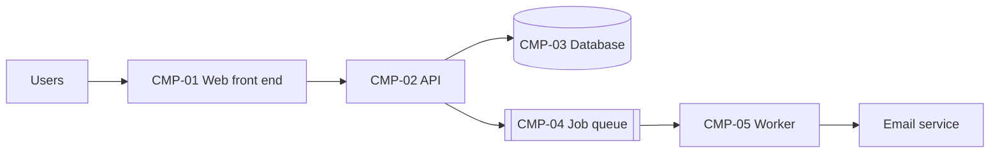
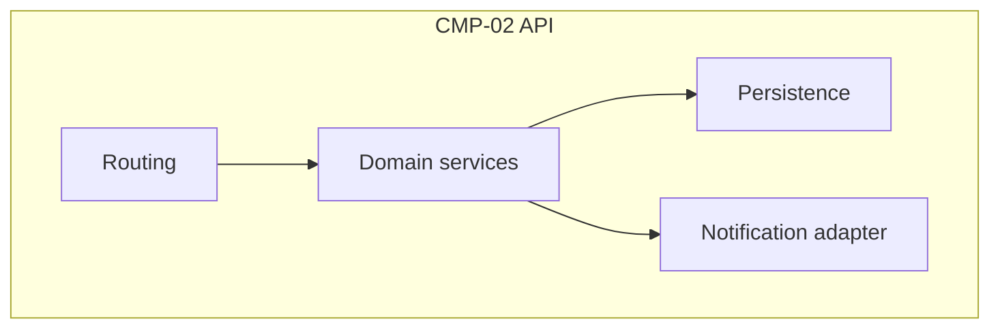
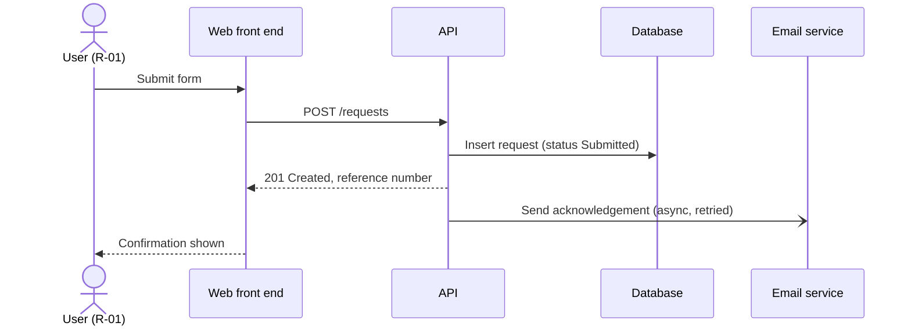
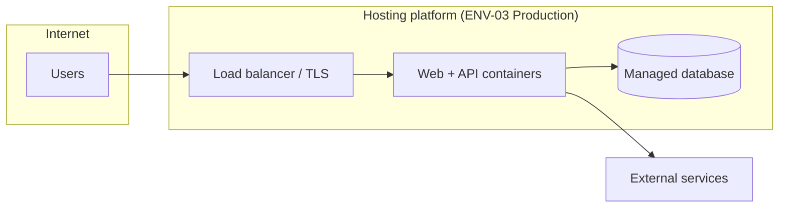

# <Application> – Architecture & Design

> **How to use this template**
> - **Who writes it:** the technical owner or lead engineer. For an existing system an agent may draft from the code, infrastructure files and configuration; mark drafted content as inferred until confirmed.
> - **When it is due:** context and containers drafted by stage 2 (Define); complete and Accepted by stage 3 (Build).
> - **Depth S** (section `## ENG-03 Architecture & Design` in ENG-09): one context diagram, and the containers table cut down to a stack list (ID, Container, Technology, Responsibility). When T4 or T11 is Yes, add the security section as a few lines. Keep every linked column (the linter checks them; other columns may be left out) and use level-3 subheadings named after this template's sections, so the section can later be promoted to its own file without restructuring.
> - **Depth D (Standard):** every section except those marked (Full).
> - **Depth D+ (Full):** every section, including (Full).
> - This is a cut-down arc42 outline with C4 diagrams (context, containers, and components for critical containers). Draw diagrams in Mermaid; the C4 levels matter more than the notation.
> - Delete this block and every `> **Guide:**` block before review, and replace every `<…>`.

## Purpose

<Two to four sentences. Example: "Explains how <Application> is built and how it behaves at run time, so engineers and agents can change it without breaking its design, and operators know where each part runs.">

## Scope

<Example: "Covers the system context, containers, runtime behaviour of the main journeys, deployment, cross-cutting concepts, quality goals, security and technical debt. The data model is in ENG-04, interface contracts in ENG-05, environments and configuration in ENG-06, and the reasons for decisions in ENG-10.">

## Context (C4 level 1)

> **Guide:** Show the application as one box, the people (by role) who use it, and every external system it talks to. Every integration in ENG-05 must appear here (X-29). Label each arrow with what flows.

*Caption: <One sentence, e.g. "The application, its users and the external systems it depends on".>*

## Containers (C4 level 2)

> **Guide:** A container is anything separately deployed or run: web front end, API, worker, scheduled job, database, queue, file store. List every one. **Stores data** lists the ENG-04 entities held there (ENT IDs), or `None`; every container that stores data must map to entities (X-29).

*Caption: <One sentence, e.g. "Deployable parts of the application and how they communicate".>*

| ID | Container | Technology | Responsibility | Stores data | Owner |
|---|---|---|---|---|---|
| CMP-01 | <Web front end> | <Framework and version> | <What it does> | <ENT-01, or None> | <Team or person> |

## Components of critical containers (Full)

> **Guide:** Only for containers where a change is risky or the internal structure is not obvious from the code layout. Show the main modules and how they depend on each other. Components also use `CMP` IDs.

*Caption: <One sentence, e.g. "Main components inside the API and their dependencies".>*

| ID | Component | Container | Responsibility | Code location |
|---|---|---|---|---|
| CMP-10 | <Domain services> | <CMP-02> | <…> | <src/domain/> |

## Runtime view

> **Guide:** One sequence diagram for each of the 3–5 most important journeys in ENG-02: the ones that carry the core business value, change status, or touch an external system. Show how a request moves through the containers, where data is written, and what happens when an external call fails. The steps must match the journey (X-29).

### <J-01 Journey name>

*Caption: <One sentence, e.g. "How a submitted request is validated, stored and acknowledged".>*

<Notes on failure handling for this flow, e.g. "If the email call fails, the job is retried 5 times over 1 h, then raises ALR-02.">

## Deployment view

> **Guide:** Show where each container runs in production, the network boundaries between them, and how users and external systems reach it. Name environments by their ENG-06 `ENV` IDs. Note anything that differs in non-production environments.

*Caption: <One sentence, e.g. "Production deployment and network boundaries".>*

| Container | Runs on | Region or site | Scaling | Environment notes |
|---|---|---|---|---|
| <CMP-01> | <Platform, service or server> | <…> | <Instances, autoscale rule> | <Differences in ENV-01, ENV-02> |

## Cross-cutting concepts

> **Guide:** One row per concept. Say what the approach is and where in the code it is implemented, so an agent reuses the pattern instead of inventing a second one. Write "Not used" rather than deleting a row.

| Concept | Approach | Where implemented | Notes |
|---|---|---|---|
| Authentication | <Method, e.g. single sign-on via the identity provider> | <path> | <…> |
| Authorisation | <Model, e.g. role-based; roles and permissions as in BUS-04> | <path> | <…> |
| Logging | <Format, levels, correlation ID, where logs go> | <path> | <No personal data in logs> |
| Error handling | <How errors are caught, shown to users and reported> | <path> | <…> |
| Auditing | <Which actions are recorded, where, for how long> | <path> | <…> |
| Caching | <What is cached, where, expiry> | <path> | <…> |
| Time zones and dates | <Stored in UTC; displayed in <zone>; date-only fields> | <path> | <…> |
| Internationalisation | <Languages, formats, how text is externalised> | <path> | <…> |
| <Other: validation, file handling, background jobs> | <…> | <…> | <…> |

## Quality goals

> **Guide:** The top three NFRs from ENG-01 that the design optimises for, in priority order, and how the design achieves each. When two goals conflict, this table says which wins.

| Priority | Quality goal | NFR | How the design achieves it |
|---|---|---|---|
| 1 | <Availability during business hours> | <NFR-01> | <…> |

## Security

> **Guide:** Required when T4 (personal or confidential data) or T11 (public-facing) is Yes, and at depth D+. Otherwise write one line: "No personal or confidential data and not public-facing; security follows <platform standard>." A threat model summary is required at D+ and whenever T4 or T11 is Yes.

**Authentication method:** <e.g. single sign-on with multi-factor authentication; service accounts for jobs>

**Authorisation model:** <e.g. role-based, roles and permissions as defined in BUS-04; enforced in <layer>>

**Trust boundaries:** <Where data crosses from less to more trusted zones, e.g. internet → load balancer, API → external service. Show them on the deployment view.>

**Encryption:** in transit <TLS version, where it terminates>; at rest <database, file store, backups>.

**Audit logging:** <Security-relevant events recorded: sign-in, permission change, data export, record deletion; where kept and for how long>

**Data classification by store:**

| Store | Highest classification held | Entities | Protection |
|---|---|---|---|
| <CMP-03 Database> | <Public / Internal / Confidential / Personal / Special-category> | <ENT-01, ENT-02> | <Encryption, access restriction, backup encryption> |

**Threat model summary:**

> **Guide:** List the main threats (for example using STRIDE: spoofing, tampering, repudiation, information disclosure, denial of service, elevation of privilege) against each trust boundary, and the control for each. Link residual risks to BUS-08 by `RISK` ID.

| Threat | Boundary or asset | Control | Residual risk |
|---|---|---|---|
| <Session hijacking> | <Browser → API> | <Secure cookies, short session lifetime> | <RISK-01, or None> |

## Technical risks and debt

> **Guide:** Things in the design that are known to be weak, temporary or risky. Each risk that could affect the business is also in BUS-08; give its `RISK` ID instead of repeating the assessment there. Debt is something you would do differently with time; say what triggers paying it off.

| Item | Type | Impact | Plan or trigger | Risk |
|---|---|---|---|---|
| <Single database instance, no replica> | <Risk / Debt> | <Outage during database maintenance> | <Add replica if availability target rises> | <RISK-02, or None> |

## Assumptions and open questions

| ID | Assumption or question | Owner | Due | Status |
|---|---|---|---|---|
| Q-01 | <…> | <…> | <YYYY-MM-DD> | <Open / Closed> |

## Known limitations

| ID | Limitation | Impact | Workaround | Owner |
|---|---|---|---|---|
| LIM-01 | <…> | <…> | <…, or None> | <…> |

## Change log

| Version | Date | Author | Summary | Approved by |
|---|---|---|---|---|
| 0.1 | <YYYY-MM-DD> | <Name> | First draft | — |
