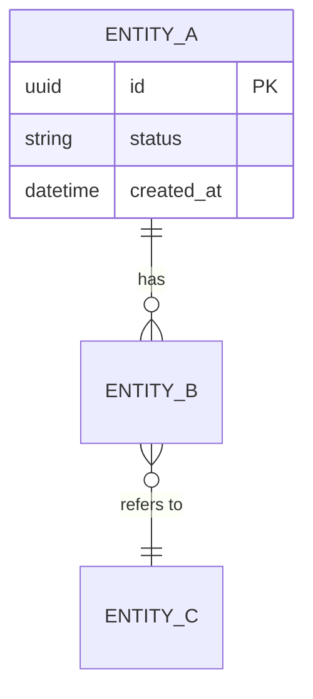

# <Application> – Data Model

> **How to use this template**
> - **Who writes it:** the lead engineer, with the data owner confirming classification and retention. An agent may draft from the schema, migrations and models; mark drafted content as inferred until confirmed.
> - **When it is due:** Draft by stage 3 (Build); Accepted by stage 3 (Build).
> - **Depth S** (section `## ENG-04 Data Model` in ENG-09): the entity table only, with the linked columns filled in (ID, Entity, Records, Classification, Retention). Keep every linked column (the linter checks them; other columns may be left out) and use level-3 subheadings named after this template's sections, so the section can later be promoted to its own file without restructuring.
> - **Depth D (Standard):** every section except those marked (Full).
> - **Depth D+ (Full):** every section, including (Full).
> - Delete this block and every `> **Guide:**` block before review, and replace every `<…>`.

## Purpose

<Two to four sentences. Example: "Describes the entities <Application> stores, their fields, keys and relationships, how they map to the business records in BUS-06, and how they are classified and kept. Engineers and agents use it to change the schema safely.">

## Scope

<Example: "Covers persistent entities in <stores>. Business meaning, ownership and retention rationale of records are in BUS-06; statuses in BUS-05; where each store runs in ENG-03; how migrations are deployed in ENG-07.">

## Entities

> **Guide:** One row per persistent entity (table, collection, document type, file set). Every entity stores at least one BUS-06 record (`Records`), and every record is stored by at least one entity (X-17). Join and log tables that hold no business record still list the record they support.
> - **System of record:** Yes when this application is the authoritative source; otherwise name the system that is (by `D` ID).
> - **Classification:** Public / Internal / Confidential / Personal / Special-category; at least as high as the records it holds.
> - **Retention:** the period from BUS-06, and how it is enforced (purge job, manual, archive).

| ID | Entity | Records | Description | System of record | Classification | Retention | Owner |
|---|---|---|---|---|---|---|---|
| ENT-01 | <request> | <REC-01> | <One sentence> | <Yes / No: D-03> | <Personal> | <7 years after closure; nightly purge job> | <Data owner> |

## Entity relationships

*Caption: <One sentence, e.g. "Main entities and their relationships".>*

## Entity details

> **Guide:** Repeat this block for each entity. List every field an engineer or agent might read or change. **Key** is PK, FK (with target), UK (unique) or blank. **Classification** is per field; mark the personal or confidential fields explicitly so logs, exports and test data can exclude them. A **status field** lists the BUS-05 status IDs it may hold, so lifecycle and data agree.

### ENT-01 <Entity name>

**Store:** <CMP-03> · **Table or collection:** <name> · **Approximate volume:** <rows now, growth per year>

| Field | Type | Required | Constraints | Key | Classification | Notes |
|---|---|---|---|---|---|---|
| <id> | <uuid> | Yes | <…> | PK | Internal | <…> |
| <status> | <string> | Yes | <One of ST-01, ST-02, ST-03> | | Internal | <Changed only by transitions in BUS-05> |
| <customer_id> | <uuid> | Yes | <…> | FK → <ENT-02> | Internal | <…> |
| <email> | <string> | No | <Valid email, ≤ 254 chars> | | Personal | <Not written to logs> |

**Indexes:** <name: fields, purpose>

## Migrations

> **Guide:** Say how schema changes are written, named, reviewed, applied and reversed, so an agent writing a migration follows the same pattern. Deployment steps are in ENG-07; link rather than repeat.

| Item | Approach |
|---|---|
| Tool | <Migration tool and version> |
| Location | <path/to/migrations> |
| Naming | <e.g. timestamp_description> |
| How to create | <exact command, as in ENG-09> |
| How applied | <Automatically in the pipeline step, see ENG-07> |
| Reversibility | <Every migration has a down step / forward-only with a compensating migration> |
| Data migrations | <How data backfills are written and tested> |
| Destructive changes | <e.g. two-step: stop writing, then drop in a later release> |

## Reference data

> **Guide:** Lists, codes and settings that the business maintains (for example locations, categories, rates). Each needs an owner and an update process, or it silently goes stale.

| Reference data | Entity | Source | Owner | Update process | Frequency |
|---|---|---|---|---|---|
| <Resource list> | <ENT-03> | <Admin screen / seed file / upstream D-03> | <Role or person> | <…> | <…> |

## Data lifecycle and deletion (Full)

> **Guide:** For applications with personal or regulated data: how retention is enforced, how a deletion or subject-access request is fulfilled, what happens to backups, and how test environments are kept free of real personal data.

| Entity | Retention trigger | Deletion method | Backups | Evidence |
|---|---|---|---|---|
| <ENT-01> | <Closure date + 7 years> | <Nightly purge job; hard delete> | <Expires with backup retention, 35 days> | <Purge log, MT-03 in ENG-08> |

## Assumptions and open questions

| ID | Assumption or question | Owner | Due | Status |
|---|---|---|---|---|
| Q-01 | <…> | <…> | <YYYY-MM-DD> | <Open / Closed> |

## Known limitations

| ID | Limitation | Impact | Workaround | Owner |
|---|---|---|---|---|
| LIM-01 | <…> | <…> | <…, or None> | <…> |

## Change log

| Version | Date | Author | Summary | Approved by |
|---|---|---|---|---|
| 0.1 | <YYYY-MM-DD> | <Name> | First draft | — |
