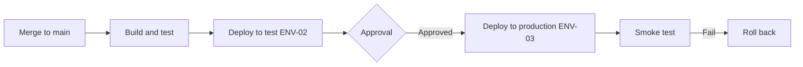

# <Application> – Deployment & Release Guide

> **How to use this template**
> - **Who writes it:** the technical owner or release manager. An agent may draft from pipeline definitions and deployment scripts; mark drafted content as inferred until confirmed. Someone who did not write it must dry-run it before it is Accepted.
> - **When it is due:** Draft by stage 4 (Verify); Accepted by stage 5 (Go-live). Never dropped: how to run and deploy the application is always in scope.
> - **Depth S** (section `## ENG-07 Deployment & Release Guide` in ENG-09): how to deploy to production as numbered steps, the smoke test that proves it worked, when to roll back and the rollback steps, and the dry-run record. Keep every linked column (the linter checks them; other columns may be left out) and use level-3 subheadings named after this template's sections, so the section can later be promoted to its own file without restructuring.
> - **Depth D (Standard):** every section except those marked (Full).
> - **Depth D+ (Full):** every section, including (Full).
> - Delete this block and every `> **Guide:**` block before review, and replace every `<…>`.

## Purpose

<Two to four sentences. Example: "Explains how a change gets from a merged commit to production for <Application>, how to check it worked, and how to roll it back. An operator who did not build the system must be able to follow it.">

## Scope

<Example: "Covers the build and release pipeline, versioning, deployment to each environment, verification, rollback, database migrations and release notes. Environments and configuration are in ENG-06; incident handling after a failed release is in ENG-08.">

## Pipeline

> **Guide:** Every step from merge to production, in order. Say what triggers it, what it does, who must approve, and what happens if it fails. Link the pipeline definition file.



*Caption: <One sentence, e.g. "Release pipeline from merge to production, with the approval gate and rollback path".>*

| Step | Trigger | What it does | Approval | Where defined | On failure |
|---|---|---|---|---|---|
| <1 Build and test> | <Merge to main> | <Runs lint, unit and integration tests; builds image tagged with version> | <None> | <path/to/pipeline.yml> | <Pipeline stops; author fixes> |

## Versioning

<Scheme and where the version is visible, e.g. "Semantic versioning MAJOR.MINOR.PATCH; tag vX.Y.Z on main; version shown in the page footer and the /health response".>

## Pre-deployment checklist

> **Guide:** Things a person must confirm before a production deployment. Remove items that do not apply; add ones that bit you before.

- [ ] All Must application acceptance criteria affected by the change pass in the test environment (SP-11).
- [ ] Database migrations reviewed, tested on a copy of production data, and their rollback understood (below).
- [ ] Configuration, secret and feature flag changes are in place in ENG-06 and in the target environment.
- [ ] Release notes written (below).
- [ ] Users and downstream consumers told about downtime or visible changes (ENG-08 Communication, ENG-05 Downstream consumers).
- [ ] A person able to roll back is available for the monitoring window.
- [ ] <Other: change approval reference, freeze calendar checked>

## Deployment steps

> **Guide:** One block per environment, starting with production. Steps are numbered, exact, and copy-pasteable where they are commands. Each environment ends with **verification**: smoke tests a person or script runs to prove the deployment worked, with the expected result.

### Deploy to <ENV-03 Production>

1. <Exact step, e.g. "Approve the 'deploy-production' job in the pipeline for tag vX.Y.Z.">
2. <…>

**Verification (smoke tests):**

| Check | How | Expected result |
|---|---|---|
| <Health check> | <`curl https://app.example.org/health`> | <HTTP 200, body shows version X.Y.Z> |
| <Core journey works> | <Create a test request as the smoke-test user (J-01)> | <Request reaches Submitted (ST-01) and acknowledgement email is captured> |

### Deploy to <ENV-02 Test>

<Steps, or "Automatic on merge to main; verification as for production using the test URL".>

## Rollback

> **Guide:** Decide the criteria before you need them, so nobody argues during an incident. Rollback steps must be exact and end with verification.

**Roll back when any of these is true:**

| Signal | Threshold | Decision |
|---|---|---|
| <Smoke test fails> | <Any check fails> | <Roll back immediately> |
| <Error rate> | <Above 2% of requests for 5 min within the monitoring window> | <Roll back; declare incident per ENG-08> |
| <Core journey broken for users> | <Any confirmed report> | <Roll back unless a fix can ship within 30 min> |

**Who decides:** <Role on duty during the deployment; escalate to technical owner>

**Steps:**

1. <Exact step, e.g. "Re-run the 'deploy-production' job for the previous tag vX.Y.(Z-1).">
2. <Database: see Database migrations below before rolling back code that changed the schema.>
3. <…>

**Verification after rollback:** <Run the production smoke tests above; confirm version shown is the previous one; post the outcome per ENG-08 Communication.>

## Database migrations

> **Guide:** How migrations run during deployment and how they are reversed. Say plainly whether code can be rolled back without reversing the migration (backward-compatible changes) and what to do when it cannot. The migration approach itself is in ENG-04.

| Item | Approach |
|---|---|
| When migrations run | <Pipeline step before new code starts> |
| Compatibility rule | <Each migration works with the previous release's code, so code rollback never needs a schema rollback> |
| How to reverse | <Exact command, or "forward-only: write a compensating migration"> |
| Data-changing migrations | <Take an on-demand backup first (ENG-08 Backup and restore)> |

## Release notes

> **Guide:** Release notes are the source for the "What's new" section of BUS-09, which links each version to its entry here in its `Release` column. Write them for users, not engineers: what changed, what they need to do differently.

**Location:** <e.g. `CHANGELOG.md` in the repository, and BUS-09 What's new>

**Format:**

```markdown
## vX.Y.Z – YYYY-MM-DD
### New
- <What users can now do, in their words>
### Changed
- <Behaviour that is different, and what to do now>
### Fixed
- <Problem that no longer happens>
### For administrators and support
- <Configuration, access or support changes>
```

## Post-deployment monitoring

<Length of the monitoring window and what to watch, e.g. "For 60 minutes after a production deployment, the deploying engineer watches the dashboard in ENG-08: error rate, p95 latency, job queue age. Any rollback criterion met → roll back.">

## Emergency release (Full)

> **Guide:** The shortened path for an urgent fix: which steps may be skipped, who must approve, and what must be done afterwards. Must match the emergency change type in ENG-08 Change management.

<…>

## Progressive delivery (Full)

> **Guide:** If releases are rolled out gradually (feature flags, canary, blue-green), describe the stages, how far each goes, and the signal to proceed or stop.

| Stage | Exposure | Duration | Proceed when | Stop when |
|---|---|---|---|---|
| <Canary> | <5% of traffic> | <30 min> | <Error rate ≤ baseline> | <Any rollback criterion met> |

## Dry-run record

> **Guide:** Before go-live, someone who did not write this guide performs a deployment and a rollback in a non-production environment by following it exactly. Record it honestly; this is the evidence SP-12 and gate G6 need. Never fill in a dry run that did not happen.

| Procedure | Performed by | Date | Environment | Result | Issues found | Evidence |
|---|---|---|---|---|---|---|
| <Deployment> | <Name, role> | <YYYY-MM-DD> | <ENV-02> | <Pass / Fail> | <…, or None> | <Link to log or recording> |
| <Rollback> | <Name, role> | <YYYY-MM-DD> | <ENV-02> | <Pass / Fail> | <…, or None> | <…> |

## Assumptions and open questions

| ID | Assumption or question | Owner | Due | Status |
|---|---|---|---|---|
| Q-01 | <…> | <…> | <YYYY-MM-DD> | <Open / Closed> |

## Known limitations

| ID | Limitation | Impact | Workaround | Owner |
|---|---|---|---|---|
| LIM-01 | <…> | <…> | <…, or None> | <…> |

## Change log

| Version | Date | Author | Summary | Approved by |
|---|---|---|---|---|
| 0.1 | <YYYY-MM-DD> | <Name> | First draft | — |
