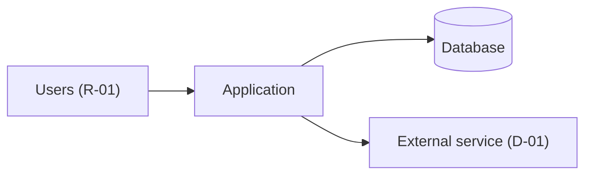

# <Application> – Developer & Agent Guide

> **How to use this template**
> - **Who writes it:** the technical owner or lead developer. An agent may draft it from the repository, but every command must then be run and its "Verified on" date filled in by whoever ran it.
> - **When it is due:** Draft by stage 3 (Build); Accepted by stage 5 (Go-live).
> - **Where it lives:** at **Foundation** level this document *is* the root `AGENTS.md`, and it also holds the other engineering items the Scope Record sets to S (see "Documents held as sections" below). At **Standard** and **Full** it is `docs/ENG-09-developer-and-agent-guide.md`, and the root `AGENTS.md` is the short pointer shown below.
> - **Depth S** is not used for this item. When trigger T10 is No, this may be a short README with the commands, the repository map and the update-trigger table.
> - **Depth D (Standard):** every section; this item is always at least D (floor rule F3 and trigger T10).
> - **Depth D+ (Full):** the same as D. No section is marked (Full).
> - Keep it short enough that an agent reads all of it before every task: link to other documents for detail.
> - Delete this block and every `> **Guide:**` block before review, and replace every `<…>`.

## Purpose

<Two to four sentences. Example: "The first thing a developer or AI agent reads before changing <Application>. It explains where things are, the exact commands to build, run and test, the conventions to follow, how to make a change safely, what an agent may and may not do alone, and which documents to update with each kind of change.">

## Scope

<Example: "Covers working on the code in this repository. What the application is for is in BUS-01; how it is designed in ENG-03; deployment in ENG-07; operations in ENG-08.">

## What this application is

> **Guide:** One paragraph: what it does, for whom, and the one or two things that make it unusual. Link BUS-01 for the full picture.

<One paragraph.> See BUS-01 for the business case and owners.

## Repository map

> **Guide:** The directories a newcomer needs, one line each. Skip generated and vendored folders, but say they are generated so nobody edits them.

```text
<repo>/
  AGENTS.md            This guide (Foundation) or a pointer to it
  docs/                Application documentation (see ENG-09 "Where to find things")
  src/<…>/             <What lives here>
  tests/               <Unit and integration tests; how they are organised>
  migrations/          <Database migrations, see ENG-04>
  <infra/>             <Infrastructure and pipeline definitions, see ENG-07>
  <build/>             Generated – do not edit
```

## Prerequisites

| Tool | Version | How to get it | Notes |
|---|---|---|---|
| <Runtime> | <x.y> | <Install link or version manager file> | <…> |
| <Database> | <x.y> | <Local container: `docker compose up db`> | <…> |

<Accounts or access needed, e.g. "Read access to the secret store for ENV-01; ask <owner>.">

## Commands

> **Guide:** Exact, copy-pasteable commands run from the repository root. **Verified on** is the date someone last ran the command and it worked, with their name. A command that has not been run is written `Not verified` and gets a `Q-xx`. Agents rely on these literally: an out-of-date command costs every future task.

| Task | Command | Expected result | Verified on |
|---|---|---|---|
| Install | <`npm ci`> | <Exits 0> | <YYYY-MM-DD, name> |
| Run locally | <`npm run dev`> | <App on http://localhost:3000> | <YYYY-MM-DD, name> |
| Test | <`npm test`> | <All tests pass in ≤ 5 min> | <YYYY-MM-DD, name> |
| Lint and format | <`npm run lint`> | <No errors> | <YYYY-MM-DD, name> |
| Build | <`npm run build`> | <Output in build/> | <YYYY-MM-DD, name> |
| Migrate | <`npm run db:migrate`> | <Schema up to date> | <YYYY-MM-DD, name> |
| <Seed test data> | <…> | <…> | <YYYY-MM-DD, name> |
| <Lint documentation> | <`python3 tools/doclint.py package .`> | <No High or Medium findings> | <YYYY-MM-DD, name> |

## Coding conventions and patterns

> **Guide:** The rules a reviewer would enforce, each with a short example from this codebase, so an agent copies the house pattern instead of inventing one. Point to one good existing file per pattern. Choices that look odd but are deliberate need an ADR in ENG-10; link it.

| Topic | Rule | Example to copy | Avoid |
|---|---|---|---|
| <Layering> | <Controllers call services; only services touch the database> | <src/requests/service.ts> | <Queries in controllers> |
| <Naming> | <…> | <…> | <…> |
| <Errors> | <Throw domain errors; the handler maps them to responses (ENG-03 Cross-cutting concepts)> | <…> | <…> |
| <Status changes> | <Only through the transition function, which checks BUS-05 rules> | <…> | <Setting the status field directly> |
| <Tests> | <One test file per module; acceptance tests named after AC IDs> | <tests/…> | <…> |

```<language>
// <Short example of the most important pattern, e.g. performing a guarded status transition>
```

## How to make a change safely

1. <Create a branch from `main` named `<type>/<short-description>`.>
2. <Write or update tests first for the behaviour you are changing; acceptance tests reference their `AC` IDs from SP-11.>
3. <Make the change following the conventions above.>
4. Update the documents listed for your kind of change in the update-trigger table below, in the same pull request.
5. <Run test, lint and the documentation linter locally.>
6. <Open a pull request; describe the change, the documents updated and any new IDs.>
7. <Get review from <role>; changes in "Needs a human" below need that person's approval.>

**Definition of done:**

- [ ] Behaviour matches the requirement (ENG-01) and its acceptance criteria (SP-11) pass.
- [ ] Tests added or updated; the full suite passes.
- [ ] Lint and the documentation linter pass.
- [ ] Every document required by the update-trigger table is updated in the same pull request.
- [ ] Any significant technical decision has an ADR in ENG-10.
- [ ] Release notes entry written if users or administrators will notice (ENG-07).
- [ ] <Other team rules>

## Where to find things

| You need | Look in |
|---|---|
| What the application is for, who owns it | BUS-01 |
| Words and names to use | SP-01 Glossary |
| Requirements | ENG-01 |
| How it is built, components, runtime flows | ENG-03 |
| Entities, fields, status fields, migrations | ENG-04 |
| External systems and their contracts | ENG-05 |
| Environments, configuration, secret locations, flags | ENG-06 |
| Deploying and rolling back | ENG-07 |
| Alerts, runbooks, backups | ENG-08 |
| Why something is the way it is | ENG-10 |
| Application acceptance criteria and tests | SP-11 |
| Business rules and statuses | BUS-05 |

## Agent rules

> **Guide:** Be specific to this repository. The three lists together should let an agent decide alone whether it may go ahead. Anything not listed needs a human.

**May change without asking:**

- <Code and tests within an assigned task, following the conventions above>
- <Documentation updates required by the update-trigger table>
- <Dependency patch versions when tests pass>

**Needs a human (stop and ask the <role>):**

- <Database schema changes and data migrations>
- <Anything touching authentication, authorisation or roles (BUS-04)>
- <Changing a business rule, status or transition (BUS-05)>
- <Adding or removing an external dependency or integration (ENG-05)>
- <Configuration or feature flags in production (ENG-06)>
- <Reversing or contradicting an Accepted ADR in ENG-10>
- <Marking any document Accepted or recording any sign-off>

**Never:**

- Write a secret value into code, configuration committed to the repository, documentation, logs or a pull request.
- Invent a value, an owner, a test result or an approval in documentation; write `TBD` with an owner and a `Q-xx` instead.
- <Deploy to production / run migrations against production / delete data>
- <Disable or skip failing tests to make a build pass>

## Documentation update triggers

Source: 00_documentation_model.md, "Update triggers", in the documentation framework. Keep this table identical to the source and refresh it when the framework changes.

| Change | Documents to update |
|---|---|
| New or changed feature | BUS-02, ENG-01, SP-11, BUS-09, release notes (ENG-07) |
| New status or transition | BUS-05, ENG-04, ENG-02, BUS-09 (Concepts), SP-11 |
| New or changed business rule | BUS-05, ENG-01, SP-11 |
| New role or permission | BUS-04, SP-01, BUS-09 |
| New record, field classification or retention change | BUS-06, ENG-04 |
| New report, export or notification | BUS-06, SP-10 or ENG-08 output checks if others rely on it |
| New integration or dependency | ENG-05, ENG-03, ENG-08, BUS-07 if cost changes, SP-00 (re-score D4) |
| Architecture or technology decision | ENG-10, ENG-03 |
| New configuration item, secret or feature flag | ENG-06 |
| Deployment or release process change | ENG-07 |
| Incident with a new failure mode | ENG-08 (runbook entry), BUS-08 |
| Success measure missed for two periods | SP-10 (review), BUS-08 |
| New user group, data type or regulatory exposure | SP-00 (re-score) |

A pull request that changes behaviour without updating the listed documents fails review. Documents out of scope in the Scope Record (SP-00) are skipped; S items are updated in their parent section.

## Root AGENTS.md pointer

> **Guide:** At Standard and Full level, put this short file at the repository root so any agent finds the guide. It has no front-matter; the linter accepts it as a pointer. At Foundation level delete this section, because this document is the root `AGENTS.md`.

```markdown
# AGENTS.md

Read docs/ENG-09-developer-and-agent-guide.md before making any change.
It holds the build, run and test commands, the coding conventions, the agent
rules, and the table of documents to update with each kind of change.
The full documentation for this application is in docs/; start with
docs/BUS-01-overview-and-business-case.md for what the application is for.
```

## Documents held as sections

> **Guide:** List the engineering items the Scope Record (SP-00) sets to depth S with this document as parent, and add each one to `contains` in the front-matter. At Foundation this is usually ENG-01, ENG-03, ENG-04, ENG-05, ENG-06, ENG-07 and ENG-08 (plus ENG-10 when T10 is Yes); at Standard usually only ENG-06. Keep the skeletons below for the items listed and delete the rest. Each one keeps every linked column of its own template and uses level-3 subheadings named after that template's sections, cut down to what answers the question, so it can later be lifted into its own file. Write "None." if this file holds no sections.

This file holds: <ENG-01, ENG-03, ENG-04, ENG-05, ENG-06, ENG-07, ENG-08, or None>.

## ENG-01 Requirements Specification

Must requirements and key non-functional requirements. Each one is verified by an application acceptance criterion in SP-11.

### Functional requirements

| ID | Requirement | Capabilities | Rules | Priority | Status |
|---|---|---|---|---|---|
| FR-01 | The system shall <…> | <C-01> | <BR-01, or None> | Must | <Proposed / Agreed / Built / Verified> |

### Non-functional requirements

| ID | Category | Requirement | Target | Measurement method | Priority |
|---|---|---|---|---|---|
| NFR-01 | Availability | <…> | <99.5% monthly in business hours> | <Uptime monitor> | Must |
| NFR-02 | Recoverability | Recovery time objective (RTO) | <≤ 1 working day> | <Restore test, ENG-08> | Must |
| NFR-03 | Recoverability | Recovery point objective (RPO) | <≤ 24 h> | <Backup frequency and restore test> | Must |

## ENG-03 Architecture & Design

### Context (C4 level 1)



*Caption: <The application, its users, its data store and the external services it uses.>*

### Containers (C4 level 2)

| ID | Container | Technology | Responsibility | Stores data |
|---|---|---|---|---|
| CMP-01 | <Web application> | <Framework and version> | <…> | <None> |
| CMP-02 | <Database> | <Engine and version> | <…> | <ENT-01> |

### Security

<When T4 or T11 is Yes: authentication method, authorisation model, encryption in transit and at rest, where personal data is stored, and the main threats with their controls, in three to six lines. Otherwise one line: "No personal or confidential data and not public-facing.">

## ENG-04 Data Model

### Entities

| ID | Entity | Records | Classification | Retention | Owner |
|---|---|---|---|---|---|
| ENT-01 | <…> | <REC-01> | <Public / Internal / Confidential / Personal / Special-category> | <Period, how enforced> | <…> |

## ENG-05 Integrations & Dependencies Register

### Dependency register

| ID | Dependency | Type | Purpose | Owner | Criticality | Impact | Support path | Capabilities affected | Workaround | Runbook | Cost | Renewal |
|---|---|---|---|---|---|---|---|---|---|---|---|---|
| D-01 | <…> | <Hosting / Domain / Email / Identity / Integration / Data / Vendor / Network / People / Process / Funding> | <…> | <…> | <High / Medium / Low> | <…> | <…> | <C-01, …> | <…, or None> | <RB-01, or None> | <Yes / No> | <YYYY-MM-DD, or None> |

### Interfaces

<Required when T5 is Yes: one row per integration.>

| ID | Dependency | Direction | Protocol | Data exchanged | Authentication | Error and retry behaviour |
|---|---|---|---|---|---|---|
| INT-01 | <D-01> | <In / Out> | <…> | <ENT-01> | <SEC-01> | <…> |

## ENG-06 Configuration & Environments

### Environments

| ID | Environment | Purpose | URL | Data | Access | Hosting |
|---|---|---|---|---|---|---|
| ENV-01 | <Production> | <…> | <…> | <Real> | <…> | <…> |

### Secrets

| ID | Name | Purpose | Stored in | Rotation | Owner |
|---|---|---|---|---|---|
| SEC-01 | <…> | <…> | <Secret store and path, never the value> | <…> | <…> |

## ENG-07 Deployment & Release Guide

### Deployment steps

1. <Exact step or command>
2. <…>

**Verification (smoke tests):** <Check, how to run it, expected result.>

### Rollback

**Roll back when:** <Criteria, e.g. a smoke test fails or users cannot complete the main journey.>

1. <Exact rollback step>
2. <Repeat the smoke tests and confirm the previous version is running.>

### Release notes

<Where release notes are kept; BUS-09 What's new links to them by version.>

### Dry-run record

| Procedure | Performed by | Date | Environment | Result | Evidence |
|---|---|---|---|---|---|
| Deployment | <Name, role> | <YYYY-MM-DD> | <ENV-01> | <Pass / Fail> | <…> |
| Rollback | <Name, role> | <YYYY-MM-DD> | <ENV-01> | <Pass / Fail> | <…> |

## ENG-08 Operations & Support Runbook

### Ownership model

| Area | Primary owner | Backup owner | Escalation owner |
|---|---|---|---|
| Business process questions | <…> | <…> | <…> |
| User access and roles | <…> | <…> | <…> |
| System issue | <…> | <…> | <…> |

### Support intake

<How users get help: the channel and what to include.>

### Triage guide

| Category | Examples | Owner | Initial checks | Dependencies | Escalate when |
|---|---|---|---|---|---|
| <System error> | <…> | <…> | <Health check; recent deployment> | <D-01> | <…> |

### Monitoring and alerting

**Health check:** <URL or command, expected response; where logs are.>

| ID | Alert | Threshold | Meaning | Owner | Runbook |
|---|---|---|---|---|---|
| ALR-01 | <…> | <…> | <…> | <…> | <RB-01> |

### Runbook entries

| ID | Failure mode | Triggered by | Dependencies | Owner |
|---|---|---|---|---|
| RB-01 | <Failure of a High dependency> | <ALR-01> | <D-01> | <…> |

**RB-01:** Symptom <…> · Diagnosis <…> · Fix <…> · Verification <…> · Escalation <…>

### Backup and restore

<What is backed up, how often, where, retention.>

**Restore procedure:** <Steps, ending with a verification step.>

**Last restore test:** <YYYY-MM-DD and result, or "Not yet tested" with a Q-xx.>

### Maintenance calendar

| ID | Task | Type | Frequency | Next due | Owner | Evidence |
|---|---|---|---|---|---|---|
| MT-01 | <Renew domain> | <Domain> | <Yearly> | <YYYY-MM-DD> | <…> | <…> |

### Output checks

<Required when T6 is Yes.>

| ID | Check | Type | Records | Procedure | Frequency | Owner | On failure |
|---|---|---|---|---|---|---|---|
| OC-01 | <…> | <Invariant / Reconciliation / Completeness / Sample audit / Golden data> | <REC-01> | <…> | <…> | <…> | <…> |

## Assumptions and open questions

| ID | Assumption or question | Owner | Due | Status |
|---|---|---|---|---|
| Q-01 | <…> | <…> | <YYYY-MM-DD> | <Open / Closed> |

## Known limitations

| ID | Limitation | Impact | Workaround | Owner |
|---|---|---|---|---|
| LIM-01 | <…> | <…> | <…, or None> | <…> |

## Change log

| Version | Date | Author | Summary | Approved by |
|---|---|---|---|---|
| 0.1 | <YYYY-MM-DD> | <Name> | First draft | — |
